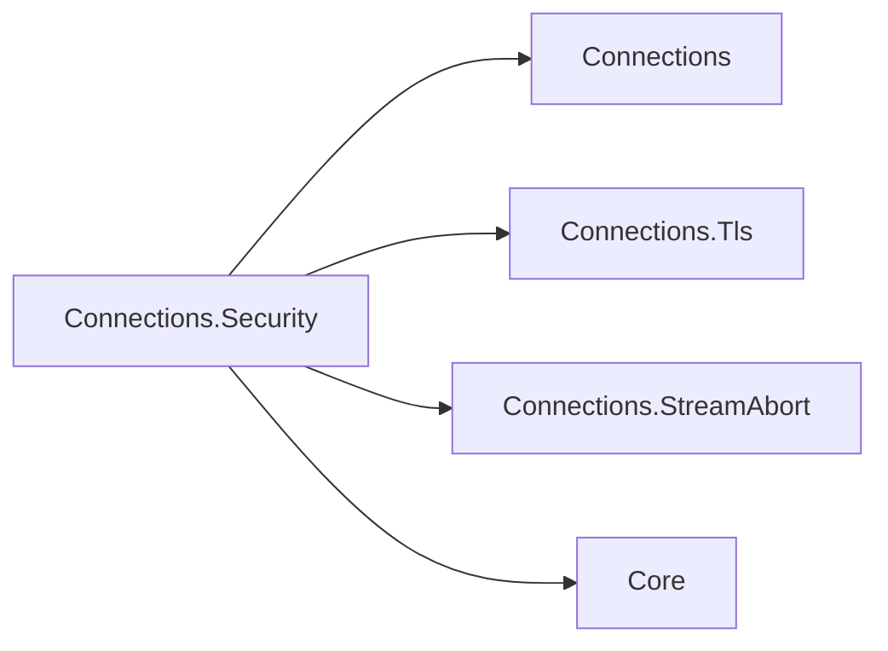

# Assimalign.Cohesion.Connections.Security design

Design decisions and ownership boundaries for `Assimalign.Cohesion.Connections.Security`.

[Overview](index.md) · [Examples](examples/index.md)

## Design and boundaries

A TLS upgrade returns a new secured connection over `SslStream`; it does not mutate the carrier's
identity into a middleware context. Listener and factory composition use `TlsConnectionLayer`.
Client and server authentication settings and handshake timeouts are explicit options.

## Handshake facts

The secured connection registers itself as `ITlsConnectionInfo` from `Connections.Tls` in
`ConfigureFeatures`, with
`Name = ITlsConnectionInfo.FeatureName` (`Tls`). Its `InnerFeatures` returns `_inner.Features`, so
features registered beneath TLS remain visible unless TLS hides them. It removes
`IMultiplexedStreamAbort.FeatureName` (`StreamAbort`): aborting the inner transport cannot invalidate
plaintext already buffered in TLS's outer `PipeReader`, so the inner feature cannot guarantee that
every later read fails. `connection.Features.Get<IMultiplexedStreamAbort>()` therefore returns
`null` through TLS; the inner connection's collection is unchanged. The TLS result remains an
`IConnection`; `DirectionalAbort` is an accessor on `IMultiplexedStream` after #1453. An application
protocol reads `connection.Tls` without referencing this library: the ALPN application protocol, the TLS
version, the cipher suite, and the peer's certificate (`SslStream.NegotiatedApplicationProtocol`,
`SslProtocol`, `NegotiatedCipherSuite`, `RemoteCertificate`), captured once when the handshake
completes. HTTP reads them to serve HTTP/2 or HTTP/1.1 on one listener and to show its handlers
the session. This holds on the server and the client side alike.

Reading `SslStream.RemoteCertificate` hands the certificate's ownership to the reader (an
`SslStream` no longer disposes a certificate it has exposed), so the secured connection disposes
the peer certificate when it is disposed: the `SslStream` first, then the inner connection, then
the peer's certificate.

## Client certificates

`TlsServerOptions.RequireClientCertificate(validate)` and `AllowClientCertificate(validate)` set
the server's mutual-TLS policy:

| Method | A client without a certificate | A presented certificate |
|---|---|---|
| (neither) | completes the handshake; none is requested | — |
| `AllowClientCertificate` | completes the handshake | must pass validation, or the handshake fails |
| `RequireClientCertificate` | fails the handshake | must pass validation, or the handshake fails |

Validation is the `validate` callback, which receives the certificate, the chain the platform
built, and the platform's verdict; with no callback a certificate passes only when the platform
reports no policy error, which means it chains to a root the machine trusts. A private CA therefore
needs a callback.

- **The methods write into `AuthenticationOptions`.** They set `ClientCertificateRequired`, which
  makes the server send a `CertificateRequest` during the handshake (RFC 8446 §4.3.2), and install
  a `RemoteCertificateValidationCallback` carrying the policy. The authentication options are then
  the single source of truth that every consumer applies: this library's layer for TCP listeners,
  and a QUIC listener handed the same options (QUIC runs TLS 1.3 itself, RFC 9001). A policy held
  in separate properties would have needed each consumer to translate it, and a QUIC listener
  never sees this library.
- **The certificate is requested in the handshake only.** HTTP/2 forbids TLS 1.3 post-handshake
  authentication (RFC 9113 §9.2.3) and TLS 1.2 renegotiation (§9.2.1), so a deferred request, as
  Kestrel's `DelayCertificate` mode makes on HTTP/1.1, is not offered: the policy is the same on
  every protocol a listener serves.
- **No silent overwrite.** The methods refuse to replace a validation callback they did not
  install, so code that configured the raw options keeps its callback; calling either method again
  replaces the earlier policy. Assigning a new `AuthenticationOptions` after calling them drops the
  policy, so they are called last.

Reading the certificate after the handshake is the application's job (`connection.Tls` from
`Connections.Tls`, and over HTTP `context.TlsConnection` from `Assimalign.Cohesion.Http.Tls`);
authenticating a user from it is out of scope here.

## Handshakes on a TLS-layered listener

`UseTls` composes this layer through the contracts library's layered listener. For a TLS endpoint
that means the following (#1304):

- **Each handshake runs on its own task.** A client that sends nothing holds only its own handshake;
  every other client is accepted and handshaken alongside it.
- **A failed handshake fails only its connection.** Each of these closes that connection and leaves
  the listener accepting:
  - bytes that are not a ClientHello;
  - a client the certificate policy refuses;
  - a handshake that exceeds `HandshakeTimeout`;
  - a client that hangs up mid-handshake.

  The `Assimalign.Cohesion.Connections` event source reports each one as `UpgradeFailed`.
  `RequireClientCertificate` therefore refuses a client without a certificate without affecting
  anyone else. Before #1304 that refusal stopped the listener.
- **`HandshakeTimeout` applies per connection.** Short of the client hanging up, it is what ends a
  silent client's handshake.
- **`MaxConcurrentHandshakes` bounds the connections held at once** (default 512). A connection
  counts from accept until it is returned secured or its handshake fails. At the bound, new clients
  wait in the transport's backlog, so a flood of stalled handshakes cannot grow memory without
  bound.

The option lives on `TlsServerOptions` because only a listener that handshakes has handshakes to
bound. A QUIC listener handed the same `AuthenticationOptions` does not use it: QUIC bounds its
pending handshakes with its own listener backlog.

When `UpgradeAsync` fails, the exception propagates and the caller still owns the inner connection:
- `AuthenticationException` from the platform TLS stack;
- `IOException` for bytes that are not a TLS handshake;
- `OperationCanceledException` when the timeout elapses.

The layered listener and the layered factory both dispose it.

## Relationships

The TLS layer references the contracts whose features it registers or hides:

- **`Assimalign.Cohesion.Connections`** — the `IConnection` / `IConnectionLayer` contracts, the
  `UseTls` composition points (`IConnectionListener` / `IConnectionFactory`), and the
  `DuplexPipeStream` adapter.
- **`Assimalign.Cohesion.Connections.Tls`** — the optional handshake-facts contract and accessors.
- **`Assimalign.Cohesion.Connections.StreamAbort`** — the directional-abort feature name that TLS
  hides because the inner implementation does not govern its outer pipes.
- **`Assimalign.Cohesion.Core`** — foundational library support.
- **Security area (certificate management)** — supplies certificates for the TLS options. The
  platform-agnostic certificate manager is owned by the Security area and is intentionally not a
  dependency of this layer.

## Compatibility with 10.0.0-preview.1

Hiding `StreamAbort` corrects the unreleased #1452 feature propagation behavior. It adds no break
against 10.0.0-preview.1: that release had neither connection features nor directional aborts.
Consumers of the unreleased behavior must treat a missing `StreamAbort` feature as unsupported on
the TLS connection. The #1453 multiplexed root changes do not widen the TLS layer's `IConnection`
result to a multiplexed stream. Other inner features and TLS handshake facts remain discoverable.

## Dependency boundary

The declared build inputs are `Assimalign.Cohesion.Core`, `Assimalign.Cohesion.Connections`,
`Assimalign.Cohesion.Connections.Tls`, and `Assimalign.Cohesion.Connections.StreamAbort`. The
[overview](index.md#dependencies) distinguishes project references, package references, shared
source, and analyzer inputs.

## Sources

- **Source** — `cohesion/libraries/Connections/Assimalign.Cohesion.Connections.Security/src/Assimalign.Cohesion.Connections.Security.csproj`.

- **Source** — `cohesion/libraries/Directory.Build.props`.

- **Source** — `cohesion/libraries/Connections/Assimalign.Cohesion.Connections.Security/docs/OVERVIEW.md`.

- **Source** — `cohesion/libraries/Connections/Assimalign.Cohesion.Connections.Security/docs/DESIGN.md`.

- **Source** — `cohesion/libraries/Connections/README.md`.

- **Source** — `cohesion/libraries/Connections/Assimalign.Cohesion.Connections.Security/src`.
