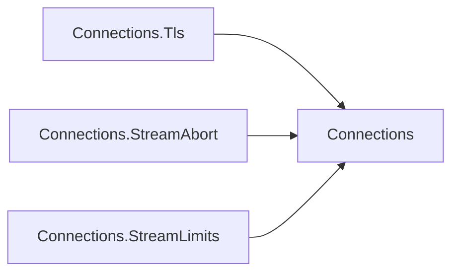

# Assimalign.Cohesion.Connections design

Design decisions and ownership boundaries for `Assimalign.Cohesion.Connections`.

[Overview](index.md) · [Examples](examples/index.md)

## Design and boundaries

A stream connection is itself an `IDuplexPipe`, with input and output anchored to its holder.
Listeners bind explicitly and factories establish outbound connections. Capabilities describe
delivery and security; connection layers transform connections at establishment without introducing
a parallel transport abstraction.

## Connection features

`IConnection`, `IMultiplexedConnection`, and `IDatagramConnection` expose an
`IConnectionFeatureCollection` through `Features`. A feature implements `IConnectionFeature` and
has one stable, non-empty `Name`. `Set<TFeature>` installs it in that named slot, replacing any
feature with the same ordinal, case-sensitive name; null features and null or empty names throw.
An object fills one slot, so a driver offering two named capabilities registers two feature objects.

The public `ConnectionFeatureCollection(inner)` exposes the wrapped connection's effective set.
A lookup checks the layer's own names first, then its inner collection. `Remove(name)` leaves a
local tombstone: it hides both today's inner value and future registrations of that name, and
returns whether a visible feature was removed. `Set` can replace that tombstone. Enumeration yields
own features first and then inner features whose names are neither replaced nor hidden. Typed
`Get<TFeature>()` follows the same order; replacing a name with a different type still hides the
inner feature of the requested type. Exact built-in collections are scanned without allocating;
custom collections and subclasses retain their own enumeration semantics.

Collections serialize mutations and publish immutable arrays. Named and typed reads require no
lock, and an enumerator retains the local snapshot it started with. Concurrent changes never
invalidate a reader; a traversal across independently changing layers is not one atomic snapshot.
Features themselves own the thread safety of their values.

`Connection`, `MultiplexedConnection`, and `DatagramConnection` create no collection until the
first `Features` access. They resolve protected `InnerFeatures`, construct the collection, and call
protected `ConfigureFeatures` exactly once before publishing it with `Interlocked.CompareExchange`.
Concurrent first readers wait for the configured collection; a failed configuration is remembered
and rethrown rather than retried or partially published. The bases do not implement the collection.
A driver's configuration uses its supplied collection; it must not recursively access `Features`.
A layer overrides `InnerFeatures` to return its wrapped connection's `Features`. A multiplexed
stream retains its own collection and does not inherit features from its parent connection.

Optional contracts belong to their feature packages, all with the family namespace
`Assimalign.Cohesion.Connections`. The driver registers a feature and consumers reference only the
package that describes it. The package dependency direction is:

| Package | Contract and pinned name | Access |
|---|---|---|
| `Assimalign.Cohesion.Connections.Tls` | `ITlsConnectionInfo`, `"Tls"` | `Tls` on a stream or multiplexed connection |
| `Assimalign.Cohesion.Connections.StreamAbort` | `IMultiplexedStreamAbort`, `"StreamAbort"` | `DirectionalAbort` on `IMultiplexedStream` |
| `Assimalign.Cohesion.Connections.StreamLimits` | `IMultiplexedConnectionStreamLimits`, `"StreamLimits"` | `StreamLimits` on a multiplexed connection |

A byte-rewriting layer removes any inherited capability whose behavior it invalidates. TLS facts
remain valid through accounting or compression above TLS. Hot-path consumers resolve a feature
once per connection or stream and cache it. `ConnectionCapabilities` remains the pre-connection
description of a transport class and does not move into this collection.

**Breaking change against 10.0.0-preview.1 (owner decisions 15 and 56, #1452):** adding `Features`
to the three root interfaces breaks direct implementers. Deriving from the guided bases supplies
the implementation. The three optional contracts were added after preview.1, so moving them into
feature packages breaks no released API. The multiplexed root changes below complete the migration.

## Handshake facts: `ITlsConnectionInfo`

`ConnectionSecurity.Tls` says a connection is secured; it cannot say what the handshake agreed,
because capabilities describe a transport class and the handshake is per connection. An
application protocol needs that agreement: HTTP chooses between HTTP/2 and HTTP/1.1 from the
application protocol ALPN selected (RFC 7301), and shows its handlers the client certificate,
TLS version, and cipher suite. `ITlsConnectionInfo`, owned by
[Connections.Tls](../assimalign-cohesion-connections-tls/design.md), is the typed feature
that carries it. A connection that terminates TLS registers it under `ITlsConnectionInfo.FeatureName`,
and a consumer reads the `Tls` extension property on the connection it holds:

- the secured `IConnection` the TLS layer returns (`Assimalign.Cohesion.Connections.Security`),
  which captures the values once its handshake completes;
- a multiplexed connection whose transport is TLS itself (QUIC, RFC 9001).

The feature reports four values, all fixed once the handshake completes:

| Member | Meaning |
|---|---|
| `ApplicationProtocol` | the protocol ALPN selected (RFC 7301), or none when the client offered none |
| `TlsProtocol` | the negotiated TLS version |
| `CipherSuite` | the negotiated cipher suite |
| `RemoteCertificate` | the certificate the peer presented, or `null`: the client's on a server-side connection (present only when the server requested one, RFC 8446 §4.3.2), the server's on a client-side one |

The connection owns `RemoteCertificate` and disposes it with itself. Both platform stacks hand
ownership of the peer certificate to whoever reads it (`SslStream.RemoteCertificate`,
`QuicConnection.RemoteCertificate`), so an implementation that reads it to report it must
release it; a consumer that keeps the certificate past the connection copies it.

Why this shape:

- **The feature package owns the contract.** The TLS layer, QUIC driver, and consumers reference
  `Connections.Tls`; HTTP never references the TLS layer. HTTP republishes the handshake values on
  its own connection-info object, which `Assimalign.Cohesion.Http.Tls` keeps reading.
- **The facts stay typed and fixed at handshake time.** Public feature registration does not change
  the certificate ownership or handshake semantics.
- **The capability stays optional.** Cleartext connections and individual QUIC streams do not
  claim connection-level handshake facts.
- **Layers preserve visibility.** An outer layer supplies `InnerFeatures`, so it need not implement
  TLS's contract or forward its individual members.

## What every multiplexed transport supports, and what only some do (#1453)

Owner decision 56 follows the approved transport survey. A root member must have semantics every
byte-stream multiplexer can honor. Optional capabilities stay named features; a root member cannot
require most transports to do nothing or contradict its documentation.

| | QUIC | WebTransport (H3/H2) | HTTP/2 streams | SSH channels | yamux | mplex |
|---|---|---|---|---|---|---|
| Half-close | FIN | FIN | END_STREAM | CHANNEL_EOF | FIN | Close |
| Whole-stream reset | RESET_STREAM + STOP_SENDING | both directions | RST_STREAM | CHANNEL_CLOSE | RST | Reset |
| Stream reset code | 62-bit | 32-bit | 32-bit | none | none | none |
| Independent directional abort | yes | yes | no | no | no | no |
| Connection close code | 62-bit | 32-bit plus message | 32-bit | 32-bit plus description | three fixed values | none |
| Cumulative inbound stream allowance | MAX_STREAMS | WT_MAX_STREAMS | none | none | none | none |
| Unidirectional streams | yes | yes | no | no | no | no |

SCTP's message streams have no individual close and belong to the datagram shape.

`IMultiplexedConnection.Abort(code, reason)` closes the connection; its first abort or disposal
wins. Drivers validate their own code range, always rejecting negative codes. QUIC accepts 0 through
2^62 - 1; a transport without close codes closes as `Abort(reason)` does.

`IMultiplexedStream : IConnection` owns the whole-stream `Abort(code, reason)` and
`IsInputCompleted`. The reset ends both directions, carrying the code where supported, and then ends
the lifecycle. Each direction preserves its first end signal. HTTP/3 resets a stream with one root
call. Per-direction aborts remain `DirectionalAbort` on `IMultiplexedStream`; cumulative stream
allowance remains `StreamLimits` on `IMultiplexedConnection`.

**Breaking changes against 10.0.0-preview.1 (owner decisions 15 and 56):**

- `AcceptStreamAsync` and `OpenStreamAsync` now return `ValueTask<IMultiplexedStream>` instead of
  `ValueTask<IConnection>`. Implementers and binaries break; a caller awaiting and assigning to
  `IConnection` still compiles.
- The guided base returns `ValueTask<MultiplexedStream>` instead of `ValueTask<Connection>`.
- `Abort(long, Exception?)` is required on `IMultiplexedConnection` and abstract on its guided base,
  breaking implementers and subclasses.
- The removed coded-close and input-completion facets, and the narrowed `DirectionalAbort`
  accessor, postdate preview.1 and break no released API.

## Observed input completion: `IMultiplexedStream.IsInputCompleted` (#1427, #1453)

Every surveyed byte-stream multiplexer has a half-close. The root reports a clean transport end
once every received byte has been delivered to `Input`; it neither reads nor waits. A conservative
`false` means the end is not known yet. The pipe may still buffer bytes, so consumers combine the
property with their empty-buffer check. Aborts and failed reads never count as a clean end.

QUIC reads its existing `ReadsClosed` task, excluding a locally aborted read. In-memory streams
observe their peer's clean output completion. A buffering layer preserves the distinction between
transport completion and buffered bytes. No HTTP contracts or interpretation enter Connections.

## Cumulative stream allowance: `IMultiplexedConnectionStreamLimits` (#1425)

The optional `InboundBidirectionalStreamLimit` feature in `Connections.StreamLimits` reports a
conservative upper bound on how
many peer-initiated bidirectional streams the transport may have allowed over the connection's
lifetime. It is cumulative, not the number that may be open concurrently, and never decreases.
Protocols can reject a referenced stream ordinal at or beyond that bound; they still own the
mapping between their identifiers and stream ordinals. No application-protocol types enter the
Connections contracts.

A conservative bound may include credit whose release has started but is not advertised yet.
Consumers must retain their own state limits; this facet is not a replacement for flow control.
Drivers without the feature remain valid. Consumers use `connection.StreamLimits`, and decorators
preserve it through `InnerFeatures`. Its feature contract postdates 10.0.0-preview.1; the root
`Features` addition is the breaking change recorded above.

## Application error codes and directional aborts (#1080, #1453)

The root coded aborts communicate a protocol's reason directly. For HTTP/3 that distinguishes
`H3_REQUEST_REJECTED` from `H3_MESSAGE_ERROR`, and a connection error such as
`H3_FRAME_UNEXPECTED` from `H3_NO_ERROR`. The error code is wire data, independent of the optional
reason exception, whose type belongs to the caller.

| Contract | Member | QUIC frame |
|---|---|---|
| `IMultiplexedStream` | `Abort(errorCode, reason)` | RESET_STREAM and STOP_SENDING |
| `IMultiplexedConnection` | `Abort(errorCode, reason)` | CONNECTION_CLOSE |
| `IMultiplexedStreamAbort` feature | `AbortRead(errorCode)` | STOP_SENDING |
| `IMultiplexedStreamAbort` feature | `AbortWrite(errorCode)` | RESET_STREAM |

Only a transport that can end directions independently offers the `Connections.StreamAbort`
feature. QUIC, WebTransport and the in-memory model can; HTTP/2, SSH, yamux and mplex cannot.
HTTP/3 keeps its no-code fallback keyed on `stream.DirectionalAbort`. It uses the feature to stop
an unread request with `H3_NO_ERROR` while completing its response with FIN.

- The first signal for each direction wins. Whole-stream reset, later abort and disposal retain
  a direction's earlier code. The first abort or disposal likewise decides the connection close.
- A directional abort leaves the holder's lifecycle alone: it changes neither `State` nor
  `ConnectionClosed`. A whole-stream reset ends the lifecycle. The peer observes an abandoned
  stream in either case.
- After `AbortRead`, every read fails, including pending reads and buffered bytes. In-memory
  throws `ConnectionAbortedException`; QUIC throws `QuicException(OperationAborted)`.
- Root code ranges are transport-specific. The directional feature retains its 0 through
  2^62 - 1 contract; QUIC and its in-memory model validate that range and throw
  `ArgumentOutOfRangeException` outside it.
- The peer sees a carried code in `QuicException.ApplicationErrorCode` on QUIC or
  `ConnectionResetException.ApplicationErrorCode` on in-memory streams.

Completing `Output` cleanly sends FIN without closing input. Completing it with an error resets
output with the configured default code; completing `Input` aborts reading with its default code.
A consumer needing another code ends that direction through the feature first.

## Guided Abstract Bases

Per the repository's interface-first-with-a-guided-abstract-base rule, each contract ships a
public abstract base (`Connection`, `ConnectionListener`, `ConnectionFactory`,
`MultiplexedConnection` and its listener/factory, `MultiplexedStream`, `DatagramConnection`). Where the base exposes a
concrete-typed member — a listener's `AcceptAsync` returning `Connection` rather than
`IConnection` — the typed member is declared `public` (so holders of the concrete type get the
richer signature without casting) and the interface member is implemented explicitly, forwarding
to it. Multiplexed stream accept/open members return `ValueTask<MultiplexedStream>` on the base
and `ValueTask<IMultiplexedStream>` on the interface. `MultiplexedStream` inherits `Connection`
(including its lazy features) and makes coded whole-stream abort and input completion abstract.
The interface remains the canonical surface consumers depend on.

## A listener contains each connection's failure

`AcceptAsync`, on both listener shapes, returns a connection that is ready to use, with any
handshake already complete. A failure that belongs to one inbound connection is the listener's to
handle: it releases that connection and accepts the next. Examples are a handshake that fails or
times out, or a client that resets before the accept. An exception from `AcceptAsync` therefore
means the listener itself can produce no more connections (it was disposed, or its endpoint failed),
or the caller canceled. A consumer such as the HTTP listener treats it as fatal.

- **The layered listener** (`listener.Use(layer)`, and so `UseTls`) runs each connection's upgrade
  on its own task, off the accept loop (#1304). `AcceptAsync` returns connections in the order
  their upgrades complete.
  - A failed or timed-out upgrade fails only its connection: the listener disposes the connection,
    reports `UpgradeFailed`, and keeps accepting.
  - At most `maxConcurrentUpgrades` connections are held at once; the default is 512, and TLS sets
    it from `TlsServerOptions.MaxConcurrentHandshakes`. At the bound the pump stops accepting, and
    new peers wait in the transport's own backlog.
  - Canceling an `AcceptAsync` call abandons only that wait. Disposal releases every connection the
    listener still holds.
- **The drivers** honor the same contract. The QUIC driver drops an inbound connection whose
  handshake failed and keeps accepting (#1304). The TCP driver skips a connection whose client
  reset it while it waited in the accept queue (#1308), and it waits and retries when the process
  runs out of descriptors or buffers, which clears once connections close (#1312).
- **A layer that fails leaves the connection to its caller**, which disposes it. The layered
  listener disposes a connection it accepted, and the layered factory a connection it dialed
  (#1309).

The diagnostics tests link the canonical test-only `build/TestSupport/EventSourceRecorder.cs`
with MSBuild `Compile`/`Link`; it records events and counter publication without adding a shipped
dependency.

The layered listener reports through this library's one internal event source,
`Assimalign.Cohesion.Connections`:

| Id | Event | Level | Payload |
|---|---|---|---|
| 1 | `UpgradeFailed` | Warning | `connectionId`, `remoteEndPoint`, `exceptionType`, `exceptionMessage` |

The counters are `current-upgrades` and `failed-upgrades`. The payload is the exception's type and
message, never the peer's bytes, a certificate, or key material. An upgrade canceled because the
listener is being disposed is not reported.

The alternatives were rejected for these reasons:

- **Upgrading inside `AcceptAsync`**, the shape before #1304, serialized handshakes on the accept
  loop and turned one peer's failure into the listener's.
- **Containing the failure in the consumer** cannot work by exception type. A handshake timeout
  throws `OperationCanceledException`, the same type a disposed listener throws. Only the component
  that ran the upgrade knows which failure it was.
- **An unbounded listener** would make every stalled handshake cost a socket, its buffers, and TLS
  state, which is a memory-exhaustion target.

## When `ConnectionClosed` fires

A connection has three teardown paths: complete `Output` for a graceful half-close,
`DisposeAsync()` to close, and `Abort(Exception?)` to tear down at once, discarding in-flight data.
A multiplexed transport's streams and connections can also abort with a transport-specific
application error code. Optional directional aborts end one stream direction at a time (see
[Application error codes](#application-error-codes-and-directional-aborts-1080-1453)).
`ConnectionClosed` is signaled on closure, and `ConnectionState` tracks
`Idle → Opening → Open → Closing → Closed`, or `Aborted`.

A stream of a multiplexed connection also signals `ConnectionClosed` when its peer abandons the
stream — a QUIC `RESET_STREAM` or `STOP_SENDING`, or the in-memory driver's equivalents — so a
consumer learns of it without reading or writing (#1329). A half that ends cleanly does not signal
it. The contract is stated on `IConnection.ConnectionClosed`, and it is how an HTTP/3 server fires
`RequestCancelled` for a request the client cancelled while the application neither reads nor
writes, which HTTP/3 cannot otherwise see because it has no frame pump.

`ConnectionException` is the area's exception root, with `ConnectionAbortedException` and
`ConnectionResetException` for the common failures, so consumers catch one hierarchy.
`ConnectionResetException.ApplicationErrorCode` carries the code a peer reset or stopped a stream
with, when the driver reports the reset through this family: the in-memory driver does, and the QUIC
driver surfaces `System.Net.Quic`'s `QuicException`.

## Dependency boundary

The declared build inputs are `Assimalign.Cohesion.Core`. The [overview](index.md#dependencies)
distinguishes project references, package references, shared source, and analyzer inputs.

## Sources

- **Source** — `cohesion/libraries/Connections/Assimalign.Cohesion.Connections/src/Assimalign.Cohesion.Connections.csproj`.

- **Source** — `cohesion/libraries/Directory.Build.props`.

- **Source** — `cohesion/libraries/Connections/Assimalign.Cohesion.Connections/docs/OVERVIEW.md`.

- **Source** — `cohesion/libraries/Connections/Assimalign.Cohesion.Connections/docs/DESIGN.md`.

- **Source** — `cohesion/libraries/Connections/README.md`.

- **Source** — `cohesion/libraries/Connections/Assimalign.Cohesion.Connections/src`.
