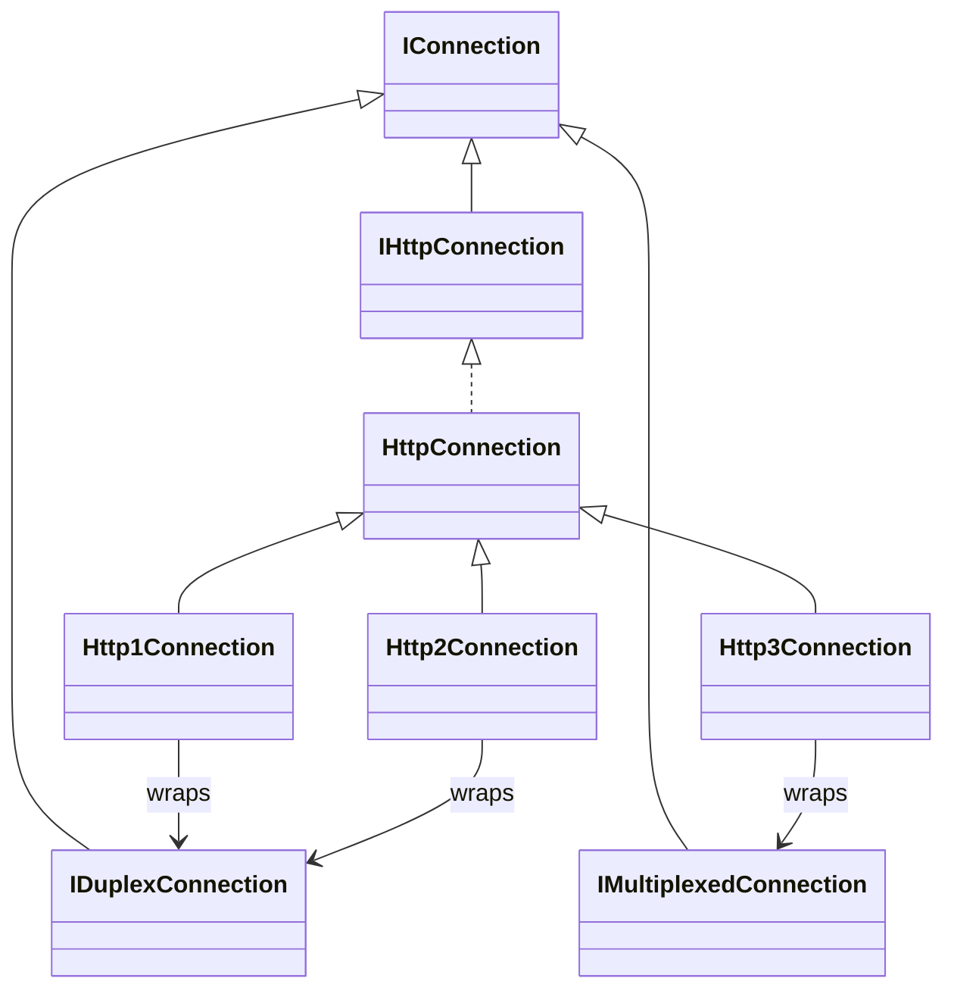
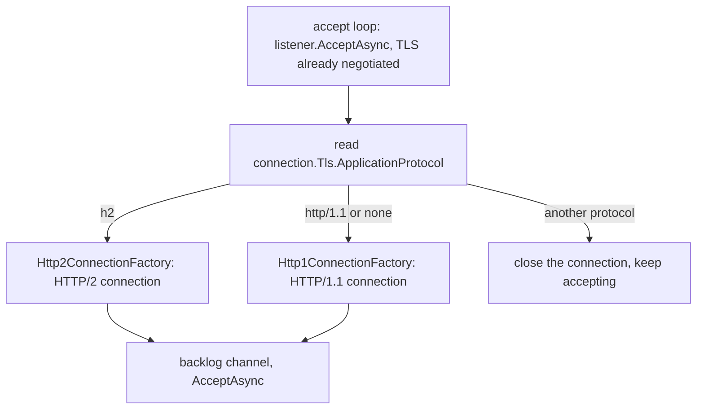
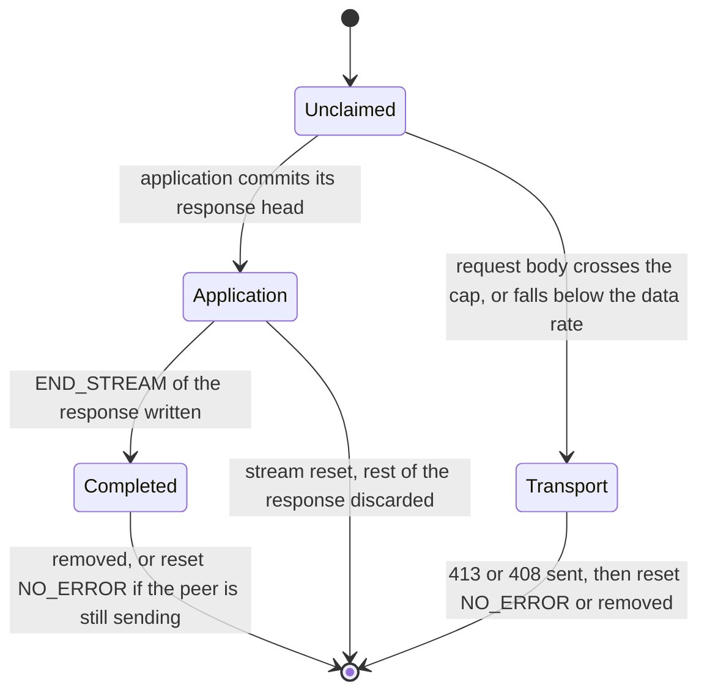
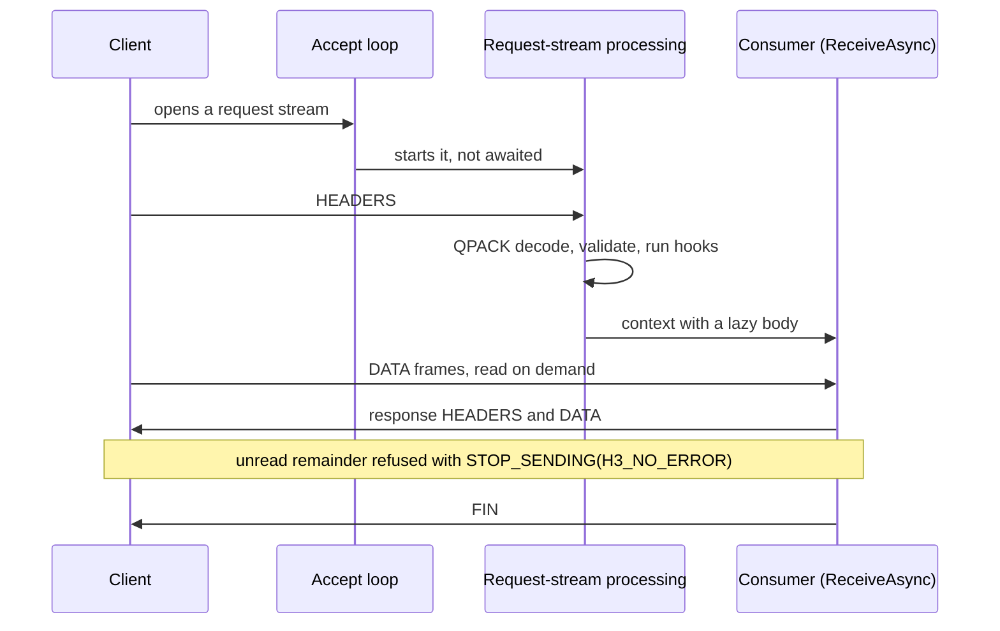
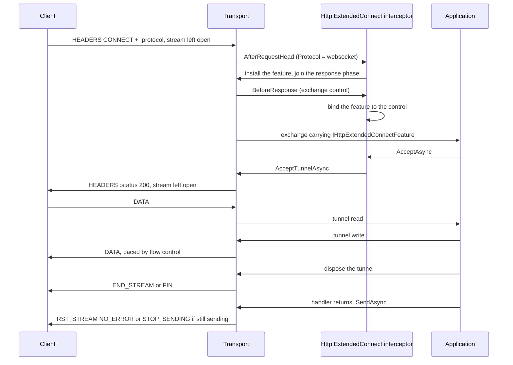

# Assimalign.Cohesion.Http.Connections design

Design decisions and ownership boundaries for `Assimalign.Cohesion.Http.Connections`.

[Overview](index.md) · [Examples](examples/index.md)

## Design and boundaries

This package delegates transport I/O and resource acquisition to Connections drivers.
The deleted `Assimalign.Cohesion.Transports` stack
(`ITransport`, `ITransportConnection`, `ITransportConnectionContext`,
`TransportConnectionPipe`, `ServerTransport<T>`, the `Items`/`IsSecure`
extensions) has been replaced by consumption of the
`Assimalign.Cohesion.Connections` contracts:

- `IDuplexConnectionListener` produces live `IDuplexConnection`s — the connection
  **is** the duplex pipe (`Input`/`Output` directly on it; there is no
  separate "context" and no `OpenAsync` step on the transport).
- `IMultiplexedConnectionListener` produces `IMultiplexedConnection`s
  whose accepted/opened streams are `IMultiplexedConnectionStream`s with a per-stream
  `Direction`, whole-stream coded abort and observable clean input completion.

`IHttpConnection` derives from `IConnection`: identity, endpoints, capabilities,
state, cancellation and abort belong to the same connection hierarchy. Its
`Protocol` is the one HTTP version the connection speaks, including when ALPN
selects it from a listener's combined `Protocols`. `Features` is the wrapped
transport's exact collection, so `Tls` can be read through `IHttpConnection`.
`IHttpConnectionContext` remains the separate HTTP request/response projection.

`IHttpConnectionListener` derives from `IConnectionListener<IHttpConnection>`.
`HttpConnectionListener` uses the generic listener base for both accept methods
and its live collection: root and typed `AcceptAsync` calls drain one channel,
and one covariant collection object exposes the same connections to both views.
The listener assigns its own `ListenerId`; it is distinct from transport listener
identities. A handed-out connection stays in `Connections` until its
`ConnectionClosed` token fires. Disposal closes queued connections that have no
owner yet, while connections already handed out remain their owners' responsibility.
The collection strongly retains open connections; only the accepting owner reads
or writes them. See the [Connections design](../../connections/assimalign-cohesion-connections/design.md)
for tracking and abandoned-owner costs.

Every HTTP wrapper forwards `ConnectionClosed` from its transport. Closing,
aborting or a peer close signals it, no later than `DisposeAsync` completing.
HTTP/2 and HTTP/3 dispose their transport even if their protocol cleanup fails.
For an HTTP/3 request stream, `ConnectionClosed` also signals successful completion
after both FINs. That lifecycle signal is broader than `RequestCancelled`: the exchange
observes peer cancellation until its complete response has flushed, then detaches its
stream-close registration before refusing unread input and sending the final FIN. A local
STOP_SENDING may signal the stream token synchronously; it must follow that detachment.
Successful buffered and streamed responses therefore retain an uncancelled request
token, and locally abandoned body reads retain their `IOException` contract.

Extended CONNECT tunnels detach at the same terminal boundary: an application close
first ends tunnel I/O and waits for its serialized writer, then detaches before the FIN.
Server finalization detaches before refusing unread input, whether or not the application
already closed the tunnel. A client FIN alone does not detach observation; active tunnel
reads and writes still observe peer resets, STOP_SENDING and connection loss. Both a clean
EOF followed by application close and a tunnel finalized by the server therefore keep
`RequestCancelled` unset, so Web completion callbacks remain eligible to run. This corrects
an unreleased #1459 regression; it adds no signature or wire-format break against preview.1.

The hierarchy and its transport projections are:



A host drives each connection context in a loop and finalizes every exchange exactly once through
`SendAsync`: HTTP/1.1 exchanges one at a time, HTTP/2 and HTTP/3 exchanges concurrently, bounded by
stream admission. After an application fault, `HttpContextTransportExtensions.HasResponseStarted`
tells the host whether a replacement response can still be sent or the exchange must be reset. All
three versions enforce `MaxRequestBodySize` with `413`: HTTP/1.1 and HTTP/3 dispatch at the request
head and read the body lazily, while HTTP/2 freezes the cap at dispatch and enforces it on receipt.
Since #1085 every version also enforces `KeepAliveTimeout`, `RequestHeadersTimeout` and
`MinRequestBodyDataRate` (see
[connection timeouts and data rates](#http2-and-http3-connection-timeouts-and-data-rates-1085)), and
since #1384 `MinResponseDataRate` on every response, buffered and streamed (see
[minimum response data rate](#minimum-response-data-rate-1384)). A request can change either rate for
itself until its body's first read or its response's first write (see
[per-request data rates](#per-request-data-rates-1383)).

## Breaking changes against 10.0.0-preview.1 (#1459)

On decision 15's terms, this contract refactor accepts source and binary breaks:
`IHttpConnection` now inherits `IConnection` and requires `Protocol`, transport
endpoints, capabilities and features; its guided `HttpConnection` base adds the
`LocalEndPoint`, `RemoteEndPoint`, `Capabilities`, `Features` and `Protocol` abstract
members. `IHttpConnectionListener` inherits the typed
listener, adding `Id`, the live `Connections` collection and `EndPoints`.
`AcceptOrListenAsync` is replaced by `AcceptAsync`, which returns
`ValueTask<IHttpConnection>` on the concrete listener and typed interfaces; the root
interface returns `ValueTask<IConnection>`. HTTP/1.1,
HTTP/2 and combined registrations now require `IDuplexConnectionListener` or
`Func<IDuplexConnectionListener>`. HTTP/3 uses the renamed
`IMultiplexedConnectionStream` internally and in transport-facing consumers.
Outside implementations and callers must adopt these contracts and await the new
accept method. No wire format changes.

## Optional connection features (#1452)

The transport references `Connections.Tls`, `Connections.StreamAbort` and
`Connections.StreamLimits` explicitly. It reads `Tls`, `DirectionalAbort` and
`StreamLimits` from each connection's feature collection. Wrapping connections
pass features through with `InnerFeatures`; replacing or removing a named feature
is deliberate. A stream never inherits its multiplexed connection's features.

The request-body reader resolves its directional abort feature at the first operation
that needs it, caches both presence and absence, and reuses it for later reads and
end probes. Before resolving the feature, response completion checks for a known FIN
at a safe frame boundary: no read is active, no partial DATA or skipped payload remains,
and the pipe contains no unread bytes. This includes a transport-reported FIN that the
stream-backed pipe has not yet observed through a zero-byte read. It records the clean
end without creating a stream feature collection; unread DATA, trailer bytes, partial
frame headers, cancelled input and failed input keep the existing probe/abort path.
Content-Length validation on body reads is unchanged. Since Part 2 of decision 56 (#1453),
HTTP/3 calls coded connection close and whole-stream reset on the multiplexed roots, and
reads `IMultiplexedConnectionStream.IsInputCompleted` directly. A whole reset is one
`Abort(code, reason)` call that ends both directions and the lifecycle. Directional
abort stays optional, and the request-body reader keeps its fallback when that feature
is absent. The root return-type and coded-abort changes are the Connections package's
accepted source/binary breaks against 10.0.0-preview.1; the hierarchy changes above extend that migration to HTTP.

## Structural listener registration

`HttpConnectionListenerOptions` binds concrete listeners to protocols
with shape safety enforced at the seam:

```csharp
HttpConnectionListener listener = HttpConnectionListener.Create(options =>
{
    options.UseHttp1(tcpListener);                 // IDuplexConnectionListener
    options.UseHttp2(tlsTcpListener, http2 =>      // IDuplexConnectionListener (TLS pre-composed)
    {
        http2.Limits.MaxStreamsPerConnection = 256;
    });
    options.UseHttp3(quicListener, http3 =>        // IMultiplexedConnectionListener
    {
        http3.QPack.MaxTableCapacity = 4096;
    });
});
```

- `UseHttp1` / `UseHttp2` accept an `IDuplexConnectionListener` (or a
  `Func<IDuplexConnectionListener>` materialized when the
  `HttpConnectionListener` is constructed) and **gate on capabilities,
  never on protocol identity**: the listener's `ConnectionCapabilities`
  must report `Delivery == Stream`, `IsReliable`, and `IsOrdered`, else
  an `ArgumentException` describes the capability mismatch.
  `ConnectionProtocol` is diagnostics-only and is never branched on.
- `UseHttp3` accepts an `IMultiplexedConnectionListener` — the parameter
  type itself is the shape gate, so no runtime capability check is
  needed for stream multiplexing.
- `UseHttp1AndHttp2` registers one listener for both stream protocols and
  chooses between them per connection from the protocol ALPN selected (see
  [Serving HTTP/1.1 and HTTP/2 on one TLS listener](#serving-http11-and-http2-on-one-tls-listener-alpn)).
  Its gate adds one capability: ALPN is a TLS extension, so the listener must report
  `Security == Tls`, else an `ArgumentException` names the mismatch.

`BacklogCapacity` retains its bounded-channel semantics: it caps how
many accepted HTTP connections may buffer before the per-listener accept
loops wait for `AcceptAsync` to drain them.

## Bind lifecycle, accept loops, and the live-connection model

`EndPoints` reads every configured transport listener's current `EndPoint`.
After `BindAsync` completes it contains the bound addresses, including TCP and
QUIC ports assigned for port-zero binds. It is independent of the live connection
collection, which can be empty when a host reports its bind. This lets any
composition, including raw listener factories, report its endpoints without a
separate capture mechanism.

`HttpConnectionListener.BindAsync` is the explicit resource-acquisition boundary. It awaits
`BindAsync` on every registered stream and multiplexed transport before it completes, and it does
not start any accept loop. Binding is idempotent. If a later transport fails to bind, the aggregate
releases every materialized listener and rethrows the original failure, so host startup cannot
leave a partially bound endpoint set behind. `DisposeAsync` is the symmetric release boundary and
is terminal for that listener instance; an in-process restart constructs a fresh host and listener.

`AcceptAsync` retains a compatibility fallback that invokes `BindAsync` before starting the
accept loops. Hosted servers still call `BindAsync` explicitly from their awaited `StartAsync`, so a
resource is never reported started while its endpoint remains unbound. Alt-Svc is computed only
after all transports bind, allowing an HTTP/3 listener configured with port zero to advertise its
actual assigned port.

`HttpConnectionListener` runs one accept loop per registered listener.
The HTTP/1.1 and HTTP/2 loops do
`IDuplexConnection connection = await listener.AcceptAsync(token)` and wrap the result in
`Http1Connection`/`Http2Connection`; the HTTP/3 loop accepts an
`IMultiplexedConnection` (with the QUIC platform guard) and wraps it in
`Http3Connection`. Because connections are already live when produced,
`IHttpConnection.Open()`/`OpenAsync` is a synchronous projection — it
constructs the protocol's connection context over the wrapped
connection; there is no transport open step to await.

## Graceful close: the host contract

A host stops a connection in two steps (#146). `IHttpConnectionContext.BeginGracefulClose` starts a
lame-duck close: the connection takes no new exchange and announces the close the way its version
requires, while every exchange already yielded keeps its request body and its `SendAsync`.
`ReceiveAsync` then ends on its own once nothing more can arrive, so a host's receive loop
completes without being cancelled. When the host stops waiting, it cancels the token it enumerates
`ReceiveAsync` with: every exchange the connection yielded observes `RequestCancelled`, on all three
versions. The call returns at once; a frame it needs is written in the background, and the
connection's disposal waits for it. Calls after the first do nothing.

| Version | Announcement | New work after the call | `ReceiveAsync` ends |
| --- | --- | --- | --- |
| HTTP/1.1 (RFC 9112 §9.6) | `Connection: close` on the response to the exchange in flight | not read; an idle keep-alive wait ends at once without a response, but a request whose head started to arrive is read and answered with `Connection: close` | after the exchange in flight, or at once when idle |
| HTTP/2 (RFC 9113 §6.8) | `GOAWAY(NO_ERROR)` carrying the highest stream accepted | a new stream, or one whose header block was still arriving, is refused with `RST_STREAM(REFUSED_STREAM)` once its header block is decoded | once the contexts already queued are read |
| HTTP/3 (RFC 9114 §5.2) | `GOAWAY` carrying the first request stream not processed, once the accept loop has stopped | a request whose head was still arriving is reset with `H3_REQUEST_REJECTED`, and so is every request stream opened later, unread, until the connection closes (#1306) | after the requests already published |

The seam is a member of the context contract rather than a capability interface a host type-tests
for: every context this package produces implements it, and a host that drains should not have to
discover whether it can. `HttpConnectionContext` declares it abstract, so an implementation outside
this repository must add it. Two alternatives were rejected: a second token on `ReceiveAsync`,
because on HTTP/1.1 and HTTP/3 the enumeration token already is each exchange's abort token and a
token cannot carry the announcement a version needs; and draining inside disposal only, because
disposal must be bounded and a host disposes a connection only after its own exchanges are done.

Two version details make the contract hold:

- **HTTP/1.1** — the read-timeout phase is an interlocked latch, so the close and the first octet
  of a racing request cannot both win: either the wait is reclaimed as idle, or the request that
  started to arrive is read under its request-headers deadline and answered with
  `Connection: close`. A response head committed before the close began goes out without
  `Connection: close`; the connection still ends after it, which RFC 9112 §9.5 permits at any time.
- **HTTP/2** — a frame pump stopped by cancellation aborts every live stream, a fully received
  request included, so cancelling the receive token cancels every exchange the connection yielded,
  as HTTP/1.1 and HTTP/3 already did. The teardown (`GracefulCloseAsync`) begins the close itself
  when no host did, and its own drain stays bounded.

`Web.Server`'s `WebApplicationServer` is the reference host: its lame-duck drain begins every
connection's graceful close when a stop begins and cancels the receive token only when the stop's
budget runs out.

## Serving HTTP/1.1 and HTTP/2 on one TLS listener (ALPN)

An `https` origin is expected to answer HTTP/2 and HTTP/1.1 on one port: the client offers the
protocols it speaks in the TLS handshake through ALPN (RFC 7301), the server selects one, and the
connection speaks it (RFC 9113 §3.2 identifies HTTP/2 over TLS as `h2`).
`UseHttp1AndHttp2(listener, configureHttp1, configureHttp2)` registers such a listener;
`UseHttp1AndHttp2(listener)` uses default options, and both have a `Func<IDuplexConnectionListener>`
form whose listener is created, and its capabilities validated, when the `HttpConnectionListener`
is constructed. Each protocol keeps its own options, captured at registration like those of
`UseHttp1`/`UseHttp2`, and both share the listener-wide interceptors. The registration's gate adds
one capability: ALPN is a TLS extension, so the listener must report `Security == Tls`, else an
`ArgumentException` names the mismatch.

Each connection is dispatched by the protocol its handshake negotiated, read through
`connection.Tls`:

| Negotiated | Served |
|---|---|
| `h2` | HTTP/2 |
| `http/1.1` | HTTP/1.1 |
| none: the client sent no ALPN extension, or the connection has no `Tls` feature | HTTP/1.1, what a client that does not negotiate expects of an `https` origin |
| anything else, which the server offered through an application-supplied list (`acme-tls/1`, say) | the connection is closed; the listener keeps serving other connections |

The registration carries an internal `HttpAlpnConnectionFactory` in place of a single protocol's
factory. It holds the HTTP/1.1 and the HTTP/2 factory and picks one per connection; a factory that
cannot serve a connection returns `null`, and that one connection is disposed instead of being
treated as a listener fault. The `Alt-Svc` value is pushed into both inner factories, so an HTTP/1.1
and an HTTP/2 response from the endpoint advertise the same h3 alternative, and the listener
reports both protocols in `HttpConnectionListener.Protocols`.



- **The transport owns the choice.** Picking the connection parser is transport work; the host only
  exposes the surface (`Web.Hosting`'s `UseHttps`).
- **Not preface sniffing.** Detecting the HTTP/2 connection preface is how prior knowledge works on
  cleartext (RFC 9113 §3.3). On a TLS connection the handshake has already decided, and RFC 9113
  §3.2 makes ALPN the way HTTP/2 starts for `https`.
- **Unknown protocols close rather than fall back to HTTP/1.1.** RFC 7301 §3.2 binds the connection
  to the protocol the handshake selected; speaking HTTP/1.1 on it would answer a client that agreed
  to something else.
- **TLS only.** A cleartext listener has no ALPN, so the registration rejects it; HTTP/2 prior
  knowledge and the deprecated `h2c` upgrade on a shared cleartext port are not supported. The
  single-protocol registrations ignore ALPN: `UseHttp1` and `UseHttp2` on a TLS listener serve their
  one protocol whatever was negotiated, so their TLS options should offer only that protocol.
- **The HTTP/2-over-TLS profile of RFC 9113 §9.2** (TLS 1.2 or later, the TLS 1.2 cipher-suite
  blocklist) is left to the TLS options; the transport does not inspect the negotiated version or
  suite before serving `h2`.

## Accept-side isolation: where the handshake runs (#1304)

The transport listener keeps one connection's failure away from the accept loops here. A TLS
handshake never runs in an accept loop in this package. The TLS-layered listener (`UseTls`) runs
each connection's handshake on its own task, at most `TlsServerOptions.MaxConcurrentHandshakes` at
a time, and `AcceptAsync` returns only connections whose handshake completed.
- **A failed TLS handshake** closes that connection, is reported by the
  `Assimalign.Cohesion.Connections` event source, and never reaches the accept loop. Failures
  include garbage bytes, a client the certificate policy refuses, and a silent client that times
  out.
- **QUIC handshakes** are contained the same way by the QUIC driver, which reports them from its
  own event source.
- **A client that resets while queued** is skipped by the TCP driver (#1308). Windows fails that
  accept with `ConnectionReset`.
- **Running out of descriptors or buffers** does not reach the accept loop either: the TCP driver
  waits and retries, from 5 ms doubling to 1 s, so clients that hold enough connections open slow
  accepts down until some close instead of stopping the endpoint (#1312).

So a slow client never delays another client's accept, and one client never stops an endpoint.

That is the contract of `AcceptAsync` on both listener shapes: a listener contains each
connection's failure, so whatever escapes it is the listener's own. The accept loops rely on it:

- **An exception from `AcceptAsync` is fatal to the `HttpConnectionListener`.** The accept loop
  completes the backlog channel with the listener's exception before it cancels the internal
  dispose token. It also records the exception, so accepts that begin after the cancellation
  rethrow it too. The host therefore sees the transport's root-cause exception from
  `AcceptAsync`, never a bare `ObjectDisposedException`.
- **Only this listener's own cancellation ends a loop quietly.** Before #1304 any
  `OperationCanceledException` did, so a TLS handshake that timed out inside the transport's
  `AcceptAsync` silently ended that endpoint's accepts. A cancellation this listener did not request
  is now the transport's failure. The Web server's accept loop applies the same rule (#1310).

Rejected: classifying exceptions in the accept loop and continuing on the ones that look like a
connection's. The loop cannot tell them apart:
- A handshake timeout throws `OperationCanceledException`, the type a disposed in-memory listener
  throws.
- Garbage bytes throw `IOException`, the family of transport I/O failures.

A wrong guess either stops the server or spins on a dead listener. The component that ran the
handshake knows which failure it was, so it decides.

## The TLS session on every exchange

### What it is

Every exchange that arrived over TLS has a connection info that also implements
`Connections.Tls`'s `ITlsConnectionInfo`: the client certificate, the TLS protocol version, the cipher suite,
and the application protocol ALPN selected. The transport does not run TLS, so it copies these from
the connection that did, through its `Tls` feature:

| Version | Source of the handshake facts |
|---|---|
| HTTP/1.1, HTTP/2 | the accepted `IDuplexConnection`, which the TLS layer secured |
| HTTP/3 | the accepted `IMultiplexedConnection`: QUIC's own TLS 1.3 handshake (RFC 9001) |

A connection without a registered `Tls` feature (cleartext, or secured by a layer that
does not report its handshake) gives its exchanges a plain `HttpConnectionInfo`.

The transport installs no HTTP TLS feature and references no package that declares one.
Applications read the session as `context.TlsConnection` from `Assimalign.Cohesion.Http.Tls`, which
builds its `IHttpTlsConnectionFeature` from this facet on first read (that package's DESIGN). Code
that needs only the raw facts reads `context.ConnectionInfo is ITlsConnectionInfo`.

### Where it is published

The internal `HttpTlsConnectionInfo` derives from `HttpConnectionInfo` and implements
`ITlsConnectionInfo`. `HttpTlsConnectionInfo.Create` returns it when the accepted connection reports
a handshake and a plain `HttpConnectionInfo` otherwise, and it is called wherever the transport
builds a connection info:

- **HTTP/1.1 and HTTP/2** build one when the connection context opens
  (`HttpStreamConnectionContext`). Every exchange on the connection shares it.
- **HTTP/3** builds one per request stream, because each carries the stream's endpoints. The
  facet's values come from the multiplexed connection, captured once when `Http3ConnectionContext`
  opens.

The same instance goes to the request-parse interceptors' context, the exchange, and the response
interceptors' context. Request-parse hooks therefore see the session from `AfterRequestHead`
onward, through their context's `ConnectionInfo`. When the transport attached a feature instead,
those hooks could not see it, because they run before the exchange exists.

### Why a facet and not a feature

Core Http holds base contracts only, and the application-facing HTTP TLS feature lives in its own
package (owner decision 20, 2026-10-09). The transport references `Connections.Tls` for the handshake
facts and snapshots them onto HTTP's connection-info object. `Http.Tls` keeps reading that object;
it does not need the live connection. Owner decision 56 moves the connection contract into its own
package and makes it an App kernel root, so this adds no repeated area-framework entries. The
transport never installs an HTTP TLS feature: an exchange that never reads `context.TlsConnection`
pays for no HTTP TLS feature object.

### Sharing and ownership

The snapshot is immutable, which is safe for concurrent HTTP/2 and HTTP/3 streams. It copies the
four values and never references the connection that ran the handshake: `QuicMultiplexedConnection`
is public, and a handler that could cast the connection info back to it could open streams. The
certificate is the connection's own instance, which the connection disposes when it is disposed, so
code that keeps it beyond the exchange copies it. A context wrapper that returns a new connection
info object hides the facet. The shipped wrappers forward the inner context's object.

## Response interceptors per exchange: the fast path

The listener partitions its interceptors by their declared `HttpInterceptorScopes` once, and the
response-scoped machinery — the raw response body sink and the exchange control — exists only for an
exchange that has a response interceptor. A request-parse hook can also add an interceptor to its
own exchange's response phase (`HttpExchangeInterceptorRequestContext.AddResponseInterceptor`).
Each transport resolves the exchange's response interceptors at setup (the listener's, then the
added ones, each once) and builds the sink and control only when that list is not empty. So the
protocol-upgrade interceptor `Web.Hosting` installs by default, which declares the request scope and
joins the response phase only of an HTTP/1.1 upgrade or `CONNECT`, costs an ordinary exchange
nothing on any version. While that interceptor declared both scopes, every exchange on every version
built a sink, an exchange control and a response context for it. The extended CONNECT interceptor
the Web host also installs by default follows the same pattern and joins only an HTTP/2 or HTTP/3
extended CONNECT (see [the tunnel](#extended-connect-the-tunnel)).
`HttpExchangeResponseInterceptorTests` pins the fast path for an ordinary request on all three
versions under the Web host's three default interceptors, and pins that an HTTP/2 and HTTP/3
extended CONNECT joins the response phase.

## One added response interceptor (#1389)

A request-parse hook that adds one response interceptor now stores it in a singleton array.
When no listener response interceptors are registered, `ResolveResponseInterceptors` retains
that array directly. The path creates no intermediate list, backing array, enumeration object,
or final copy. A second distinct addition promotes parse-side storage to a list; listener-first
ordering and equality-based deduplication still use the existing merge path. An exchange with
no added interceptor still reuses the listener's array.

This is shared setup for HTTP/1.1, HTTP/2 and HTTP/3. It changes no public contract, hook order,
or feature behavior. The per-exchange response-joining API did not exist in 10.0.0-preview.1,
so this optimization introduces no behavior break against that release. Protocol upgrade,
extended CONNECT and Web.Hosting's body-specific client-fault interceptor use this seam.
The current Web host also registers response lifecycle interceptors, so its ordinary body
request uses the mixed merge path and benefits from the smaller first-add storage; it does
not have the no-listener-response configuration required for direct array reuse.

`HttpResponseInterceptorAllocationTests.ResolveResponseInterceptors_WithOneAddedAndNoneRegistered_ShouldAllocateOnlyOneArray`
pins the combined add-and-resolve allocation against a separately allocated singleton array,
with context construction, assertions and disposal outside the sample. Reverting both production
changes to `d47169452` made this regression fail: add allocated 64 B and resolution 136 B, or
200 B per exchange. With the fix, add allocates 32 B and resolution 0 B: 168 B (84%) less.
The test calibrates the expected array size so it does not assume a particular object header.
The equality guard in core Http pins existing behavior and passes with the fix reverted too.

The allocation guard isolates its test-only `MeasurementContext` construction behind a
`NoInlining` factory (#1462). Release IL leaves the ending counter subtraction on the
evaluation stack. The [.NET 10 JIT importer](https://github.com/dotnet/runtime/blob/v10.0.0/src/coreclr/jit/importer.cpp#L9054-L9063)
can emit the raw allocation for a following `newobj` before spilling that expression.
On x64, this places the 128-byte context allocation ahead of the preceding
`GC.GetAllocatedBytesForCurrentThread` counter, even though the constructor stays afterward.
Disassembly confirms this in both tier-0 and fully optimized code with tiering disabled:
the add sample includes the 32-byte interceptor array plus the unrelated 128-byte test object.
The factory keeps the allocation after the add sample and before the resolve sample on both
architectures. Warming longer or disabling tiering does not establish that boundary. Product
storage and resolution are unchanged, and the exact singleton-array assertion remains intact.
This corrects test measurement only; it changes no behavior from 10.0.0-preview.1.

Verification on Windows ARM64 with SDK 10.0.401 / runtime 10.0.12, Release builds, using
`dotnet test --arch x64` (emulated) and `--arch arm64`, with default tiering. Each independent
run measures 1,000 exchanges after 100 warmups; resolution is 0 B in every run:

| Architecture | Add B/exchange, runs 1–5 | Calibrated singleton B |
|---|---|---:|
| x64 | 32, 32, 32, 32, 32 | 32 |
| arm64 | 32, 32, 32, 32, 32 | 32 |

Reverting the factory call reproduces 160 B/exchange on x64; restoring it gives 32 B.
A separate x64 run with `DOTNET_TieredCompilation=0` also gives 32 B after the fix
(160 B before it), confirming that the boundary is independent of tier promotion.

The body measurement uses
`ReceiveAndSend_WithBodyAndOneAddedInterceptor_ShouldReportBytesPerRequest`: one preloaded
HTTP/1.1 keep-alive connection, `POST /` with `Content-Length: 3`, the consumed body `abc`,
a 204 response, and one request-scoped interceptor adding one response interceptor only when
`CanHaveBody` is true. Every receive, body read, send and exchange disposal must complete
synchronously, keeping `GC.GetAllocatedBytesForCurrentThread` valid. Listener/payload setup,
the reused body buffer and reporting are excluded. Request/response rates, header/keep-alive
timeouts and automatic Date are disabled. These are transport measurements, not full Web host
or network throughput measurements.

Measured on Windows ARM64, .NET SDK 10.0.401, Debug builds, with
`DOTNET_TieredCompilation=0` for both runs (to keep changing tiered optimizations out of the
comparison). After 1,000 warmup requests, each result is the median of five rounds of 5,000:

| Listener response interceptors | Before (`d47169452`), B/request | After, B/request | Saved, B/request |
|---|---:|---:|---:|
| None: singleton fast path | 32,112.63 | 31,944.63 | 168.00 |
| One: mixed merge path | 32,128.63 | 32,088.63 | 40.00 |

Run the Connections tests with the filter
`FullyQualifiedName~HttpResponseInterceptorAllocationTests` to print all samples. The complete
request cost is reported rather than pinned: unrelated transport changes may alter it. Only the
single-interceptor storage/resolution cost is an allocation regression assertion. The mixed-path
saving includes the smaller first-add storage and the array enumerator replacing the boxed list
enumerator; its registered-before-added merge still builds the existing effective list and array.

## Sizing the feature collection: `ExchangeFeatureCapacity` (#1381)

Every exchange's collection is created at one of three sites: the HTTP/1.1 parser and
`HttpRequestInterceptorPipeline` (HTTP/2 and HTTP/3) when an interceptor is registered, or the
exchange context's constructor on the zero-interceptor fast path. All three size it for
`HttpConnectionListenerOptions.ExchangeFeatureCapacity`, a listener-wide count of the features an
ordinary exchange is expected to carry, snapshotted with the interceptors when the
`HttpConnectionListener` is constructed. The default, `0`, leaves the collection to grow as before,
and a negative value throws `ArgumentOutOfRangeException`. The parse-time collection becomes the
exchange's own, so it is sized for every feature the exchange will carry, not only the hooks'.

The seam is generic on purpose (owner decisions 20 and 36): the transport learns a number, not which
features a host installs. A host that stamps the same features onto every exchange sets it;
Web.Hosting does, from its application features plus the four it always installs. Without it, a host
stamping eight features onto a collection that grows from three slots pays for the 3-, 7- and
17-slot dictionaries on every exchange. With it, the collection allocates one dictionary of the
right size.

A feature beyond the count still works, but the dictionary grows from the size the count chose, and
that overflow can cost more than never presizing. An unsized dictionary grows through 3, 7, 17, 37,
89 and on, each the runtime's smallest table prime at least twice the last. A size between two of
those grows to another size between them: sized for 11, a twelfth feature grows the dictionary to 23
slots, and the dictionary allocates 1,136 B in all where an unsized one holding twelve allocates
992 B. Sized at one of the chain's own sizes, an overflow grows exactly as an unsized dictionary does
and never costs more. The transport takes the count as given; a host that cannot count every feature
an exchange carries rounds it up to the chain itself, as Web.Hosting does.

## The request method is kept as sent (#1301)

The method is parsed the same way on every version: the request-line token, or the `:method` field,
goes through `HttpMethod.GetCanonicalizedValue`, which keeps it as sent and matches the standard
methods byte for byte (RFC 9110 §9.1; see the core's
[case-sensitive methods](../assimalign-cohesion-http/design.md#methods-are-case-sensitive-rfc-9110-91)).
`get`, `head` and `connect` are unknown extension methods, so HTTP/1.1 sends a body for `head`, and
HTTP/2 and HTTP/3 treat a `connect` that carries `:scheme` and `:path` as the ordinary request their
pseudo-header checks, which already compared `CONNECT` ordinally, took it for. On HTTP/1.1,
`connect host:port` used to become a `CONNECT` tunnel and is now rejected as a malformed
request-target (authority-form on a method that is not `CONNECT`), and `options *` is rejected the
same way, because asterisk-form belongs to `OPTIONS` alone. Before #1301 the token was upper-cased
here, and the transport applied semantics an intermediary in front of it did not.

## Absolute-form request-targets decode like origin-form (#1324)

`IHttpRequest.Path` is the **percent-decoded** path on every transport, produced by the same
`HttpPath.FromUriComponent` decode (RFC 3986 §2.4). HTTP/2 and HTTP/3 run it over the `:path`
pseudo-header; HTTP/1.1's `Http1MessageReader` runs it over the **origin-form** and
**absolute-form** request-target path after `HttpRequestTarget` has split path from query (#895;
absolute-form since #1324). Identical wire bytes therefore yield an identical `Path` on all three.

Absolute-form (RFC 9112 §3.2.2, which every server must accept) takes the same decode. Its
`HttpRequestTarget.Path` comes from `System.Uri.AbsolutePath`, which removes dot segments and
decodes escaped unreserved characters but leaves every other escape as written: `/caf%C3%A9` and
`/100%25` stay encoded. Until #1324's review the reader passed that path through, so
`GET http://example.com/caf%C3%A9` reached middleware as `/caf%C3%A9` while the origin-form request
reached it as `/café`, and a redirect that encodes the decoded path (`HttpPath.ToUriComponent`; see
the core's
[writing a path and a query back out](../assimalign-cohesion-http/design.md#writing-a-path-and-a-query-back-out-touricomponent-httpquerycreate))
wrote `/caf%25C3%25A9`, another resource. `HttpRequestTargetDecodeParityTests` pins the two forms
and HTTP/2 to the same `Path`. Authority-form (CONNECT) carries no path, and asterisk-form is the
literal `*`.

## The request scheme and an https target on cleartext (#1324)

`IHttpRequest.Scheme` is the target URI's scheme (RFC 9112 §3.3): the connection's, unless an
HTTP/1.1 absolute-form request-target or an HTTP/2 or HTTP/3 `:scheme` names one. Until #1324's
review a named `https` was taken whatever the connection, so
`GET https://example.com/admin HTTP/1.1` sent to a cleartext port, or an h2c stream with
`:scheme https`, reached the application as `https`. `UseHttpsRedirection` passed it on, because the
effective scheme falls back to `Request.Scheme` when no trusted proxy forwarded one, and HSTS (RFC
6797 §7.2) and the Secure-cookie decisions in CookiePolicy and Antiforgery read it as secure. RFC
9110 §4.2.2 makes an `https` resource reachable only over a secured connection, and §7.4 has an
origin server reject a request for one that arrives otherwise.

- **HTTP/1.1** answers an `https` absolute-form target on a cleartext connection with
  `421 Misdirected Request` (§15.5.20), which tells the client to retry over a secured connection,
  and closes the connection. `Http1MessageReader` raises `Http1MisdirectedRequestException` once the
  head is read, before any interceptor or the application runs; `Http1ConnectionContext` writes the
  421 the way it writes a 400.
- **HTTP/2 over cleartext (h2c)** answers an `https` `:scheme` with 421 before
  request interceptors or application dispatch (#1415, owner decision 44). The full
  field block is decoded and validated first, preserving HPACK state. The existing
  pre-dispatch 413 path supplies the response shape: HEADERS with `END_STREAM` and
  `content-length: 0`, followed by `RST_STREAM(NO_ERROR)` when the request is still
  open (RFC 9113 §8.1). A finished request needs no reset. This preserves the 421
  status and keeps the connection available for other streams; a reset alone would
  discard useful status information despite an existing status-answer path.
- **Trusted h2c gateways** can set listener-wide
  `HttpConnectionListenerOptions.AllowAlternateSchemes = true` (default false).
  Under this explicit trust decision `Request.Scheme` retains the gateway's
  `:scheme`; connection security still reports cleartext. Web.Hosting binds
  `Http:AllowAlternateSchemes`. HTTP/1.1 validation remains unchanged.
- **HTTP/3** is unchanged: QUIC always carries TLS.
- **An `http` target on a secured connection** keeps `http`. It claims less than the
  connection gives, so at worst `UseHttpsRedirection` sends the client to the
  `https` URI once.

By default, `https` on `Request.Scheme` means a secured connection. A proxy can
report its client's scheme through trusted forwarded headers, or use the explicit
h2c listener opt-out above. Plaintext HTTP/2 fixtures now use `http`; TLS and
intentional scheme tests retain `https`.

**Breaking behavior against 10.0.0-preview.1 (decision 15).** An h2c request naming
`https` used to reach the application and now receives 421 by default. Trusted
TLS-terminating gateways forwarding that scheme must enable the option or send
`http` and use trusted forwarded headers. No existing public interface changes.

## Extensible status codes (#1414)

Core `HttpStatusCode` accepts every integer from 100 through 599 (RFC 9110
§15), including values absent from its reason-phrase table. These values carry
an empty phrase; the transport preserves their numeric identity rather than
substituting their class's `x00` code. Interpreting an unknown status as its
class default is the recipient's responsibility.

- **HTTP/1.1** writes `HTTP/1.1 299 ` followed by CRLF for an unregistered
  `299`: the SP after the status code remains present even though the phrase is
  empty, as RFC 9112 §4 requires. Buffered, streamed, interim and transport-built
  heads share this status-line writer.
- **HTTP/2 and HTTP/3** encode only the three decimal digits in `:status`,
  such as `299`. Neither HPACK nor QPACK carries a reason phrase.
- **Informational codes** remain 100–199. Unregistered values such as `104`
  and `199` can be emitted through the interim-response seam; every protocol
  continues to reject them as final responses. `101` remains exclusive to the
  HTTP/1.1 protocol-upgrade path. Accepting a numeric value does not recommend
  emitting a reserved status: `306` retains its legacy `(Unused)` phrase and
  obsolete accessor; `418` has an empty phrase.

`HttpUnregisteredStatusCodeTests` exercises real buffered exchanges carrying
`299`, `418` and `599` on all three protocols, each protocol's streamed `299`
head, all interim writers with `104` and `199`, and the existing numeric final
response guard. Invalid values below 100 or above 599 are rejected by the core
value type before reaching a writer.

**Breaking behavior against 10.0.0-preview.1 (decision 15).** Application code
can now assign and send an unregistered in-range response status where the
`HttpStatusCode` constructor and implicit conversion previously threw. No
transport interface or framing rule changes; registered phrases stay intact.

## Automatic Date on final responses (#1417)

The listener defaults `HttpConnectionListenerOptions.AddDateHeader` to true.
HTTP/1.1 heads, HPACK response field sections and QPACK response field sections
include `Date` in IMF-fixdate (RFC 9110 §5.6.7, §6.6.1) whenever the application
supplies none. This includes streamed heads, successful tunnels and transport-built
rejections. All final statuses, including 5xx, carry it: the RFC's 5xx MAY is taken
so error responses have an origination time as well. Interim 1xx heads, including
101 transitions, omit Date even when the application supplied one.

A shared immutable cache holds the formatted value and its HTTP/1.1, HPACK and
QPACK field encodings. Production uses one process-wide cache driven by
`TimeProvider.System`; internal provider injection isolates deterministic tests.
A UTC-second comparison is the fast path. Refresh is serialized and rechecks the
clock under the lock, so concurrent callers format and encode only once in that
second. A clock rollback refreshes too. There is no timer or background process.
The snapshot, its string and all three encoded fields are reused across listeners
and connections. Core Http's generic inline-first header storage avoids allocating
a dictionary or consuming its capacity for this default field. Cache hits, header
insertion and copying cached field bytes need no per-request scratch allocation;
response output buffers still contain the additional wire bytes. A final head
containing only the matching cached Date bypasses collection enumeration in all
three writers, avoiding the boxed enumerator that otherwise adds an allocation
when Date turns an empty head into a nonempty one. The check uses the existing
header count and lookup contract; no interface or core collection changes are
needed. The 204/304 encoding regressions compare enabled and disabled listener
policies, measuring the extra output-array storage separately, including runtime
alignment. HTTP/1.1 retains its existing capacity buffer.

The transport seeds response headers before application dispatch and re-seeds a
missing Date before each `BeforeResponse` interceptor, respecting the listener's
opt-out and preserving explicit values. An earlier hook may clear headers; the
upgrade interceptor still captures the default for a successful CONNECT, whose
head bypasses the transport writer, even if the application clears headers again.
This is the response's origination time (the RFC permits generation at
any time during message origination); it stays stable while a slow handler runs.
StaticFiles can therefore clamp Last-Modified and evaluate If-Range against the
same timestamp that the head sends. Head writers regenerate the default if the
application cleared its headers. An application value, including one different
from the cached value, is never overwritten; ordinary syntax validation still
applies. The matching cached value takes the pre-encoded path.

Set `AddDateHeader = false`, or `Http:AddDateHeader = false` in Web.Hosting
configuration, behind a proxy that supplies its own Date. This disables automatic
generation only; an application Date still goes out on a final response. StaticFiles keeps
Last-Modified and date validators enabled (#1449): when Date is absent, invalid, or repeated,
it reads `TimeProvider.System.GetUtcNow()` once for the future-date clamp and all date
validation, including the date-form If-Range strength check. A single valid response Date
remains its reference. This fallback does not add or rewrite the Date header.

**Breaking behavior against 10.0.0-preview.1 (decision 15).** Final responses now
carry an additional Date field by default, and the application sees it before
dispatch. Applications asserting an exact header set must account for it. An
explicit application Date remains authoritative. No existing public interface or
assembly dependency changes.

## Trailers on HTTP/2 and HTTP/3

Trailers (RFC 9110 §6.5) are HTTP semantics, decided apart from gRPC (decision 18, the Http area's
ADR 2 in `cohesion/docs/libraries/Http/DECISIONS.md`). Every version surfaces a request's trailer
section on `Request.Trailers`, a supported collection that stays empty until the body has been read
to its end: HTTP/1.1 for a chunked request, HTTP/3 from a trailing HEADERS frame, and HTTP/2 as
below. HTTP/2 and HTTP/3 also send response trailers; HTTP/1.1 does not.

**HTTP/2 request trailers: every field block is decoded (#1314).** HPACK is stateful (RFC 7541): a
field block can add entries to the connection's dynamic table, and later blocks reference them, so
RFC 9113 §4.3 requires every block to be decoded. A trailing HEADERS frame used to be appended to
the stream's header buffer after the head was decoded and never decoded itself, so a trailer field
the client indexed left the server's decoder out of step for every later request on the connection.
The frame pump now treats the trailer section as a field block of its own:

- **Accumulation.** A HEADERS frame that arrives once the head is in (it must carry `END_STREAM`)
  starts a fresh block under the head's raw-size bound, the CONTINUATION-flood defence;
  CONTINUATION frames extend it.
- **Decoding** happens in frame order as soon as `END_HEADERS` completes the block, whether or not
  the application ever reads the body. The whole block is decoded before any field is judged, so a
  malformed section still leaves the decoder in step.
- **Validation.** `HttpTrailerFieldRules`, shared with HTTP/3, rejects a pseudo-header, a field that
  breaks the field syntax — a name that is not a lowercase token, a value with a control character
  or edge whitespace (#1376) — a connection-specific field, and the fields RFC 9110 §6.5.1 excludes
  from trailers. A CONNECT stream carries only DATA after its head, so any trailer section on it is
  malformed. A violation fails the body pipe with an `IOException` first, then resets the stream
  with `PROTOCOL_ERROR`; the connection keeps serving.
- **Exposure.** The pump parks the validated fields on the stream; the request body copies them into
  `Request.Trailers` when its reader reaches the clean end of the body, on the reader's own thread.
- **Limits.** The decoded section counts against `MaxRequestHeaderListSize` on its own. Going over
  leaves the dynamic table indeterminate, so it is the connection error `ENHANCE_YOUR_CALM`, as for a
  head; a block that is not valid HPACK is `COMPRESSION_ERROR`.

Two alternatives fail on HPACK: decoding at the body read, as HTTP/3 does (QPACK inserts on its
encoder stream, so an unread section can be skipped; HPACK inserts inside the blocks), and validating
while decoding, as the request head did before #1322 (rejecting a field mid-block abandons the rest
of the block, so every violation would cost the connection). A handler that answers without reading
the whole body makes the server reset the stream with `NO_ERROR`, and the client may already have
sent its trailers, so the connection remembers the most recent 128 streams it reset or refused, and
decodes and drops a trailer section that arrives for one of them. Since #1074 that is every such
stream, not only one whose peer was still sending: the RFC's rule has no such condition. DATA frames
on such a stream are ignored the same way, and still credited back to the connection window, and a
WINDOW_UPDATE on any retired stream is ignored (see
[frames after a reset](#http2-refused-streams-and-frames-after-a-reset)).

**One trailer rule set for every version.** `HttpTrailerFieldRules` is the single rule set for a
received trailer section, so a section one version accepts no version refuses. Every version
rejects a connection-specific field and the fields RFC 9110 §6.5.1 excludes from trailers (framing,
routing, request modifiers, authentication, response controls, content processing, `Trailer`
itself, and the cookie fields). Every version also applies the core field syntax to a trailer field
as to a header field: a token name, and a value with no control character but HTAB (#1341 on
HTTP/1.1, #1376 on HTTP/2 and HTTP/3, `HttpReceivedFieldRules`). HTTP/2 and HTTP/3 also reject a
pseudo-header and an uppercase name, two rules of their field-section syntax; HTTP/1.1's own syntax
rule — a token name with nothing before the colon — is its header section's (see
[HTTP/1.1 field lines](#http11-field-lines-and-malformed-bodies)). Each version reports a violation
through its own malformed-message path: a stream `PROTOCOL_ERROR` on HTTP/2, `H3_MESSAGE_ERROR` on
HTTP/3, and on HTTP/1.1 a failed body read, after which the transport answers `400` and closes the
connection. Before #1314, HTTP/3 rejected only connection-specific fields, `Content-Length` and
`Host`; before #1319, HTTP/1.1 rejected only `Content-Length`, `Transfer-Encoding` and `Host`, so a
trailer section carrying, say, `Authorization` or `Keep-Alive` was accepted over HTTP/1.1 and
refused over HTTP/2 and HTTP/3.

**Response trailers (#1315).** The fields an application stages on `Response.Trailers` before the
response completes go out after the body, on the buffered and the streaming path alike:

| Path | HTTP/2 (RFC 9113 §8.1) | HTTP/3 (RFC 9114 §4.1) |
|---|---|---|
| Buffered `SendAsync` | HEADERS, DATA frames without `END_STREAM`, then the trailer HEADERS [+ CONTINUATION] block carrying `END_STREAM`. With no content: HEADERS, then the trailer block. | HEADERS, DATA, then a HEADERS frame, then the FIN. |
| Streaming sink | The trailer HEADERS block carries `END_STREAM` in place of the empty DATA frame. | A HEADERS frame after the last DATA frame, then the FIN. |

- **No trailers, no change.** The send path writes a trailer section only when the collection holds
  a field, so a response that never staged one goes out byte for byte as before.
- **Refused when added.** A pseudo-header, a name that is not a token, a connection-specific field,
  a field RFC 9110 §6.5.1 prohibits in trailers, or a value with a control character but HTAB
  (#1183) throws `ArgumentException` from `Add` or the indexer. The encoders check the field syntax
  again (see [response field syntax](#response-field-syntax-refused-before-a-byte-is-written-1183)).
- **When they are read.** The buffered path reads them at `SendAsync`, the streaming path when the
  sink completes, so a field added later is not sent. The transport adds no `Trailer` header; an
  application that wants the declaration sets it.
- **HEAD** sends no trailer section, though the collection stays supported, so a handler shared with
  GET stages trailers without branching on the method. **CONNECT** reports the collection
  unsupported, because a tunnel carries only DATA. A transport-generated `413`, `408` or `431` drops
  staged trailers.
- **HTTP/1.1 keeps `IsSupported = false`** (decision 18): a buffered HTTP/1.1 response carries
  `Content-Length`, and HTTP/1.1 clients rarely consume chunked trailers.

## Responses without content: HEAD, 204, and 304 (#1073)

**The defects this closes.**

- **HTTP/1.1 stated a length for an empty HEAD.** The writer synthesized `Content-Length: 0` when
  the handler produced no body, a length the GET would not send (RFC 9110 §8.6), so a cache could
  treat its stored GET as stale (RFC 9111 §4.3.5). HTTP/2 and HTTP/3 had stopped doing so in #1048.
  Web.StaticFiles answers HEAD for a stream of unknown length with headers only, which hit this.
- **Every version sent `Content-Length` on a `204`,** which RFC 9110 §8.6 forbids, and on every
  `304`, from the empty body, where §15.4.5 makes the length the selected representation's.
  Web.StaticFiles' `304`s therefore stated a length of `0` for non-empty files.
- **A body written for a `204` or `304` reached the wire.** HTTP/1.1 ends either response at its
  blank line, whatever its fields say (RFC 9112 §6.3), so on a kept-alive connection the client read
  the octets as the start of the next response. A streamed `204` or `304` also took
  `Transfer-Encoding: chunked`, which RFC 9112 §6.1 forbids on a `204`, and its terminating chunk
  was read the same way. On HTTP/2 and HTTP/3, DATA on either response is content in a response that
  cannot have any, and a strict client resets the stream.

**One rule, every writer.** `HttpResponseContentRules` holds the rule, and all three versions apply
it on the buffered path and through the raw body sink:

| Response | Content and trailers | `Content-Length` synthesized from the staged body | `Content-Length` the application set |
|---|---|---|---|
| To HEAD (status other than `204`/`304`) | Discarded | Only from a non-empty body | Sent |
| `204 No Content` | Discarded | Never | Not sent |
| `304 Not Modified` | Discarded | Never | Sent |
| Any other | Sent | Always (buffered path) | Sent |

- **Discarded, not refused.** A staged or streamed body for a response that cannot carry one is
  dropped, as a HEAD body always was. The status can change until the head is committed, so the
  transport is the first place that knows the body has nowhere to go, and an error there would fail
  a response that is otherwise sound.
- **The wire, not the collection.** The head encoders (`Http1MessageWriter.EncodeHead`,
  `HPackEncoder.EncodeResponseHeaders`, `Http3HeaderCodec.EncodeResponseHeaders`) skip
  `Content-Length` on a `204`, an application-set one included, and leave `Response.Headers` as it
  was, as they do for the connection-specific fields.
- **No transfer coding on a `204` or `304`.** The HTTP/1.1 sink selects chunked coding only for a
  response that can carry content, or for HEAD, whose head is the one a GET would get. A `204` or
  `304` head never gets a terminating chunk, and the transport adds no `Transfer-Encoding` to
  either. `Http1MessageWriter.EncodeHead` also skips a `Transfer-Encoding` the application set on a
  `204`, on the buffered and the streamed path alike, which RFC 9112 §6.1 forbids
  (`HttpResponseContentRules.PermitsTransferEncoding`). A `304` keeps one the application set: §6.1
  lets it name the coding a `200` would have had. HTTP/2 and HTTP/3 never send the field, which is
  connection-specific there.
- **Interim heads are out of scope.** RFC 9110 §8.6 also forbids `Content-Length` on a `1xx`; the
  interim writers send the fields the caller passes.

**Behavior changes.** Accepted on decision 15's terms:

- *Observable by applications and clients.* On every version, a `Content-Length` the application set
  on a `204` is no longer sent, and on HTTP/1.1 neither is a `Transfer-Encoding` it set there.
  `Response.Headers` still holds both.
- *Observable by applications and clients.* A body staged or streamed for a `204` or `304` is
  discarded silently instead of being sent, as a HEAD body always was. No exception tells the
  application.
- *Observable by clients.* An HTTP/1.1 response to HEAD with an empty buffered body no longer
  carries `Content-Length: 0`, and no version synthesizes a length for a `304` (or a `204`).

## Connection-specific fields in HTTP/2 and HTTP/3 response heads

RFC 9113 §8.2.2 and RFC 9114 §4.2 make a message carrying `Connection`, `Keep-Alive`,
`Proxy-Connection`, `Transfer-Encoding` or `Upgrade` malformed, and allow `TE` only as `trailers`;
a client may reset a stream that carries one. An application, middleware written for HTTP/1.1, or a
proxy can set these fields, so the HTTP/2 and HTTP/3 encoders skip them while they encode a response
head (#1328):

- **One rule, every head.** `HttpResponseFieldRules.IsSendable` covers the buffered head, the
  streamed head, early hints and every other interim response, and an extended CONNECT tunnel's
  `200`. `TE: trailers` is the one value kept.
- **The wire, not the collection.** The field is skipped without being removed from
  `Response.Headers`, so a component that set it and reads it back still sees it.
- **Dropped, not refused.** A head that carries such a field is still sent: the field means nothing
  on these versions, and a response built without knowing the version should not fail on one of
  them. Trailers differ, because the trailer collection exists only where HTTP/2 or HTTP/3 sends it,
  so it refuses such a field when it is staged.
- **Transport-built heads** (the HTTP/2 `413` or `408`, the HTTP/3 status-only response) carry only
  fields the transport chose, and HTTP/1.1, where these fields have meaning, does not use the rule.

## Response field syntax: refused before a byte is written (#1183)

Until #1183 a response field went to the wire as the application wrote it. The HTTP/1.1 writer
formatted `{name}: {value}\r\n`, so a value with CR or LF that an application reflected from the
request — a redirect `Location` built from the query, a `Content-Disposition` file name — ended its
line early and started a header, or a whole second response, of its own (CWE-113: cache poisoning,
session fixation, XSS). HTTP/2 and HTTP/3 encoded the same value into a field section that RFC 9113
§8.2.1 and RFC 9114 §4.2 make malformed, and that a downgrading intermediary may split. The
`Http.ProtocolUpgrade` 101 writer did the same outside the transport.

**The rule (decision 27).** Every head writer applies the core field rule
(`HttpFieldNormalization`, #1341; see the core's [field syntax](../assimalign-cohesion-http/design.md#field-syntax))
to each field line as it encodes it, through `HttpResponseFieldRules.EnsureValidName` and
`EnsureValidValue`:

- **A name is a token** (RFC 9110 §5.1). That refuses SP, HTAB, `:`, CR, LF, every other control
  character, and non-ASCII, and with them a name that starts with `:`, which an application could
  otherwise use to append a pseudo-header after the regular fields.
- **A value holds no control character but HTAB** (`IndexOfInvalidControlCharacter`): CR, LF, and
  NUL, and also `%x01-08`, `%x0B-1F`, and DEL. A sender may not generate a value outside
  `field-content` (RFC 9110 §2.2, §5.5); the latitude §5.5 gives is a recipient's, and the HTTP/1.1
  reader rejects the same characters (#1341), so a Cohesion-to-Cohesion hop would answer the value
  with `400` anyway.
- **Not refused:** SP or HTAB at a value's ends, which split nothing and are not part of the value
  (RFC 9110 §5.5); obs-text (`%x80-FF`); and a character above `U+00FF`, which every encoder already
  writes as `?`. HTTP/2 and HTTP/3 field names are lowercased by the encoders, so uppercase is not
  refused.
- **Trimmed on HTTP/2 and HTTP/3:** those versions have no optional whitespace around a value, and
  a value that starts or ends with SP or HTAB makes the whole response malformed (RFC 9113 §8.2.1;
  RFC 9114 §10.3 through `field-content`), so a strict client resets the stream. The HPACK and QPACK
  encoders send every value of a head, interim, or trailer section without it
  (`HttpResponseFieldRules.TrimEdgeWhitespace`): the value an HTTP/1.1 recipient reads once it
  strips the same whitespace, so all three versions deliver one value, and the server no longer
  sends what its own decoders refuse (#1376). HTTP/1.1 writes the value as given; its recipient does
  the stripping. Refusing the value instead would turn a handler that reflects `"v "` into a `500`
  on HTTP/2 and HTTP/3 alone.

**Where.** At encode time, in each writer, never only in the header collection:
`IHttpHeaderCollection` is an interface anyone can implement, and an `HttpHeaderValue` built over an
array shares that array with its caller. The writers are `Http1MessageWriter` (final and interim
heads, buffered and streamed), `HPackEncoder.EncodeResponseHeaders` /
`EncodeInterimResponseHeaders` / `EncodeTrailers`, `Http3HeaderCodec.EncodeResponseHeaders` /
`EncodeInterimResponseHeaders` / `EncodeTrailers` (so every buffered, streamed, interim, tunnel and
trailer section), and `Http.ProtocolUpgrade`'s `Http1ProtocolUpgrade`. A connection-specific field
the HTTP/2 and HTTP/3 encoders drop (#1328) is still checked, so a value that would split an
HTTP/1.1 head is refused on every version alike. HTTP/1.1 sends no response trailers (decision 18),
so its writer checks heads only.

**The failure mode.** A refused field throws `HttpInvalidResponseFieldException`, an `HttpException`
whose `Code` is `HttpErrorCode.InvalidResponseField`. Its message names the offending character in
hex and never quotes the name or the value, either of which may hold CR, LF, or NUL and forge a log
line. Each writer encodes the whole head in memory first, and each path encodes before it commits
any exchange state:

| Path | Refused where | State it leaves |
|---|---|---|
| Buffered `SendAsync`, every version | `SendAsync` throws | nothing written; the response neither claimed (HTTP/2) nor marked started, so `HasResponseStarted` stays `false`; HTTP/2 keeps the exchange running, slot included, and HTTP/3 keeps it running, its request stream counted as in flight for the keep-alive, until it is finalized again or disposed; the `Content-Length` synthesized from the refused body is removed from the headers again, so a replacement that keeps the other headers and changes the body is framed by its own body (a stale length would misframe an HTTP/1.1 keep-alive connection, and make an HTTP/2 or HTTP/3 response malformed) |
| Streamed head (the raw body sink's first write or flush) | the write throws | nothing written; the sink returns to unstarted, and HTTP/1.1 withdraws the `Transfer-Encoding: chunked` it added, so a buffered response sent in its place is framed by `Content-Length` alone |
| Interim (`103`, `100`) | `WriteInterimResponseAsync` throws | nothing written; the final response is unaffected |
| Extended CONNECT tunnel accept (HTTP/2, HTTP/3) | `AcceptTunnelAsync` throws | nothing written; unclaimed, unstarted, the staged status restored; the accept is spent |
| `Http.ProtocolUpgrade` accept | `AcceptAsync` throws | nothing written; the connection not taken over and the response headers untouched; the accept is spent |
| Buffered trailer section | `SendAsync` throws | as for the buffered head: the trailers are encoded first and the head last, both before the commit, so a refused trailer section is thrown before the head synthesizes a `Content-Length` (the encoders keep no state, so the order changes no octet) |
| Streamed trailer section | `SendAsync` throws | the head and body are already out, so the response can be neither completed nor replaced: the transport resets the stream (HTTP/2 `RST_STREAM(INTERNAL_ERROR)`, HTTP/3 `H3_INTERNAL_ERROR`, RFC 9113 §7, RFC 9114 §8.1) before the refusal propagates, and the peer never sees `END_STREAM` or a FIN on a response that lost its trailers |

A head refused before the commit is therefore a replaceable response: the host replaces it and sends
again, exactly as it answers a pipeline fault before the response started (see
[Design and boundaries](#design-and-boundaries)). `Web.Hosting` does so with a bodyless `500`,
clearing the staged trailers as well. The trailer store also checks the field syntax when a trailer
is staged (`HttpTrailerFieldRules.EnsureSendable`, an `ArgumentException` where the mistake is made);
the encode-time check is what holds when an array-backed value changes after staging.

**Alternatives rejected.**
- **Validate in `HttpHeaderCollection` at set time**, as Kestrel's response header dictionary does.
  It catches the mistake earliest, but any other `IHttpHeaderCollection`, an interim collection the
  application builds, and array-backed values bypass it, and decision 27 asks for the writer to hold
  the line.
- **Replace CR, LF, and NUL with SP**, which RFC 9110 §5.5 allows a recipient. A sender that
  rewrites a value silently changes what the application meant, and the application never learns it
  reflected unvalidated input.
- **Answer `500` inside the transport.** The transport would hide the fault from the host, which
  owns the response policy and its diagnostics; it throws instead, before anything is on the wire,
  and leaves the choice to the host.

## Received field syntax on HTTP/2 and HTTP/3 (#1376)

Until #1376 the HTTP/2 and HTTP/3 decoders checked a received field name only for uppercase letters,
and no value at all, in a head or a trailer section. CR, LF, NUL, `:`, and SP reached
`IHttpRequest.Headers`, although RFC 9113 §8.2.1 and RFC 9114 §4.2 make such a request malformed. A
value with CR or LF that an application reflects into a response is now refused by the response
writers (#1183), so it became a remote `500`, and HTTP logging recorded the raw line breaks.
HTTP/1.1 had refused the same characters since #1341.

**The rule.** `HttpReceivedFieldRules`, one class for both versions, applies the core field rule
(`HttpFieldNormalization`) to every decoded field line: `HPackDecodedHeaders` for an HTTP/2 head,
`Http3HeaderCodec.BuildRequestHead` for an HTTP/3 head, and `HttpTrailerFieldRules.AddReceivedFields`
for a trailer section on either.

- **A regular field name** is a token with no uppercase letter. A token already excludes `:`, SP,
  every control character, the delimiters `"(),/;<=>?@[\]{}`, and anything outside VCHAR, so this
  is RFC 9113 §8.2.1's character exclusions and RFC 9110's `field-name` grammar at once. A name that
  starts with `:` goes to the pseudo-header rules instead, which accept only the request
  pseudo-headers (§8.3), and a trailer section carries none.
- **Every value**, a pseudo-header's included, has no NUL, CR, or LF and no SP or HTAB at either end
  (`IsValidFieldValue`, RFC 9113 §8.2.1, RFC 9114 §4.2, §10.3). `:authority` reached `Host`
  unchecked before.
- **No other control character but HTAB** either (`IndexOfInvalidControlCharacter`). RFC 9110 §5.5
  lets a recipient keep one, and the issue asked only for the RFC 9113 minimum, but every response
  writer refuses to send one (#1183) and the HTTP/1.1 reader rejects one (#1341). Accepting it here
  would let a request that HTTP/1.1 answers with `400` reach the application over HTTP/2 or HTTP/3,
  and turn an application that echoes it into a `500`.
- **Cost: two scans per accepted field.** The name is scanned once against a lowercase `tchar` set,
  and the value once for a control character (which covers NUL, CR, and LF), after which only its
  two end characters are read. The core `IsValidFieldName` runs only to describe a refused name, and
  a test pins the lowercase set to it so the two cannot drift.

**The failure.** A violation throws `InvalidDataException`: the request is malformed, a stream error
that costs that request alone. HTTP/2 resets the stream with `PROTOCOL_ERROR` before the request
reaches the application, or, for a trailer section, fails the body read and resets the stream
(RFC 9113 §8.1.1); the block was decoded to its end first, so the HPACK state stays in step. HTTP/3
resets the request stream with `H3_MESSAGE_ERROR` (RFC 9114 §4.1.2). Sibling streams and the
connection carry on. A message never quotes a name that is not a token or any value: it names the
offending character in hex, as the HTTP/1.1 reader does.

**obs-text decodes the same on every version (#1387).** A field octet in `0x80`–`0xFF` is valid in a
value (RFC 9110 §5.5). HTTP/1.1 (#1341) and QPACK (`QPackStringCodec`) decode a string as Latin-1,
one character per octet, and HPACK now does too (`HPackDecoder`, raw or Huffman-coded), so an
application reads the same string whichever version carried it. HPACK decoded ASCII until #1387, and
each such octet arrived as `?`. The rule above is unchanged: no octet above `0x7F` is a `tchar`, so
a name holding one is refused either way, and obs-text is not a control character, so a value keeps
it.

**The request target and its host are not ordinary values.** HTTP/1.1 refuses any octet but VCHAR in
its request line and in `Host`, and `HttpFieldNormalization.ValidateRequestTarget` holds `:path`,
`:authority`, and every `Host` value on HTTP/2 and HTTP/3 to the same set (see
[HTTP/2 request heads](#http2-request-heads-rfc-9113-83)). Without it the faithful decode would
route a path or admit a host that HTTP/1.1 answers with `400`: an allowlist that trims
`api.test\xA0` to `api.test` would admit a host that a front end routing on the raw octets sees as
another. HTTP/3 had that gap since QPACK decoded Latin-1, and the ASCII decode gave HTTP/2 a worse
one: `/admin\xFFx` became the path `/admin` and the query `x`, the split #1341 removed from
HTTP/1.1.

**No Unicode trim.** A faithful decode also makes a Unicode trim dangerous, as #1341 found on
HTTP/1.1: `StringSplitOptions.TrimEntries` and `string.Trim()` strip `U+0085` and `U+00A0`, which
obs-text now reaches a value as. HTTP/3's `Content-Length` parser
(`Http3HeaderCodec.ParseContentLength`) split with `TrimEntries`, so `content-length: 5\xA0` was
enforced as `5` while HTTP/1.1 answers it with `400` and the application read `5\xA0` in
`Request.Headers`. It now trims `Http1FieldLine.OptionalWhitespace` (SP and HTAB) from each list
element and nothing else, so such a value is not a decimal and the request is malformed
(`H3_MESSAGE_ERROR`). HTTP/2 parses a declared length with `NumberStyles.None`, which trims nothing.

**A trailer section is judged whole before any of it is published.** HTTP/2 always collected a
section into a collection of its own and published it once valid; HTTP/3 added each field to
`Request.Trailers` as it checked it, so a section `x-a: 1`, `x-b: a\0b` reset the stream but left
`x-a` behind. `Http3HeaderCodec.AddTrailers` now validates into a temporary collection and copies it
over only when the whole section passed, so on both versions a malformed section publishes none of
its fields.

## HTTP/2 frames and request bodies

**A frame is written in one piece (#1326).** `Http2FrameWriter` hands each frame to the connection's
stream in a single write — header, fixed fields and payload together — and writes a HEADERS frame
with all of its CONTINUATION frames as one write too. The connection's pipe copies a write's octets
before it waits for room, and a cancelled token cuts the wait short, not the copy, so a frame written
as two writes could be cut between them: the peer would read a header that claims a payload that
never follows and misread every later frame, tearing down all of the connection's streams. A header
block cut after its HEADERS frame breaks RFC 9113 §6.10 the same way. With one write per frame and
per block, a caller's token is observed only before a frame starts or after its last octet is handed
over. The cost is one pooled buffer and one copy per frame.

**A body cut off by a reset faults (#1327).** Only `END_STREAM` completes a request body cleanly
(RFC 9113 §8.1). A body cut off by a peer `RST_STREAM`, the server's own reset, or the loss of the
connection fires the stream's abort first and then fails the body pipe with an `IOException`.
Completing the pipe first used to wake a parked reader with a clean end of the body, so a truncated
upload, with or without a `content-length`, read as complete. A reader now sees an
`OperationCanceledException` carrying the exchange token even when the pipe failure wins the race
(#1439); an already latched client fault still surfaces as its own failure. The request's trailer
section is published only at a clean end. HTTP/3 needed no change: its body reads the
request stream directly, and a reset or a closed connection fails that read.

**A cancelled send resets the stream (#1075).** Cancelling the `SendAsync` token cancels the wait
with `OperationCanceledException`, and once the application's final response is claimed it also
resets the stream with `RST_STREAM(CANCEL)` before the exception propagates — on the buffered path,
when the streaming sink's completion is cancelled, and when the wait for an extended CONNECT tunnel's
end is cancelled (`FinishTunnelAsync`; that end is written in the background, and nothing else would
remove the stream). The stream can carry no other response, so before #1075 it stayed open with no
response: it held its concurrency slot for the life of the connection, the graceful-close drain
waited its whole five-second window for it, and the peer was left with a half-open stream. The reset
removes the stream, which releases the drain and returns its receive-window debt, and the exchange
gives its slot back when `SendAsync` ends (see
[a reset stream keeps its slot](#http2-a-reset-stream-keeps-its-slot-until-its-exchange-ends-1072)).
Send credit reserved for a frame that never reached the wire was already returned by the writer.
Nothing is sent for a stream already reset, or one the transport answered itself with its `413` or
`408`.

- **No reset after `END_STREAM`.** A cancellation can land after the frame that carries
  `END_STREAM` was handed to the transport: in that frame's own write, since only a write's wait is
  cut short, or in the flush after it. The response is then complete, and a `RST_STREAM(CANCEL)`
  after it would be a frame on a closed stream, which RFC 9113 §5.1 forbids sending (a peer MAY
  treat it as a connection error `STREAM_CLOSED`, killing its sibling streams). So the writers
  record the end (`Http2Stream.CompleteResponse`) as they hand that frame over, under the write
  gate, and a cancelled send whose response completed ends the stream like any completed response:
  it is removed, or reset with `NO_ERROR` when the peer is still sending (RFC 9113 §8.1), and only
  the `OperationCanceledException` reports the cancellation. A tunnel's end can get out while the
  reset waits for the write gate, so `EmitRstStreamAsync` repeats the check under the gate for an
  abandoned response.
- **A reset with a cancelled token is still written.** The caller of the reset is often the one
  that gave up: the cancelled send above, or a host that resets an exchange with its own, already
  cancelled, stop token (Web.Hosting does, once its stop budget runs out). The write gate refuses a
  cancelled token at once, so the reset used to be dropped while the stream was removed, and the
  peer never learned the stream had ended. `EmitRstStreamAsync` now writes the frame, and the
  connection `WINDOW_UPDATE` that returns the stream's receive debt, on a token bounded by a fixed
  two-second window when the caller's token was already cancelled, so a transport that takes nothing
  cannot hold the caller. The removal after a complete response (`FinishCompletedResponseAsync`)
  writes its `WINDOW_UPDATE` on the same terms: the removal credits the debt to the connection
  window at once, so a dropped frame would leave the peer's connection send window short by it for
  the rest of the connection.

**Each stream has one final-response owner.** RFC 9113 §8.1: a stream carries exactly one final
response. The application claims it when its buffered send or its streaming head commit starts the
final response; the transport claims it only to answer a request it rejects itself (`413`, or the
`408` of the minimum data rate). The frame pump, the body reader and the application race for the
claim, so it is taken with `Interlocked`, and the loser writes nothing: an application whose claim
fails discards its response, and a rejection that finds the application's response under way resets
the stream instead of sending its status. A transport claim stores the status it answers with in the
owner field itself, so the claim and its status are one compare-exchange and no reader sees one
without the other. `SendAsync` copies that status onto the exchange's `StatusCode` when it finds the
stream answered by the transport, before it returns without writing, as HTTP/1.1 and HTTP/3 do when
they replace a staged response with their own. Without it a host reported whatever the exchange held
instead: a Web host whose pipeline faulted on the failed read had staged its `500`, so a slow HTTP/2
upload answered `408` on the wire was recorded as a `500` server error in its telemetry.

The ownership states, as the paragraph above describes them:



## HTTP/2: the write scheduler (#1455)

`Http2WriteScheduler` replaces the plain FIFO write semaphore. It preserves the
non-interleaving invariant (RFC 9113 §4.1 — exactly one writer holds the gate at a
time) and, when writers contend, grants the gate in RFC 9218 §10 order instead of
first-come-first-served:

1. connection-control frames first (a sentinel urgency below 0, so ACKs / window
   updates / GOAWAY are never starved behind response data);
2. then response writes by ascending urgency;
3. non-incremental before incremental at the same urgency;
4. round-robin by stream id among same-urgency incremental streams.

The ordering policy is a pure, synchronous function (`SelectNextWaiterIndex`) so
it is unit-tested in isolation, separate from the async gate. Both response write
paths go through it:

- The **buffered** path (`SendAsync`) holds the gate for the contiguous
  HEADERS [+ CONTINUATION…] [+ DATA…] sequence for as long as the peer's
  flow-control windows cover it, so the scheduler orders **which stream's queued
  response proceeds next** under contention. When credit runs out the writer
  releases the gate before it waits for `WINDOW_UPDATE` and re-queues at its
  priority for the rest (see "HTTP/2 response flow control, HEAD, and the
  request-body cap").
- The **streaming** path acquires the gate **per DATA frame** — and only after
  the send-window credit for that frame has been granted, so a writer parked on
  flow control never holds the gate. This is what delivers real frame-level
  interleaving: same-urgency incremental streams round-robin DATA frame by DATA
  frame, and a newly-arrived lower-urgency (more urgent) response preempts
  between frames of a less urgent one.

**Lock and cancellation rule (#1455).** `_sync` protects the queue and gate ownership.
Code holding it must never dispose or wait for a cancellation registration or run
user code. Both `Waiter.Grant` and `Waiter.Cancel` use the nonblocking
`CancellationTokenRegistration.Unregister()`. A callback already running may still
enter `CancelWaiter` afterward; registration cleanup must not wait for that callback
because it takes the same lock. Waiter completions use
`RunContinuationsAsynchronously`, so completing them under the lock cannot invoke
the writer's continuation inline. The registration callback itself only withdraws
a queued waiter and completes its task; synchronous registration on an already
cancelled token can safely reenter the monitor without invoking application code.

Removing the waiter under `_sync` decides the race. If cancellation removes it
first, the acquisition observes cancellation and never owns the gate. If granting
removes it first, its task succeeds and a late cancellation callback leaves the
grant intact. The granted writer owns the gate and must release it exactly once
in `finally`, including when its write then observes cancellation. Scheduler
disposal cancels queued acquisitions under the same nonblocking rule.

**Breaking behavior against 10.0.0-preview.1 (#1455).** A concurrent cancellation
and grant or scheduler disposal now finish instead of deadlocking the frame pump,
the canceller and later writes such as GOAWAY. This is the preview behavior change
recorded on decision 15's terms; public contracts and priority ordering are unchanged.
The released scheduler contains both blocking disposals. An unauthenticated peer
can reach cancellation through a reset of a stream whose writer uses its request
cancellation token; exploitation also requires concurrent write contention and
the grant/cancellation race (CWE-833, proposed medium severity for race-dependent
denial of service).

## HTTP/2 request heads (RFC 9113 §8.3)

`HPackDecoder.DecodeRequestHeaders` decodes the whole field block first, then folds the field lines
into the request's fields (#1322). Two kinds of failure come out of it, reported differently:

- **The block cannot be decompressed** — an index of zero or past the dynamic table, a Huffman
  string with an EOS symbol or with padding longer than seven bits or not all 1 bits, an integer
  over 31 bits, a string length past the end of the block, or a dynamic table size update that
  follows a field line or exceeds the `SETTINGS_HEADER_TABLE_SIZE` the server advertised (RFC 7541).
  The connection ends with `GOAWAY(COMPRESSION_ERROR)` (RFC 9113 §4.3), because its decoder state
  can no longer be trusted. A decoded list over `SETTINGS_MAX_HEADER_LIST_SIZE` is the one
  exception: `ENHANCE_YOUR_CALM`. The same mapping covers a trailer section and the block of a
  refused or reset stream.
- **A decoded field breaks a field rule** — an empty name, a name that is not a lowercase token or a
  value with a control character or edge whitespace (#1376, see
  [received field syntax](#received-field-syntax-on-http2-and-http3-1376)), a connection-specific
  field, `TE` other than `trailers`, a pseudo-header field after a regular field, or one not defined
  for requests. The request is malformed, so its stream is reset with `RST_STREAM(PROTOCOL_ERROR)`
  (RFC 9113 §8.1.1, #1332): the request never reaches the application, and the connection keeps
  serving its other streams, which is safe because the block was decoded to its end. This used to
  close the connection, so one client's malformed request took down every request multiplexed with
  it — a proxy's connection, for one.

A repeated field folds as on HTTP/3: a list field appends through
`HttpFieldNormalization.CombineFieldValue`, and the crumbs of a split `Cookie` (§8.2.3) collect in
`HttpCookieCrumbs` and are joined with `"; "` once, when `DecodeRequestHeaders` completes the
section. Joining crumb by crumb copied the growing cookie per crumb, quadratic in the crumb count
under a raised `MaxRequestHeaderListSize` (#1082; see
[decoded field-section size](#http3-decoded-field-section-size-1082)).

Whether the pseudo-header fields make a complete request is judged afterwards, with the whole block
decoded (#1321). In order:

| Rule | Applies to | Failure |
| --- | --- | --- |
| No pseudo-header field repeats (§8.3) | every request | stream `PROTOCOL_ERROR` |
| `:protocol` is not empty, appears only on CONNECT, and that CONNECT then carries `:scheme`, `:path` and `:authority` (RFC 8441 §4, RFC 9110 §5.6.2) | a request with `:protocol` | stream `PROTOCOL_ERROR` |
| A `:path` that is present is not empty (§8.3.1) | every request | stream `PROTOCOL_ERROR` |
| `:method` is present (§8.3.1) | every request | stream `PROTOCOL_ERROR` |
| `:scheme` and `:path` are present (§8.3.1) | every request but a classic CONNECT (§8.5) | stream `PROTOCOL_ERROR` |
| `:method` is a token (RFC 9110 §9.1) of at most the 32 characters `HttpMethod` holds (#1334) | every request | stream `PROTOCOL_ERROR` |
| `:path`, `:authority`, and every `host` value hold only VCHAR (RFC 3986 §2, RFC 9110 §7.2, #1387) | every request | stream `PROTOCOL_ERROR` |
| `:authority` is `host:port` and `:scheme` and `:path` are absent (§8.5, #1334) | a classic CONNECT | stream `PROTOCOL_ERROR` |
| A `:path` that starts with `*` is exactly `*`, and the method is `OPTIONS` (§8.3.1, RFC 9110 §7.1, #1334) | every request | stream `PROTOCOL_ERROR` |
| `:path` decodes to a legal path (#937) | every request | stream `PROTOCOL_ERROR` |

Nothing is defaulted. A missing `:method` used to become `GET` and a missing `:path` `/`, so a head
without its pseudo-header fields reached the application as `GET /`. `OPTIONS` for the server as a
whole carries `:path: *` and is dispatched with the path `*`, as asterisk-form is on HTTP/1.1; a
classic CONNECT carries only `:method` and `:authority`, and its path is the root. HTTP/3 applies the
equivalent rules in its QPACK field-section codec.

**Request-target forms (#1334).** The two target-form rules are one core rule,
`HttpFieldNormalization.ValidateRequestTarget`, which both versions call after their presence checks
(see the core's
[request-target forms](../assimalign-cohesion-http/design.md#request-target-forms-1334)). It holds a
classic CONNECT's `:authority` to the authority-form HTTP/1.1 parses (RFC 9112 §3.2.3) and
asterisk-form to the single character `*` (§3.2.4), so the three versions accept the same targets.
Until #1334 a CONNECT without `:authority` reached the application with a host taken from `Host`, or
none; a CONNECT with `:scheme` or `:path` reached it as an ordinary request; and `GET *`, or a
`:path` such as `*foo` on any method, reached routing, because `HttpPath` accepts any value that
starts with `*`. HTTP/1.1 had refused all of them. A violation names the rule and never quotes the
peer's text: the CONNECT check no longer appends `HttpRequestTarget.TryParse`'s message, which
quotes the port it rejected.

**The method is one `HttpMethod` can represent.** The same rule holds `:method` to a token (RFC 9110
§9.1) of at most 32 characters. `HttpMethod.GetCanonicalizedValue` throws `ArgumentException` for
anything else, and nothing on the request path expected it. On HTTP/2 it reached the frame pump's
last-resort handler, which dropped the connection without a `GOAWAY` and with it every stream it
carried. On HTTP/3 it escaped the stream's `H3_MESSAGE_ERROR` mapping, reset the stream with
`H3_INTERNAL_ERROR`, and faulted the connection's receive enumeration. `G T`, `GET\xE9` (obs-text,
which HPACK and QPACK keep), an empty `:method`, and a 33-character token are now malformed
requests, and only their stream is reset. A method longer than 32 characters is no syntax error, but
the server can neither represent nor implement it, and HTTP/2 has no way to answer a request with a
status before it becomes an exchange, so both versions refuse it as malformed. HTTP/1.1 gets the
same two limits in `Http1MessageReader`, which used to throw the same exception out of
`ReceiveAsync`: a method that is not a token (a VCHAR such as `@`, `(` or `,` passes the
request-line octet check) is answered with `400`, and one longer than 32 characters with `501`, the
status RFC 9112 §3 gives a method longer than any the server implements.

**Behavior changes (#1334, #1387).** Accepted on decision 15's terms:

- *Observable by clients.* HTTP/2 and HTTP/3 now reset requests they used to dispatch: `GET *`, a
  `:path` such as `*foo` or `*?x` on any method, a classic CONNECT that carries `:scheme` or
  `:path`, and a classic CONNECT whose `:authority` is absent or is not `host:port`. HTTP/1.1
  already refused all of them.
- *Observable by clients.* HTTP/2 and HTTP/3 now reset a request with obs-text (an octet above
  `0x7F`) in `:path`, `:authority`, or `Host` (#1387). HTTP/3 dispatched it before, since QPACK
  already decoded Latin-1; HTTP/2 dispatched it with each such octet read as `?`. HTTP/3 also resets
  a request whose `Content-Length` carries `U+0085` or `U+00A0` beside its digits, which it used to
  enforce as the bare number.
- *Observable by applications.* On HTTP/2, an obs-text octet in a header value now reaches
  `Request.Headers` as the Latin-1 character of the same value instead of `?` (#1387), as it already
  did on HTTP/1.1 and HTTP/3.
- *Observable by clients.* A `:method` that is not a token or is longer than 32 characters resets
  its HTTP/2 or HTTP/3 stream instead of ending the connection or faulting the receive enumeration.
  On HTTP/1.1 it is answered with `400` or `501` instead of throwing out of `ReceiveAsync`.
- *Public API.* `HttpFieldNormalization.ValidateRequestTarget` is a new public member of the core
  `Assimalign.Cohesion.Http` package.

**HEADERS padding (#1320).** Only the field block fragment reaches the HPACK decoder: the frame
reader strips a HEADERS frame's Pad Length octet and PRIORITY fields, and the trailing padding is
stripped before the fragment is appended, so the decoder never sees framing octets and the
raw-size cap counts only the block. Padding longer than the octets left after the fixed fields is a
connection `PROTOCOL_ERROR` (RFC 9113 §6.2).

## HTTP/2 request content-length (RFC 9113 §8.1.1, #1378)

RFC 9113 §8.1.1 makes a request malformed when its `content-length` does not equal the sum of its
DATA payloads, and a malformed request is a stream error of type `PROTOCOL_ERROR`. HTTP/2 used the
declaration only to refuse a body over the cap before it was read, and delivered whatever DATA
arrived: a body that ran past its declaration was read in full, and one that ended short read as
complete. HTTP/1.1 frames its body by the declaration, and HTTP/3 already held the DATA to it (RFC
9114 §4.1.2, `Http3RequestBodyStream`). #1378 needs the check so a body that contradicts its
declaration is the client's fault on all three versions.

`Http2Stream` parses the declaration at dispatch with `HttpRequestContentLength.Parse`, the helper
HTTP/3 now shares, and holds the DATA to it on receipt:

- **A value that is not a valid length** (RFC 9110 §8.6) — not a non-negative decimal integer,
  empty, or two different values — makes the head malformed: `CreateContextAsync` resets the stream
  before the request is dispatched, as for any other malformed head.
- **A non-zero length on a head that ends the stream** declares content the request cannot carry:
  malformed, refused before dispatch.
- **DATA past the declaration** is refused when the frame that crosses it arrives (`ReceiveData`),
  and **a stream that ends short of it** when its END_STREAM arrives, on a DATA frame or on the
  trailer section (`ReceiveTrailers`). The body pipe fails first, with an `IOException`, so a reader
  never takes the request for a complete one, and the stream error resets the stream alone. Like the
  other stream errors a peer's frames raise, it counts toward the reset-flood budget.

The content check runs before the cap. A declaration over the cap was refused at dispatch, so a body
within its declaration is within the cap too, and a body that runs past both is reported as
malformed, not as too large. A CONNECT's DATA is tunnel traffic (RFC 9113 §8.5), so its declaration
binds nothing.

**Behavior change.** An HTTP/2 request whose content contradicts its `content-length`, whose
`content-length` is not a valid length, or whose head ends the stream while declaring content is
reset with `PROTOCOL_ERROR`. It used to be dispatched, and its body read as whatever arrived.

## HTTP/2: refused streams and frames after a reset

**Refused streams (#1317).** A stream is refused when it would exceed
`SETTINGS_MAX_CONCURRENT_STREAMS`, or when it arrives after a graceful close began. Refusal does not
skip the stream's header block: a refused request's head can add entries to the dynamic table that
later requests reference, so the block, CONTINUATION frames included, is decoded first, and
`RST_STREAM(REFUSED_STREAM)` goes out once that decode is done. A refused head used to go undecoded,
so every later request on the connection could decode against a stale table. The refused id also
counts as seen (RFC 9113 §5.1.1): DATA or a trailer section the client already sent lands on a
closed stream rather than an idle one, which was a connection `PROTOCOL_ERROR`. A refused stream is
remembered with the streams the server reset, so those frames are handled like any frame on such a
stream; until #1074 only a refused stream whose head did not end the stream was remembered. `GOAWAY`
still announces the highest *accepted* stream (RFC 9113 §6.8), so the peer may retry every refused
stream.

**Frames on a stream the server reset (#1318, #1074).** A stream the server reset or refused ignores
the peer's later frames with no reply, since the peer sent them before the reset reached it
(RFC 9113 §5.1) — whether or not the peer was still sending when the stream was reset (#1074). DATA
on it is discarded, but its cost is credited back to the connection's receive window (RFC 9113
§6.9), so a benign race does not shrink the window. Any other retired stream still answers DATA with
`RST_STREAM(STREAM_CLOSED)`. A WINDOW_UPDATE on any retired stream, reset or ended by both sides, is
ignored whatever its increment: the stream lookup comes before the zero-increment check, because a
zero increment is a stream error only on a stream that is still open (#1074). Before #1074 a zero
increment on a stream the server reset after the request had ended, a `GET` the application
cancelled say, drew a second `RST_STREAM(PROTOCOL_ERROR)`.

**Exchange tokens (#1307).** `Http2Stream.CreateContextAsync` takes no connection token, so the abort
token an exchange observes is its stream's own, and no exchange builds a linked token source that
would outlive it. After many sequential exchanges on one connection, cancelling the connection's
token reaches none of the completed ones.

## HTTP/2: the reset budget counts the server's resets (#1072)

Rapid reset (CVE-2023-44487) has a client open a stream and immediately `RST_STREAM` it. Each cycle
costs the client one HEADERS and one RST_STREAM but makes the server allocate, dispatch, and tear
down a stream — and because the stream is closed, it never counts against `MAX_CONCURRENT_STREAMS`.
Its server-reset variant, **MadeYouReset (CVE-2025-8671)**, gets the same effect without sending
`RST_STREAM`: the client sends a frame that breaks a stream rule (a zero-increment `WINDOW_UPDATE`,
an overrun window, a malformed trailer section), and the server resets the stream itself.
`Http2Limits.MaxResetStreamsPerWindow` (200 per 5 s `FloodDetectionWindow` by default) escalates to
`GOAWAY(ENHANCE_YOUR_CALM)`, and it counts the resets the peer causes, in two ways:

- **The peer's own `RST_STREAM`** on a stream the server has actually opened (or recently retired),
  in `ProcessRstStreamFrameAsync` — rapid reset.
- **A `RST_STREAM` the server sends because of the peer's frame** — every stream error the frame
  pump raises and answers with a reset, in `TryProcessFrameAsync`: a zero-increment `WINDOW_UPDATE`,
  an overrun flow-control window, a malformed request head or trailer section. This is MadeYouReset.
  Before #1072 these resets were free, so a client could churn streams at any rate without sending a
  single `RST_STREAM`.

Four deliberate exclusions keep the accounting honest:

- A `RST_STREAM` on a never-opened (idle) stream is a *different* violation — the RFC 9113 §6.4
  `PROTOCOL_ERROR` — and is excluded so the two failure modes stay distinct.
- A **refusal** (`REFUSED_STREAM`, over the concurrency cap or during a graceful close) does not
  count. The refused stream started no work, and the peer may retry it, so a compliant client that
  races a slot still held by a reset exchange (see below) is not pushed toward `ENHANCE_YOUR_CALM`.
  The option's documentation said refusals counted; the code never counted them, and the
  documentation now says so.
- A request a **request-parse interceptor rejects** (Http.DigestFields' `400` for a malformed
  `Content-Digest`, say) does not count either, although the pump raises it as a stream error. The
  rejection is the server's policy, taken before the request is dispatched, so it starts no work and
  orphans no handler: it costs what a refusal costs. Its reset carries `CANCEL` so as not to blame
  the peer, and no other stream error the pump raises carries `CANCEL`, so the exclusion is by code.
  A client whose requests a policy keeps rejecting would otherwise draw `GOAWAY(ENHANCE_YOUR_CALM)`
  after 200 of them in five seconds, which kills its healthy streams too. #1072 counted them at
  first; its review took them out.
- The server's resets on its **own** account — the `RST_STREAM(NO_ERROR)` that stops an undrained
  body after a complete response (RFC 9113 §8.1), the `CANCEL` the application requests, the reset
  after the transport's `413` or `408` — are not raised as stream errors, so ordinary server
  operation cannot trip the peer-abuse detector.

## HTTP/2: a reset stream keeps its slot until its exchange ends (#1072)

`SETTINGS_MAX_CONCURRENT_STREAMS` is meant to bound the work in flight on a connection. A reset — the
peer's, or one the server sends — removes the stream from the stream table at once, but the exchange
it carried keeps running when its handler ignores `RequestCancelled`. Before #1072 admission counted
the stream table alone, so a client could reset streams whose handlers ignore cancellation and open
new ones, and the running handlers grew without limit, only as fast as the reset budget allowed
(CVE-2023-44487, and CVE-2025-8671 through server resets).

Admission now counts the stream table plus `_retiredExchangeSlots`: the streams that left the table
while their exchange was still running. Each stream carries one exchange state (`none`, `running`,
`finishing`, `retired`), changed with `Interlocked`:

- **When an exchange starts running.** The frame pump sets the stream `running` (`BeginExchange`) as
  it hands the exchange to the host, and attaches the exchange to the connection. It takes no lock:
  until the host has the exchange, only the pump can remove its stream.
- **Removal.** `RemoveStreamAsync` turns a `running` exchange `retired` and counts its slot in
  `_retiredExchangeSlots`, under `_syncRoot`, the lock admission reads. That covers a peer reset, a
  reset the server sends, the transport's own `413` or `408`, and any other removal while the
  handler may still run.
- **A response the send path completes.** Once `SendAsync` has put the response's `END_STREAM` out,
  it sets the exchange `finishing` before it removes the stream (or resets it with `NO_ERROR`), so
  the removal gives the slot back at once. The peer has `END_STREAM`, so under RFC 9113 §5.1.2 the
  stream no longer counts for it, and the handler has returned. A client that keeps exactly
  `MAX_CONCURRENT_STREAMS` requests in flight (a gRPC channel, `h2load -m N`, a browser draining its
  queue) opens its next stream at once, while the after-response hooks may still run; holding the
  slot through those hooks refused that stream.
- **When it ends.** `SendAsync` ends the exchange when it returns or throws, whatever it wrote — for
  a reset stream that is the call that observes the reset. A `SendAsync` that refuses the head or a
  buffered trailer section (#1183) does not end it: nothing is on the wire, the caller may still
  send a replacement, and the exchange keeps running, slot included, until it is finalized again or
  disposed. Disposing the exchange ends it too, so a host that never calls `SendAsync` for a reset
  exchange still gives the slot back. `EndExchange` is idempotent, and takes the lock only to give
  back a `retired` slot.
- **Never dispatched.** A stream reset or refused before the pump handed its exchange over holds no
  slot after its removal: nothing runs for it.

`finishing` is set by the send path, not derived from the response having ended. A `HEAD` response
streamed through the raw sink ends the stream with its HEADERS frame while the handler that wrote it
keeps running, and an extended CONNECT tunnel can end the server's side the same way. A peer that
resets such a stream would otherwise free a slot the handler still uses.

The host's side of the bargain is in `IHttpConnectionContext.ReceiveAsync`'s contract: every
exchange it yields is finalized with `SendAsync` or disposed, also after its `RequestCancelled`
fired. A host that drops a reset exchange without either never gets its slot back, and once
`MaxStreamsPerConnection` such slots are held, the connection refuses every new stream for the rest
of its life.

The cost is that a client cancelling requests whose handlers are slow to stop sees
`REFUSED_STREAM` until they stop. That is the RFC's own signal that the request was not processed
and may be retried (RFC 9113 §8.7); the refusal does not count toward the reset budget (above), so
it never escalates to `GOAWAY`. A client whose streams end with a complete response never pays it.

## HTTP/2 and HTTP/3 connection timeouts and data rates (#1085)

### The holes this closes

`KeepAliveTimeout`, `RequestHeadersTimeout` and `MinRequestBodyDataRate` live on the shared
`HttpConnectionListenerLimits`, but only HTTP/1.1 read them. Each was a Slowloris an unauthenticated
client could run against the other two versions:

- **HTTP/2.** The preface was read with no deadline, so a connection that sent nothing, or sent its
  preface and opened no stream, held its host's `MaxConcurrentConnections` slot until the server
  stopped. A HEADERS frame without END_HEADERS stalled the whole connection (RFC 9113 §6.10) for as
  long as the peer liked. A stream whose peer never sent its body held a handler, and up to
  `MaxStreamsPerConnection` of them a connection; flow control bounds the memory, not the time.
- **HTTP/3.** A connection with no request stream was bounded only by QUIC's idle timeout, which any
  packet resets, PING included. A request stream that never sent its HEADERS frame held a QUIC
  stream credit, and a body that never arrived held its handler.

The limits keep their names and defaults, and each version now enforces all three. `Web.Hosting`
already copied `Limits:KeepAliveTimeout` and `Limits:RequestHeadersTimeout` onto its HTTP/2 and
HTTP/3 endpoints, so configuration needs no change.

| Limit | HTTP/2 | HTTP/3 |
|---|---|---|
| `KeepAliveTimeout` | Idle while the stream table is empty and no exchange keeps a retired slot, measured from acceptance (the preface and the client's SETTINGS arrive under it) or the end of the last exchange, whichever is later. A stream that never became an exchange does not restart it. `GOAWAY(NO_ERROR)`, or no frame at all before the preface | Idle while no request stream is in flight, measured from the start of the receive loop or the end of the last exchange, whichever is later. Graceful close: `GOAWAY`, the receive enumeration ends, and the host closes the QUIC connection with `H3_NO_ERROR` |
| `RequestHeadersTimeout` | From a HEADERS frame's header to END_HEADERS: request heads, trailer sections, and blocks on refused or reset streams. `GOAWAY(ENHANCE_YOUR_CALM)` | From the request stream's acceptance until its field section has decoded. That stream alone is reset with `H3_REQUEST_REJECTED` |
| `MinRequestBodyDataRate` | The stream's body reader, from its first read, under the rate the request ended up with (#1383); a low connection receive window excuses at most the grace period of its waits. `408` and `RST_STREAM(NO_ERROR)` before the response starts; `RST_STREAM(CANCEL)` after | The lazy body, from its first read, under the rate the request ended up with (#1383). `STOP_SENDING(H3_NO_ERROR)` at the deadline, then `408` from the send path while the head is uncommitted |
| `MinResponseDataRate` | Not enforced by #1085; #1384 bounds the credit wait and the frame writes (see [minimum response data rate](#minimum-response-data-rate-1384)) | Not enforced by #1085; #1384 bounds the request stream's writes |

Whichever deadline fires, the connection's receive enumeration ends or the stream is answered, so
the host releases what it held: its connection slot, or the stream's exchange.

### HTTP/2: one deadline per connection (`Http2ConnectionTimeout`)

The frame pump bounds every inbound read, the preface included, with one `CancellationTokenSource`
linked to its own token. The deadline it carries moves with the connection's state, as
`Http1ReadTimeout`'s moves through an HTTP/1.1 request:

- **Keep-alive.** The connection is busy by the count that admits streams against
  `SETTINGS_MAX_CONCURRENT_STREAMS`: the streams in the table plus the exchanges that kept a slot
  after their stream was reset (#1072). A stream the server resets therefore keeps the connection
  busy exactly as long as it keeps its slot. The count changes under the connection's lock, wherever
  the table or a retired slot changes. When it reaches zero the deadline is armed from the later of
  the connection's acceptance and the end of its last exchange: the moment a stream the pump handed
  to the host left the count, as it left the table or gave back its retired slot
  (`OnExchangeLeft`). A stream that never became an exchange — refused, reset for a malformed head,
  or rejected by a request-parse interceptor — keeps the connection busy while it lasts but does not
  move the deadline, so a peer that opens one every so often cannot keep an idle connection open.
  PING, SETTINGS and WINDOW_UPDATE frames do not move it either, so a chatty peer is reclaimed like a
  silent one.
- **Request headers.** The header of a HEADERS frame starts the deadline before the frame's payload
  is read, so a field block trickled inside one frame is bounded as well as one whose CONTINUATION
  never comes. After each frame, the pump ends it unless a continuation is pending. A block that ends
  without opening a stream returns the connection to the keep-alive deadline as it stood, so blocks
  on a refused or reset stream cannot keep an idle connection open.

A deadline can fire while the pump processes a frame rather than while it reads one. The HPACK
decode, the request-parse interceptors (which run inline in the pump) and the `413` or `RST_STREAM`
writes they cause all happen between reads, after a head that arrived in time. So which deadline
fired is settled when the pump next takes the deadline's token, not from the connection's state when
a read fails. If the deadline the connection now carries has elapsed, it is the one that fired, and
the read fails with it. If it has not (the field block ended in time, or the connection is busy with
the stream it opened), the cancelled source is replaced by a fresh one and the pump reads on: nothing
was read under the old one. The payload of a frame takes the token afresh too, so a keep-alive
deadline that fired just as a HEADERS frame's header arrived does not fail the block that header
started as a request-headers timeout.

When a read is cancelled by the deadline while it waits, the connection always ends: the read may
have consumed part of a frame. While a read waits, only the pump could change which deadline is
carried, so that deadline is the one that fired. The request-headers deadline ends the connection
with `GOAWAY(ENHANCE_YOUR_CALM)`. The block holds the whole connection, and RFC 9113 §10.5 lets an
endpoint treat activity that ties up its resources as that connection error, the code every other
HTTP/2 limit escalates to. Requests already received in full stay answerable, as after any
connection error. The keep-alive deadline begins a graceful close, which writes `GOAWAY(NO_ERROR)`
with the last accepted stream (RFC 9113 §6.8, §9.1), and stops. Before the preface has arrived
nothing is written: the server's SETTINGS must be its first frame (RFC 9113 §3.4).

### HTTP/2: the request-body rate

`Http2RequestBodyStream` holds the body to `MinRequestBodyDataRate` with the shared
`MinDataRateGate`, started at the first read. The time charged is the time the reader waits for DATA
its pipe does not hold yet, bounded by what is left of the peer's allowance. Every octet delivered
extends the allowance, whenever it arrived.

Part of a wait may not be the peer's fault. A peer cannot send a stream's DATA while the
connection-level receive window is exhausted, and on this server that window refills only as other
streams' handlers consume their bodies (RFC 9113 §6.9). The connection therefore keeps a clock of the
window's low periods: the window is low while it cannot carry one full frame (less than the
`SETTINGS_MAX_FRAME_SIZE` the server advertises, 16,384 octets, and never more than half the initial
65,535). The clock is updated under the connection's lock wherever the window changes. A reader
reads it at the start and end of each wait, and the wait is charged less the time the window spent
low while it ran. The rest of the wait is charged, so a wait that began while the window was low is
not excused whole once the window recovers.

The excuse is bounded: each request body is excused for at most the rate's grace period in total,
and every wait after that is charged whatever the window. Without the bound the window would be the
peer's to hold. It is 65,535 octets, the size of one stream's window, so a client that sends a full
window of DATA on one stream whose handler never reads its body (an SSE or long-poll handler, a
push-only tunnel) pins it for as long as that stream lives. Every other stream's waits would then go
uncharged, and their bodies could trickle at an octet a minute: the Slowloris the rate exists to
stop. While the window is low and some excuse is left, a wait may run past the reader's allowance on
what remains of it, but no longer than a second at a time. The reader then looks at the window
again, so it neither spins nor waits long after the window recovers. A larger connection window,
announced with a WINDOW_UPDATE on stream 0, would let more than one stream hold back unread DATA
before the others are excused. It would not bound the excuse, and it would raise each connection's
buffered-memory bound, so it is left out.

When the allowance is spent, the reader has the connection answer the stream the way it answers a
body over the size cap (`RejectRequestBodyAsync`). Before the response starts, the transport claims
it, writes `408` with END_STREAM, and resets the stream with `NO_ERROR`, which RFC 9113 §8.1 lets a
server send after a complete response. Once the application's response is under way the stream is
reset with `CANCEL`. The read then fails with an `IOException`. The stream keeps its concurrency slot
until its exchange ends, like every stream the server resets. `SendAsync` sets the exchange's
`StatusCode` to the `408` it finds there, so a host reports the status that went on the wire, not the
`500` its fault boundary staged for the failed read (see
[HTTP/2 frames and request bodies](#http2-frames-and-request-bodies)).

The rate is per stream, and the connection keeps serving its other streams. A CONNECT stream's DATA
is tunnel traffic, which may idle, so it gets no gate.

### HTTP/3: the keep-alive

QUIC's idle timeout cannot do this job: any packet resets it, PING included. The HTTP layer counts
the request streams in flight instead. The accept loop counts a bidirectional stream when it accepts
one. The stream stops counting when its head yields no exchange (reset, rejected, or answered
`431`), or when the exchange it yielded ends: its `SendAsync` returns or throws, or the exchange is
disposed (`Http3Context.TryEndExchange` makes that once). A `SendAsync` that refuses the head or a
buffered trailer section (#1183) does not end the exchange: nothing is on the wire, the caller may
still send a replacement, and until it does the stream keeps counting, as an HTTP/2 stream keeps its
slot. The idle period is measured from the later of the receive loop's start and the end of the last
exchange, so only an exchange's end moves it. A stream whose head yielded no exchange stops counting
without moving it, and a peer cannot keep an idle connection open by opening an empty or malformed
request stream every so often. At zero an `ITimer` is armed for what is left of `KeepAliveTimeout`,
at once when nothing is. When it fires it re-checks the count and how long the connection has been
idle, then begins a graceful close: no further stream is accepted, the `GOAWAY` announces the first
unprocessed stream, and the receive enumeration ends. The host then disposes the connection, which
closes it with `H3_NO_ERROR` (RFC 9114 §5.2). The QUIC driver's own idle and handshake timeouts are
unchanged beneath it.

### HTTP/3: the request-headers deadline

The head read's linked `CancellationTokenSource` gets `CancelAfter(RequestHeadersTimeout)` when the
stream is accepted. QUIC opens a stream with its first octets, so that is the HTTP/1.1 first-octet
rule. The deadline covers the HEADERS frame and its QPACK decode, including a decode blocked on
encoder-stream insertions that never come, and is disarmed once the field section has decoded. A
deadline that fired before the disarm still rejects the request. The rejection takes the teardown
path that already existed: the stream alone is reset with `H3_REQUEST_REJECTED`, since no
application processing happened and the client may retry (RFC 9114 §4.1.1).

### HTTP/3: the request-body rate

`Http3RequestBodyStream` starts its gate at the first read of a request body (never a tunnel's).
Each read is bounded by what is left of the allowance and charged the time it took; DATA octets
delivered extend the allowance. When the allowance runs out:

- On a stream that carries codes (the QUIC and in-memory drivers), the deadline stops the stream
  with `STOP_SENDING(H3_NO_ERROR)`, which fails the pending read. Cancelling the read would make the
  QUIC driver stop the stream with its default code, `H3_REQUEST_CANCELLED`, and .NET's `HttpClient`
  reports that as a failed request even after a complete response. RFC 9114 §4.1 asks for
  `H3_NO_ERROR` when the server needs no more of a request it will answer. On a stream without codes
  the deadline cancels the read.
- The body records `408` as its rejection, like an over-cap body's `413`, and fails the read with an
  `Http3LimitExceededException`. A deadline that fires just as a read completes is latched the same
  way, and the next read reports it.
- The send path answers the rejection: `408` while the response head is uncommitted, replacing
  whatever the application staged, and a reset with `H3_REQUEST_CANCELLED` once a streamed head is on
  the wire (#1084).

### Not covered

- **`MinResponseDataRate` on HTTP/2 and HTTP/3.** Closed by #1384: a peer that grants no
  flow-control credit, or reads below the rate, is reclaimed on every version and both response
  paths (see [minimum response data rate](#minimum-response-data-rate-1384)).
- **A per-request opt-out from `MinRequestBodyDataRate`.** Closed by #1383: a request can lower,
  raise or disable its own rate until the first read of its body, on all three versions (see
  [per-request data rates](#per-request-data-rates-1383)).
- **Automatic `Expect: 100-continue` on HTTP/2 and HTTP/3.** Closed by #1385: the first read sends
  `100 Continue`, as on HTTP/1.1, before the rate charges any wait for the content (see
  [automatic Expect: 100-continue](#automatic-expect-100-continue-on-http2-and-http3-1385)).
- **Unidirectional streams.** A peer stream whose type octets never arrive is not timed. It holds one
  of the peer's few unidirectional-stream credits, and the keep-alive closes a connection that
  carries nothing else.
- **`SETTINGS_TIMEOUT`.** RFC 9113 §6.5.3 lets the server close a connection whose peer never
  acknowledges its SETTINGS. The keep-alive bounds such a connection while it is idle.

### AOT posture

No reflection or code generation. The deadlines are `CancellationTokenSource.CancelAfter` and
`TimeProvider.CreateTimer`, and the rate gates are `MinDataRateGate`'s arithmetic over
`TimeProvider` ticks.

## Per-request data rates (#1383)

### What it is

`MinRequestBodyDataRate` is a listener-wide default, and each request can change it for itself.
Every transport seeds the listener's rate into the request's parse context
(`HttpExchangeInterceptorRequestContext.MinRequestBodyDataRate`), the way it seeds
`MaxRequestBodySize`. A request-parse hook, middleware or an endpoint may then lower it, raise it,
or set it to `null` until the first read of the request body freezes it
(`FreezeMinRequestBodyDataRate`); a later write throws `InvalidOperationException`. The body is held
to the frozen value from that read on, with the same gate, signals and statuses as the listener's
rate. [`Http.RequestLimits`](../assimalign-cohesion-http-requestlimits/index.md) surfaces the knob
as the typed `IHttpMinRequestBodyDataRateFeature`, whose `MinDataRate` writes through to the
context; Kestrel's `IHttpMinRequestBodyDataRateFeature` is the model, and gRPC's streaming calls are
the case it exists for. Web.Hosting binds the listener-wide value from
`Limits:MinRequestBodyDataRate`.

A body that legitimately idles — a client-streaming or duplex call, a long-lived telemetry upload,
one message every ten seconds — used to fail with `408` (or a stream reset once the response had
started) whenever an idle gap outlasted its allowance. The only remedy was listener-wide, and `null`
there removed the slow-body defence for every other request. The endpoint that serves such a body
now disables the rate for its own requests, and every other request keeps the default.

### Where it freezes, per protocol

| Protocol | The body that resolves the rate | When |
|---|---|---|
| HTTP/1.1 | `Http1RequestBodyStream`, handed the context by the parser | its first read, with the body-size cap |
| HTTP/2 | `Http2RequestBodyStream`, a paced body (`IHttpPacedRequestBody`) | its first read; the body-size cap froze at dispatch |
| HTTP/3 | `Http3RequestBodyStream`, a lazy body (`IHttpLazyRequestBody`) | its first read, with the body-size cap |

The shared `HttpRequestInterceptorPipeline` hands the context to the HTTP/2 and HTTP/3 bodies after
the head hooks. HTTP/2 enforces the body-size cap on receipt, so the pipeline still freezes that
knob after the head hooks, but its reader holds the peer to the rate at the reader's pace, so the
rate stays adjustable until that reader's first read. A body that is neither lazy nor paced has both
knobs frozen by the pipeline, since nothing would enforce a later change. With no interceptor
registered there is no context, and the body is held to the listener's rate exactly as before.

On HTTP/2 the connection's `Http2RequestBodyDataRate` (its receive-window clock and its `408`/reset
answer) is now created whether or not the listener configures a rate: a request may set a rate on a
listener that has none, and its reader needs the window clock as much as one held to the listener's.
The backpressure exemption is computed per reader from the grace period of the rate the reader
resolved. A CONNECT tunnel's octets are not a request body: its knob freezes like any other, and no
rate applies.

### Where the value type lives (decision 20)

The knob needed a type core Http could name. `HttpMinDataRate` was a public type of this package,
which core cannot reference, so there were two options:

- **The context carries primitives** (`double` octets per second and a `TimeSpan` grace period).
  Core stays free of the type, but the knob becomes two members whose "disabled" state needs a third
  convention, every consumer (the transports, the typed feature, Web.Hosting's binder) re-validates
  the pair, and the typed feature in `Http.RequestLimits` would need either its own value type or
  the same primitive pair.
- **The value type moves to core as a base value object.** One immutable, validated type serves the
  listener limits, the parse context and the typed feature, and `null` keeps meaning "no rate"
  everywhere.

The type moved: `Assimalign.Cohesion.Http.HttpMinDataRate`, in `Assimalign.Cohesion.Http`. It is a
value object of the protocol, like `HttpMethod` or `HttpPriority`, not a feature contract, so
decision 20's rule ("core holds base contracts and generic seams only") admits it. Its constructor
now also refuses a `NaN` rate, which compared false against zero and slipped through, and would have
made every allowance `NaN`.

**The break, accepted on decision 15's terms during the previews.** The type changed namespace and
assembly, so:

- **Source:** code that names `HttpMinDataRate` with only
  `using Assimalign.Cohesion.Http.Connections;` adds `using Assimalign.Cohesion.Http;`. Code in a
  namespace under `Assimalign.Cohesion.Http` (this package's own, for instance) resolves it
  unchanged.
- **Binary:** an assembly compiled against 10.0.0-preview.1 that references
  `Assimalign.Cohesion.Http.Connections.HttpMinDataRate` fails to load the type. A type forward
  cannot bridge it, because the namespace changed with the assembly.
- The shape is unchanged: the same constructor, `BytesPerSecond` and `GracePeriod`.

### Cost

An exchange with interceptors pays one more reference field on its parse context (8 B) and nothing
else: `Http.RequestLimits` puts the rate contract on the same feature object as the body-size
contract (`HttpRequestLimitsInterceptor.Create()`), so the web host's exchanges carry no extra
feature and its presized collection (#1381) keeps its size. An HTTP/2 connection allocates its rate
policy and three delegates once, configured or not. The zero-interceptor fast path is unchanged.

### AOT posture

No reflection or code generation: a nullable reference on the context, a freeze flag, and the
existing `MinDataRateGate` arithmetic.

## Minimum response data rate (#1384)

### The hole this closes

A client that never reads a response held the server's response writer for as long as it liked:

- **HTTP/2.** A writer waits for send-window credit, and a peer that grants none (an initial window
  of 0, or no `WINDOW_UPDATE` after the first 65,535 octets) parked it with no deadline. A peer that
  stopped reading the TCP connection itself parked the writer that held the connection's write gate,
  and every other writer behind it.
- **HTTP/3.** QUIC paces a response with `MAX_STREAM_DATA` and `MAX_DATA`; a peer that grants no
  credit blocked the response's flushes with no deadline. The frame headers were written octet by
  octet through the stream adapter, whose synchronous writes flush, so a stalled write could block a
  thread no token could reach.
- **HTTP/1.1.** The streaming sink enforced `MinResponseDataRate`, but the buffered path, every
  ordinary response, did not, and the sink did not bound its head write.

Each blocked write kept its handler and buffers alive, up to `MaxStreamsPerConnection` per HTTP/2
connection. The connection was never idle, so #1085's keep-alive never fired. An unauthenticated
client could hold server resources indefinitely with ordinary requests (a slow-read denial of
service, CWE-400). 10.0.0-preview.1 shipped every one of these paths unbounded, except the HTTP/1.1
sink.

### What every version enforces now

`HttpConnectionListenerLimits.MinResponseDataRate` (default 240 octets per second after a 5-second
grace period) now holds every response body on every version, buffered and streamed. The rate, as on
the request side, is an average measured with `MinDataRateGate` over the time the transport waits
for the peer, and only that time: a handler that is slow to produce its response is never charged.
When the allowance runs out, the transport releases the peer's slot with its version's signal, the
exchange's `RequestCancelled` fires, and the stalled write throws an `OperationCanceledException`
carrying that token (Kestrel's `ConnectionAbortedException` is one too), so a host records a
cancelled exchange, not an application fault.

| Version | What is bounded | Signal |
|---|---|---|
| HTTP/1.1 | Every write and flush of the head, the body and the chunked terminator, on the buffered path (`Http1MessageWriter.WriteResponseAsync`) and the streaming sink (`Http1ResponseBodyStream`) | The connection is aborted, the only reset HTTP/1.1 has, and the receive loop ends after the exchange |
| HTTP/2 | The response's wait for send-window credit (`AcquireSendWindowAsync`), held to the response's rate; and every write and flush to the connection's output, whoever makes it, held to the connection output's allowance (below) | Stream window empty: `RST_STREAM(CANCEL)`, and the connection keeps serving. Connection window empty and uncredited for a grace period: `GOAWAY(ENHANCE_YOUR_CALM)` and the pump stops. Output not draining: the connection is aborted and the pump stops |
| HTTP/3 | Every write and flush of the response's frames to the request stream, which QUIC credit paces | The request stream is reset with `H3_REQUEST_CANCELLED`, and the connection keeps serving |

The HTTP/2 signal follows what holds the writer when its allowance runs out. RFC 9113 §5.4.2 lets an
endpoint end one stream with `RST_STREAM`, and §7 defines `CANCEL` for a stream that is no longer
needed; the stream keeps its slot until the exchange ends, like every stream the server resets. When
the connection-level window is what is empty and the peer has not credited it (a `WINDOW_UPDATE` on
stream 0) for a whole grace period, every stream of the connection is stalled, so the connection
ends with `GOAWAY(ENHANCE_YOUR_CALM)`: RFC 9113 §10.5 lets an endpoint treat activity that ties up
its resources as that connection error, and it is the code this connection's other limits escalate
to. Stopping the pump aborts every exchange the connection carries and ends the receive enumeration,
so the host releases the connection. Connection credit that keeps arriving means the peer is reading
and other streams took the credit: the writer was starved, not the connection, so only its stream is
reset. A stream is held to the rate over the credit it actually gets, so a connection that shares
its throughput among N streams keeps each above the rate while its throughput exceeds N times the
rate (at the default 240 octets per second, 100 streams need 24 KB/s). When the connection's output
itself stops draining, nothing more can be written, a `GOAWAY` included, so the connection is
aborted. HTTP/3 has no shared window to tell apart: a peer that withholds `MAX_DATA` stalls every
response, and each is reset as its own allowance runs out, with the code RFC 9114 §4.1.1 gives a
request whose processing began.

### The HTTP/2 connection's output

Every frame an HTTP/2 connection sends goes to one transport output under one write gate: the pump's
`SETTINGS` and `PING` acknowledgements, `WINDOW_UPDATE`, `RST_STREAM` and `GOAWAY`, the transport's
own `408` and `413` answers, interim and final responses, and tunnel octets. A peer that stops
reading the TCP connection stalls whichever writer holds the gate, and every writer queued behind
it. Bounding only the response frames left a hole: a peer that stopped reading and sent `PING`s, far
under the flood limit, parked the pump on an acknowledgement's flush with no deadline, and the next
response writer then waited for the gate forever, its exchange still in flight, so keep-alive never
armed and the connection kept its slot.

So the output, not one response, is what the HTTP/2 rate is measured over
(`Http2ConnectionContext.Output`). The connection holds one `MinDataRateGate` at the listener's
`MinResponseDataRate` (`_outputDataRate`): every frame any writer hands to the output is credited to
it, and every wait any writer spends on the transport is charged to it, as Kestrel's HTTP/2 output
times every frame against the connection. A write that waits past what is left of the allowance
means the output stopped draining: the connection is aborted and the pump stops (`FailOutputStall`),
and every writer that then takes the gate fails at once without touching the transport. The gate
holder waits on nothing but the transport, so bounding every write bounds every writer queued behind
it; nothing needs a deadline on the gate itself.

Measuring the output as a whole is also what keeps a slow but steady reader safe. A small response,
a `304` or a `HEAD`, whose flush waits while the transport drains another stream's large body, is
charged against the octets that body handed over, not against its own hundred. Held to its own
allowance alone, as before, it bought about 5 seconds at the default rate and aborted the whole
connection on a reader merely slower than its buffered backlog.

A final response's write still credits its octets to the response's own gate too, which bounds the
response's wait for flow-control credit; that wait is the stream's own, and its per-request rate
(below) applies there. When the listener holds the connection to no rate there is no output gate,
and a response that set a rate for itself is held to its own over its own writes, as on the other
versions.

### Crediting octets as they are handed over

A writer credits the octets it hands to the transport before it waits for the transport to accept
them (`MinDataRateWait`), as Kestrel's write timing does: the peer must accept them within the grace
period plus the octets over the rate. The HTTP/1.1 sink used to credit a write only after it
completed, so one large write that a healthy reader drained above the rate, but for longer than the
grace period, was reclaimed as a slow reader. Crediting first fixes that, and is what "unify" means
for the sink: every version and both paths now share one accounting.

Crediting a whole write up front would hand a peer that reads nothing the write's size over the rate
(a megabyte at the default rate is over an hour, and the operation clamp of an hour then bounds the
stall). So every write held to a rate is handed over in pieces of at most
`MinDataRateWait.MaxWriteSize` (16 KB), each credited as it goes: a buffered body and a streamed
handler write alike on HTTP/1.1 (`Http1MessageWriter.TryWriteWithinRateAsync`, which the sink
shares) and HTTP/3. On HTTP/2 the pieces are DATA frames, and while a rate applies they are capped
at 16 KB (`GetMaxDataFrameSize`) whatever `SETTINGS_MAX_FRAME_SIZE` the peer advertises, up to 16
MiB; 16 KB is also the smallest frame size a peer may advertise and the default, so the cap changes
no framing a default peer sees. A peer that grants no credit gets the grace period alone. A peer
that reads none of a response is reclaimed within the grace period plus, over the rate, the octets
the transport buffers before a write waits and one piece, not plus the whole write: some 73 seconds
by default for the piece. The pieces cost an HTTP/1.1 or HTTP/3 response one write per 16 KB, and
only when a rate applies; a pipe write that the reader keeps up with does not wait.

### The per-request knob

The rate is the listener's default, seeded into the request's parse context
(`HttpExchangeInterceptorRequestContext.MinResponseDataRate`) like the request-body rate (#1383),
and frozen at the response's first write (`TransportHttpContext.GetResponseDataRateGate`), which
resolves the gate once per exchange. HTTP/3's interim responses, including automatic `100 Continue`,
use the knob without freezing it (`TransportHttpContext.PeekResponseDataRate`). A request-parse hook,
middleware or an endpoint may lower, raise or disable it until the final response's first write;
`Http.RequestLimits` surfaces it as `IHttpMinResponseDataRateFeature` on the same feature object as
the other limits. The parse context reaches the exchange through
`HttpRequestInterceptionResult.Context` and `TransportHttpContext.RequestInterception`, one
reference per exchange that ran request hooks. Disabling the rate is for a response whose reader
legitimately pauses for long stretches; it removes the slow-read defence for that response only. On
HTTP/2 that means the response's wait for flow-control credit, which is how a reader there pauses:
the connection's output is shared by every stream and the pump, so it stays held to the listener's
rate.

### Not covered

- **Tunnels.** An accepted HTTP/1.1 upgrade or `CONNECT`, and an extended `CONNECT` on HTTP/2 and
  HTTP/3, carry tunnel octets, not a response body, and are not held to the rate (as Kestrel exempts
  upgraded connections). Their reads and their wait for credit are the tunnel's owner's to bound. An
  HTTP/2 tunnel's writes to the connection's shared output are held to the output's allowance like
  every other frame there, and fail with an `IOException` once the output has stalled.
- **Interim responses on HTTP/1.1 and HTTP/2.** A `1xx` written through the exchange control is not
  held to the response's rate; it is small, and the final response that follows is. On HTTP/2 it is
  a write to the connection's output and is held to the output's allowance. HTTP/3 application
  interims and automatic `100 Continue` use the response minimum data rate, including its
  per-request override, without freezing it (see
  [application interim responses and the final head](#application-interim-responses-and-the-final-head-1428)).
- **The connection's own writes with no rate.** A listener whose `MinResponseDataRate` is `null`
  holds the HTTP/2 output to nothing, so the pump's control frames and the transport's own answers
  are unbounded there, whatever rate a request sets for itself.
- **Status-only answers on HTTP/1.1 and HTTP/3.** The transport's own small answers (`400`, `408`,
  `413`, `414`, `421`, `431`, `501`) are not bounded. On HTTP/1.1, `421` and `501` are
  pre-dispatch answers, written the same way as the `400`. Each is a few hundred octets, written
  when nothing else is being written to its connection (HTTP/1.1) or request stream (HTTP/3). On
  HTTP/2 they share the connection's output and are bounded with it.

### Breaking changes

These are behavior breaks against 10.0.0-preview.1, accepted on decision 15's terms like #1383's
type move:

1. **Slow readers are cut by default.** HTTP/2 and HTTP/3 responses, and HTTP/1.1 buffered
   responses, used to wait for a reader indefinitely. Under the default 240 octets per second over 5
   seconds, a reader slower than the rate, or one that pauses longer than its allowance, now has its
   response cancelled with the version's signal above. On HTTP/2 a connection window left uncredited
   for a grace period ends every stream with `GOAWAY(ENHANCE_YOUR_CALM)`, and an output that stops
   draining, a peer that has stopped reading the connection, aborts it, whatever writer the stall
   holds. An endpoint whose readers legitimately pause disables the rate for its own responses.
2. **The HTTP/1.1 streaming sink fails differently.** A reader below the rate used to fail the write
   with an `IOException` and abort the exchange. The write now throws an
   `OperationCanceledException` carrying the exchange's `RequestCancelled`, and the connection is
   aborted.
3. **Web.Hosting rejects malformed rate configuration.** `Limits:MinRequestBodyDataRate` (#1383) and
   `Limits:MinResponseDataRate` were not bound before, so any value under them was ignored. They now
   bind, and a value that is neither `none`/`disabled` nor a section with a positive
   `BytesPerSecond` and `GracePeriod`, such as a bare number, fails startup.

### AOT posture and cost

No reflection or code generation. A deadline is armed only when an operation actually waits
(`MinDataRateWait.TryRunAsync`). The operation starts with the token of the gate's one reusable
`CancellationTokenSource` (`MinDataRateGate.RentDeadline`), unarmed, and the caller's token reaches
it through a registration on that token for the operation's run, which reuses the token's own node.
A write that completes synchronously, which a pipe write below its pause threshold always does,
therefore costs no timer, no linked source and no allocation. Only an operation still pending arms
the source (`CancelAfter`), charges the measured wait, and resets the source for the next operation
(`TryReset`). The source is created once per transfer, its timer at the first wait, and replaced
only after it fired. On the default rate a small response therefore pays one gate per exchange (and,
on HTTP/2, the connection's one output gate) and nothing per write; Kestrel reaches the same end
with a heartbeat. HTTP/3 encodes each frame header into the request stream's own buffer
(`PipeWriter.GetSpan`), so a frame costs no header array and goes out with its payload's write. The
helpers pass their arguments through static lambdas and value tuples, and a write that completes
synchronously completes its async helpers synchronously too.

## Response-side client-fault reporting (#1432)

### The fact the boundary needs

The minimum response data rate already cancels slow readers (#1384), and a peer may reset a stream
or send HTTP/3 `STOP_SENDING` while a handler streams its response. Previously a fault boundary had
only the response exception's type and cancellation token to distinguish those outcomes from an
application defect. A middleware wrapper could change the exception type and make an expected
cancellation reach `OnException` as an application fault.

Every protocol's exchange control now implements `IHttpExchangeControl.ResponseAbortedByClient`.
The member defaults to `false` for other control implementations and latches `true` for this exchange
when the transport abandons its response on the client's account. It is separate from the request's
`ClientFaultStatusCode`, implies no status, and remains readable after the response write fails.
`TransportHttpContext` owns the common latch and cancellation helpers. A transport-initiated slow-read
abort latches before resetting the stream or connection, so the cancellation it fires cannot wake a
handler ahead of the reason. A peer's driver-level stream-closure notification can arrive first; its
failed response operation latches before surfacing the failure to the handler.

### Protocol paths

| Version | Where the outcome is latched |
|---|---|
| HTTP/1.1 | A minimum-rate failure latches before aborting the connection. Buffered and streamed raw response writes classify connection I/O failures and closure-backed cancellation, fire the exchange token, and fail as cancellation. |
| HTTP/2 | A slow response latches before its `RST_STREAM`; a connection-wide output or credit stall marks every application response still in flight before teardown. Inbound `RST_STREAM` marks the active application response before cancelling the stream. Peer connection loss marks active responses and cancels exchanges before output failures escape or credit waiters resume. Raw output observes connection closure even without a caller token. The control reads both the exchange and stream latches. |
| HTTP/3 | A minimum-rate failure latches before `H3_REQUEST_CANCELLED`. Final frame writes and flushes observe exchange cancellation even with no caller token. Active interims preserve caller cancellation and also observe stream and parent closure; peer `RESET_STREAM`, `STOP_SENDING`, or parent connection loss is latched before the operation throws with the exchange token. Native peer failures are recognized even before the driver signals closure, using the driver's exclusion of local `OperationAborted`. |

HTTP/2 preserves its existing response-write behavior on peer reset: a writer awaiting flow-control
credit may return after discarding the unwritten remainder, while `RequestCancelled` and the latch
report why the response ended. A thrown failure is not needed to retain the transport's fact.

HTTP/3 extended CONNECT acceptance HEADERS and tunnel DATA use the same peer-abort classifier and
exchange cancellation as ordinary responses. They retain their direct pipe writer and minimum-rate
exemption. A tokenless tunnel flush ends on peer reset or `STOP_SENDING`, and the response latch is
visible before the failure escapes. Classification sees the original driver exception before tunnel
compatibility wrapping: DATA retains its `IOException` contract, while a peer failure accepting the
HEADERS carries the exchange's cancellation token.

Application cancellation, application header or callback failures, and server resets caused by
request-body rejection do not alone set the response latch. HTTP/3 excludes its local request reset
and explicitly initiated local connection closure from the peer classifier. Ending stream acceptance
does not imply local connection closure: peer loss remains reportable after a graceful GOAWAY or
receive-enumeration teardown. HTTP/2 keeps a plain input FIN distinct from loss of the whole connection,
so a fully received request can still be answered when output remains usable. Request framing and limit failures continue
to use `ClientFaultStatusCode`; losing a request connection mid-body remains the cancellation behavior
of #1430 and #1439.

### Projection and compatibility

This is the generic exchange-control seam of owner decision 20. #1432 sanctions the new default
interface member; the addition is recorded for the owner's stage review. No feature contract or Web
reference enters the transport. Web.Hosting projects the control through `IWebResponseClientFaultFeature`
in Web.Server, implemented by its existing response-starting feature, so bodiless streamed requests
are covered without a new feature allocation or response interceptor. Web.ErrorHandling reads that
projection before its application-fault boundary, including when middleware wraps the transport's
exception, and ends the exchange as `request_canceled` without an Error log or `OnException`.

Against 10.0.0-preview.1 this is an observable classification change on decision 15's terms: a peer
reset or connection loss during response writing, or a configured HTTP/1.1 slow streamed response, no longer invokes the
application fault observer. HTTP/2 and HTTP/3 minimum-rate reclamation arrived later in #1384. The
latch changes no rate default or wire reset code and keeps existing control implementations source
compatible through its default `false`.

The HTTP/3 extended CONNECT transport path did not exist in 10.0.0-preview.1. Its HEADERS and DATA
classification now follows the same behavior as ordinary responses without changing tunnel rate policy.

The implementation remains AOT compatible: interface dispatch, static delegates and value tuples,
with no reflection. HTTP/1.1 and HTTP/3 final writes reuse the exchange token when the caller passes
it or no token. HTTP/2 output combines caller, connection and response cancellation, so a read failure
can release a pending response flush before the driver's closure callback. HTTP/3 active interims
combine caller, stream and parent closure without observing local exchange cancellation. Temporary
linked sources are disposed with each write. The rate gate's reusable deadline still avoids a timer
for synchronous writes.

## Automatic `Expect: 100-continue` on HTTP/2 and HTTP/3 (#1385)

**The gap.** Only HTTP/1.1 answered the expectation. A client that sent
`expect: 100-continue` over HTTP/2 or HTTP/3 and waited for `100 Continue` before
sending a large body stalled until its own timeout (about a second for `curl` and
`HttpClient`) and then sent the body anyway; a client that waited longer met the
minimum request-body data rate first and got `408`. RFC 9110 §10.1.1 applies to every
version, and RFC 9113 §8.1 and RFC 9114 §4.1 both let interim responses precede the
final one.

**The same lazy model.** The decision is made when the request is dispatched and the
`100` is sent at the **first body read**, through the interim-response path the
exchange control's `WriteInterimResponseAsync` already uses — so the rules above hold
on all three versions, and a handler that answers `401` or `417` from the head never
invites the body:

- **Which requests.** The request carries `Expect: 100-continue`
  (`HttpInterimResponseRules.ExpectsContinue`, shared with HTTP/1.1's
  `ShouldSolicitContinue`: an element of the `Expect` list, compared
  case-insensitively, trimmed of SP and HTAB only), it is not a CONNECT, and it still
  has content to solicit. On HTTP/2 that is a head without `END_STREAM`. On HTTP/3 it
  is a request stream whose FIN was not already buffered behind its HEADERS frame
  (`Http3RequestStreamReader.IsEndBuffered`, the probe `CanHaveBody` uses); a stream
  whose end the transport has not seen yet is solicited, which costs nothing if the
  content turns out to be empty. The QUIC driver's generic input-completion facet
  also exposes an already-observed FIN before the pipe reads zero (#1427). A known
  end suppresses solicitation even if a positive declared content length still
  requires the client-fault gate for a truncated body.
- **HTTP/2.** `Http2RequestBodyStream` sends it after resolving the rate at its first
  read, through `Http2ConnectionContext.WriteInterimResponseAsync` on the exchange
  `Http2Stream.CreateContextAsync` attaches (`AttachExchange`): a HEADERS block
  without `END_STREAM`, under the connection write gate. It skips the write when the
  final response has started, the exchange was cancelled, or the stream was reset, and
  the interim path itself discards it when the stream's final response is claimed or
  the stream reset before it gets the gate, so a response that wins the race is never
  preceded by a `100`.
- **HTTP/3.** `Http3RequestBodyStream` sends it after `EnsureStarted` at its first
  read, so a Content-Length over the cap is refused (`413`) rather than invited, through
  the request-stream overload of `Http3ConnectionContext.WriteInterimResponseAsync`: an
  interim HEADERS frame on the request stream, handed to the stream's writer whole and
  then flushed, so a cancelled flush never leaves part of a frame behind. It skips the
  write when the final response has started, the exchange was cancelled, or the stream
  was reset or stopped. A request hook that reads the body before dispatch solicits it
  too, as on HTTP/1.1.
- **HTTP/3 has no connection write gate, so the `100` and the final head take turns.** A
  full-duplex handler reads the body on one task while another starts the streamed
  response, and both write the same request stream's `PipeWriter`, which allows one
  writer. HTTP/2 serializes them under the connection write gate and re-checks the claim
  there; HTTP/3 writes each stream directly, so the exchange carries a small claim
  (`Http3Context.TryBeginInterimAsync` / `EndInterim` / `ClaimFinalResponseHeadAsync`, a
  lock and a completion source owned by the active interim). The
  `100` takes it before it writes and is dropped once the final head has; the final head
  — the buffered send's commit and the streamed sink's `CommitHeadersAsync` — takes it
  before its HEADERS frame and waits for a `100` still being written. The `100` goes out
  whole and first, and the two never share the writer. Application interim responses
  through `Http.InterimResponses` share this claim (#1428).
- **HTTP/3 holds the `100` to the response's minimum data rate (#1384).** Once the
  exchange exists, `Http3ConnectionContext.WriteContinueAsync` hands the frame over and
  runs its flush through `MinDataRateWait.TryRunAsync`, crediting the frame's octets
  first. The rate is the one the response is held to: the request's own knob
  (`HttpExchangeInterceptorRequestContext.MinResponseDataRate`), else the listener's. It
  is read through `TransportHttpContext.PeekResponseDataRate`, which does not freeze it,
  so the request may still change its response's rate until the response's first write,
  as on HTTP/1.1 and HTTP/2, whose `100` freezes nothing either. The `100` gets a
  `MinDataRateGate` of its own, so a stall that the final head's wait for it also sits
  through is charged to the response's gate once, by the head's wait. When the allowance
  runs out, `FailSlowResponse` resets the request stream with `H3_REQUEST_CANCELLED`
  and trips the exchange's `RequestCancelled`, and the read throws that cancellation.
  The bound is needed because the request-body rate does not cover the `100`: on a
  driver that registers `DirectionalAbort` (QUIC and in-memory) its deadline
  stops the receiving direction with `STOP_SENDING(H3_NO_ERROR)` and is left out of the
  read's token, so a client that granted no stream credit for the `100` held the handler's
  first read with nothing to reclaim it. A final head waiting for the `100` is held to the
  rate too (`ClaimFinalResponseHeadAsync`, against the response's own gate). The `100`'s
  allowance started first, so it is normally the `100` that resets the stream; the head's
  wait then ends, finds the stream reset, and throws the same cancellation. Before
  dispatch (a request hook reading the body) there is no exchange and no response rate,
  and only the read's token bounds the `100`.
- **Its failures are the read's.** The `100` is written inside the read's error handling
  and under the read's token (the caller's, the exchange's abort, the connection's
  closure), so a write the client's `STOP_SENDING` fails reaches the application as the
  exchange's cancellation, exactly as a read meeting its `RESET_STREAM` does (see "Client
  faults on HTTP/2 and HTTP/3"), never as a raw driver exception the read never maps.
- **Once.** The first read clears the decision, so a later read sends nothing. As on
  HTTP/1.1, an explicit `100` the application sent through `Http.InterimResponses`
  before its first read is not remembered, so the automatic one may follow it: a
  second interim response is legal (RFC 9110 §15.2), and every version behaves alike.

**Behavior changes.**

- *Observable by clients.* An HTTP/2 or HTTP/3 request that carries `Expect: 100-continue`
  and can still carry content receives an interim `100 Continue` at the application's
  first body read, ahead of the final response; it used to receive none, so a client that
  waited for it stalled until its own timeout. Over the QUIC driver a request with the
  expectation whose end is not yet known receives one too (see "Which requests").
- *Observable by applications.* On HTTP/3, the head of a streamed response started while
  the first read writes the `100` waits for it, within the response's minimum data rate;
  a first read whose `100` meets the client's `STOP_SENDING` throws the exchange's
  cancellation; and so does a first read whose `100` the client grants no stream credit
  for past the response's allowance, after the request stream is reset with
  `H3_REQUEST_CANCELLED`.

### Application interim responses and the final head (#1428)

An application `103 Early Hints` takes the same claim as automatic `100 Continue`.
An active interim completes before the final head writes; a queued or later
application interim is refused with `InvalidOperationException` once the final
head has claimed the writer. An automatic `100` loses that race silently. Multiple
interims serialize without replacing the active writer's completion signal. The
buffered send, streamed response and extended CONNECT acceptance all claim the
final head before writing it.

Each interim flush uses the response minimum data rate, including its per-request
override, through the same helper as automatic `100` (#1384). Reading that setting
does not freeze it. The active interim's own rate gate bounds the final head's
claim wait, including the interim frame's byte credit: a 2 KB `103` at 1,000 B/s
with 300 ms grace can legitimately wait 800 ms for credit. The final head must not
impose a separate zero-byte gate that expires after grace alone. Caller and
exchange cancellation still end the claim wait, and an interim that exceeds its
allowance resets the request stream and cancels the waiting head. With the rate
disabled, the claim waits until the interim finishes or cancellation occurs.

After the handoff, the final response resolves its own rate gate at its first
write and credits its own bytes. The interim's wait is not charged again. This
corrects a post-preview.1 regression in the claim's rate enforcement; preview.1
had neither the claim nor the response rate gate. Automatic `100 Continue` uses
the same handoff and accounting, replacing the former separate final-wait gate.

**Breaking behavior from 10.0.0-preview.1 (decision 15):** concurrent application
interims and final heads now serialize or reject the interim cleanly instead of
sharing the writer, and stalled application interims are held to the response
rate. The released tag has the unsynchronized application write. Advisory triage:
CWE-362, low severity; corrupt response framing or a failed exchange requires
concurrent application operations. Unauthenticated remote exploitability is not
established independently of that application behavior.

## HTTP/1.1 field lines and malformed bodies

**Field lines (#1333).** A field line whose name is not a token is answered `400 Bad Request`: the
reader rejects whitespace before the colon, an empty name, a line that starts with whitespace
(obsolete line folding, RFC 9112 §5.2), and a line with no colon. RFC 9112 §5.1 makes the `400` a
must for whitespace before the colon: a field name that one parser trims and another keeps is how
requests are smuggled. The name is no longer trimmed, and an empty one, which used to throw out of
the reader past its error handling, is a `400` like the rest. A trailer section uses the same
parser, so its lines follow the same syntax and the
[one trailer rule set](#trailers-on-http2-and-http3).

**A malformed chunked body (#1333).** The first framing error the chunked decoder meets — a broken
chunk framing or a malformed trailer section — fails the read and latches the body as malformed:

- **The body is never read again, so it is never drained.** The drain used to resume decoding where
  the read had failed, so the octets after a bad chunk-size line — `0`, an empty line, then
  `GET /next ...` — read like a last chunk and a fresh request, and the connection served a request
  the original framing never delimited.
- **The transport answers `400` with `Connection: close`** in place of whatever the application
  staged, when the response has not started; a response already on the wire is finished, and the
  connection still closes after it. That is HTTP/1.1's counterpart of the stream reset HTTP/2 and
  HTTP/3 send for a malformed request.
- **A body the application never read to its end** is found malformed by the drain instead, after
  its response, and the connection closes.

## HTTP/1.1: request-line octets and field values (#1341)

`ReadLineAsync` ends a line only at CRLF, so a bare CR or a bare LF stays inside the line it arrived
in. An intermediary that ends the line at a bare LF (RFC 9112 §2.2 lets it) reads
`X-Trace: a<LF>Transfer-Encoding: chunked` as two fields where this server would read one. So each
kind of line is checked once read, before any part of it is interpreted. A violation in the head is a
`400` through `Http1BadRequestException`. One in the body, a chunk-size line or a trailer, fails the
body read with an `InvalidDataException`, which the transport also answers with `400`. Either way the
connection closes:

- **The request line** is `method SP request-target SP HTTP-version`, so every octet is a VCHAR or
  SP (RFC 9112 §3). Any other octet is rejected before the line is split: a tab, a bare CR or LF,
  NUL, DEL, or anything above `0x7F`. Before this check, the line was decoded as ASCII, which turned
  each octet above `0x7F` into `?`. `HttpRequestTarget` then split at that `?`, so `GET /admin\xFFx`
  was routed as the path `/admin` with the query `x`. An intermediary forwarding the raw octets saw
  another path. Other malformed request lines (a wrong part count, an unsupported version, a bad
  target) still drop the connection as a wire-level failure.
- **A field value** loses SP and HTAB at either end and nothing else (RFC 9112 §5.1, RFC 9110
  §5.6.3). `string.Trim()` used to strip every Unicode whitespace character as well: a vertical tab,
  a form feed, a bare CR, a no-break space. Another parser keeps those as part of the value. What
  remains may hold no control character but HTAB, so NUL, a bare CR, a bare LF, and DEL are rejected
  (RFC 9110 §5.5). `Http1FieldLine` applies the core field rule,
  `HttpFieldNormalization.IsValidFieldName` and `IndexOfInvalidControlCharacter`, which the response
  writers (#1183) and the HTTP/2 and HTTP/3 decoders (#1376) share. A trailer line goes through the
  same parser and fails the body read with an `InvalidDataException`. The transport then answers it
  with `400`, like any other malformed chunked body.
- **A chunk-size line** is `chunk-size [chunk-ext]`, and a chunk extension is BWS, tokens, and quoted
  strings (RFC 9112 §7.1.1), so it holds no control character but HTAB either. Each part of the line
  is checked once, before the extension is dropped: the framing line reader refuses a bare CR or LF
  anywhere in it (see [chunk framing limits](#http11-chunk-framing-limits-1375)), the size must be
  HEXDIG only, and `Http1ChunkExtensions` applies the core token rule to each name and token value
  and `IndexOfInvalidControlCharacter` to each quoted string. Without these, `2;<LF>xx` was read here
  as the size 2 with an ignored extension, while a hop that ends the line at the bare LF reads the
  size line `2;` and then the data `xx`; `5<CR>` passed as 5 because `TrimEnd()` stripped the bare
  CR. The BWS before `;` is trimmed as SP and HTAB only, so `5\xA0;x` is not the size 5.
- **Lines are decoded as Latin-1**, one character per octet, so obs-text (`%x80-FF`, RFC 9110 §5.5)
  reaches a field value intact: a no-break space is `U+00A0`, not `?`. The trailer reader already
  decoded this way.
- **Every reader of a value trims SP and HTAB only**, not just `Http1FieldLine`. The Latin-1 decode
  makes this load-bearing: `string.Trim()` and `StringSplitOptions.TrimEntries` strip `U+0085` and
  `U+00A0` too, which the ASCII decode used to turn into `?`. Each list parser splits at commas and
  trims `Http1FieldLine.OptionalWhitespace` from each element: `Transfer-Encoding` and
  `Content-Length` in `Http1MessageBodyReader`, and the `Connection` and `Expect` options and the
  `100-continue` length check in `Http1MessageReader`. So `Transfer-Encoding: chunked\xA0` names an
  unknown coding and `Content-Length: \x855` is not a decimal, and both are rejected before
  dispatch. A Unicode trim framed them as chunked and as 5, while a hop that compares the value
  exactly saw an unknown coding and an invalid length. `Http.ProtocolUpgrade` and `Http.WebSockets`
  parse their tokens the same way.
- **A `Host` value holds VCHARs only.** It is `uri-host [":" port]` (RFC 9110 §7.2), and RFC 9112
  §3.2 requires a `400` for a `Host` field with an invalid value. So any other octet is answered with
  `400` through `Http1BadRequestException`: an interior SP or HTAB, or obs-text.
  `Host: api.test\xA0` would otherwise reach `HttpHost`, and a host allowlist could read it as
  `api.test` while a front end that routes on the raw value saw another host. `HttpHost` itself also
  trims SP and HTAB only, for the HTTP/2 and HTTP/3 `:authority`.

A rejection message never quotes text that can still hold a control character. A request-line,
field-line, chunk-size, or `Host` rejection gives the offending octet in hex, and a field-line one
names the field, which is a token: the raw text can hold CR, LF, or NUL, and a log that copied it
would be open to injection. A chunk-size line, a chunk terminator, and malformed chunk extensions are
rejected without quoting any of the line. A message that does quote a value, such as a bad transfer
coding or length, quotes one these checks have already passed.

## HTTP/1.1: chunk framing limits (#1375)

The request line and each header line are read line by line under the head limits, before dispatch.
A chunked body has the same shape after dispatch: its chunk-size lines (chunk extensions included)
and its trailer section are read line by line too, by the application or by the keep-alive drain.
`Http1Limits` bounds them, and every body-phase limit is answered after dispatch:

| Limit | Default | Enforced by | Rejection |
|---|---|---|---|
| `MaxChunkFramingLineSize` | 8 KB | `Http1RequestBodyStream` chunk framing-line read; twice it bounds the body's unpaid chunk framing | `400` for a chunk-size line (extensions included) or a body over its framing budget, `431` for a trailer field line, after dispatch (#1375) |
| `MaxRequestBodySize` | ~28.6 MB (`null` = unbounded) | `Http1RequestBodyStream` (frozen at first read) | `413` Content Too Large (§15.5.14), after dispatch (#1339) |
| `MinRequestBodyDataRate` | 240 B/s, 5 s grace (`null` = off) | `Http1RequestBodyStream` | `408` Request Timeout (§15.5.9), after dispatch (#1339) |

- **Bounded framing lines.** Every framing line is read into one reused buffer under a cap, and the
  first octet past it fails the read, so a line that never ends costs at most the cap. A chunk-size
  line, chunk extensions included, is capped by `MaxChunkFramingLineSize` and rejected as malformed
  (`400`); a chunk terminator may hold nothing but its CRLF; a trailer field line is capped as
  described below. Before the cap, a chunk extension or trailer line was appended to a
  `StringBuilder` for as long as the peer sent it, on any route, since the keep-alive drain reads a
  body the application never touched.
- **A framing budget for the whole body.** RFC 9112 §7.1.1 asks a server to limit the *total* length
  of a request's chunk extensions, and a per-line cap does not: a line just under the cap before
  every one-octet chunk is about 8 KB of framing per data octet, so the body-size cap, which counts
  data only, let a client make the server read about 240 GB of framing at the default 28.6 MB, one
  octet at a time, on any route. The stream keeps Go's chunked-reader budget: each chunk-size line is
  charged its octets plus four (its CRLF and the CRLF that ends its chunk's data), each chunk pays
  back 16 octets plus twice its size, the unpaid excess never goes below zero, and a body whose
  excess passes twice `MaxChunkFramingLineSize` (16 KB by default, Go's figure) is malformed
  (`400`). Leading zeros in a chunk-size are charged the same way. Ordinary framing never
  accumulates: a line of up to 14 octets is paid for by a one-octet chunk, and a long extension is
  paid for by a chunk about half its length. The budget derives from the line cap rather than adding
  a limit, so a listener that raises the cap for long extensions raises the total with it.
- **A framing line ends only at CRLF, and chunk extensions keep to their grammar.** A bare CR or a
  bare LF anywhere in a chunk-size line, a chunk terminator or a trailer field line fails the body as
  malformed (`400`). RFC 9112 §2.2 lets a recipient take a bare LF for a line's end and requires a
  bare CR to be treated as invalid or as a space; the reader used to keep both inside the line, which
  is neither. That was a smuggling vector: in `2;\nxx\r\n45\r\n0\r\n\r\nGET /smuggled ...` the
  reader took `2;\nxx` for one line, a 2-octet chunk `45`, then a last chunk, and left the smuggled
  request on the connection, while an intermediary that ends the line at the LF reads a 2-octet chunk
  `xx` and a 0x45-octet chunk that holds the smuggled request. A trailer line `X-A: 1\n` followed by
  CRLF split the same way, ending the trailer section early for such an intermediary. Chunk
  extensions are still ignored, but `Http1ChunkExtensions` checks them against RFC 9112 §7.1.1:
  `*( BWS ";" BWS token [ BWS "=" BWS ( token / quoted-string ) ] )`, where BWS is spaces and tabs
  only. Any other octet, every control character but a tab in BWS or a quoted-string, an empty name
  or value, an unclosed quoted-string, or whitespace that ends the line, fails the body the same way.
  The octet classes are the core field rule (#1341): a name or token value is
  `HttpFieldNormalization.IsValidFieldName`, and a quoted string's content, its quoted pairs
  included, passes `IndexOfInvalidControlCharacter`. Only spaces and tabs may stand between the
  chunk-size and its first `;`; a vertical tab or a no-break space there was trimmed as whitespace
  before. This reader is the one place a bare CR or LF in a framing line is refused; control
  characters other than CR and LF inside a trailer field *value* are left to the field-value rule
  the header section gets (#1341), and nothing else rechecks the chunk-size line.
- **The trailer section is held to the header section's bounds.** Each field line counts against
  `MaxRequestHeaderCount` and, with its CRLF, against `MaxRequestHeadersTotalSize`, repeated names
  included, and no line may exceed `MaxChunkFramingLineSize` or what is left of the section's size.
  A breach fails the read with `Http1LimitExceededException(431)`, latched like the other limits
  (see [a body over a limit](#http11-a-body-over-a-limit-is-rejected-by-the-transport-1339)).
  Repeated fields are gathered per name and published once the section ends, one entry per name with
  its values in arrival order, so a section of repeats costs time linear in its size (combining on
  each repeat copied the values so far every time), and a section that fails is never published in
  part.

The drain reads framing lines under the same caps as the application. A drain that meets an
over-long chunk extension or trailer line, a trailer section over its bounds, or a body over its
framing budget stops at the breach, returns `false`, and the connection closes; it never reads on to
find where the line ends. The response the application sent before the drain is not changed.

## HTTP/1.1: a body over a limit is rejected by the transport (#1339)

The head limits (`414` / `431`) and the head-arrival timeout are detected *before* the request is
dispatched, so the transport emits a clean bodyless status response and closes. The body-size
(`413`) and request-body data-rate (`408`) violations are detected *after* dispatch, on the streamed
body read. The read fails with an `Http1LimitExceededException` and the body stream latches its
status, so `SendAsync` answers that status itself, with `Connection: close`, when the response has
not started, and the connection closes either way. A host's exception boundary no longer turns the
failed read into a `500`.

- **What is latched.** Each `Http1LimitExceededException` the stream throws latches its status in
  `RejectedStatusCode`: `413` for a declared `Content-Length` or an accumulated chunked body over
  the frozen cap, `408` for a read that fell below the minimum data rate, `431` for a trailer section
  over its bounds (#1375). `Http1Context.RequestBodyRejectedStatusCode` reports it beside the `400`
  of a malformed body.
- **How it is answered.** `SendAsync` takes one branch for both: the status replaces a response that
  has not started, `Connection: close` included, and sets the exchange's `StatusCode` so a host
  reports what went on the wire; an application that staged that same status itself keeps its
  representation. A response already on the wire is finished as it is, and the connection still
  closes after it.
- **A started response is truncated.** A host whose fault boundary *resets* an exchange that
  faulted after its response started (Web.Hosting does) still truncates it: that is the HTTP/1.1
  form of the stream reset HTTP/2 and HTTP/3 send, and completing the chunked framing would pass a
  cut-off response off as whole. Before this, the read only threw, so a host answered `500` (HTTP/2
  and HTTP/3 already answered `413`).
- **A rejected body stays rejected.** A later read fails with the same status without touching the
  wire.

**A rejected body is never drained.** A chunked body breaks its cap at a chunk-size line, before
that chunk's data, so a drain that resumed there read the data as framing: `40`, then `0`, an empty
line and `GET /smuggled ...` served a request smuggled inside the rejected chunk. A `Content-Length`
body over the cap was drained in full, past the cap it had just been rejected for. The
`RejectedStatusCode` latch makes the drain return `false` at once, as `IsMalformed` does.

**Nor is a body whose read stopped inside its framing.** A read that fails while a chunk terminator,
a chunk-size line or the trailer section is in progress, an application's cancelled read among them,
has consumed part of a line, and the decoder keeps no partial line. A drain that resumed there would
read the rest of the line as a line of its own: the rest of `40` is `0`, a last chunk, and the
chunk's data, from its leading CRLF, then reads as the end of a trailer section and a new request.
The stream latches the interruption, the drain returns `false`, and a later read fails with an
`IOException` instead of resuming mid-line. The response status is left alone, since the client did
nothing wrong. A read cancelled inside a chunk's data consumed nothing of it, so the drain still
resumes that one.

## HTTP/1.1: reporting the client fault (#1340)

The `400`, `408`, `413` and `431` above reach the wire, but the read that found
them only throws: an `InvalidDataException` for a malformed body, an
`IOException` (`Http1LimitExceededException`) for a broken limit. Code that
observes that exception, such as a host's fault boundary, its access log or its
telemetry, could not tell the client's fault from the application's, so a Web host
logged it at `Error`, ran the application's fault observer and staged a `500` that
the transport then replaced. Any client could cause that at will.

`Http1ExchangeControl.ClientFaultStatusCode` reports the latched status, the same
`Http1Context.RequestBodyRejectedStatusCode` that `SendAsync` answers with. It is
the core report-don't-throw member `IHttpExchangeControl.ClientFaultStatusCode`
(owner decision 28, after decision 20's seam rule), so a feature package reads it
from the control its response interceptor captures, as it reads the other probes.
Malformed-body and limit exception types are unchanged: the body is a `Stream`, and a reader that
catches `InvalidDataException` or `IOException` keeps working.

- **A body cut short cancels the exchange (#1439).** A fixed-length or chunked body that ends
  before its framing is complete fires `RequestCancelled` and throws `OperationCanceledException`
  carrying that token. No client-fault status is latched and no response is attempted. This replaces
  #1340's incomplete-body `400` mapping under owner decision 45; drivers cannot reliably distinguish
  a reset from an orderly EOF before their closure signal arrives.
- **When it reports.** `null` until a read fails on the client's side, then the
  latched status for the rest of the exchange. A read cancelled by the
  application, or one that stopped inside the framing because of it, is not a
  client fault and reports nothing. A body the application never read is found
  malformed or over its limit only by the drain, after the response, so
  its report comes too late for the pipeline; the connection still closes.
- **The other versions.** `Http2ExchangeControl` and `Http3ExchangeControl` report
  it too since #1378: see "Client faults on HTTP/2 and HTTP/3".
- **Who reads it.** `Web.Hosting` installs a request-scoped interceptor that adds
  itself to the response phase of a request that can have a body
  (`HttpExchangeInterceptorRequestContext.CanHaveBody`, which this transport sets
  from the framing it decides before the head hooks run) and publishes the report
  as `IWebClientFaultFeature` (`Web.Server`). Every other HTTP/1.1 exchange keeps
  this transport's fast path, and so does an HTTP/2 one whose head ended its stream.
  HTTP/3 also omits this feature when its pipe or the QUIC driver's completion
  facet reports an empty, ended request (see "The body signal for a host's gate").
  A positive declared length retains the gate for truncation validation.
  Web.Hosting's DESIGN carries the consumers.

## Client faults on HTTP/2 and HTTP/3 (#1378)

### The defect this closes

#1340 gave `IHttpExchangeControl` its client-fault report and filled it on HTTP/1.1. HTTP/2 and
HTTP/3 kept the interface's `null`, yet both reject a request body while the application reads it: over
the size cap (`413`), below the minimum data rate (`408`, #1085), with an HTTP/3 trailer section over
`SETTINGS_MAX_FIELD_SECTION_SIZE` (`431`), or malformed. A host that saw the read's exception could not
tell any of these from an application defect, so a Web host logged them at `Error`, ran the
application's fault observer, and recorded a `500` on the server span for a stream that carried a
`4xx` or a reset. Any client could cause it at will.

### What each control reports

| Fault | HTTP/2 | HTTP/3 | Reported |
|---|---|---|---|
| Body over the size cap | `413`, or `RST_STREAM(CANCEL)` once the response is under way | `413`, or a reset with `H3_REQUEST_CANCELLED` once the head is committed | `413` |
| Body below the minimum data rate | `408`, or `RST_STREAM(CANCEL)` | `408`, or a reset | `408` |
| Trailer section over the field-section limit | (a connection error: `ENHANCE_YOUR_CALM`) | `431`, or a reset with `H3_MESSAGE_ERROR` once the head is committed | `431` on HTTP/3 |
| Content that contradicts its `content-length` | `RST_STREAM(PROTOCOL_ERROR)` | reset with `H3_MESSAGE_ERROR` | `400` |
| A malformed trailer section | `RST_STREAM(PROTOCOL_ERROR)` | reset with `H3_MESSAGE_ERROR` (`H3_FRAME_ERROR` for a frame over its limit) | `400` |
| A connection error the body read finds | (found by the frame pump, not the read: see below) | the connection closes with the error's code | `400` on HTTP/3, for the exchange whose read found it |

- **HTTP/2.** `Http2Stream` latches the fault (`LatchClientFault`, status and failure in one
  compare-exchange, the first fault standing) before the body pipe fails and before the stream is
  answered or reset: the frame pump for the cap and a malformed body, the body reader for the rate.
  `Http2ExchangeControl.ClientFaultStatusCode` reads it. Unlike `TransportResponseStatusCode`, it is
  reported whether or not the transport could still claim the stream's response.
- **HTTP/3.** `Http3RequestBodyStream` latches `ClientFaultStatusCode` where it records a rejection
  (`RejectedStatusCode`), where it resets the stream for a stream error the body found, and where it
  aborts the connection for a connection error the body found (`FailConnection`). Every stream or
  connection error the body can find is in the client's octets. `Http3ExchangeControl.ClientFaultStatusCode`
  reads it.
- **A malformed body is reported as `400`.** These versions frame the request themselves, so the
  transport resets the stream rather than answering it (RFC 9113 §8.1.1, RFC 9114 §4.1.2), and no status
  reaches the wire. `400` is what HTTP/1.1 answers a malformed body with, so a host classifies the
  exchange the same on every version.
- **A connection error the HTTP/3 read finds is reported as `400`.** An invalid frame sequence (DATA
  after the trailer section, a second trailer section), a frame type a request stream may not carry, a
  truncated frame, or a trailer section that corrupts the QPACK state closes the connection (RFC 9114
  §7.1, §4.1, RFC 9204 §2.2), but the exchange whose read found it saw the client's octets: its read
  latches `400` before the abort, and the stream counts as reset, so `SendAsync` writes nothing on the
  dead connection and adopts the `400`. Without it, that read's `IOException` reached the host as an
  application fault: an `Error` log, `OnException`, and a `500` the send could not deliver. Every other
  exchange on the connection observes the loss of the connection, not a fault.
- **Not reported on HTTP/2:** a connection error in a request's frames — a trailer block HPACK cannot
  decode or over `SETTINGS_MAX_HEADER_LIST_SIZE` among them. The frame pump, not a body read, finds it,
  and the pump's shutdown fires the cancellation of every request still arriving
  (`AbortPendingRequests`), that one's included, so it ends as cancelled rather than as an application
  fault.
- **A client that resets its own request is not at fault.** It cancels the request (RFC 9113 §8.1,
  RFC 9114 §4.1.1). See the next section.
- **Connection loss is cancellation (owner decision 45, #1430).** An HTTP/3 connection lost after
  the exchange exists, to an error its body read had no part in, fires `RequestCancelled` even when
  the application is not reading. This includes FIN or reset of the peer's control stream
  (`H3_CLOSED_CRITICAL_STREAM`), a forbidden control frame, and a connection error elsewhere.
  The exchange links the multiplexed connection's closure token as well as its request stream's.
  A pending or later body read throws `OperationCanceledException` carrying that exact exchange
  token; buffered content, partial trailers and blocked QPACK decoding cannot hide the loss.
  `ClientFaultStatusCode` remains `null`. A body fault already latched still wins over cancellation.
  Web.Hosting consequently records `request_canceled`, without an Error log, `OnException`, or a
  staged `500`. The transport supplies the cancellation; the host's existing boundary handles it.

**Behavior and advisory triage (#1430).** This replaces the post-preview streaming body's former
`IOException` contract. The scoped defect is absent from 10.0.0-preview.1, which buffered the complete
HTTP/3 body before publishing an exchange. On the current streaming implementation an unauthenticated
peer could cause incorrect fault logs and error handling (CWE-755, low severity). There is no public
signature change or new dependency.

**Connection loss on HTTP/1.1 and HTTP/2 (#1439, owner decision 45).** Both versions now expose
`OperationCanceledException` carrying the exchange's exact `RequestCancelled` token. HTTP/1.1 links
the driver's closure token for the exchange's lifetime, and normalizes transport read failures that
arrive before that signal. An incomplete body EOF also cancels: TCP can expose a reset as EOF before
its queued closure signal, so FIN and reset cannot be distinguished reliably here. HTTP/2 attaches
the exchange token to its body reader and normalizes both cancelled waits and DATA-channel failures
racing cancellation. Previously latched malformed-body and limit faults retain their precedence.
`ClientFaultStatusCode` stays null on connection loss. Pending, later, rate-gated and ungated reads
are covered, including tokenless application reads. The first read's lazy `100 Continue` solicitation
also observes exchange cancellation on both protocols. A failed interim flush cancels with the exact
exchange token, including failures preceding the driver's closure signal. A latched body rejection
keeps precedence; cancellation by only the caller retains that caller's token. Web.Hosting records `request_canceled` through
`UseErrorHandling()`, with no Error log, `OnException`, or replacement `500`.

**Breaking behavior and advisory triage (#1439).** Against 10.0.0-preview.1, dispatched HTTP/1.1 body
EOF/transport failures now cancel instead of exposing an I/O failure; incomplete EOF no longer
latches the later #1340 `400`. HTTP/2 cancellation now carries the exchange token instead of its
stream token. Malformed framing bytes and pre-dispatch head truncation retain their behavior. The
released code has both cancellation gaps, reachable by unauthenticated peers on body-reading
endpoints (CWE-755, low severity: incorrect cancellation and application fault handling). Preview.1
had no current server Error telemetry; its exception boundary could nevertheless invoke `OnException`
and attempt a `500`. The HTTP/1.1 lazy-interim bypass was present in preview.1; HTTP/2 lazy solicitation
arrived later in #1385. No new public signature or dependency is introduced.

### The read reports the fault, not the reset

A fault that resets the stream also fires the exchange's cancellation, and on HTTP/2 the transport's
`413` or `408` is followed by `RST_STREAM(NO_ERROR)`, which fires it too. `Http2RequestBodyStream`
checked the abort first, so a read that met the end of the request after the reset threw an
`OperationCanceledException`, and one that met it before threw the `IOException`: the same fault
surfaced either way, by timing. The reader now throws the latched fault's `IOException` whenever the
abort fired after a client fault, at a read's start and from a wait, so the exchange always learns the
client's fault from its read; a peer reset with no fault still surfaces as the cancellation. HTTP/3
already rethrew its recorded failure from every read.

The other direction matters as much: a client that resets its own request is not at fault, and a host must
not see an application fault for it. An HTTP/2 `RST_STREAM` fires the stream's abort before it fails the
body pipe, so the read throws `OperationCanceledException` and the exchange ends as `request_canceled`. An
HTTP/3 `RESET_STREAM` reached the read as a failed stream instead — `QuicException` (`StreamAborted`) on
the QUIC driver, `ConnectionResetException` on the in-memory one — which the body wrapped in an
`IOException`, and the stream's closure fires `RequestCancelled` only later on the QUIC driver, from a
thread-pool continuation. A Web host then ran `OnException`, logged at `Error`, staged a `500` and sent it
on the response direction the client had not reset. `Http3RequestBodyStream` now recognizes the peer's
abort (`IsPeerAbort`: those two reports, on a stream this server has neither reset nor stopped reading,
with no client fault latched and the connection still up) and, once the exchange exists, trips
`RequestCancelled` itself (`TransportHttpContext.AbortRequestForPeer`, which, like `AbortSlowResponse`, does
not record an application cancel) and throws the `OperationCanceledException`, which every later read
rethrows. A request hook that reads the body before dispatch still sees the stream failure: there is no
exchange to cancel, and the head path resets the stream as incomplete.

### The exchange's status after a reset

A stream the transport reset for a malformed body before any response started carries no status. The
send path finds it reset and writes nothing; it now sets the exchange's status to the reported `400`, as
it already set the transport's own `413` or `408` (HTTP/2's `AdoptTransportResponseStatus`, HTTP/3's
`SendCoreAsync`). A host's fault boundary stages a `500` for the failed read, and its telemetry and
access log read the exchange's status after the send, so without it they recorded a `500` for a request
the client got wrong.

On HTTP/2 the frame pump finds the malformed body, fails the body pipe, and only then writes the
`RST_STREAM`; the stream counts as reset once that write is done. Failing the pipe wakes the reader on
another thread, so the application's failed read could unwind, and its host's `500` reach `SendAsync`,
while the reset still waited for the write gate: the send claimed the stream and wrote the `500`, and the
reset followed it. The Web host's end-to-end test caught a `500` head on the wire about one run in
three. The pump now takes the stream's final response before it fails the pipe (`FailMalformedBody`,
through `TryClaimResponseForRejection` with `400`): `SendAsync` finds the stream answered by the transport,
writes nothing, and adopts the `400`. An application response already under way keeps its claim, and the
reset cuts it off.

The pump's own `413` had the same order: `Http2Stream.ReceiveData` failed the pipe, and the caller's
`RejectRequestBodyAsync` claimed the response only after it returned. No write stood between the two, so
the window was far narrower, but a host's `500` that won it was written in place of the `413`, and the
claim the pump then lost left the `413` unsent. `ReceiveData` now takes the claim for the `413` before it
fails the pipe and reports whether it got it, and the pump writes the `413` only when it did
(`AnswerRequestBodyRejectionAsync`), so the cap's answer and the malformed body's reset follow one order.
The `408` needs no change: the body reader latches it and has the connection answer the stream before its
own read throws. The narrower window has no deterministic test — nothing runs on the pump's thread between
the two steps — so the order itself, and the existing `413` tests, are what pin it.

HTTP/3 needs no claim for this: its body is read on the application's own read, which resets the stream
before it throws.

### The body signal for a host's gate

The control exists only in the response phase. `HttpExchangeInterceptorRequestContext.CanHaveBody`
(core Http DESIGN, "The body signal") lets a request-scoped interceptor join it only for a request whose
body can fault, which an HTTP/2 or HTTP/3 request need not declare:

- **HTTP/1.1** sets it from the framing: chunked, or a `Content-Length` above zero. The framing is now
  decided before the head hooks run, so a request whose framing cannot be read is refused before any
  hook sees it; it used to be refused after them.
- **HTTP/2** sets it when the head's HEADERS frame did not carry `END_STREAM`, whatever `content-length`
  it declares, since DATA or a trailer section may still follow. A CONNECT never has one.
- **HTTP/3** sets it unless the request stream's FIN is already buffered behind its HEADERS frame
  (`Http3RequestStreamReader.IsEndBuffered`, a `TryRead` that consumes nothing), and only when a
  request hook is registered (or an `Expect: 100-continue` needs the signal). The QUIC driver's
  `IMultiplexedConnectionStream.IsInputCompleted` exposes a clean FIN already observed by the runtime (#1427, #1453),
  even before its stream-backed pipe reads zero bytes. The probe requires an empty, uncancelled
  pipe as well; buffered DATA followed by FIN still reports a body. A positive declared content
  length also retains the gate: an empty stream then faults when its body is validated. It never
  waits for a late FIN or overrides a reset. Streams reporting no known completion keep the conservative pipe-only probe.

  A bodiless GET or POST whose head ends the QUIC stream now skips body-gated response interceptors
  and does not arm automatic `100 Continue`. Real-QUIC tests pin both empty and DATA-bearing
  requests. Web.Hosting allocation coverage measures the saved client-fault registration and
  feature; its always-registered response-starting interceptor still needs the response phase.
  There is no source break from 10.0.0-preview.1: this body signal and incremental reader were
  introduced after that release. Compared with intervening builds, hooks now observe `false`
  when the driver already knows there are no bytes after the head.

  Part 2 validation (#1453, #1451) keeps the input-completion allocation test and its
  assertion unchanged and measures 3,200 B saved across 16 requests (200 B/request).
  An isolated rerun at base `03207dd6d` measures the same 200 B/request, confirming that
  the root migration preserves this saving. The historical #1427 report recorded 240 B/request. The independently developed
  #1389 interceptor optimization is already present in base commit `03207dd6d`:
  commit `0cdeaa019` records a 40 B/request reduction on the mixed
  response-interceptor path (see "One added response interceptor"). The default
  response-starting interceptor keeps Web.Hosting on that path. Singleton-array storage
  for the client-fault registration and its smaller enumerator account for the reduction;
  the multiplexed-root migration changes neither that storage nor the allocation assertion.

  The completion-race regression uses a delegating pipe reader that publishes DATA and FIN
  immediately after an empty probe. Its explicit constructor stores the inner reader in a
  readonly field and the one-shot completion callback in a separate mutable field, following
  the same constructor convention as production code.

### Behavior changes

- *Observable by applications.* On HTTP/2, a read of a body the transport rejected now throws the
  rejection's `IOException` even after the stream's reset fired `RequestCancelled`; it used to throw
  `OperationCanceledException` when the reset came first.
- *Observable by hosts.* After a malformed HTTP/2 or HTTP/3 body reset the stream, `SendAsync` leaves
  the exchange's status at `400` instead of whatever was staged.
- *Observable by applications.* An HTTP/3 body read that meets the client's `RESET_STREAM` throws an
  `OperationCanceledException` with `RequestCancelled` already fired; it used to throw an `IOException`.
  An HTTP/3 body read that finds a connection error now reports a `400` client fault, and `SendAsync`
  writes nothing for that exchange and adopts the `400`; it used to try to send the staged response on the
  aborted connection.
- *Performance (HTTP/3 over the QUIC driver).* Since #1427 the default Web server's client-fault gate
  omits its response registration and feature for a bodiless request whose FIN the driver already
  observed. Like the in-memory driver, it retains the gate for buffered body bytes or a positive
  declared length. Independent response interceptors can still require a response sink, exchange
  control and response context (see "The body signal for a host's gate").
- *Observable by clients.* An HTTP/1.1 request whose framing cannot be read (both `Content-Length` and
  `Transfer-Encoding`, a malformed `Content-Length`, a `Transfer-Encoding` that does not end in `chunked`)
  is refused before any head hook runs, so a hook can no longer answer it first with its own rejection, a
  `403` or a `429`; it used to be refused after the head hooks.
- *Public API.* `HttpExchangeInterceptorRequestContext.CanHaveBody` (core `Assimalign.Cohesion.Http`): an
  optional `init` property, `true` when a context built outside a transport does not set it, which every
  version of this transport sets from the framing it sees (see "The body signal for a host's gate").
- *Internal.* `Http2RequestBodyStream` takes its `Http2Stream` instead of a stream id, an abort token and
  a trailer-publishing delegate, which also saves the delegate it allocated per request.
  `Http2Stream.ReceiveData` takes the claim for the `413` itself and reports it.

## Query parameters with an empty name

All three versions parse a request's query through the core's `HttpQuery.Parse`, which now skips a
parameter with an empty name (`?=1`, a bare `=`) instead of throwing (#1323). The throw happened
while the transport read the request head, so one `=` failed the client's connection or stream and
was logged as a server defect. The parameter stays visible in the raw query.

## HTTP/3: request streams and inline parse hooks (#1338)

HTTP/3 runs CPU-only parse hooks inline, as HTTP/2 does on its frame pump. The default
Web.Hosting interceptors complete synchronously, so registering them adds no
thread-pool dispatch. A hook with long-running work must explicitly offload that
work before blocking; the transport cannot infer which arbitrary hook will block.
Request hooks can install a lazy body wrapper; long work belongs in asynchronous
body reads or response callbacks, where the hook can explicitly yield or offload it.



**Acceptance is concurrent.** The accept loop (`RunAcceptLoopAsync`) accepts a
stream, derives its wire ID (the GOAWAY boundary and the QPACK stream key, see
"Graceful GOAWAY"), and starts its processing **without awaiting it**; the
processing runs synchronously only until it needs octets that have not arrived,
then continues on its own. Finished request heads are published to a
ready-context channel, which `ReceiveAsync` yields from, in the order heads
become ready. A request whose HEADERS (or whose QPACK insertions) are still in
flight, or whose body is still arriving, holds back no other stream. Request
interceptor hooks run inline under the CPU-only parse-hook contract, matching
HTTP/2. A blocking synchronous hook can stall acceptance (#1338); long work
belongs in a lazy body wrapper or asynchronous response callback that explicitly
offloads it. The post-preview.1 thread-isolation behavior is removed; the CPU-only
hook contract and public surface shipped in 10.0.0-preview.1 are unchanged.
The channel is unbounded because QUIC's
concurrent-stream limit already bounds it, and it holds request heads, never
bodies. When acceptance stops, the loop waits for every started stream to finish
its head processing before completing the channel, so no context is published
after the enumeration ends. When the consumer stops enumerating early, requests
that were assembled but never handed over are reset with `H3_REQUEST_REJECTED`
(never processed, so the peer may retry them), as is any head still being read.

## HTTP/3: releasing completed request streams (#1424)

The HTTP/3 engine continues to complete both request-stream halves. The QUIC
driver owns removal from its tracked stream collection and reports `StreamClosed`
once its background `QuicStream` disposal finishes. HTTP/3 does not await per-stream
delivery at exchange completion: a peer withholding delivery must remain subject
to the connection's `CloseDeliveryTimeout`. A stream still delivering stays tracked,
so teardown retains its FIN-before-`CONNECTION_CLOSE` ordering. Single-half completion
and its cancellation/state behavior are unchanged. Disposing an exchange also starts
observed background disposal of its stream after exchange cleanup, covering a host
that never called `SendAsync` and a peer reset. The connection still owns the bounded
delivery wait, including a stream disposal already started by the exchange.

Preview.1 retained each wrapper until the connection closed, even after both pipes
completed. Repeated unauthenticated requests on a long-lived opt-in HTTP/3 connection
could therefore grow retained managed memory (CWE-401). The driver's current-streams
gauge now falls as requests are released; this diagnostic behavior change against
preview.1 follows decision 15. Tests pin HTTP/3's half completion over the in-memory
driver and verify real QUIC request-stream release and the gauge separately.

## HTTP/3: a client's cancellation fires `RequestCancelled` (#1329)

A client cancels an HTTP/3 request by resetting the request stream (`RESET_STREAM`) and stopping the
response (`STOP_SENDING`), usually with `H3_REQUEST_CANCELLED` (RFC 9114 §4.1.1). HTTP/3 has no
frame pump that would see either signal, so an application that was neither reading nor writing
used to keep working on a request whose client had gone, where HTTP/2's `RST_STREAM` fires
`RequestCancelled` at once. The signal now comes from the connection drivers: a multiplexed stream's
`ConnectionClosed` fires when its peer abandons the stream, and `Http3Context` links it with the
receive token and the multiplexed connection's closure token into the source behind
`RequestCancelled` (#1430).

- **Either direction cancels.** A `RESET_STREAM` alone, a `STOP_SENDING` alone, and both fire the
  token. A pipeline that honors it unwinds, and the host resets the exchange
  (`H3_REQUEST_CANCELLED`) instead of answering it.
- **The server's own reset fires it too**, as HTTP/2's reset fires its abort.
- **A completed exchange is left alone.** A clean FIN is a half-close, not an abort, and the server
  stopping or releasing the stream after the response is a local operation, so neither fires the
  token.
- **Connection loss** fires `RequestCancelled` even when the application is not reading: the exchange
  links the multiplexed connection's closure token as well as its request stream's (#1430). A pending
  or later body read throws `OperationCanceledException` carrying that exact exchange token; a body
  fault already latched still wins over cancellation (see
  [client faults on HTTP/2 and HTTP/3](#client-faults-on-http2-and-http3-1378)).

Since #1451 the in-memory multiplexed driver propagates parent abort and disposal to its peer too:
the peer's `ConnectionClosed` fires, its accept loop ends, and open streams fail with
`ConnectionResetException.ApplicationErrorCode` carrying the close code. HTTP/3 peer-loss tests rely
on this driver notification instead of aborting both ends by hand.

## HTTP/3: error codes on the wire (#1080)

**The codes reach the wire through the multiplexed roots (#1080, #1453).**
QUIC and in-memory streams also register the `DirectionalAbort` feature from
`Connections.StreamAbort`, for operations that end only one direction:

- **`STOP_SENDING`** is `DirectionalAbort.AbortRead(code)` on the request stream.
- **A reset** is `IMultiplexedConnectionStream.Abort(code, Http3StreamException)`. The
  driver ends both directions with the code where carried, preserving any direction
  already ended, then ends the lifecycle and fires the exchange's `RequestCancelled`
  (`Http3ConnectionContext.ResetStream`).
- **A connection error** is `IMultiplexedConnection.Abort(code, Http3ConnectionException)`, so the QUIC `CONNECTION_CLOSE` carries the error's
  code (`AbortConnection`).

A transport without wire codes still resets or closes through the same roots.
A stream without directional abort keeps the request reader's no-code fallback.
The in-memory
driver reports a code to the peer as `ConnectionResetException.ApplicationErrorCode`,
which is how the in-memory tests assert codes. A real QUIC peer sees
`QuicException.ApplicationErrorCode`, which `Http3ErrorCodeRoundTripTests`
asserts.

Before #1080 the contract could not carry a code, so the QUIC driver sent its configured defaults:
`H3_REQUEST_CANCELLED` on every reset and `STOP_SENDING`, and `H3_NO_ERROR` on every connection
close. .NET's `HttpClient` fails a request whose upload is stopped with anything but `H3_NO_ERROR`,
even after the complete response arrived, so the transport drained up to 64 KiB of an unread upload
for up to five seconds before ending each response, and a larger upload still failed at the client.
The drain is gone: `STOP_SENDING(H3_NO_ERROR)` is what the client expects, at any upload size, with
no wait.

**Refusing the rest of a request.** If the request was not read to its end when the response ends,
the transport refuses the rest with `STOP_SENDING(H3_NO_ERROR)` after the response body is flushed
(on the streamed path, before its trailers and final flush) and before the FIN, and reads nothing
more (`Http3RequestBodyStream.RefuseRemainder`); RFC 9114 §4.1 permits stopping the request before
the response completes. A body read still in flight — a handler that left one running past its
response — fails instead of waiting for octets the client will no longer send. A buffered response,
a streamed response (`CompleteFramedAsync`), a transport-written rejection, and the end of an
extended CONNECT tunnel all refuse before their FIN.

The request-body reader resolves its directional abort feature at the first operation that needs
it and caches presence and absence. Before resolving it, response completion checks for a known FIN
at a safe frame boundary: no read is active, no partial DATA or skipped payload remains, and no
unread bytes remain in the pipe. A transport-reported FIN can complete this path without creating a
stream feature collection (#1452).

A request the handler never read may still have ended. A GET's FIN usually arrives with its HEADERS
frame, and nothing reads past HEADERS for a bodiless request. So when no read is in flight and the
stream sits on a frame boundary, `RefuseRemainder` first reads one frame header without waiting. If
the FIN is already buffered, the read completes at once with no frame and the request has ended
cleanly. Nothing is refused then: no `STOP_SENDING`, and with the QPACK dynamic table enabled no
Stream Cancellation (RFC 9204 §4.4.2), which would otherwise cost every GET a write on the
connection-wide decoder stream. A probe that would have to wait is failed by the stop itself. On a
stream without the `DirectionalAbort` feature it is cancelled instead, so it never waits for the peer.

**Order.** RFC 9114 §4.1 permits stopping the request before the response completes: abort reading,
finish the response, then end the sending direction cleanly. So the refusal goes out after the
response body is flushed and before the FIN, and the input pipe is released after the FIN
(`StopReading`). Since #1330 the QUIC driver ends each direction on its own — completing `Output`
sends the FIN and leaves the stream readable, completing `Input` stops only the receiving direction,
and the stream is disposed once both are done — so the order is the RFC's rather than a constraint
of the driver. Before #1330, completing either pipe disposed the whole QUIC stream, which stopped an
unread request with the default code.

**A rejection after a streamed head (#1084).** When the application, or a hook, committed a streamed
response head through the raw sink before the body was rejected, no status can follow, and completing
the response would hand the client a whole-looking response to a request the server refused to
receive. `SendAsync` consults the body's rejection on both streamed paths, as on the buffered one,
and resets the stream with `H3_REQUEST_CANCELLED` instead of finishing the sink (RFC 9114 §4.1.1:
processing began, so not `H3_REQUEST_REJECTED`). HTTP/2 resets with `CANCEL` in the same case. A
streamed response that carries the rejection status itself is complete and finishes normally. The
`408` of the minimum data rate (#1085) takes the same path.

The signals and their RFC 9114 §8.1 codes:

| Situation | Signal | Code | Why |
|---|---|---|---|
| Complete response sent; request not read to its end, and its FIN not yet arrived | `STOP_SENDING` | `H3_NO_ERROR` | RFC 9114 §4.1: the server does not need the rest of a request it fully answered |
| Unknown or reserved unidirectional stream type | `STOP_SENDING` | `H3_STREAM_CREATION_ERROR` | RFC 9114 §6.2: abort reading, with the code the RFC recommends; the connection is unaffected |
| Application cancelled the exchange (`IHttpContext.Cancel`) | reset (both directions) | `H3_REQUEST_CANCELLED` | §4.1.1: processing began, so never `H3_REQUEST_REJECTED`, which promises the request was not processed |
| Request body rejected (`413`, `408`, `431`) after a streamed response head was committed (#1084) | reset (both directions) | `H3_REQUEST_CANCELLED` | §4.1.1: no status can follow the head, and the response cannot be whole without the request the server refused |
| Refused before dispatch — an interceptor rejection, teardown before dispatch, or assembled but never handed over | reset | `H3_REQUEST_REJECTED` | §4.1.1: no application processing, so the peer may retry |
| Request head not arrived and decoded within `RequestHeadersTimeout` (#1085) | reset | `H3_REQUEST_REJECTED` | §4.1.1: the request never reached the application, so the peer may retry; the connection keeps serving |
| Request body below `MinRequestBodyDataRate` (#1085) | `STOP_SENDING` at the deadline, then `408` while the response head is uncommitted | `H3_NO_ERROR` | §4.1: the server needs no more of a request it will answer; RFC 9110 §15.5.9 |
| No request stream in flight for `KeepAliveTimeout` (#1085) | `GOAWAY`, then connection close | `H3_NO_ERROR` | §5.2: a graceful close |
| Malformed request (field section, `:path`, Content-Length, trailers) | reset | `H3_MESSAGE_ERROR` | §4.1.2 |
| HEADERS frame longer than `MaxRequestHeadersFrameSize` | reset | `H3_FRAME_ERROR` | §7.1 names invalid frame sizes; a local limit leaves connection state intact, so the error is scoped to the stream (§8) |
| Request head decoded past `MaxFieldSectionSize` | `431` response, then `STOP_SENDING` unless the request's FIN is already buffered | `H3_NO_ERROR` | §4.2.2 lets the server answer 431; the request was never dispatched |
| Trailer section decoded past `MaxFieldSectionSize` after the response head was committed | reset | `H3_MESSAGE_ERROR` | §10.5.1 lets an oversized section be treated as malformed (§4.1.2); no status can follow a committed head |
| Stream ended before its HEADERS frame | reset | `H3_REQUEST_INCOMPLETE` | §8.1 |
| A frame truncated by the stream's end | connection close | `H3_FRAME_ERROR` | §7.1 requires a connection error |
| DATA before HEADERS; DATA or HEADERS after the trailer section; HEADERS after a CONNECT head; a control, push, reserved HTTP/2, or PRIORITY_UPDATE frame on a request stream | connection close | `H3_FRAME_UNEXPECTED` | §4.1, §4.4, §7.2.x, §7.2.8, RFC 9218 §7.2 |
| QPACK decompression failure | connection close | `QPACK_DECOMPRESSION_FAILED` | RFC 9204 §2.2 |

An unknown or reserved unidirectional stream type is not a connection error, but its recipient must
abort reading or discard the data (RFC 9114 §6.2): the transport stops reading with
`STOP_SENDING(H3_STREAM_CREATION_ERROR)` and releases the stream. A stream that ends before its
type, or whose type cannot be read, is released the same way.

## HTTP/3: decoded field-section size (#1082)

`Http3Limits.MaxRequestHeadersFrameSize` bounds the encoded HEADERS frame, but QPACK expands: a
one-octet static reference such as `accept: */*` decodes to a field, and the references to one large
dynamic-table entry cost an octet each. Before #1082 nothing bounded the decoded section. One 32 KB
frame of one-octet references decoded to about 32,000 fields. Combining them as one repeated field
cost about 0.85 s of CPU and 4 GB of allocation per request, on any HTTP/3 listener, from an
unauthenticated client.

`Http3QPackOptions.MaxFieldSectionSize` (16 KB by default, the HTTP/2 `MaxRequestHeaderListSize`
default) is the bound:

- **Counting.** Each field costs its name length plus its value length plus 32 octets (RFC 9114
  §4.2.2). Strings decode as Latin-1, so the lengths are the octet counts. The overhead bounds the
  field count too: 16 KB admits at most 512 fields, so no separate count cap is needed.
- **Advertised.** The value goes out as `SETTINGS_MAX_FIELD_SECTION_SIZE` (0x06) in the server's
  opening SETTINGS (RFC 9114 §7.2.4.1). Without it a peer may assume the size is unlimited.
- **Enforced inside the decoder.** `QPackFieldSectionDecoder` adds each field's size as the field
  resolves and throws before the field joins the decoded list. The decode stops at the field that
  crosses the limit and never reads the rest. Request heads and trailer sections share one check on
  both profiles. A decode only reads the dynamic table, so stopping one is stream-scoped. A section
  that referenced the table gets the Stream Cancellation any abandoned decode gets, and no Section
  Acknowledgment: acknowledging a section the decoder did not finish would let a peer that tracks its
  references close the connection with `QPACK_DECODER_STREAM_ERROR`.
- **One value per connection.** `Http3ConnectionContext` copies its `Http3QPackOptions` when the
  connection opens (`Http3QPackOptions.Snapshot`). The SETTINGS written when the receive loop starts,
  the static-only decode, and `QPackDecoderState` all read that copy, so a connection enforces
  exactly what it advertised. A host that changes the listener's options affects only connections
  opened afterwards.
- **The response.** The decoder throws `Http3LimitExceededException` carrying
  `431 Request Header Fields Too Large`, which RFC 9114 §4.2.2 lets a server send and which HTTP/1.1
  sends for the same condition. A request head over the limit is never dispatched: the transport
  writes a bodyless `431`, then refuses the rest of the stream as for any refused request:
  `STOP_SENDING` with `H3_NO_ERROR`, unless the request's FIN is already buffered. A trailer section
  over the limit fails the body read and is recorded like an over-cap body. `SendAsync` then answers
  `431` if the response head is uncommitted. If the head is already on the wire, no status can
  follow it, so the stream is reset with `H3_MESSAGE_ERROR`: RFC 9114 §10.5.1 lets a peer treat a
  section over the advertised size as malformed. The connection and its other streams are unaffected
  in every case.

The option lives on `Http3QPackOptions`, not `Http3Limits`, because it is a decoder setting
advertised in the same SETTINGS frame as `QPACK_MAX_TABLE_CAPACITY` and enforced by the same decoder.
The limit is distinct from `MaxRequestHeadersFrameSize`, the encoded HEADERS payload cap. Inside the
transport the encoded cap travels as `maxHeadersFrameSize` (`Http3RequestStreamReader`,
`Http3RequestBodyStream`) and the decoded one as `maxFieldSectionSize` (`QPackFieldSectionDecoder`),
so neither is wired where the other belongs. The server records the peer's own
`SETTINGS_MAX_FIELD_SECTION_SIZE` but does not check its response heads or trailers against it,
although RFC 9114 §4.2.2 says an endpoint SHOULD NOT send a field section over that size.

**Repeated fields combine in linear time.** The limit makes the quadratic combine cheap at 16 KB, but
a host may raise it, as it may raise HTTP/2's `MaxRequestHeaderListSize`. Two changes keep the
combine linear at any limit, on both versions. `HttpHeaderValue.Concat` (core Http) now appends in
amortized constant time. `HttpFieldNormalization.CombineFieldValue` still joins a cookie crumb onto
the whole value so far, so `Http3HeaderCodec` and HTTP/2's `HPackDecodedHeaders` both collect a
section's crumbs in `HttpCookieCrumbs` and join them with `"; "` once, at the end of the section. The
joined cookie keeps the position of its first crumb. Trailer sections need neither: `Cookie` is
prohibited there (RFC 9110 §6.5.1).

## HTTP/3: critical streams (#1083)

The peer's control stream and its two QPACK streams are *critical streams* (RFC 9114 §6.2.1, RFC
9204 §4.2): the connection depends on them for its whole life, so the server holds the peer to their
rules as connection errors, with the error as the abort's reason, and the receive enumeration ends.

**The opening SETTINGS.** At most one control stream per peer; a second is
`H3_STREAM_CREATION_ERROR`. The first frame on it must be SETTINGS. A missing or non-SETTINGS first
frame is `H3_MISSING_SETTINGS`, and so is a stream that ends (`FIN`) before its first frame's type
and length; a truncated or malformed one — the stream ending inside the SETTINGS payload included,
or one declaring more than a 16 KiB payload, which the server refuses to buffer — is
`H3_FRAME_ERROR`. A reset before SETTINGS is complete is `H3_CLOSED_CRITICAL_STREAM`.

**After SETTINGS.** The stream is handed to a background drain (`DrainPeerControlStreamAsync`) that
reads every later control frame for the connection's lifetime; the control stream is long-lived, so
draining it inline would tie up its processing for the connection's life. The drain enforces the
control stream's rules after SETTINGS as connection errors (#1083). Because the stream is critical,
it never stops quietly while the connection is open — a frame it left unread could be the one that
closes the connection — so it ends only when the connection closes, or with one of:

| The peer's control stream, after its SETTINGS frame | Code | Rule |
| --- | --- | --- |
| Ends (`FIN`) between frames, or is reset | `H3_CLOSED_CRITICAL_STREAM` | RFC 9114 §6.2.1 |
| Ends inside a frame | `H3_FRAME_ERROR` | §7.1 |
| Carries `DATA`, `HEADERS`, `PUSH_PROMISE`, a second `SETTINGS`, or a reserved HTTP/2 type | `H3_FRAME_UNEXPECTED` | §7.2.1, §7.2.2, §7.2.4, §7.2.5, §7.2.8 |
| Carries a push `PRIORITY_UPDATE` (`0xF0701`) or a `CANCEL_PUSH` | `H3_ID_ERROR` | RFC 9218 §7.2, RFC 9114 §7.2.3: the server promises no pushes, so every push ID is one it never sent |
| Carries a request `PRIORITY_UPDATE` that names no client-initiated bidirectional stream, or an ID at or beyond the transport's published stream allowance | `H3_ID_ERROR` | RFC 9218 §7.2 (#1425) |
| Carries a request `PRIORITY_UPDATE` cut short inside its element ID | `H3_FRAME_ERROR` | §7.1 |
| Carries a `GOAWAY` or `MAX_PUSH_ID` whose payload is not exactly one variable-length integer | `H3_FRAME_ERROR` | §7.1, §7.2.6, §7.2.7 |
| Carries a `GOAWAY` with a larger identifier than an earlier one | `H3_ID_ERROR` | §5.2 |
| Carries a `MAX_PUSH_ID` with a smaller maximum than an earlier one | `H3_ID_ERROR` | §7.2.7 |

A request `PRIORITY_UPDATE` otherwise sets the referenced stream's effective priority, or is
buffered for a stream not yet opened, within a bound (below); one whose Priority Field Value does
not parse, whose payload is over the 16 KiB the drain buffers, or that names a stream that has
ended, is skipped and has no effect. The element ID is still validated before skipping an oversized
field value. A valid peer `GOAWAY` (§7.2.6) is otherwise not acted on (the
server does not implement the *client* role of graceful shutdown — reacting to a peer's `GOAWAY` —
only the server role of *emitting* one), and a valid `MAX_PUSH_ID` (§7.2.7) is inert because the
server never pushes; the drain keeps only their last identifiers, for the ordering rules above.
Frames of unknown or reserved type are skipped (§9).

A read that fails underneath the drain is a peer reset only while the connection is still open: the
QUIC driver's `QuicException` with `StreamAborted`, or the in-memory driver's `ConnectionException`.
Any other failure — the connection closing or lost, a stream released with it — ends the drain
without an error of its own, so a normal teardown never reports a closed critical stream.

Before #1083 the drain stopped quietly on the stream's end, on a malformed or oversized frame, and
on a push `PRIORITY_UPDATE`, which it only recorded; the codes in the table above were never sent.
`GOAWAY` and `MAX_PUSH_ID` were skipped unread until #1083's review, so their payload and ordering
rules went unchecked.

**The QPACK encoder and decoder streams.** Each of the QPACK encoder (0x02) and decoder (0x03)
streams may appear at most once (RFC 9204 §4.2); a duplicate is a connection error. Both are critical
streams: the peer ending or resetting either one is
`H3_CLOSED_CRITICAL_STREAM` (§4.2, #1083). With the QPACK dynamic table
disabled (`QPACK_MAX_TABLE_CAPACITY = 0`, the default posture), the encoder
stream is decoded for the connection's lifetime (#1423). The only permitted
instruction is Set Dynamic Table Capacity to zero (`0x20`). An Insert, a
Duplicate into the empty table, or a capacity above zero closes the connection
with `QPACK_ENCODER_STREAM_ERROR` (RFC 9204 §3.2.3, §4.3.1–4.3.4).
The first octet already identifies every forbidden instruction: a capacity
with a continuation is at least 31, and an Insert cannot fit any entry.
Consequently the disabled-table drain needs no table, partial-string buffer,
or allocation proportional to attacker-supplied instruction lengths. Capacity
zero is accepted repeatedly, including across reads; FIN/reset still ends
the connection with `H3_CLOSED_CRITICAL_STREAM`. The enabled-table parser is
unchanged.

This is a behavior break against 10.0.0-preview.1 on decision 15's terms:
forbidden instructions that were ignored now close the connection. The tag
left disabled-table encoder bytes unprocessed. Unauthenticated clients can
reach that validation gap (CWE-20); no security impact beyond the requester's
own protocol behavior has been established.

The peer's decoder stream is read for the connection's lifetime too
(`WatchQPackDecoderStreamAsync`), and its instructions are checked. The server's encoder references
only the static table and inserts nothing, so every field section it sends has a Required Insert
Count of zero, and the one instruction a decoder may send it is a **Stream Cancellation** (§4.4.2),
which is read and needs nothing. A **Section Acknowledgment** refers to a stream with no
unacknowledged section that has a non-zero Required Insert Count (§4.4.1), and an **Insert Count
Increment** would raise the Known Received Count beyond the zero entries sent (§4.4.3): each closes
the connection with `QPACK_DECODER_STREAM_ERROR`, as does a stream ID whose prefixed integer
overflows. A partial instruction waits for its octets, at most ten of them.

When the dynamic table is enabled (opt-in), the peer's encoder stream is drained on a background
task (`DrainQPackEncoderStreamAsync`) that applies each instruction to the shared decoder table. The
drain closes the connection with `H3_CLOSED_CRITICAL_STREAM` when the encoder stream ends cleanly or
is reset, or when the peer stops the server's decoder stream it writes to. Both server-opened
streams are critical streams — left open for the connection lifetime and released by the
connection-first teardown, never completed early.

**The priority map is bounded.** It holds an entry for each live request stream — accepted, its head
or exchange not yet ended — and for updates buffered for streams not yet opened, the most recent per
stream, for at most 128 streams (RFC 9218 §7 leaves that bound to local policy); an update past the
bound is dropped. A stream's entry goes when the stream ends, and an update naming a stream that has
ended is discarded: it has nothing left to prioritize. Before, every update naming a fresh ID added
an entry for the connection's lifetime, so a client could grow the map without limit with frames of
about nine octets. The 128-stream buffered cap remains a backstop even when the transport publishes
a limit, and is the only limit for drivers without the feature. A request `PRIORITY_UPDATE` whose
stream ordinal (`ID / 4`) is at or beyond `StreamLimits.InboundBidirectionalStreamLimit` closes the
connection with `H3_ID_ERROR` (#1425); see
[extensible priorities and stream allowance](#http3-extensible-priorities-and-stream-allowance-1425).

**Breaking changes (#1083).** These are behavior breaks against 10.0.0-preview.1, accepted on
decision 15's terms. A client that did any of the following was tolerated, and now has its
connection closed with the code above:

- ends or resets its control stream, or either QPACK stream, while the connection is open;
- sends on its control stream a `CANCEL_PUSH`, a push `PRIORITY_UPDATE`, a request `PRIORITY_UPDATE`
  that names no client-initiated bidirectional stream, a `DATA`, `HEADERS`, or `PUSH_PROMISE` frame,
  a second `SETTINGS`, a reserved HTTP/2 frame type, or a frame the stream ends inside;
- sends a `GOAWAY` or `MAX_PUSH_ID` that is not exactly one integer, a `GOAWAY` that raises its
  identifier, or a `MAX_PUSH_ID` that lowers its maximum;
- sends a Section Acknowledgment or an Insert Count Increment on its QPACK decoder stream.

A client that names many unopened streams in `PRIORITY_UPDATE` frames also has updates past the
first 128 dropped, where every one was kept before.

## HTTP/3: extensible priorities and stream allowance (#1425)

HTTP/3 multiplexes streams at the QUIC layer, so there is no shared connection
write gate to schedule — response ordering across streams is delegated to the QUIC
transport. What the HTTP/3 engine owns is the **priority signal as observable
state**:

- The peer's control-stream drain now parses post-SETTINGS `PRIORITY_UPDATE`
  frames instead of discarding them: a request-stream update (`0xF0700`) records
  the referenced stream's effective priority in the connection's priority map;
  the request `Priority` header sets the per-request effective priority on the
  context. Both are observable to the engine.
- A push `PRIORITY_UPDATE` (`0xF0701`) references a push id that cannot exist (the
  server issues no pushes — see the server-push scope decision below), so it closes
  the connection with `H3_ID_ERROR` (RFC 9218 §7.2, #1083). So does a request
  `PRIORITY_UPDATE` whose Prioritized Element ID is not a client-initiated
  bidirectional stream, or whose stream ordinal (`ID / 4`) is at or beyond the
  optional `StreamLimits.InboundBidirectionalStreamLimit` feature
  published by its transport (#1425). Division avoids overflow at the maximum QUIC
  ID. The ID is checked even when an oversized Priority Field Value will be skipped.
  Until #1083 the push frame was only recorded and the drain
  stopped, leaving the rest of the control stream unread (see "The peer control
  stream and SETTINGS").
- **The priority map is bounded.** It holds an entry for each live request
  stream — accepted, its head or exchange not yet ended — and for updates
  buffered for streams not yet opened, the most recent per stream, for at most
  128 streams (RFC 9218 §7 leaves that bound to local policy); an update past
  the bound is dropped. A stream's entry goes when the stream ends, and an update
  naming a stream that has ended is discarded: it has nothing left to prioritize.
  Before, every update naming a fresh ID added an entry for the connection's
  lifetime, so a client could grow the map without limit with frames of about
  nine octets. The 128-stream buffered cap from #1083 remains a backstop even when
  the transport publishes a limit, and is the only limit for drivers without the facet.
- **The stream allowance is cumulative.** The QUIC driver starts with the listener's
  bound-time inbound bidirectional limit and accounts for credit released by disposing
  inbound bidirectional streams. A fixed initial concurrent limit would reject legal
  later stream IDs. System.Net.Quic does not expose its current native MAX_STREAMS;
  the generic facet conservatively includes credit whose native disposal has started
  but may not yet have been advertised (see the QUIC DESIGN). HTTP/3 rejects IDs at
  or beyond that bound without treating it as permission to open a stream. This keeps
  transport facts in Connections and HTTP validation here (decision 20).

**Breaking behavior against 10.0.0-preview.1 (#1425).** A request PRIORITY_UPDATE
whose ID exceeds the transport's published allowance now closes the connection with
`H3_ID_ERROR` (RFC 9218 §7.2); that release accepted such IDs. The optional facet is
additive and requires no change to existing multiplexed connection implementations.

## HTTP/3: requests after the GOAWAY (#1306)

A graceful close sends `GOAWAY` on the control stream once the accept loop has stopped, carrying the
first client-initiated bidirectional stream ID the server did not process (see
[graceful close](#graceful-close-the-host-contract)). Requests on streams below it may finish;
requests at or above it were not processed, and the client may retry them elsewhere.

RFC 9114 §5.2 says a server SHOULD explicitly cancel requests that arrive after its GOAWAY. Once the
accept loop has stopped — the boundary is final — `RejectLateStreamsAsync` keeps accepting streams
until the connection closes. A request stream it accepts is at or above the boundary, so it is reset
with `H3_REQUEST_REJECTED` at once (§4.1.1: not processed, the client may retry it elsewhere)
without being read, counted toward the boundary, keeping the connection busy, or reaching the
receive enumeration. Its wire ID continues the client-bidi numbering past the boundary and keys the
QPACK Stream Cancellation the reset owes when the dynamic table is enabled. A unidirectional stream
is handled as before, bounded by the connection rather than the ended enumeration. The same loop
runs after the receive enumeration ends without a graceful close, until the host disposes the
connection. Before #1306 such a stream was never accepted: its client waited until the QUIC
connection closed — up to a host's whole drain window — before it could retry.

**Breaking change (#1306).** A behavior break against 10.0.0-preview.1, accepted on decision 15's
terms: a request stream a client opens once the accept loop has stopped is reset with
`H3_REQUEST_REJECTED` at once. In 10.0.0-preview.1 such a stream stayed pending, unanswered, until
the QUIC connection closed.

## Extended CONNECT: the tunnel

Extended CONNECT (RFC 8441 for HTTP/2, RFC 9220 for HTTP/3) lets a client run another protocol —
most commonly WebSocket — over one stream by sending a `CONNECT` that also carries `:protocol`. The
transport recognizes and validates it, and lets the application accept the stream as a duplex
tunnel, which is what WebSockets on HTTP/2 and HTTP/3 run over (the Http area's ADR 1).

**A mechanism on the exchange control, a feature in a package.** The transport installs no extended
CONNECT feature and references no feature package. It offers two generic seam members from the core
(the core's [extended CONNECT seam](../assimalign-cohesion-http/design.md#the-extended-connect-seam);
owner decision 20, #1368):

- **The validated `:protocol`.** Once a head passes validation, the decoded `:protocol` rides the
  request head (`TransportHttpRequestHead.Protocol`), and `HttpRequestInterceptorPipeline` hands it
  to the request-parse hooks as `HttpExchangeInterceptorRequestContext.Protocol`. It is `null` on
  every other request, HTTP/1.1 included. `Http2Context` and `Http3Context` keep it as
  `ExtendedConnectProtocol`.
- **The tunnel accept.** `Http2ExchangeControl` and `Http3ExchangeControl` implement
  `IHttpExchangeControl.CanAcceptTunnel` and `AcceptTunnelAsync` for an exchange that carries a
  `:protocol`. `Http1ExchangeControl` reports `false` and refuses: an HTTP/1.1 `CONNECT` takes the
  connection over through `TakeOver` instead.

`Assimalign.Cohesion.Http.ExtendedConnect` turns them into `IHttpExtendedConnectFeature`: its
interceptor installs the feature when a head hook sees `Protocol`, adds itself to that exchange's
response phase, and binds the feature to the control in `BeforeResponse`, before the application
observes the exchange. The `context.ExtendedConnect` / `context.IsExtendedConnect` accessors read it.
Without that interceptor on the listener, an extended CONNECT reaches the application as an ordinary
`CONNECT`. Joining the response phase gives an extended CONNECT exchange the raw response body sink
and the exchange control; that is the price of one WebSocket handshake, and an ordinary exchange
keeps the [fast path](#response-interceptors-per-exchange-the-fast-path). Recognition, validation,
and the `IsExtendedConnect` / `ValidateExtendedConnect` rules are shared between HTTP/2 and HTTP/3
through `HttpFieldNormalization`, so both versions behave identically. A classic `CONNECT` (no
`:protocol`) has no `Protocol` and cannot accept a tunnel.

**Deterministic validation (RFC 8441 §4, RFC 9220).**

- A **present but empty** `:protocol` is malformed on every method. A protocol name is a token,
  `1*tchar` (RFC 9110 §5.6.2), so `""` names no protocol (#1369). Only an absent field means "not an
  extended CONNECT"; before #1369 an empty value passed as absent, and on a `GET` the exchange
  controls then reported `CanAcceptTunnel`.
- `:protocol` on a **non-CONNECT** request is malformed.
- An extended CONNECT (CONNECT + `:protocol`) MUST also carry `:scheme`, `:path`, and `:authority`;
  a missing one is malformed.
- `:protocol` MUST NOT appear more than once.

A violation fails deterministically — never a silent downgrade. It is a malformed request, so both
versions reset only the offending stream and keep serving the connection: HTTP/2 with
`RST_STREAM(PROTOCOL_ERROR)` (RFC 9113 §8.1.1, as for the other pseudo-header rules; until #1369 it
closed the connection with `GOAWAY(PROTOCOL_ERROR)`), HTTP/3 with `H3_MESSAGE_ERROR` (RFC 9114
§4.1.2). As defense in depth the exchange controls do not trust the head alone: they decide at
dispatch, through `HttpFieldNormalization.IsExtendedConnect`, that the exchange is a `CONNECT` with
a non-empty `:protocol`. For anything else `CanAcceptTunnel` is `false` and `AcceptTunnelAsync`
refuses it as not an extended CONNECT.

**Advertising is unconditional.** HTTP/2 advertises `SETTINGS_ENABLE_CONNECT_PROTOCOL = 1` in its
initial SETTINGS (RFC 8441 §3), and HTTP/3 sends the same setting in the SETTINGS frame on the
server's own control stream, a unidirectional stream it opens (RFC 9220 §3), whether or not the
listener registered the extended CONNECT interceptor. A listener without it still receives extended CONNECT requests,
validates them, and surfaces them as ordinary `CONNECT` requests with no `context.ExtendedConnect`,
so a WebSocket over HTTP/2 or HTTP/3 cannot be accepted there. The Web host registers the
interceptor by default.

**The tunnel.** `AcceptTunnelAsync` turns the exchange's stream into a duplex tunnel (RFC 8441 §5,
RFC 9220 §3). The accept rules both versions share live in `HttpExtendedConnectRules` (the refusals
and the `200` head) and `HttpExtendedConnectStream`; `Http2ExchangeControl` and
`Http3ExchangeControl` run the accept, and the `Http2ConnectionContext` / `Http3ConnectionContext`
partials (`*.ExtendedConnect.cs`) and the per-version tunnel streams do the wire work. The sequence
shows a tunnel's life from the request to the end of the exchange.



- **Accepting.** The guards run in a fixed order before anything is written: at most once (the
  attempt latches even when a later guard refuses it), never on a cancelled exchange, never after
  the final response started — each an `InvalidOperationException` — and never on a stream already
  gone (HTTP/2 reset; HTTP/3 reset or connection closed), an `IOException`. An exchange that is not
  an extended CONNECT is refused first, without latching. Then the head is prepared, the HTTP/2
  stream's final response is claimed, the final response is marked started, the tunnel is
  registered, the head is written, and the head is marked committed. The head is a `200` with the
  headers the application set, minus `Content-Length` and the connection-specific fields; it gets
  no `Alt-Svc` advertisement. A response field the head cannot carry is refused before the stream
  is claimed (see
  [response field syntax](#response-field-syntax-refused-before-a-byte-is-written-1183)).
- **Takeover.** Accepting registers the tunnel before the head is written, so the exchange reports a
  takeover: the raw response sink refuses to commit a head, `SendAsync` finalizes the tunnel instead
  of writing the application's response, and the interceptors' response-head and after-response
  hooks do not run, as for an HTTP/1.1 upgrade. A host whose handler faults after accepting resets
  the stream rather than writing a `500`.
- **Reads** drain the transport's own request body, outside the body-size cap and the
  `Content-Length` rule (RFC 9110 §9.3.6). A read returns 0 only at the peer's `END_STREAM` or FIN; a
  reset or a torn-down connection is an `IOException`.
- **Writes** are unbuffered. HTTP/2 splits a write into `DATA` frames under both send windows and
  flushes at once; HTTP/3 frames `DATA` into the request stream's output, paced by QUIC's flow
  control. A write on a reset stream faults, and cancellation is honored only while a write waits.
- **Closing.** Disposing ends the server's side: an empty `DATA` frame with `END_STREAM`, or the
  HTTP/3 FIN. `Dispose` starts the close and returns, because the BCL WebSocket disposes its stream
  synchronously; `DisposeAsync` and `SendAsync` wait for it. The client may keep sending until it
  ends its own side (see the half-close, below).
- **Ending the exchange.** When the handler returns, `SendAsync` ends a tunnel left open, then stops a
  client still sending: `RST_STREAM(NO_ERROR)` on HTTP/2, `STOP_SENDING(H3_NO_ERROR)` on HTTP/3. On
  HTTP/3 the stop goes out before a FIN the application left unsent, in RFC 9114 §4.1's order. A
  cancelled exchange, or a tunnel whose head never reached the wire, is reset instead
  (`RST_STREAM(CANCEL)`, `H3_REQUEST_CANCELLED`). No second head is ever written.
- **Lifetime.** An open tunnel is an in-flight exchange: it holds its stream against
  `SETTINGS_MAX_CONCURRENT_STREAMS` or QUIC's stream limit, and a graceful close waits for it only
  within the drain window.

**Half-close.** Closing the tunnel ends only the server's sending direction, on every driver. On
HTTP/3 the close completes the request stream's output pipe, and since #1330 the QUIC driver maps
that to the FIN alone (`QuicStream.CompleteWrites`): the stream stays readable, so the client can
keep sending — more than QUIC's stream window, since the request stream is still read — until it
ends its own side, or until the exchange ends and the transport stops it with
`STOP_SENDING(H3_NO_ERROR)`. The tunnel `Stream` itself refuses reads once it is closed, so after
closing, the handler reads what the client still sends through the exchange's request body, which
carries the CONNECT's `DATA`; `Http3ExtendedConnectRoundTripTests` does exactly that over real QUIC.
The in-memory driver has always half-closed this way. A reset that comes after the close — the
request body hits a stream error, or the tunnel finishes with the body unread — stops only the
reading direction: the FIN was the first signal for the sending one, and the QUIC driver no longer
lets a later `AbortWrite` or `Abort` put `RESET_STREAM` after it, where the client could discard
tunnel data it had been told was complete.

Before #1330 the QUIC driver's pipes did not leave the `QuicStream` open, so completing the output
disposed the stream and stopped its read side with the driver's default code
(`H3_REQUEST_CANCELLED`): ending the server's side ended the tunnel in both directions, and a server
that closed first could not read what the client still sent. A WebSocket, which closes after its
close handshake, was unaffected.

## Diagnostics

The internal sealed `HttpTransportEventSource` and its BCL `Meter` are both named exactly
`Assimalign.Cohesion.Http.Connections` (#1300, decisions 31 and 49). This name is final: #1399's
Web default forwarder enables this exact source, not the `Assimalign.Cohesion.Connections.`
driver prefix. Subscribe with `EventListener` / `MeterListener`, an OpenTelemetry meter
subscription, or the .NET diagnostic tools. NativeAOT applications need
`EventSourceSupport=true` for events; transport behavior and metrics do not depend on event delivery.

### Events and attribution

All five events are Warning, without keywords. Each event id is emitted at most once per second
across the process; its next emission carries the number suppressed since the preceding emission.
`suppressedCount` saturates at `Int32.MaxValue`; independent occurrence counters remain exact.
Disabled events do not advance the throttle. A quiet interval does not emit a synthetic summary.

| Id | Event | Payload (in order) |
| --- | --- | --- |
| 1 | `RequestRejected` | `connectionId:string, protocol:string, streamId:long, statusCode:int, suppressedCount:int` |
| 2 | `ConnectionError` | `connectionId:string, protocol:string, errorCode:long, suppressedCount:int` |
| 3 | `StreamReset` | `connectionId:string, protocol:string, streamId:long, errorCode:long, suppressedCount:int` |
| 4 | `ResponseRateAborted` | `connectionId:string, protocol:string, streamId:long, suppressedCount:int` |
| 5 | `ResponseAbortedByClient` | `connectionId:string, protocol:string, streamId:long, suppressedCount:int` |

`protocol` is `1.1`, `2` or `3`; `streamId=-1` means that no request stream applies
(HTTP/1.1 or an HTTP/2 connection-output stall). IDs identify the driver's connection and the
multiplexed request stream. These transport events can precede an HTTP exchange and never depend
on Web.Server's request-id feature or `Activity.Current`. They report no target, path, query,
header name or value, body, exception message, peer text, route, or peer address.

The raising sites describe decisions, not successful wire delivery:

- HTTP/1.1 reports a pre-dispatch answer before its best-effort error write, and reports a body's
  first 400/408/413/431 fault at the latch. A fault caught by an interceptor before the context
  exists is reported when that context attaches. If malformed framing escapes a body hook instead,
  pre-dispatch cleanup reports the pending 400 before disposing wrappers, without needing an
  exchange. A body-local atomic claim prevents replay from recounting the fault. Explicit hook
  rejections and limit exceptions remain owned by the pre-dispatch error-response path. Final send
  and repeated reads do not recount it.
- HTTP/2 reports a first rejection at its stream fault latch or transport response claim, whichever
  wins. Non-`NO_ERROR` GOAWAY and RST_STREAM decisions report their numeric RFC 9113 codes;
  only the first connection-error decision counts. Flood guards therefore expose
  `ENHANCE_YOUR_CALM`. Graceful close and successful unread-body cleanup are not errors.
- HTTP/3 reports connection errors exactly at `AbortConnection` and whole-stream resets exactly
  at `ResetStream`, including critical-stream errors and numeric RFC 9114/QPACK codes. Those
  methods use the multiplexed root coded abort members; no driver raises HTTP events. A per-request
  atomic reset claim exists before the head is read and is shared by head failures, interceptor body
  reads, and response cleanup. The first claimant owns reporting and the coded abort, so concurrent
  malformed-body and response-rate failures cannot double-count a reset or replace its winning code.
  Only that cleanup path emits any required QPACK Stream Cancellation, including when the peer has
  already ended the stream. Request fault latches and pre-dispatch answers report once. An interceptor
  refusal reports its rejection
  status even when HTTP/3 resets the stream instead of writing that status.
- Minimum request-body rates report their 408 outcomes; slow-response enforcement reports its
  rate abort and the client's response-abort outcome. The latter's first latch also covers peer
  loss/reset while a response is outstanding (#1432). The two counters intentionally measure
  different facts: request-attributed rate-aborts are the reason-specific subset. HTTP/2 can
  additionally report a connection-output rate abort with no active response (for example a
  stalled SETTINGS write); that abort has `streamId=-1` and need not increment response-aborts.
  Cancellation by the application is not a client-abort
  outcome; normal keep-alive expiry is not a rejected request.

Each backing count is updated with Interlocked, even with no listener. Five lazy
`IncrementingPollingCounter` instances publish rates per second from those exact totals:
`rejected-requests`, `connection-errors`, `stream-resets`, `response-rate-aborts`, and
`response-aborts`. They are created only on the first EventSource enable command. Internal
read-only total properties support delta assertions; there are no connection gauges here.

### Meter instruments

The [OpenTelemetry HTTP metrics conventions](https://opentelemetry.io/docs/specs/semconv/http/http-metrics/)
define request duration, active requests and body sizes, but no rejection, protocol-error or
response-abort count. These four custom `Counter<long>` instruments therefore use a Cohesion
prefix. Their attribute names reuse the semantic conventions where applicable.

| Instrument | Unit | Tags |
| --- | --- | --- |
| `cohesion.http.server.rejected_requests` | `{request}` | `network.protocol.version:string`, `cohesion.http.rejection.status_code:int` |
| `cohesion.http.server.protocol_errors` | `{error}` | `network.protocol.version:string`, `error.type:string`, `cohesion.http.error.scope:string` |
| `cohesion.http.server.response_rate_aborts` | `{abort}` | `network.protocol.version:string` |
| `cohesion.http.server.response_aborts` | `{response}` | `network.protocol.version:string` |

`error.type` is the server-selected protocol code in invariant decimal notation; interpret it
with the version. `cohesion.http.error.scope` is `connection` or `stream`. No connection or
request identifier becomes a metric tag. Rejection statuses include 400, 408, 413, 414, 421, 431
and 501, plus explicit request-interceptor refusal statuses. After dispatch, a rejection code
records the client-fault outcome even when a response already started and cannot be replaced.
That is why the status tag is custom: `http.response.status_code` would incorrectly claim that
the rejection status was sent on the wire, including interceptor refusals handled by a reset.
Meter observations are exact while subscribed and independent of EventSource throttling.

The disabled reporting path allocates nothing after initialization: string conversion and event
payload construction sit inside `IsEnabled`, metric tag boxing and error-code formatting inside
`Instrument.Enabled`. Tests measure all five reporting methods with neither listener attached,
and verify real protocol decisions under both listeners by delta and connection/stream identity.

| What an operator wants | Owner |
| --- | --- |
| Per-request spans, latency, route and pipeline outcome | Web.Server's `ActivitySource` and `Meter`; application responses are not counted here. |
| Driver connection lifetimes and counts | Each Connections driver's EventSource. |
| TLS handshakes | Runtime `System.Net.Security`, plus the listener/QUIC driver's failures. |
| Transport rejections, client-fault outcomes and protocol codes | This source and Meter; Web sources never report them. |

### Compatibility with 10.0.0-preview.1

Preview.1 contained only an empty event-source placeholder and emitted none of these diagnostics.
This adds opt-in events and metrics without public API or wire-behavior changes. A consumer already
forwarding the assembly prefix can now receive throttled Warning entries: that operational behavior
change is recorded against preview.1 on decision 15's terms. No logging dependency, framework member,
or public contract is added.

## Exception message resources (#1467)

Resource names describe the failure in a short PascalCase noun phrase of at most 40
characters, such as `Http2RequestBodyTooLarge` or `Http3RequestHeadersTimeout` (#1471).
The identifier cleanup preserves message text, placeholders, ordering and cached lifecycle
diagnostics; it adds no public API or breaking behavior against 10.0.0-preview.1.

Exception diagnostics live in `src/Properties/ErrorMessages.resx`. The shared build targets
use MSBuild strongly typed resource generation to produce an internal `ErrorMessages` class
in this assembly's `RootNamespace`, under the intermediate output directory. No designer source
is checked in, and a command-line or NativeAOT build uses the same embedded resources.
Formatted diagnostics use `string.Format(CultureInfo.CurrentCulture, ErrorMessages.<Name>, ...)`.
The invariant messages, exception types, error codes and existing input-redaction rules stay
unchanged; this introduces no public API or breaking behavior against 10.0.0-preview.1.
EventSource templates, log messages and HTTP response bodies keep their existing owners.

The ordinary HTTP/3 completion path may stop an unread request body with `H3_NO_ERROR`.
`Http3RequestBodyStream.CompleteInput` caches that exception's message in a `static readonly`
field. `MarkReset` caches the unread-body failure used by cancellation and shutdown.
`ReadTrailerSectionAsync` caches the failure used when the caller cancels a trailer read.
HTTP/3 application cancellation and shutdown rejection likewise cache the reasons used by
`CancelRequestStream` and `RejectUndispatchedAsync` (also reused when request-head reading stops).
HTTP/2 caches the format strings passed to `CutOffBody` by `ReceiveReset`, `SendReset`,
`AbortOnShutdown` and `AbortOnCancellation`; the stream identifier is still formatted at use.
Extended CONNECT caches the messages for pending operations interrupted by tunnel close or abort.
The transport context caches peer-abandoned request/response and slow-response cancellation messages.
HTTP/2 output caches its peer-closed connection and stalled-output abort messages. Each cache belongs
to the type constructing the exception.
These lifecycle paths can run without a protocol defect, so they do not perform resource lookups
for each completion or cancellation. HTTP/1.1 also caches the request-line/header subjects passed
to its normal reader path. Listener capability validation caches its protocol descriptions.
Truncated HTTP/3 frame subjects are cached once as fixed diagnostics.

Parser errors propagated through `out` values and exception factories use the same resources as
direct throws. Field-value diagnostics retain their existing character/index reporting and do not
start echoing rejected values; event payloads and their type-only boundaries are unchanged.

## Dependency boundary

The declared build inputs are `Assimalign.Cohesion.Connections`, `Assimalign.Cohesion.Connections.Tls`,
`Assimalign.Cohesion.Connections.StreamAbort`, `Assimalign.Cohesion.Connections.StreamLimits` and
`Assimalign.Cohesion.Http`. The
[overview](index.md#dependencies) distinguishes project references, package references, shared
source, and analyzer inputs.

## Sources

- **Source** — `cohesion/libraries/Http/Assimalign.Cohesion.Http.Connections/src/Assimalign.Cohesion.Http.Connections.csproj`.

- **Source** — `cohesion/libraries/Directory.Build.props`.

- **Source** — `cohesion/libraries/Http/Assimalign.Cohesion.Http.Connections/docs/DESIGN.md`.

- **Source** — `cohesion/libraries/Http/README.md`.

- **Source** — `cohesion/libraries/Http/Assimalign.Cohesion.Http.Connections/src`.

- **Source** — `cohesion/docs/libraries/Http/DECISIONS.md`.

- **Source** — `cohesion/libraries/Http/Assimalign.Cohesion.Http.Connections/src/Abstractions/IHttpConnectionContext.cs`.

- **Source** — `cohesion/libraries/Http/Assimalign.Cohesion.Http.Connections/src/HttpConnectionListenerOptions.cs`.

- **Source** — `cohesion/libraries/Http/Assimalign.Cohesion.Http.Connections/src/HttpConnectionListenerLimits.cs`.

- **Source** — `cohesion/libraries/Http/Assimalign.Cohesion.Http.Connections/src/Options/Http1ConnectionListenerOptions.cs`.

- **Source** — `cohesion/libraries/Http/Assimalign.Cohesion.Http.Connections/src/Options/Http3QPackOptions.cs`.

- **Source** — `cohesion/libraries/Http/Assimalign.Cohesion.Http.Connections/src/Options/Http2ConnectionListenerOptions.cs`.

- **Source** — `cohesion/libraries/Http/Assimalign.Cohesion.Http.Connections/src/Options/Http3ConnectionListenerOptions.cs`.

- **Source** — `cohesion/libraries/Http/Assimalign.Cohesion.Http/src/HttpExchangeInterceptorRequestContext.cs`.

- **Source** — `cohesion/libraries/Http/Assimalign.Cohesion.Http/src/HttpFieldNormalization.cs`.

- **Source** — `cohesion/libraries/Http/Assimalign.Cohesion.Http/src/ValueObjects/HttpMinDataRate.cs`.

- **Source** — `cohesion/libraries/Http/Assimalign.Cohesion.Http/docs/DESIGN.md`.

- **Source** — `cohesion/libraries/Http/Assimalign.Cohesion.Http.Connections/src/Internal/EventSource/HttpTransportEventSource.cs`.

- **Source** — `cohesion/libraries/Http/Assimalign.Cohesion.Http.Connections/src/Internal/EventSource/HttpTransportEventThrottle.cs`.

- **Source** — `cohesion/libraries/Http/Assimalign.Cohesion.Http.Connections/src/Internal/TransportHttpContext.cs`.

- **Source** — `cohesion/libraries/Http/Assimalign.Cohesion.Http.Connections/src/Internal/Http2/Http2WriteScheduler.cs`.
