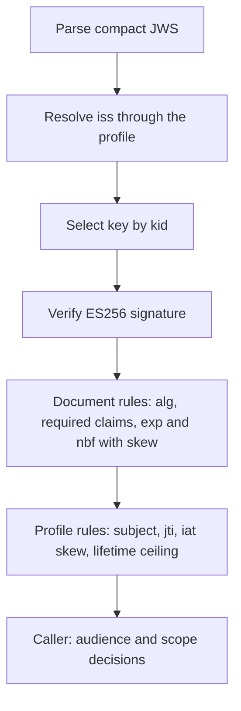

# Assimalign.Cohesion.IdentityModel.Token.JsonWebToken design

Design decisions and ownership boundaries for `Assimalign.Cohesion.IdentityModel.Token.JsonWebToken`.

[Overview](index.md) · [Examples](examples/index.md)

## Design and boundaries

Compact parsing preserves authoritative header and claim data and rejects duplicate-member
ambiguity. Writing supports ES256, while reusable verifiers handle supported RSA and ECDSA
algorithms. Callers own keys and trust policy; structural validation alone is not signature
verification.

## Public keys and the ES256 validator

Seven Cohesion call sites — the resource bootstrap verifiers in the Web, IdentityHub, and Scheduler
hosting modules, the LogSpace sink verifier, the SecretStore and ConfigurationStore trusted-issuer
verifiers, and the gateway control plane — once carried their own copy of the same JWK parsing,
thumbprint, ECDSA import, and claim rules. Those copies now configure three shared types:

- **`JsonWebKey`** — a structural parse of one public JWK (`TryParse` from UTF-8 JSON or a
  `JsonElement`). It captures the string-valued `kty`, `crv`, `x`, `y`, `n`, `e`, `kid`, `alg`, and
  `use` members and never captures private members. `ComputeThumbprint` implements RFC 7638 for EC
  (`crv`, `kty`, `x`, `y`) and RSA (`e`, `kty`, `n`) keys; `CreateECDsa` returns a caller-owned
  public ECDSA key for P-256/384/521. Policy is a separate call with two strengths:
  `TryValidateEcdsaVerificationKey(curve)` is the lenient rule the application-trust-key readers
  apply (`kty=EC`, the named `crv`, a string `kid`, and a usable public point; other members,
  `alg`, `use`, and the `kid`/thumbprint relation are not examined), and `TryValidateEs256SigningKey`
  applies the strict profile Cohesion trusted issuers publish (exactly `kty=EC`, `crv=P-256`,
  `alg=ES256`, `use=sig`, `x`, `y`, `kid`; 32-byte coordinates on the curve; `kid` equal to the
  thumbprint). Keeping parse and policy apart is what lets the lenient application-trust-key
  readers and the strict trusted-issuer stores share one type without either changing which keys
  it accepts.
- **`JsonWebKeySet`** — an issuer's keys; `Find(kid)` selects by exact `kid` and never matches a
  missing `kid`, so every accepted token names its key.
- **`IJsonWebTokenValidator`** from `JsonWebTokenValidator.CreateEs256(profile)` — verifies and
  validates in one call. `JsonWebTokenValidationProfile` supplies the issuer-to-key-set resolver,
  the lifetime ceiling, the clock skew (default five minutes), and the subject rule (an exact
  expected `sub`, a non-empty `sub`, or none when the caller applies a scope-dependent rule).

The diagram shows the order: parse, issuer resolution, `kid` selection, signature, document rules,
and profile rules all yield a single `false`, so a caller cannot probe which rule failed. Every
profile requires `iss`, `sub`, `aud`, `exp`, `nbf`, `iat`, and `jti`, a non-blank `jti`, `iat` no
later than now plus the skew, `exp` after both `iat` and `nbf`, and `exp - iat` within the ceiling.
Audience is deliberately **not** part of the profile: resources distinguish an unauthenticated token
(401) from an authentic token for another audience (403), so they call
`JsonWebTokenValidator.HasAudience` after validation, and LogSpace applies its `scope=telemetry`
rules between the two. The ECDSA key is created per validation and disposed before the call
returns, so `JsonWebKey` and the validator hold no disposable state; an unusable trusted key
rejects the token instead of throwing.

The stateless `Es256JsonWebTokenValidation` helper in this project's `shared/` folder holds these
rules in one source location (#1412). The public validator compiles that helper with its existing
per-call key ownership. Web.Hosting.Resources also compiles it and supplies an
`IJsonWebTokenSignatureVerifier` over a middleware-owned ECDSA handle while an explicit lifetime
owner is present. The helper still resolves the issuer, selects the trusted `kid`, enforces ES256,
and applies the same document and profile rules before accepting a token. Its caller must bind a
borrowed verifier to the selected trusted key and coordinate verification with disposal. The helper
has no mutable static state, no handle ownership, and no public API. Public validators retain their
existing contract and token acceptance relative to 10.0.0-preview.1.

The Cohesion claim names and ceilings (`cohesion_token_use`, `scope=telemetry`, `cohesion-export`,
24 hours, 8 hours) are not here: they belong to the resource credential seam, so they live in
`Assimalign.Cohesion.Hosting.Resources.ResourceCredentialProfile`, which this package does not
reference, and each call site passes them into its profile.

## Dependency boundary

The declared build inputs are `Assimalign.Cohesion.IdentityModel.Token` and this package's
`shared/Es256JsonWebTokenValidation.cs` through `CohesionSharedSource`. The
[overview](index.md#dependencies) distinguishes project references, package references, shared
source, and analyzer inputs.

## Sources

- **Source** — `cohesion/libraries/IdentityModel/Assimalign.Cohesion.IdentityModel.Token.JsonWebToken/src/Assimalign.Cohesion.IdentityModel.Token.JsonWebToken.csproj`.

- **Source** — `cohesion/libraries/Directory.Build.props`.

- **Source** — `cohesion/libraries/IdentityModel/Assimalign.Cohesion.IdentityModel.Token.JsonWebToken/docs/OVERVIEW.md`.

- **Source** — `cohesion/libraries/IdentityModel/Assimalign.Cohesion.IdentityModel.Token.JsonWebToken/docs/DESIGN.md`.

- **Source** — `cohesion/libraries/IdentityModel/README.md`.

- **Source** — `cohesion/libraries/IdentityModel/Assimalign.Cohesion.IdentityModel.Token.JsonWebToken/src`.

- **Source** — `cohesion/libraries/IdentityModel/Assimalign.Cohesion.IdentityModel.Token.JsonWebToken/shared/Es256JsonWebTokenValidation.cs`.
