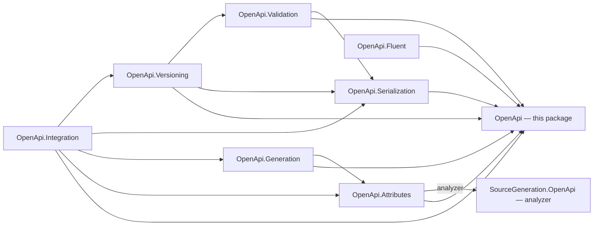

# Assimalign.Cohesion.OpenApi design

Design decisions and ownership boundaries for `Assimalign.Cohesion.OpenApi`.

[Overview](index.md) · [Examples](examples/index.md)

## Design and boundaries

`OpenApiVersionCapabilities` centralizes field availability for the supported 3.0.4, 3.1.2, and
3.2.0 lines. The format-neutral node tree carries extension and example values. Serialization and
service-runtime dependencies stay outside the root model.

## Dependency boundary

The project declares no explicit Cohesion or external package references. Shared repository build
properties still apply.

## Project family and ownership boundaries

Story L01.01.15.01.04 planned the family with a stricter rule than the one it was built to: every
package would depend on the root model and on no sibling. The built family keeps the part that matters.
This package references nothing in the family, every other package references it, and the graph is
acyclic. It does have sibling references, and each one reuses a sibling's behavior instead of
duplicating it:

- **Validation → Serialization:** the official-schema conformance stage checks the serialized document.
- **Generation → Attributes:** generation consumes the attributes' intermediate metadata.
- **Versioning → Serialization, Validation:** a transform deep-copies by a serialization round trip and
  reports version fit by running the validator.
- **Integration → Attributes, Generation, Serialization, Versioning:** the contracts compose all four.

The graph below draws those references; an arrow means "references". The labeled edge is an analyzer
reference: Attributes carries the source generator inside its package, and nothing references the
generator at run time.

| Package | Responsibility | Depends on |
|---|---|---|
| `Assimalign.Cohesion.OpenApi` | Canonical model, version capability matrix, node tree | — |
| `…OpenApi.Serialization` | Model ↔ node-tree mapping; JSON and YAML I/O | model, Content.Yaml |
| `…OpenApi.Validation` | Diagnostics + structural/semantic/version rules; official-schema stage | model, serialization |
| `…OpenApi.Fluent` | Fluent authoring builders | model |
| `…OpenApi.Attributes` | Attribute model, intermediate metadata, and mapper; carries the source generator | model |
| `…SourceGeneration.OpenApi` | AOT-safe attribute discovery → metadata registry (build time, under `analyzers/`) | — |
| `…OpenApi.Generation` | Metadata → version-targeted document | model, attributes |
| `…OpenApi.Versioning` | 3.0 ↔ 3.1 ↔ 3.2 transforms with diagnostics | model, serialization, validation |
| `…OpenApi.Integration` | Web/ApiManager contracts: endpoint source, description provider, import/export | model, attributes, generation, serialization, versioning |

Which of these ship, and how, is in the [area overview](../index.md) (*Packages* and *Dependencies and delivery*).

Boundaries that exist to preserve specific properties: the model stays free of serialization so YAML
and future formats are additive; attribute discovery is isolated so it can be source-generated (no
runtime reflection, NativeAOT-safe); validation is separable so the official-schema conformance stage
can plug in without bloating the model; and the model carries no hosting concern so Web/ApiManager
integration is built through adapters, not by leaking request-pipeline types inward.

## Sources

- **Source** — `cohesion/libraries/OpenApi/Assimalign.Cohesion.OpenApi/src/Assimalign.Cohesion.OpenApi.csproj`.

- **Source** — `cohesion/libraries/Directory.Build.props`.

- **Source** — `cohesion/libraries/OpenApi/Assimalign.Cohesion.OpenApi/docs/OVERVIEW.md`.

- **Source** — `cohesion/libraries/OpenApi/Assimalign.Cohesion.OpenApi/docs/DESIGN.md`.

- **Source** — `cohesion/libraries/OpenApi/README.md`.

- **Source** — `cohesion/libraries/OpenApi/Assimalign.Cohesion.OpenApi/src`.
