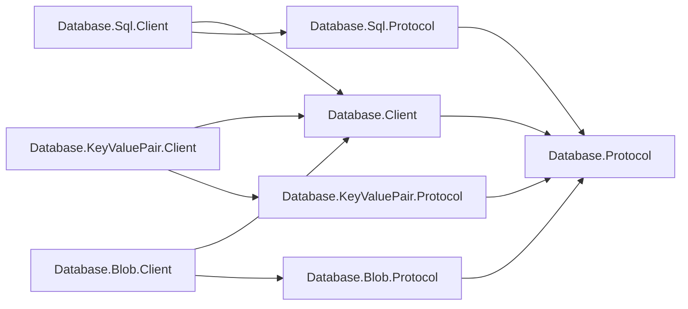
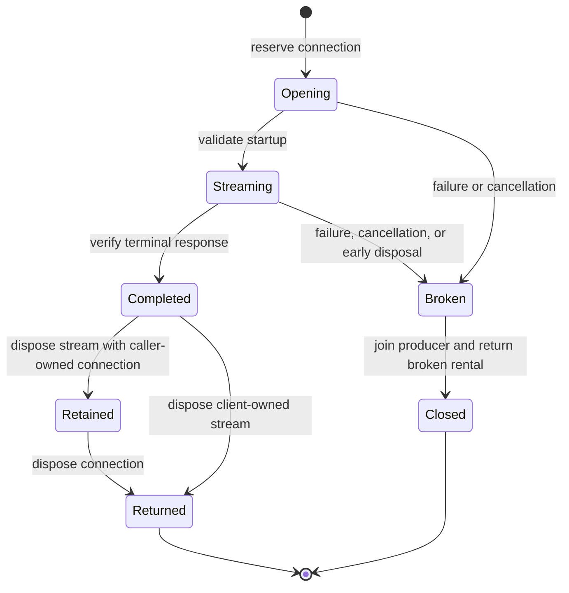

# Assimalign.Cohesion.Database.Client design

This page describes the boundaries and implementation shape of `Assimalign.Cohesion.Database.Client`.

> **Status:** Implemented.

The shared client owns transport dialing, startup/authentication, framing, pooling, and connection
health. Model clients own request encoding, response validation, and result materialization. The
shared client references no model package and imposes no result shape.

## Engine-free client core

Database.Client references shared Database.Protocol, Database.Types and Connections. Typed model
clients consume their model Protocol packages. COHDBCLIENT001 checks evaluated project references,
actual resolved assembly identities and source imports; engine dependencies and build-order-only
engine references fail the build. Repository-local test/example/sample/fixture harnesses are exempt.
The client-only sample checks its pre-trim reference closure and runs in NativeAOT CI.

DatabaseClientException derives directly from System.Exception and owns its Diagnostics snapshot.
Catch it when using the shared client core; catch the model client exception for typed APIs.
See the [migration guide](../../../../database/model-project-migration.md).

## Family boundary

Clients depend on shared mechanism and their own model's wire codecs:

| Package | Responsibility |
| --- | --- |
| `Database.Client` | Dial, handshake, bounded pooling, framed exchange lifetime |
| `Database.Protocol` | Framing, shared messages, immutable family binding |
| `Database.Sql.Client` | SQL parameter encoding, decoding, and materialization |
| `Database.KeyValuePair.Client` | `Key`-value encoding, decoding, and materialization |
| `Database.Blob.Client` | Blob transfer validation, acknowledgements, and typed metadata responses |
| Model Protocol packages | Model identifiers and payload codecs |

`DatabaseClientOptions.Family` is mandatory. The pool captures the exact immutable
`ProtocolMessageFamily` instance before dialing. Every connection uses a `ProtocolChannel` bound to
that family throughout its lifetime. A `DatabaseProtocolExchange<TResult>` supplies its required
family and consumes one exchange through the channel reader and writer. A different family instance
is rejected before execution, including a family that reuses the same identifier bytes.

The materialized operation returns only after consuming the complete response and must not retain or
dispose the borrowed reader/writer. SQL and `Key`-Value materialize; Blob uploads transfer bounded
chunks from caller-owned streams. Downloads use the shared streaming exchange described below. Model
payloads, transfer values, and acknowledgement codecs live in model Protocol packages; typed client
result materialization stays in the client.

## Lifecycle and errors

Creation performs no I/O. Rent opens or reuses an authenticated session. Disposing a healthy rental
returns its internal connector to an idle stack; `MaxPoolSize` bounds rentals and exhausted rents
wait. Each rent creates a new DatabaseConnection lease with final disposed state and independent
exchange admission. Metadata and execution on an ended lease throw ObjectDisposedException;
IsOpen returns false. Repeated disposal or abort awaits that lease's original return task, without
reaching a later renter's connector. Session reuse is observable through the server session or
ConnectionRented.reused, rather than public object identity.

Disposing the client closes idle connectors. Outstanding rentals close when returned, including
returns racing shutdown; a dial that finishes after shutdown closes its connector. Waiting renters
fail with ObjectDisposedException without waiting for outstanding rentals. Closure sends best-effort
Terminate. A lease cancels and joins admitted exchanges before returning its connector; cancellation
callback failures cannot skip the join or release of its pool slot.

SQL, Graph and Documents negotiate server-reported transaction status. Pool return rolls back open or failed transactions before reuse; only an Idle session is pooled. Missing/invalid status, failed reset or a legacy transaction-capable peer causes connector discard.

The pool does not infer connection health from an error code. On failure, the exchange base records
completion through protected MarkResponseComplete after the complete
response leaves the session ready. No evidence means a failed exchange is discarded; successful
return already guarantees a complete response. Framing
violations, transport failure, and an unfinished response invalidate the connection.

The exchange base resets the completion signal before each request. SQL, Key-Value and Graph set
it only after decoding a terminal response. Key-Value and Graph certify ParseFailure and
ExecutionFailure before result frames. SQL also certifies ExecutionFailure after partial result
frames, discards those buffered results and preserves reuse; ParseFailure after result frames
does not certify completion. This knowledge belongs to the statement exchange, not to a
pool-wide list of safe codes. Blob failures do not certify completion: a transfer can leave unread
frames even when its error code is `ExecutionFailure`. Wire codes and messages reach callers
unchanged, independently of the health decision.

Handshake rejections preserve their wire code in `DatabaseClientException`. Queued idle/shutdown
terminal errors are consumed before the next request; the broken connector is discarded.

Only one exchange may use a connection at a time. An overlapping exchange is rejected before it
writes any frames. Disposing a connection cancels and joins its current operation before returning
the rental, so an active exchange cannot enter the idle pool. Disposal and failure release each
rental exactly once.

`DatabaseConnection.AbortAsync` explicitly discards a rental when a model cannot reset its
application-level session state. It marks the connection unusable before cancelling/joining any
active exchange and disposing the rental, so the pool closes its transport instead of reusing the
session. This is non-cancellable and idempotent on the current rental. It makes no claim about
whether the server completed an unacknowledged command; transaction outcome and reconciliation
remain model concerns.

## Queued terminal errors

Under the lease's single-operation admission, the connector checks buffered input or a closed
transport before writing a new model request. It consumes a queued shared terminal Error once,
retains its code in DatabaseClientException and discards the connector. Streaming startup uses
the same gate and preflight. IsOpen remains false for a physically closed transport; logical
admission permits this final Error read. No I/O runs under the lease lock, and buffer inspection
preserves consumed/examined positions for fragmented frames. Unexpected or malformed terminal
frames use ProtocolViolation; clean EOF without an Error remains Internal. Rent-time pings are
not implemented.

During startup, clean EOF reports Internal with the message: "The server closed the connection
during the startup handshake before sending the expected response." Failed handshakes release
the pool slot. TLS terminal delivery remains limited by #1086; see
[the protocol close contract](../assimalign-cohesion-database-protocol/design.md#terminal-delivery-and-frame-writes).

## Streaming exchange and ownership

`DatabaseStreamingExchange` captures the exact Family in its protected constructor. OpenCoreAsync
writes the request and validates startup metadata; CopyToCoreAsync copies content into a
borrowed destination and verifies the terminal response. The shared client owns the asynchronous
producer, bounded handoff, cancellation, read stream, and connection lifetime. The model owns
framing semantics, metadata, counts, and acknowledgements; it never owns the handoff queue or
producer task. Startup failures reach the opening call. After startup, failures reach stream reads.
Streaming frame adapters normalize completed transport pipes that report `InvalidOperationException`
into transport failures. This normalization is confined to streaming frame I/O; materialized SQL and
`Key`-Value exchanges retain their existing transport exception behavior, and caller stream exceptions
are unchanged.

There are two deliberate ownership forms. `DatabaseConnection.ExecuteStreamingAsync` uses a
caller-owned rental and preserves that rental after verified completion and stream disposal,
allowing another operation on the same typed connection. A failed or abandoned transfer invalidates
and returns that rental immediately. `DatabaseClient.ExecuteStreamingAsync` rents on
the caller's behalf; its returned stream owns that rental until disposal or failure. Verified EOF
alone does not return a client-owned stream's healthy rental: the caller must dispose the stream.
These forms serve Blob's existing connection API and model clients that expose a download directly
from their pooled client.

The destination copies content into chunks no larger than 65,536 bytes and writes them through a
single-slot bounded queue. Backpressure stops the producer when the consumer's current chunk and
queued chunk have not advanced. Content memory stays bounded by those chunks, a pending destination
chunk, and model/transport buffers, independent of transfer length. The producer must finish
validating the terminal response before the stream can report EOF. A recorded failure is sticky: it
takes precedence over buffered content and subsequent reads keep reporting it.

The opening token remains active throughout the transfer. Canceling any asynchronous read cancels
the whole producer, including a destination write blocked on a full queue. Early synchronous or
asynchronous stream disposal cancels and joins the producer and closes the unfinished connection;
completed stream disposal preserves connection health. Disposal suppresses recorded transfer errors
because reads carry those errors. Streams are read-only and sequential, reject overlapping reads,
and do not support length or seeking.

The lifecycle below distinguishes verified completion from release of the rental. `For` a caller-owned
connection, healthy stream disposal retains the rental until connection disposal; for a client-owned
stream, it returns the rental to the pool.

The completion signal serves SQL, `Key`-Value, Blob, and future exchanges with their own terminal
semantics. The streaming contract and its two ownership forms serve Blob and test-level model
consumers; future Documents and Graph clients implement only their startup and content protocol. No
Blob-specific type enters the shared contract, and those clients need not copy Blob's former
lifetime machinery.

## Settings and compatibility

Connection strings carry database, principal, endpoint, and pool size. Drivers are typed
`IDuplexConnectionFactory` options, composed statically. Typed endpoints also support in-memory
transports. The endpoint selects the model; startup carries no model discriminator.

SQL and `Key`-Value model payload bytes retain their baseline layout under shared protocol 2.1. Moving APIs is a managed API migration: direct SQL
callers import `Database.Sql.Client` and bind `SqlProtocol.Family`, or use the existing typed
client. `DatabaseClientResult` and `DatabaseClientColumn` now live in the SQL client's namespace.
`New` model clients implement the generic exchange interface using their model's exact family.

No reflection, code generation, driver discovery, model parser, or model result policy is required.
The streaming path adds no dependencies or shipped-library `InternalsVisibleTo` grants and remains
compatible with `net10.0` and NativeAOT. TLS remains a connection-factory concern.

## Declarative command delivery

`DatabaseCommandClient.Create(Uri controlPlaneAddress, string bearerToken, HttpMessageInvoker transport)`
accepts a caller-owned transport, including its TLS trust policy. Disposing the returned client does
not dispose that transport; the caller retains it until requests finish and disposes it afterward.
The two-argument factory still creates a transport owned and disposed by the client. Both overloads
perform the same endpoint and credential validation; a null supplied transport throws
`ArgumentNullException`. The client does not discover application trust.

`IDatabaseCommandClient` is the separate HTTP admin command contract. `DatabaseCommandClient.Create`
accepts the full manifest control-plane URI (including its path) and an opaque bootstrap bearer.
`SendCommandAsync` posts the camel-case id/kind/owner/key/payload envelope to commands; payload is
base64. `DeleteCommandAsync` sends DELETE to the same route and envelope. Both return package-local
`ResourceCommandObservation` with Status and Detail, retaining actionable provider refusal text.
Transport failures propagate; HTTP refusals become Rejected observations. Serialization uses
explicit Utf8JsonWriter/JsonDocument access. The caller disposes the client; redirect following and
cookies are disabled. No runtime Hosting or ApplicationModel dependency was added.

## Duplex transport composition

`ConnectionFactory` accepts `IDuplexConnectionFactory`. The shared client reads and writes
framed bytes through the returned `IDuplexConnection`; the common `IConnection` root carries
identity, features and lifecycle only. TCP, InMemory and TLS-layered duplex factories satisfy
this contract. The pool owns each established connection and disposes it when discarded or
when the pool closes; transport disposal has signaled `ConnectionClosed` before it completes.

### Breaking changes from 10.0.0-preview.1 (#1459)

`DatabaseClientOptions.ConnectionFactory` changes from `IConnectionFactory?` to
`IDuplexConnectionFactory?`. Changing the property's getter and setter signatures breaks
preview.1 binaries and source that supplies a factory typed only as `IConnectionFactory`.
This preview break is accepted under owner decisions 15 and 58. Rebuild consumers and use
`IDuplexConnectionFactory` for factory variables and custom implementations. Custom factories
can derive from `DuplexConnectionFactory`, implement `ConnectCoreAsync` returning
`ValueTask<IDuplexConnection>`, and produce a `DuplexConnection` implementation. Built-in TCP,
InMemory and TLS-layered duplex factories already satisfy the new contract. Database wire
framing, handshake and model messages are unchanged.

## Declared dependencies

| Reference | Kind |
|---|---|
| `Assimalign.Cohesion.Database.Types` | `CohesionProjectReference` |
| `Assimalign.Cohesion.Database.Protocol` | `CohesionProjectReference` |
| `Assimalign.Cohesion.Connections` | `CohesionProjectReference` |

[Assembly overview](index.md) · [Examples](examples/index.md)

## T1 transport contract

Startup advertises the composed family's capabilities. Ready applies a validated version and
intersection once; DatabaseConnection exposes ServerVersion and Capabilities. SQL and GQL adopt
Diagnostics; Documents retains model Failure and Blob/Key-Value agree no diagnostics. 2.0 retains
empty Ready; different majors fail. Shared DatabaseClientException maps negotiated wire entries to
the non-null client exception Diagnostics snapshot. Model payload readers reject malformed UTF-8.

## Transaction status and pool reset

SQL, Graph and Documents negotiate server-reported transaction status. Pool return rolls back open or failed transactions before reuse; only an Idle session is pooled. Missing/invalid status, failed reset or a legacy transaction-capable peer causes connector discard.

The transaction-status capability uses the existing Ready identifier with a one-byte I/T/E
postamble after Execute/ExecutePaths or Documents Command completion, including statement failures. Startup Ready remains the
negotiation payload. The connector detects written Execute (5), ExecutePaths/Documents Execute (64) and Documents Command (69) frames and
automatically drains status, including for application exchanges using the one-argument
`DatabaseProtocolExchange` constructor. Applications consume the model response; they no longer
need to opt into or consume the status postamble. The explicit `transactionStatus` flag can still
require it.

After a completed result or statement error, the status drain uses a five-second internal token.
Caller cancellation after the result does not discard an acknowledged committed result or turn
an acknowledged COMMIT into cancellation. Broken/missing status still discards the connector;
an original statement error survives a failed status read.

SQL/Graph reset uses Execute 5 and ResultComplete 8 with one zero Int64 count. Documents
uses Execute 64 with empty JSON parameters and Complete 66 with two zero Int64 counts. Both
require Ready I. Pool return joins the last lease operation and sends ROLLBACK outside the pool lock. The rollback
reply and Ready drain each have a five-second internal bound, up to ten seconds total. Idle
sessions need no reset exchange. Current SQL, Graph and Documents clients discard sessions
without negotiated transaction-status, so those peers are not pooled. A connection loss does
not prove the outcome of an unacknowledged COMMIT. Other model families do not acquire text
transaction support from this shared reset path.

See [status codecs](../assimalign-cohesion-database-protocol/protocol-transaction-status-message.md).

## Sources

- **Terminal/EOF conformance** — `cohesion/resources/Database/Assimalign.Cohesion.Database.Client/tests/DatabaseClientTerminalErrorTests.cs` and `DatabaseClientHandshakeFailureTests.cs` in the same directory.

- **Primary source** — `cohesion/resources/Database/Assimalign.Cohesion.Database.Client/docs/DESIGN.md`.
- **Source** — `cohesion/resources/Database/Assimalign.Cohesion.Database.Client/src/Assimalign.Cohesion.Database.Client.csproj`.
