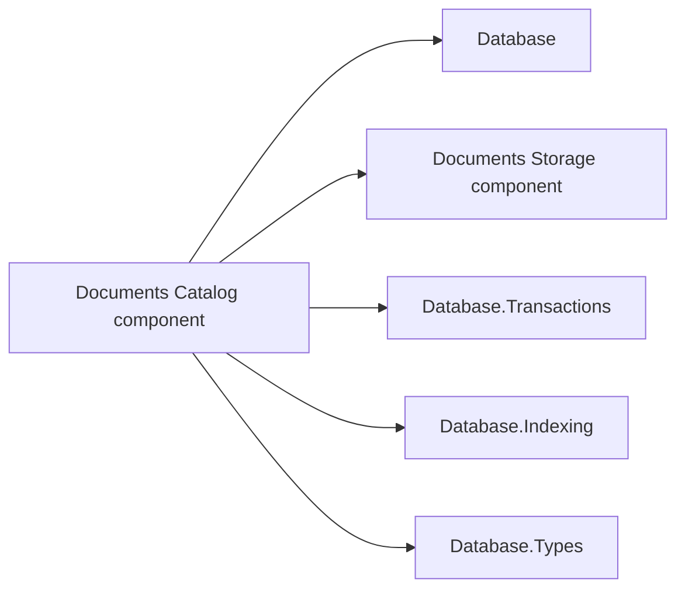

# Documents catalog design

This page describes the catalog component inside `Assimalign.Cohesion.Database.Documents`.

> **Status:** Partial.

Namespace: `Assimalign.Cohesion.Database.Documents.Catalog`. Assembly: `Assimalign.Cohesion.Database.Documents.dll`. NuGet package: `Assimalign.Cohesion.Database.Documents`.

This catalog component ships inside the model package. Keep its namespace
imports and replace the former satellite package reference with `Assimalign.Cohesion.Database.Documents`; recompile consumers.
The model enforces engine → Catalog → Storage → shared kernel through architecture tests.

## Family and responsibilities

Documents.Catalog depends on the `Database` root for ownership vocabulary, `Documents.Storage` for
record/content access, `Database.Transactions` for MVCC and statement brackets, `Database.Indexing` for
B+Trees, and `Database.Types` for scalar key encoding. The engine depends on this component and owns
sessions, OQL planning/execution, lock acquisition, ownership enforcement, and commit/rollback.
There is no Hosting or ApplicationModel dependency and no compiled-schema provisioning.

The dependency diagram shows the same reference direction as the prose.

`DocumentCatalog` is a sealed public type created by Open; it replaces the former interface/factory. The pre-existing engine, collection, session,
storage-kernel, transaction, and index interfaces are unchanged. Public metadata records are
immutable values; catalog record representations and codecs are internal.

## Snapshot directory and ownership

Opening scans only owner-zero metadata pages, building directories keyed by ordinal collection name,
`(collectionId, documentId)`, and `(collectionId, indexName)`. Directories retain physical version
references. Every lookup rereads record stamps and identity: rollback, purge, and slot reuse cannot
silently stale the directory. CRC and I/O failures propagate. Reclaimed slots and reused identities
invalidate cached references. Reads choose the newest visible writer whose deleter is not visible.
Enumeration is ordinal name/identity order, independent of insertion, page allocation, or B+Tree
scan order.

### Bounded version history

References follow publication predecessors, including a ReadCommitted writer that began earlier
than the version it replaces. Appending a publication and replacing an earlier save by the same
writer take expected O(1) directory work. Only that writer's terminal reference is retained;
the committed predecessor remains available for rollback and older readers. References retain
writer sequences, not transaction contexts or snapshots; pending aborted undo stays invisible.

A current lookup does not reread the entire pre-snapshot overwrite history. Tests measure **three
metadata record reads after 256 overwrites**, including a pending newer publication and after
catalog reopen. The count includes rotating cleanup probes. Older snapshots can traverse newer
publications to reach their visible version, and ambiguous recovered histories can require full
selection; this is not a universal three-read bound for every snapshot.

Open reconstructs publication order from predecessor-deleter/successor-writer matches. It retains
snapshot visibility even when all versions have tombstones. Each cached read still checks owner,
allocation, writer stamp and logical identity; CRC, I/O and live decoding failures propagate.

After each full model-worker purge pass, catalog maintenance checks at most **128 references**,
round-robin across directory keys and outside the coordinator apply gate. Repeated passes retire
purged histories for idle names without later name lookups. Snapshot-pinned history remains until
safe to reclaim. Lookups use any remaining current-reader budget for up to two cleanup probes.
Metadata and content pages become reusable after safe purge; steady overwrites with purge and
checkpoint work can reach a storage plateau. See [storage reclamation](storage-design.md#compatibility-and-limits).

If both purge and the following history maintenance fail, the original purge exception escapes
unchanged. The maintenance exception is retained in Data["HistoryMaintenanceFailure"], preserving
busy, cancellation and disposal classifications. A maintenance failure without a purge failure
propagates normally. OutOfMemoryException is excluded from this preservation; a purge that raises
it skips further maintenance. See [purge refusals](design.md#version-purge-refusals).

### Ownership

Collections carry `DatabaseObjectOwner` plus an optional owning schema. `Schema` requires a nonempty
schema name. The engine creates live-session collections as `Adhoc` and rejects `DROP COLLECTION`,
OQL `CREATE INDEX`, and OQL `DROP INDEX` against a schema-owned collection with
`DatabaseObjectLockedException`, naming the collection, schema, and requested operation. Catalog
metadata can be directly marked for enforcement tests; this is not a compiled-schema deployment
facility.

The caller holds appropriate shared-kernel locks and checks latest committed metadata before a
write. In particular, a transaction whose snapshot predates a changed index definition must be
rejected for mutation: maintaining its obsolete index set would miss newly committed indexes. The
engine performs this check. Catalog methods are lower-level composition seams, like Blob's catalog,
and do not acquire model locks themselves.

## Record format, per-kind versions

Every record starts with UInt64 writer at offset 0, UInt64 deleter at 8, byte kind at 16, byte
format version at 17. All integers are little-endian. Strings are Int32 UTF-8 byte length followed
by those bytes; length -1 means null where explicitly allowed. Strings use strict UTF-8. GUIDs are
the 16 bytes produced by `Guid.ToByteArray()` (the .NET mixed-endian layout). These choices are
explicit so a reader in another language can decode the format without .NET serialization.

The fields below appear consecutively beginning at offset 18. No trailing fields are accepted.

| Kind | Owner pages | Payload fields, in order |
| --- | --- | --- |
| 1 collection | 0 | GUID collection identity; string name; byte owner; nullable string owning schema |
| 2 document | 0 | GUID collection identity; string document identity; UInt64 version; UInt64 head; Int64 byte length; UInt32 IEEE CRC-32 |
| 4 index definition (v3) | 0 | GUID collection identity; string index name; Int32 key count (1..32); ordered key descriptors; byte flags (bit 0 UNIQUE, bit 1 INCLUDE MISSING); UInt64 physical generation identity |
| 5 physical registration (v3) | 1 | UInt64 physical generation identity; Int64 root page; string index name; byte unique flag (0 or 1) |

Kinds 1 and 2 remain v1. All indexes, including single-path nonunique ones, use v3. V1/v2 index
records are refused with CD06105 before recovery writes, reporting found/supported versions and requiring
database recreation with this engine. There is no upgrade path or legacy reader.

A key descriptor stores kind (0 scalar, 1 DISTINCT array), then its path. An array descriptor
adds the document source path and a normalized element-relative predicate. Predicate tags encode
absent, comparison, IS NULL, IS MISSING, AND, OR or NOT; constants are null, Boolean, Decimal or
String. Malformed tags, flags, paths or predicate trees fail closed. Shared storage and B-tree
page formats remain unchanged.

Kind 3 content chunks use the format in
[Documents.Storage](storage-design.md) . Collection IDs
cannot be empty, names cannot be blank, document versions start at 1, content heads cannot be zero,
and document lengths must be positive and fit in an Int32. Owner is the underlying
`DatabaseObjectOwner` byte (`Adhoc = 0`, `Schema = 1`). Unknown kinds, versions, invalid
references, duplicate physical generations, and malformed payloads fail closed.

Catalog metadata records fit one slotted-page record. Identity/name/path sizes are consequently
bounded by `SlottedPage.MaxRecordSize`. An encoded index definition above 8,092 bytes reports
CD03026 before document posting extraction or physical tree creation. Other oversized metadata
retains the shared storage limit.
`Document` content has its separate multi-page chunk mechanism.

## `Index` definition and key semantics

`Index` definitions are lower-level catalog mutations, not a second public engine entry point. The
Documents planner turns OQL `CREATE INDEX` and `DROP INDEX` expressions into catalog-operation
plans, and the plan executor invokes this component under the statement's `TransactionContext` after
lock acquisition and ownership enforcement. `IDocumentDatabase` therefore needs no index members,
and the catalog and B+Tree updates retain the same transaction as the DDL statement.

Each index has 1..32 ordered keys and immutable UNIQUE/IncludeMissing flags. Scalar paths use lossless
dotted and bracket-string syntax, including `items[0].price` and `['root.name']`. Wildcards,
arbitrary expression keys and sort directions are excluded. The typed API additionally admits
one [DISTINCT array projection](document-index-key.md) at any key position. The single-path
overload writes v3.

For scalar-only indexes, leading MISSING omits an entry unless IncludeMissing is true. Trailing
MISSING and explicit NULL have distinct tags. Components
collate MISSING < NULL < FALSE < TRUE < numbers < ordinal UTF-16 strings < arrays < objects.
Numbers normalize to Decimal; 1 and 1.00 encode equally. Array/object tags are lossy and the
executor reapplies the full predicate. The full encoded key must fit 1,024 bytes.

For an array key, each document version emits the distinct qualifying scalar projections combined
with its scalar document keys. NULL projections post; MISSING and complex element projections
are omitted. Empty/filtered arrays emit nothing. A missing source gives a MISSING component,
omitted when leading and sparse; a present non-array gives NULL. Search deduplicates document
identities. Keys stores descriptors; Paths is empty and Path is the empty string for an array
index, preventing scalar-only planning from assuming complete document coverage.

Multiple array keys, UNIQUE array indexes and IncludeMissing with a leading array key use
CD03025 (no SQLSTATE). Typed WHEN supports element-relative scalar comparisons, IS NULL,
IS MISSING, AND, OR and NOT; only TRUE qualifies. Unsupported constants (including Single/Double)
and trees beyond 32 levels/128 nodes throw ArgumentException. OQL array-index DDL and access
planning are deferred to batch 6.

UNIQUE checks run immediately under the caller's database writer lock before publication, using
latest committed state plus the caller's earlier writes. Keys containing NULL/MISSING never
conflict. Array/object UNIQUE components use CD02021; duplicate valued scalar tuples use
CD03020 (23505), both carried by
[DocumentConstraintViolationException](document-constraint-violation-exception.md). Failed builds
publish no definition. Physical trees stay nonunique; the catalog performs uniqueness arbitration.

[SearchIndexAsync](document-catalog.md) accepts a leading scalar equality prefix and a range on the
next component, returning snapshot-visible candidates in ordinal document-ID order for residual
filtering. [DocumentIndexMetadata](document-index-metadata.md) copies paths and compares them by value.

`Index` leaf entry references are packed metadata page/slot locations. Leaf entries carry writer and
deleter stamps through the existing index API. `Create` builds the tree immediately while the caller
holds the logical database's exclusive writer lock, preserving each visible source document's writer
stamp. The new index definition is invisible to snapshots predating its creation; those snapshots
use scans.

## Mutation, rollback, and recovery

Saving a document prepares old and new composite keys and checks UNIQUE constraints, then one shared physical statement bracket
tombstones prior metadata, inserts new metadata, tombstones old index entries, inserts new index
entries, and persists changed root registrations. Deletion tombstones metadata and keys in one
bracket. The surrounding logical transaction also owns all chunk writes/tombstones. The catalog
publishes its in-memory reference only after the physical bracket succeeds. The shared version
ledger records record and index mutations, so logical rollback erases the writer's keys and restores
old tombstones. The caller aborts the logical operation after failure.

Physical tree generations use reserved storage sequences and are never reused. `Root` registrations
carry writer/deleter zero because they describe current physical topology, including nodes holding
uncommitted versions. `Root` splits and registration updates share one physical bracket. A failure
reattaches the manager from physically restored registrations. Undo adapters resolve the current
tree instead of holding a stale manager object. Current B+Tree erase/purge removes leaf entries
without merging nodes or collapsing roots, so undo does not change the persisted root.

Dropping an index tombstones its definition and keeps the physical tree for readers with older
snapshots. Recreating the name allocates a new physical generation. Tree reclamation for dropped or
rolled-back definitions is deferred; the shared index manager has no tree-page vacuum yet. This
costs disk space, but never rebuilds a live index or exposes a dropped definition.

Recovery order is physical storage redo, coordinator `AnalyzeAndScrub` over stamped records, catalog
open (including physical registrations), `RecoverIndexesAsync` using the same abandoned writer set,
and finally coordinator `CompleteRecovery`. `Root` registrations survive logical scrub so every tree
can be scrubbed before the journal's proof is checkpointed away. No query-time repair or lazy index
rebuild is used. Tests exercise split roots, committed and abandoned updates, logical rollback,
snapshot-pinned versions, mixed shapes, and a serialized restart image. The restart test uses an
ordinary journal flush before cloning its memory streams; it verifies recovery and index scrub
without claiming physical durable-flush support.

## Compatibility and error model

Adding/removing fields, changing scalar type, or replacing an object with an array is supported
without schema migration. Each change creates a new version and updates affected indexes.
On-disk record-layout changes require a new format version and explicit migration support; unknown
versions are rejected. Former raw, unstamped `DocumentStorage` stub files are unsupported as engine
databases. Catalog format failures raise `DocumentCatalogException`; shared storage corruption
remains a storage exception. Invalid JSON/numeric-domain input is rejected by the validated storage
write helper before publication. Public package APIs require no reflection, dynamic code generation,
or Microsoft.Extensions dependencies.

## Sources

- **Failure preservation** — `cohesion/resources/Database/Assimalign.Cohesion.Database.Documents/tests/Catalog/DocumentCatalogTests.MaintenanceFailures.cs`.
- **Conformance evidence** — `cohesion/resources/Database/Assimalign.Cohesion.Database.Documents/tests/Catalog/DocumentCatalogTests.Publication.cs`.
- **Conformance evidence** — `cohesion/resources/Database/Assimalign.Cohesion.Database.Documents/tests/Catalog/DocumentCatalogTests.History.cs`.
- **Conformance evidence** — `cohesion/resources/Database/Assimalign.Cohesion.Database.Documents/tests/Catalog/DocumentCatalogTests.Overwrites.cs`.

- **Primary source** — `cohesion/resources/Database/Assimalign.Cohesion.Database.Documents/docs/DESIGN.md`.
- **Source** — `cohesion/resources/Database/Assimalign.Cohesion.Database.Documents/src/Assimalign.Cohesion.Database.Documents.csproj`.
