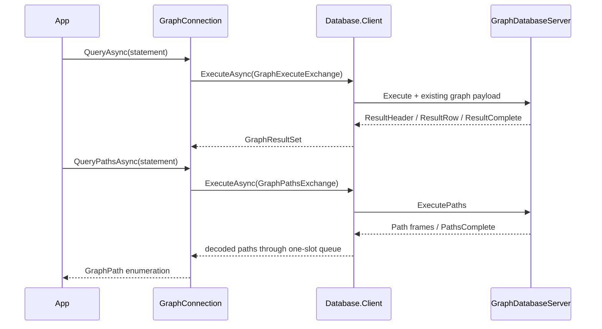

# Assimalign.Cohesion.Database.Graph.Client design

This page describes the boundaries and implementation shape of `Assimalign.Cohesion.Database.Graph.Client`.

> **Status:** Partial.

The client follows Sql.Client's interface, options, internal connection, exchange, and exception
shape. It references Database.Graph.Protocol for its model protocol and transferred graph values, and
Database.Client for the pool, handshake, frame transport, and connection lifetime. It has no
Hosting dependency, reflection, dynamic serialization, or dependency on Microsoft.Extensions.

## Contract dependencies and client errors

This client references Database.Client, Graph.Protocol, shared Protocol and Types, and Connections. Wire contracts and transferred values use the
`Assimalign.Cohesion.Database.Graph.Protocol` namespace. The client references no engine.
COHDBCLIENT001 rejects engine project references, resolved engine assemblies and engine source imports.

`GraphClientException` derives directly from `System.Exception` and declares its own
non-null, read-only Diagnostics. Catch this client exception for remote failures; catching
`DatabaseException` no longer handles them. See the [migration guide](../../../../database/model-project-migration.md#remote-failures).

## Value completion

Graph catalog/storage failures and execution-resource disposal report terminal ExecutionFailure;
the authenticated session remains ready. CG09019 identifies disposal, CG06006 a malformed
catalog record or ordinary index/storage failure, and CG04007 a catalog snapshot conflict or
aborted explicit transaction. A disposed protocol transport instead faults/closes the session
without a second error write. Successful autocommit retains success after ordinary cleanup
failure, recorded by Graph Warning 13, StatementCleanupFailed; OutOfMemoryException propagates.

GraphExecuteExchange implements IDatabaseProtocolExchange and explicitly reports
IsResponseComplete. A successful ResultComplete certifies completion. A ParseFailure or
ExecutionFailure received before any result header is the server's complete rejected-statement
response, so the pool may reuse that session. A malformed response, truncated transport,
cancellation, or error after result output cannot certify completion.

Rows require exactly the advertised number of column values. Negotiated marked columns use
GraphValueCodec for composite/unsigned values; unmarked columns retain scalar tuple components. Columns preserve wire names
and shared DatabaseType identities. The engine rejects duplicate final RETURN names with CG01015
before reads, mutation or output, including implicit/explicit collisions and EXPLAIN; no SQLSTATE
is assigned. First-column lookup remains for manually constructed duplicate metadata.
Scalar statements fully materialize before returning.
Direct COUNT projections report Int64 metadata; other MATCH projection metadata remains
DatabaseType.Null (unknown), because graph
properties may have heterogeneous types. The tuple codec preserves each actual value's runtime
type. SHOW metadata retains its precisely declared catalog types.

GraphClientException preserves the stable ProtocolErrorCode and inner failure. The typed
connection does not translate error codes into connection health decisions: completion belongs
to its exchange and pooling belongs to Database.Client.

## Composite negotiation and limits

[GraphProtocol.CompositeValues](../assimalign-cohesion-database-graph-protocol/graph-protocol.md) registers
graph.composite-values under protocol 2.1 independently of diagnostics. With agreement, all request
parameter components use the public [GraphValueCodec](../assimalign-cohesion-database-graph-protocol/graph-value-codec.md).
Lists decode to object?[], maps to read-only ordinal dictionaries, preserving nested scalar types.
Result header bit 7 marks possible composite columns and is removed from public GraphColumn.Type.
Unmarked scalar cells keep baseline bytes. Marked cells accept scalar tag 0 or component tag 1
with a little-endian byte length. Unsigned values use component tags to retain runtime types.

Limits are depth 64 (root zero), 65,536 total values and 16 MiB encoded bytes per value; rows fit
16 MiB. Malformed components, flags, UTF-8, duplicate keys or exceeded wire bounds are protocol
violations. Without agreement, composite parameters fail locally with GraphClientException /
ExecutionFailure before a frame is sent and preserve reuse; invalid/oversized encoding throws
DatabaseTypeException. Possible composite results use CG07016 before reads/writer locks/writes,
including skipped arms and empty matches. Parameter validation uses CG03003; constructed values
and row bounds fail CG02013 inside the statement transaction before commit. Statement writes
roll back on a refused result. Stored property maps remain scalar-only. Path payloads are unchanged.

## Path lifetime

Rows and paths returned without ORDER BY have no guaranteed enumeration order. The node and
relationship order within each individual path remains its traversal order. Use ORDER BY when
the row or path sequence matters, including before paging.

GraphPathsExchange derives from DatabaseProtocolExchange<bool>. One producer owns frame I/O
under shared exchange admission. It decodes each Path once inside a borrowed-read callback when
supported, then returns the pooled payload before handing the owned GraphPath to a one-slot
bounded channel. Readers without borrowed-payload support use owned frames. There is no private
byte-stream handoff or second decode. Wire payloads and path order are unchanged.

The producer waits for queue space before reading the next frame, so a terminal error cannot
overtake a queued path. EOF joins the worker after PathsComplete's count is verified and
exchange admission is released. A ParseFailure or ExecutionFailure before any path output
certifies a complete rejected statement and preserves the healthy rental and diagnostics.
Later errors, malformed frames, count mismatches, truncation and cancellation discard it.
An unfinished enumeration cancels and joins the producer before clearing pending values and
disposing cancellation state. Cleanup preserves the original failure; a secondary rental-return
failure emits PathReleaseFailed with its exception type only.

No lease or pool lock is held during queue waits, cancellation callbacks or transport I/O.
The client retains one queued path plus the consumer's current path. Decoded paths own their
values and survive later reads, pooled-buffer reuse and disposal. The engine still materializes
its result, so server memory depends on matched paths. Each path retains the 16 MiB payload
bound; there is no aggregate wire cap or entity deduplication.

### Path performance and diagnostics

The twenty-path TCP allocation regression checks the retained result digest and exactly one
decode per path against a pre-change allocation budget. It measures both ends of the fixture;
it is not a throughput or latency guarantee. Server execution/encoding/send counters and
[protocol transport counters](../assimalign-cohesion-database-protocol/design.md#protocol-eventsource)
separate that work from client decoding and queue backpressure.

Provider `Assimalign.Cohesion.Database.Graph.Client` adds these events:

| Id | Event | Level / keyword | Payload |
| --- | --- | --- | --- |
| 4 | PathReleaseFailed | Error | exceptionType |
| 5 | PathDecodeCompleted | Verbose / Queries | durationMilliseconds |

Its cumulative polling counters are maintained even before a listener attaches:

| Counter | Meaning |
| --- | --- |
| path-decode-calls | Attempted Path decodes, including failed attempts |
| path-decode-milliseconds | Total elapsed time in those decode attempts |
| path-backpressure-waits | Queue-space waits that did not complete synchronously |

Event 5 closes each attempted decode. No event payload includes statement text, parameters or
graph values. See [server phase counters](../assimalign-cohesion-database-graph/design.md#path-performance-counters).

## Parameters and completion diagnostics

Query/Execute/QueryPaths accept scalar, list and map parameters under negotiated graph.composite-values. One leading sigil is stripped and
bare names compare ordinally; runtime types survive the codec. Planner failures preserve
CG05001/CG03003/CG01014. [GraphConnection](graph-connection.md) documents the changed signatures.

QueryPathsAsync returns [GraphPathResult](graph-path-result.md), a single-use stream. Read its
ProtocolDiagnostic list after EOF; scalar GraphResultSet exposes its list at return. Negotiated
2.1 sends Warning/Error entries before completion or Error. Bounds are 4,096 entries and 1 MiB;
CK07001 reports a dropped suffix while preserving the original outcome and session. Information
is omitted; 2.0 retains baseline result/Error bytes. Malformed diagnostic ordering is fatal.

## Supported surface and limits

RETURN supports standalone expressions, computed/aliased columns, ALL/DISTINCT and named-binding
star. DISTINCT compares exact represented numeric values across runtime types, ordinal strings,
NULL groups and entity/path identities, retaining the first representative's runtime types.
Numeric comparisons and IN agree: Decimal 0.1m differs from Double 0.1d, while Int64 1 equals
Double 1.0. Arithmetic keeps its separate promotion. DISTINCT runs after mutations and never
reduces writes per binding.

ExecutePaths accepts exactly one bound path, node, or relationship projection from a read-only
MATCH, including DISTINCT or star over one named binding. Computed, multiple and multi-binding
star projections fail CG05001 before duplicate-name validation. A node becomes a singleton path; a relationship includes its stored-direction endpoints;
a named path retains traversal order. Scalar or mixed projections and mutations are rejected,
so no path is reconstructed from row results. Execute serves scalar/negotiated-composite rows and
mutations. Its static result-kind gate rejects entity projections with CG05001 and directs callers
to ExecutePaths before data access, writer locks or mutation, even on empty matches.
EXPLAIN descriptions remain scalar for entity RETURN.

Graph transaction control uses Execute text START TRANSACTION, COMMIT and ROLLBACK.
BEGIN [TRANSACTION] is a Snapshot alias of START TRANSACTION; the reserved Transaction message remains unsupported; there are no new connection transaction members. Mutations retain
the engine's existing execution and validation semantics. Database binding remains fixed at
handshake and catalog SHOW keeps its existing read-only and scoping diagnostics.

## Duplex transport composition

`ConnectionFactory` accepts `IDuplexConnectionFactory`. The shared client reads and writes
framed bytes through the returned `IDuplexConnection`; the common `IConnection` root carries
identity, features and lifecycle only. TCP, InMemory and TLS-layered duplex factories satisfy
this contract. The pool owns each established connection and disposes it when discarded or
when the pool closes; transport disposal has signaled `ConnectionClosed` before it completes.

### Breaking changes from 10.0.0-preview.1 (#1459)

`GraphClientOptions.ConnectionFactory` changes from `IConnectionFactory?` to
`IDuplexConnectionFactory?`. Changing the property's getter and setter signatures breaks
preview.1 binaries and source that supplies a factory typed only as `IConnectionFactory`.
This preview break is accepted under owner decisions 15 and 58. Rebuild consumers and use
`IDuplexConnectionFactory` for factory variables and custom implementations. Custom factories
can derive from `DuplexConnectionFactory`, implement `ConnectCoreAsync` returning
`ValueTask<IDuplexConnection>`, and produce a `DuplexConnection` implementation. Built-in TCP,
InMemory and TLS-layered duplex factories already satisfy the new contract. Database wire
framing, handshake and model messages are unchanged.

## Declared dependencies

| Reference | Kind |
|---|---|
| `Assimalign.Cohesion.Database.Client` | `CohesionSharedSource` |
| `Assimalign.Cohesion.Database.Client` | `CohesionProjectReference` |
| `Assimalign.Cohesion.Database.Graph.Protocol` | `CohesionProjectReference` |
| `Assimalign.Cohesion.Database.Types` | `CohesionProjectReference` |
| `Assimalign.Cohesion.Database.Protocol` | `CohesionProjectReference` |
| `Assimalign.Cohesion.Connections` | `CohesionProjectReference` |

[Assembly overview](index.md) · [Examples](examples/index.md)

[GQL aggregates](../../../../database/graph/language/functions/aggregate-functions.md) return Int64 counts,
promoted numeric results and negotiated lists through QueryAsync. Decimal parameters/results keep
scale in GraphValueCodec tag 7. Overflow uses CG02013 before ResultHeader and preserves a reusable
authenticated session. Final aggregate QueryPathsAsync projections use CG05001; intermediate
WITH collect followed by UNWIND may produce a single mandatory entity/path final column.

[Linear composition](../../../../database/graph/language/clauses/next.md) shares embedded stage
semantics over InMemory/TCP without new frames. WITH WHERE filters after paging; carried COUNT
columns remain Int64. Scalar final columns need no composite capability, possible list/map results
require graph.composite-values, and entities use QueryPathsAsync. Final node/relationship lists
remain CG05001 (#1662), even with that capability. A decoded composition refusal preserves
the session. QueryPathsAsync accepts read-only composition only and refuses any write stage.

## Quantified paths

QueryPathsAsync streams complete quantified trails through existing Path payloads, including
zero-length matches. QueryAsync can project scalar values after group expansion. Possible
composites without negotiation use CG07016; negotiated possibly nonempty entity lists use
CG05001. A provably empty Max=0 group can project []. Malformed bounds retain parser diagnostics
and a reusable session. No capability or wire tag is added.

## Scalar functions and clock results

QueryAsync executes [core functions/CAST](../../../../database/graph/language/functions/scalar-functions.md)
with the same signatures and NULL rules as embedded calls. DateOnly and DateTimeOffset results use
existing value tags; labels/keys/properties use negotiated composite values. Dynamic failures use
CG02013 before ResultHeader and preserve the pooled session. Unknown names retain CG00010 and
parsed arity CG00002. Graph wire explicit transactions share one transaction-start instant; autocommit captures one per statement.
Computed entity results retain static Execute admission; scalar reads through entities are legal.

## Update counts

SET/REMOVE use ordinary Execute/Query exchanges. GraphResultSet.AffectedCount retains mutation
counts even with RETURN; read-only rows use -1. Pure no-ops count zero. ExecuteAsync returns the
count while QueryAsync returns rows and count. Type/label refusals use ExecutionFailure and leave
the server session ready; framing and protocol negotiation are unchanged.

## Rental isolation

GraphConnection wraps a new shared lease for each rental; the pool retains only its internal connector.
Database is captured before return, allowing operation diagnostics to finish after the core lease
is disposed. Ended leases permanently reject execution and report IsOpen false; cleanup cannot
reach another renter. See [DatabaseConnection](../assimalign-cohesion-database-client/database-connection.md)
for disposal, shutdown and transaction-status reset.

## Queued terminal errors

Before the next admitted operation writes a request, the shared connector checks buffered input or
a closed transport and consumes a queued terminal Error once. Its original code reaches
GraphClientException and the connector is discarded. This also applies to streaming startup;
IsOpen continues to describe physical transport health. Unexpected/malformed terminal frames use
ProtocolViolation; clean EOF without an Error remains Internal. Rent-time pings are not implemented.
A clean handshake EOF has its own message naming the startup handshake. See
[shared admission](../assimalign-cohesion-database-client/database-connection.md#queued-terminal-errors)
and [terminal delivery/TLS limits](../assimalign-cohesion-database-protocol/design.md#terminal-delivery-and-frame-writes).

## Explicit transaction text

BEGIN [TRANSACTION], START TRANSACTION, COMMIT and ROLLBACK are standalone text statements over Execute (GraphConnection.ExecuteAsync). START and BEGIN use Snapshot. Embedded callers also retain typed Snapshot/ReadCommitted APIs. Savepoints, isolation/options clauses, multi-statement text, composed controls and EXPLAIN of controls are unsupported. ExecutePaths rejects controls with CG05001 before taking effect.

A statement failure aborts the explicit transaction; subsequent work is refused with CG04007 until rollback. COMMIT of a failed transaction rolls it back and reports failure. Duplicate START uses CG04022 and aborts the existing transaction; COMMIT/ROLLBACK without an open transaction uses CG04023. Disconnect and session teardown roll back. Network loss after COMMIT still requires outcome reconciliation.

Graph negotiates transaction-status. After Execute/ExecutePaths completion or a statement error,
the server sends exactly two Ready bytes: I (Idle), T (Active) or E (Failed), followed by zero for
retained state. Startup Ready is unchanged. The client drains it before returning the exchange.
Pool return rolls back active/failed sessions outside the pool lock with bounded cleanup and reuses
only Idle sessions with zero retained state. Graph declares no family reset statement. Missing/invalid
status, failed reset and legacy transaction-capable peers are discarded. No new frame identifier or
protocol version is introduced.

See [transaction-status API](../assimalign-cohesion-database-protocol/protocol-transaction-status-message.md) and [pool reset](../assimalign-cohesion-database-client/design.md#transaction-status-and-pool-reset). GraphTransactionTextWireTests and GraphTransactionFailureWireTests cover InMemory and TCP behavior.

Once an open wire transaction acquires the database writer lock, it holds it even while idle,
until COMMIT, ROLLBACK, disconnect, pool return or server `IdleTimeout` (30 minutes by default).
New clients do not pool sessions against pre-#1540 servers without negotiated transaction-status.
The shared connector automatically consumes Ready status after Execute/ExecutePaths, including
application exchanges; cancellation after a completed result preserves an acknowledged committed
result. Rollback reply and status drain each have a five-second internal bound, up to ten seconds
total on pool return.

## MERGE

[GraphConnection](graph-connection.md) sends executable whole-pattern MERGE through ordinary
QueryAsync/ExecuteAsync, with scalar result rows and the affected-entity count. QueryPathsAsync
refuses mutation with CG05001. InMemory and TCP preserve CG03004 (invalid equality), CG03005
(NULL/absent/incompatible bound node), CG03006 (decorated repeated/bound node), CG03007
(already-declared relationship), CG04024 (retryable Snapshot decision conflict), CG05023 (invalid
pattern-lock identity) and CK04002 (ended statement/session while the database is live).
None has an assigned SQLSTATE. Bare list/map property literals retain parser CK00001. Decoded
refusals preserve the session; a faulted explicit transaction requires ROLLBACK. See
[MERGE diagnostics](../../../../database/graph/language/statements/merge.md#diagnostics).

## Sources

- **MERGE over both transports** — `cohesion/resources/Database/Assimalign.Cohesion.Database.Graph.Client/tests/GraphMergeWireTests.cs`.
- **Path ownership, order and allocation evidence** — `cohesion/resources/Database/Assimalign.Cohesion.Database.Graph.Client/tests/GraphPathAllocationTests.cs` and `GraphClientFailureTests.cs` in the same directory.
- **Path events and counters** — `cohesion/resources/Database/Assimalign.Cohesion.Database.Graph.Client/src/Internal/EventSource/GraphClientEventSource.cs`.
- **Current project boundaries** — `cohesion/resources/Database/README.md`.
- **Build guard** — `cohesion/resources/Database/Directory.Build.targets`.

- **Primary source** — `cohesion/resources/Database/Assimalign.Cohesion.Database.Graph.Client/docs/DESIGN.md`.
- **Source** — `cohesion/resources/Database/Assimalign.Cohesion.Database.Graph.Client/src/Assimalign.Cohesion.Database.Graph.Client.csproj`.
