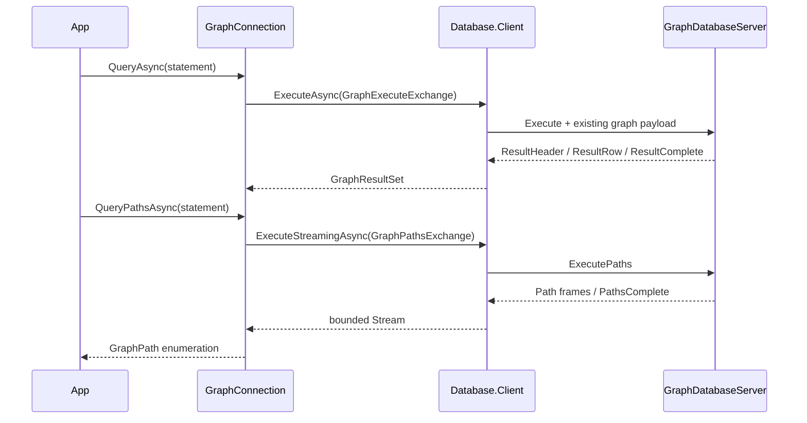

# Assimalign.Cohesion.Database.Graph.Client design

This page describes the boundaries and implementation shape of `Assimalign.Cohesion.Database.Graph.Client`.

> **Status:** Partial.

The client follows Sql.Client's interface, options, internal connection, exchange, and exception
shape. It references Database.Graph for its existing model protocol and graph values, and
Database.Client for the pool, handshake, frame transport, and connection lifetime. It has no
Hosting dependency, reflection, dynamic serialization, or dependency on Microsoft.Extensions.

## Scalar completion

GraphExecuteExchange implements IDatabaseProtocolExchange and explicitly reports
IsResponseComplete. A successful ResultComplete certifies completion. A ParseFailure or
ExecutionFailure received before any result header is the server's complete rejected-statement
response, so the pool may reuse that session. A malformed response, truncated transport,
cancellation, or error after result output cannot certify completion.

Rows require exactly the advertised number of scalar components. Columns preserve wire names
and shared DatabaseType identities. The engine rejects duplicate final RETURN names with COHDBG015
before reads, mutation or output, including implicit/explicit collisions and EXPLAIN; no SQLSTATE
is assigned. First-column lookup remains for manually constructed duplicate metadata.
Scalar statements fully materialize before returning.
MATCH projection metadata remains the engine's DatabaseType.Null (unknown), because graph
properties may have heterogeneous types. The tuple codec preserves each actual value's runtime
type. SHOW metadata retains its precisely declared catalog types.

GraphClientException preserves the stable ProtocolErrorCode and inner failure. The typed
connection does not translate error codes into connection health decisions: completion belongs
to its exchange and pooling belongs to Database.Client.

## Path lifetime

GraphPathsExchange implements IDatabaseStreamingExchange. OpenAsync sends ExecutePaths and
validates the initial Path or PathsComplete frame. CopyToAsync validates each existing path
payload and verifies the final path count. Its private stream handoff prefixes each payload
with its length to preserve boundaries through bounded byte buffering; this is entirely within
the client and does not alter the graph wire protocol. GraphConnection decodes those same
payloads into GraphPath values.

The shared ExecuteStreamingAsync owns frame I/O, applies backpressure, and keeps the connection
busy through completion. Consuming EOF verifies terminal completion before another operation.
Disposing an unfinished enumeration cancels the worker and discards the rental. A terminal refusal before any path output is consumed as a complete rejection and preserves
the session. The model wrapper throws GraphClientException after the shared worker reaches EOF.
Transport errors, malformed output and unfinished cancellation/disposal discard the connection.

The client holds a bounded number of path payloads for materialization plus the shared bounded
byte buffer. The engine currently materializes its path result, so end-to-end server memory still
depends on the number of matched paths. A single path must fit the existing maximum frame size.

## Parameters and completion diagnostics

Query/Execute/QueryPaths all accept scalar parameter maps. One leading sigil is stripped and
bare names compare ordinally; runtime types survive the codec. Planner failures preserve
COHDBG001/003/014. [GraphConnection](graph-connection.md) documents the changed signatures.

QueryPathsAsync returns [GraphPathResult](graph-path-result.md), a single-use stream. Read its
ProtocolDiagnostic list after EOF; scalar GraphResultSet exposes its list at return. Negotiated
2.1 sends Warning/Error entries before completion or Error. Bounds are 4,096 entries and 1 MiB;
COHDBP001 reports a dropped suffix while preserving the original outcome and session. Information
is omitted; 2.0 retains baseline result/Error bytes. Malformed diagnostic ordering is fatal.

## Supported surface and limits

RETURN supports standalone expressions, computed/aliased columns, ALL/DISTINCT and named-binding
star. DISTINCT compares exact represented numeric values across runtime types, ordinal strings,
NULL groups and entity/path identities, retaining the first representative's runtime types.
Numeric comparisons and IN agree: Decimal 0.1m differs from Double 0.1d, while Int64 1 equals
Double 1.0. Arithmetic keeps its separate promotion. DISTINCT runs after mutations and never
reduces writes per binding.

ExecutePaths accepts exactly one bound path, node, or relationship projection from a read-only
MATCH, including DISTINCT or star over one named binding. Computed, multiple and multi-binding
star projections fail COHDBG001 before duplicate-name validation. A node becomes a singleton path; a relationship includes its stored-direction endpoints;
a named path retains traversal order. Scalar or mixed projections and mutations are rejected,
so no path is reconstructed from scalar results. Execute serves scalar projection rows and
mutations. Its static scalar-kind gate rejects entity projections with COHDBG001 and directs callers
to ExecutePaths before data access, writer locks or mutation, even on empty matches.
EXPLAIN descriptions remain scalar for entity RETURN.

Graph transactions remain a deliberate limit: there are no connection transaction members;
BEGIN, COMMIT, ROLLBACK, and the reserved Transaction message are unsupported. Mutations retain
the engine's existing execution and validation semantics. Database binding remains fixed at
handshake and catalog SHOW keeps its existing read-only and scoping diagnostics.

## Duplex transport composition

`ConnectionFactory` accepts `IDuplexConnectionFactory`. The shared client reads and writes
framed bytes through the returned `IDuplexConnection`; the common `IConnection` root carries
identity, features and lifecycle only. TCP, InMemory and TLS-layered duplex factories satisfy
this contract. The pool owns each established connection and disposes it when discarded or
when the pool closes; transport disposal has signaled `ConnectionClosed` before it completes.

### Breaking changes from 10.0.0-preview.1 (#1459)

`GraphClientOptions.ConnectionFactory` changes from `IConnectionFactory?` to
`IDuplexConnectionFactory?`. Changing the property's getter and setter signatures breaks
preview.1 binaries and source that supplies a factory typed only as `IConnectionFactory`.
This preview break is accepted under owner decisions 15 and 58. Rebuild consumers and use
`IDuplexConnectionFactory` for factory variables and custom implementations. Custom factories
can derive from `DuplexConnectionFactory`, implement `ConnectCoreAsync` returning
`ValueTask<IDuplexConnection>`, and produce a `DuplexConnection` implementation. Built-in TCP,
InMemory and TLS-layered duplex factories already satisfy the new contract. Database wire
framing, handshake and model messages are unchanged.

## Declared dependencies

| Reference | Kind |
|---|---|
| `Assimalign.Cohesion.Database` | `CohesionProjectReference` |
| `Assimalign.Cohesion.Database.Client` | `CohesionProjectReference` |
| `Assimalign.Cohesion.Database.Graph` | `CohesionProjectReference` |
| `Assimalign.Cohesion.Database.Types` | `CohesionProjectReference` |
| `Assimalign.Cohesion.Database.Protocol` | `CohesionProjectReference` |
| `Assimalign.Cohesion.Connections` | `CohesionProjectReference` |

[Assembly overview](index.md) · [Examples](examples/index.md)

## Sources

- **Primary source** — `cohesion/resources/Database/Assimalign.Cohesion.Database.Graph.Client/docs/DESIGN.md`.
- **Source** — `cohesion/resources/Database/Assimalign.Cohesion.Database.Graph.Client/src/Assimalign.Cohesion.Database.Graph.Client.csproj`.
