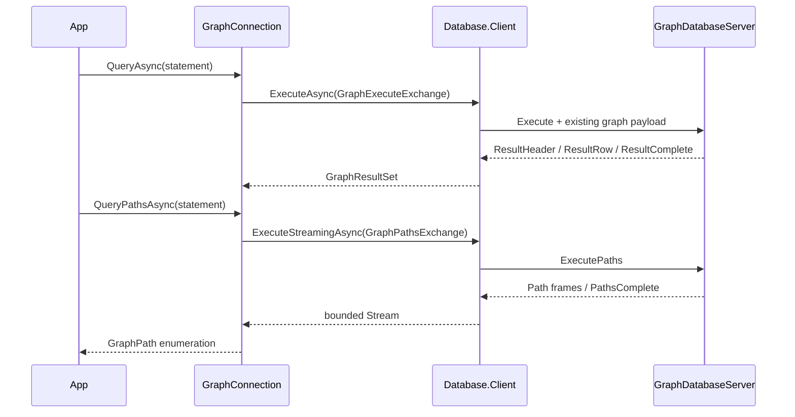

# Assimalign.Cohesion.Database.Graph.Client design

This page describes the boundaries and implementation shape of `Assimalign.Cohesion.Database.Graph.Client`.

> **Status:** Partial.

The client follows Sql.Client's interface, options, internal connection, exchange, and exception
shape. It references Database.Graph for its existing model protocol and graph values, and
Database.Client for the pool, handshake, frame transport, and connection lifetime. It has no
Hosting dependency, reflection, dynamic serialization, or dependency on Microsoft.Extensions.

## Value completion

GraphExecuteExchange implements IDatabaseProtocolExchange and explicitly reports
IsResponseComplete. A successful ResultComplete certifies completion. A ParseFailure or
ExecutionFailure received before any result header is the server's complete rejected-statement
response, so the pool may reuse that session. A malformed response, truncated transport,
cancellation, or error after result output cannot certify completion.

Rows require exactly the advertised number of column values. Negotiated marked columns use
GraphValueCodec for composite/unsigned values; unmarked columns retain scalar tuple components. Columns preserve wire names
and shared DatabaseType identities. The engine rejects duplicate final RETURN names with COHDBG015
before reads, mutation or output, including implicit/explicit collisions and EXPLAIN; no SQLSTATE
is assigned. First-column lookup remains for manually constructed duplicate metadata.
Scalar statements fully materialize before returning.
Direct COUNT projections report Int64 metadata; other MATCH projection metadata remains
DatabaseType.Null (unknown), because graph
properties may have heterogeneous types. The tuple codec preserves each actual value's runtime
type. SHOW metadata retains its precisely declared catalog types.

GraphClientException preserves the stable ProtocolErrorCode and inner failure. The typed
connection does not translate error codes into connection health decisions: completion belongs
to its exchange and pooling belongs to Database.Client.

## Composite negotiation and limits

[GraphProtocol.CompositeValues](../assimalign-cohesion-database-graph/graph-protocol.md) registers
graph.composite-values under protocol 2.1 independently of diagnostics. With agreement, all request
parameter components use the public [GraphValueCodec](../assimalign-cohesion-database-graph/graph-value-codec.md).
Lists decode to object?[], maps to read-only ordinal dictionaries, preserving nested scalar types.
Result header bit 7 marks possible composite columns and is removed from public GraphColumn.Type.
Unmarked scalar cells keep baseline bytes. Marked cells accept scalar tag 0 or component tag 1
with a little-endian byte length. Unsigned values use component tags to retain runtime types.

Limits are depth 64 (root zero), 65,536 total values and 16 MiB encoded bytes per value; rows fit
16 MiB. Malformed components, flags, UTF-8, duplicate keys or exceeded wire bounds are protocol
violations. Without agreement, composite parameters fail locally with GraphClientException /
ExecutionFailure before a frame is sent and preserve reuse; invalid/oversized encoding throws
DatabaseTypeException. Possible composite results use COHDBG016 before reads/writer locks/writes,
including skipped arms and empty matches. Parameter validation uses COHDBG003; constructed values
and row bounds fail COHDBG013 inside the statement transaction before commit. Statement writes
roll back on a refused result. Stored property maps remain scalar-only. Path payloads are unchanged.

## Path lifetime

GraphPathsExchange implements IDatabaseStreamingExchange. OpenAsync sends ExecutePaths and
validates the initial Path or PathsComplete frame. CopyToAsync validates each existing path
payload and verifies the final path count. Its private stream handoff prefixes each payload
with its length to preserve boundaries through bounded byte buffering; this is entirely within
the client and does not alter the graph wire protocol. GraphConnection decodes those same
payloads into GraphPath values.

The shared ExecuteStreamingAsync owns frame I/O, applies backpressure, and keeps the connection
busy through completion. Consuming EOF verifies terminal completion before another operation.
Disposing an unfinished enumeration cancels the worker and discards the rental. A terminal refusal before any path output is consumed as a complete rejection and preserves
the session. The model wrapper throws GraphClientException after the shared worker reaches EOF.
Transport errors, malformed output and unfinished cancellation/disposal discard the connection.

The client holds a bounded number of path payloads for materialization plus the shared bounded
byte buffer. The engine currently materializes its path result, so end-to-end server memory still
depends on the number of matched paths. A single path must fit the existing maximum frame size.

## Parameters and completion diagnostics

Query/Execute/QueryPaths accept scalar, list and map parameters under negotiated graph.composite-values. One leading sigil is stripped and
bare names compare ordinally; runtime types survive the codec. Planner failures preserve
COHDBG001/003/014. [GraphConnection](graph-connection.md) documents the changed signatures.

QueryPathsAsync returns [GraphPathResult](graph-path-result.md), a single-use stream. Read its
ProtocolDiagnostic list after EOF; scalar GraphResultSet exposes its list at return. Negotiated
2.1 sends Warning/Error entries before completion or Error. Bounds are 4,096 entries and 1 MiB;
COHDBP001 reports a dropped suffix while preserving the original outcome and session. Information
is omitted; 2.0 retains baseline result/Error bytes. Malformed diagnostic ordering is fatal.

## Supported surface and limits

RETURN supports standalone expressions, computed/aliased columns, ALL/DISTINCT and named-binding
star. DISTINCT compares exact represented numeric values across runtime types, ordinal strings,
NULL groups and entity/path identities, retaining the first representative's runtime types.
Numeric comparisons and IN agree: Decimal 0.1m differs from Double 0.1d, while Int64 1 equals
Double 1.0. Arithmetic keeps its separate promotion. DISTINCT runs after mutations and never
reduces writes per binding.

ExecutePaths accepts exactly one bound path, node, or relationship projection from a read-only
MATCH, including DISTINCT or star over one named binding. Computed, multiple and multi-binding
star projections fail COHDBG001 before duplicate-name validation. A node becomes a singleton path; a relationship includes its stored-direction endpoints;
a named path retains traversal order. Scalar or mixed projections and mutations are rejected,
so no path is reconstructed from row results. Execute serves scalar/negotiated-composite rows and
mutations. Its static result-kind gate rejects entity projections with COHDBG001 and directs callers
to ExecutePaths before data access, writer locks or mutation, even on empty matches.
EXPLAIN descriptions remain scalar for entity RETURN.

Graph transactions remain a deliberate limit: there are no connection transaction members;
BEGIN, COMMIT, ROLLBACK, and the reserved Transaction message are unsupported. Mutations retain
the engine's existing execution and validation semantics. Database binding remains fixed at
handshake and catalog SHOW keeps its existing read-only and scoping diagnostics.

## Duplex transport composition

`ConnectionFactory` accepts `IDuplexConnectionFactory`. The shared client reads and writes
framed bytes through the returned `IDuplexConnection`; the common `IConnection` root carries
identity, features and lifecycle only. TCP, InMemory and TLS-layered duplex factories satisfy
this contract. The pool owns each established connection and disposes it when discarded or
when the pool closes; transport disposal has signaled `ConnectionClosed` before it completes.

### Breaking changes from 10.0.0-preview.1 (#1459)

`GraphClientOptions.ConnectionFactory` changes from `IConnectionFactory?` to
`IDuplexConnectionFactory?`. Changing the property's getter and setter signatures breaks
preview.1 binaries and source that supplies a factory typed only as `IConnectionFactory`.
This preview break is accepted under owner decisions 15 and 58. Rebuild consumers and use
`IDuplexConnectionFactory` for factory variables and custom implementations. Custom factories
can derive from `DuplexConnectionFactory`, implement `ConnectCoreAsync` returning
`ValueTask<IDuplexConnection>`, and produce a `DuplexConnection` implementation. Built-in TCP,
InMemory and TLS-layered duplex factories already satisfy the new contract. Database wire
framing, handshake and model messages are unchanged.

## Declared dependencies

| Reference | Kind |
|---|---|
| `Assimalign.Cohesion.Database` | `CohesionProjectReference` |
| `Assimalign.Cohesion.Database.Client` | `CohesionProjectReference` |
| `Assimalign.Cohesion.Database.Graph` | `CohesionProjectReference` |
| `Assimalign.Cohesion.Database.Types` | `CohesionProjectReference` |
| `Assimalign.Cohesion.Database.Protocol` | `CohesionProjectReference` |
| `Assimalign.Cohesion.Connections` | `CohesionProjectReference` |

[Assembly overview](index.md) · [Examples](examples/index.md)

[GQL aggregates](../../../../database/graph/language/functions/aggregate-functions.md) return Int64 counts,
promoted numeric results and negotiated lists through QueryAsync. Decimal parameters/results keep
scale in GraphValueCodec tag 7. Overflow uses COHDBG013 before ResultHeader and preserves a reusable
authenticated session. Final aggregate QueryPathsAsync projections use COHDBG001; intermediate
WITH collect followed by UNWIND may produce a single mandatory entity/path final column.

[Linear composition](../../../../database/graph/language/clauses/next.md) shares embedded stage
semantics over InMemory/TCP without new frames. WITH WHERE filters after paging; carried COUNT
columns remain Int64. Scalar final columns need no composite capability, possible list/map results
require graph.composite-values, and entities use QueryPathsAsync. Final node/relationship lists
remain COHDBG001 (#1662), even with that capability. A decoded composition refusal preserves
the session. QueryPathsAsync accepts read-only composition only and refuses any write stage.

## Quantified paths

QueryPathsAsync streams complete quantified trails through existing Path payloads, including
zero-length matches. QueryAsync can project scalar values after group expansion. Possible
composites without negotiation use COHDBG016; negotiated possibly nonempty entity lists use
COHDBG001. A provably empty Max=0 group can project []. Malformed bounds retain parser diagnostics
and a reusable session. No capability or wire tag is added.

## Scalar functions and clock results

QueryAsync executes [core functions/CAST](../../../../database/graph/language/functions/scalar-functions.md)
with the same signatures and NULL rules as embedded calls. DateOnly and DateTimeOffset results use
existing value tags; labels/keys/properties use negotiated composite values. Dynamic failures use
COHDBG013 before ResultHeader and preserve the pooled session. Unknown names retain GQL0010 and
parsed arity GQL0002. Graph wire statements are autocommit, each with one transaction-start clock.
Computed entity results retain static Execute admission; scalar reads through entities are legal.

## Update counts

SET/REMOVE use ordinary Execute/Query exchanges. GraphResultSet.AffectedCount retains mutation
counts even with RETURN; read-only rows use -1. Pure no-ops count zero. ExecuteAsync returns the
count while QueryAsync returns rows and count. Type/label refusals use ExecutionFailure and leave
the server session ready; framing and protocol negotiation are unchanged.

## Sources

- **Primary source** — `cohesion/resources/Database/Assimalign.Cohesion.Database.Graph.Client/docs/DESIGN.md`.
- **Source** — `cohesion/resources/Database/Assimalign.Cohesion.Database.Graph.Client/src/Assimalign.Cohesion.Database.Graph.Client.csproj`.
