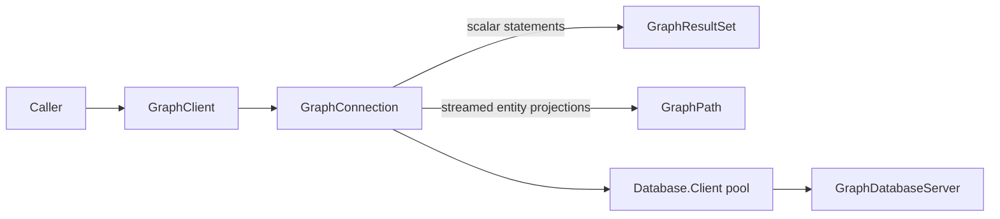

# Assimalign.Cohesion.Database.Graph.Client

`Assimalign.Cohesion.Database.Graph.Client` is the pooled, transport-independent client for `GraphDatabaseServer`.

> **Status:** Partial.

## Reference pages

- **[Design](design.md)** — Dependency boundaries and implementation decisions.
- **[Examples](examples/index.md)** — Source-backed usage and expected behavior.
- **[GraphConnection](graph-connection.md)** — Public execution contract.
- **[GraphRow](graph-row.md)** — Scalar, list and map cells by ordinal/name.
- **[GraphResultSet](graph-result-set.md)** — Public execution contract.
- **[GraphPathResult](graph-path-result.md)** — Public execution contract.
- **[GraphClientException](graph-client-exception.md)** — Values and usage.

`Assimalign.Cohesion.Database.Graph.Client` is the pooled, transport-independent client for
`GraphDatabaseServer`. It ships as a NuGet package outside the App.Database shared framework.
Create an `GraphClient` through `GraphClient.Create`, supplying `GraphClientOptions` with shared
database settings and a Connections transport factory.

`QueryAsync` returns scalar MATCH projections and the existing SHOW catalog rows as
`GraphResultSet`, with column metadata and rows accessible by ordinal or name.
`ExecuteAsync` sends CREATE, INSERT, DELETE, and DETACH DELETE to the engine and returns its
affected count. The server retains engine ownership, cycle, and database-scoping enforcement.

`QueryPathsAsync` returns real engine paths for a single bound projection:
`MATCH p = (a)-[r:KNOWS]->(b) RETURN p`, `MATCH (a) RETURN a`, or
`MATCH (a)-[r]->(b) RETURN r`. Paths retain ids, labels, relationship types, direction, and
properties. Enumerate to completion to verify the terminal count; abandoning an unfinished
enumeration discards its connection.

Dispose each connection to return a healthy authenticated session to the pool, and dispose the
client to close the pool. Scalar parse/execution failures retain the session; a terminal pre-output path refusal also preserves it. Unfinished streams discard it. Explicit transactions are not exposed:
BEGIN/COMMIT/ROLLBACK and the reserved Transaction message are unsupported.

Parameters bind WHERE, RETURN and property-map values under the shared bare-name contract.
RETURN supports standalone/computed expressions, aliases and DISTINCT/ALL. Duplicate final names
fail COHDBG015 before reads, mutation or output. Wire Execute rejects entity projections before
writes; QueryPathsAsync accepts one bare binding, including DISTINCT or star over one named binding.
Lists materialize as object?[] and maps as read-only ordinal dictionaries. Protocol 2.1 negotiates
graph.composite-values; possible unnegotiated composite results fail COHDBG016 before writes,
and the client refuses composite parameters locally before sending. Depth/count/encoded-byte
limits are enforced before commit. See [GraphRow](graph-row.md), [GraphValueCodec](../assimalign-cohesion-database-graph/graph-value-codec.md),
[GraphConnection](graph-connection.md) and [RETURN](../../../../database/graph/language/clauses/return.md).
The client never parses GQL or retries statements.
See [design](design.md) for completion and lifetime behavior.

Supply an `IDuplexConnectionFactory` through `GraphClientOptions.ConnectionFactory`; the shared pool owns the duplex connections it establishes.

## Project references

| Reference | Kind |
|---|---|
| `Assimalign.Cohesion.Database` | `CohesionProjectReference` |
| `Assimalign.Cohesion.Database.Client` | `CohesionProjectReference` |
| `Assimalign.Cohesion.Database.Graph` | `CohesionProjectReference` |
| `Assimalign.Cohesion.Database.Types` | `CohesionProjectReference` |
| `Assimalign.Cohesion.Database.Protocol` | `CohesionProjectReference` |
| `Assimalign.Cohesion.Connections` | `CohesionProjectReference` |

[Parent: Database](../index.md)

## Sources

- **Primary source** — `cohesion/resources/Database/Assimalign.Cohesion.Database.Graph.Client/docs/OVERVIEW.md`.
- **Source** — `cohesion/resources/Database/Assimalign.Cohesion.Database.Graph.Client/src/Assimalign.Cohesion.Database.Graph.Client.csproj`.
