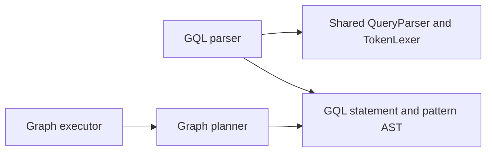

# Assimalign.Cohesion.Database.Graph.Language design

This page describes the boundaries and implementation shape of `Assimalign.Cohesion.Database.Graph.Language`.

> **Status:** Partial.

## Standard decision (#193)

The owner selected **ISO/IEC 39075:2024 GQL** on **2026-09-17**, following
`DATABASE_PROGRAM_PLAN.md`. ISO GQL provides a ratified, independently governed standard and a
portability target for the graph engine; openCypher's vendor-centered governance was the rejected
alternative. This records the owner decision independently of the feature list and chat transcript.
The GitHub issue may still require an administrative close; this implementation does not post to it.

[ISO's publication record](https://www.iso.org/standard/76120.html) identifies the first edition as
published in April 2024 and describes its property-graph data structures and operations. The
[standard editors' status page](https://www.gqlstandards.org/) records publication and the standards
committee process. These are the standard-selection references, not a claim that this MVP implements
every mandatory ISO feature.

The implemented syntax is an explicitly bounded subset. **`INSERT` is the standard graph-insertion
verb. `CREATE (pattern)` is a Cohesion compatibility extension**, retained for the phase-5 examples.
Both compile to the same `Creates` AST. `Database`-scoped catalog `SHOW` statements are another
explicit Cohesion extension. Repeated colon labels and `!=` are accepted conveniences; applications
seeking portable syntax should use one label per pattern and `<>`. `Database`, graph, schema, and
session selection statements are outside the profile: all evaluation stays inside the already-bound
logical database.

## Parser and expression tree

`GqlQueryParser` derives from the shared `QueryParser`, and its `Profile` is
`GqlLanguageProfile.Instance`. The shared `TokenLexer` supplies graph arrows and punctuation. The
parser constructs immutable lists/maps in the AST and returns diagnostics on `GqlQueryStatement`.
Its partial files separate the statement, pattern, and scalar-expression grammars. Instances
serialize concurrent calls and clear their transient state between statements. Shared analyzers run
through the existing base-class pipeline.

The parser depends on shared language contracts; the graph planner depends on the resulting AST, and
the graph executor depends on the planner's plan. This dependency view summarizes that flow.



`GqlQueryExpression` carries source-ordered [GqlStage](gql-stage.md) operations and NEXT-separated
[GqlQuerySegment](gql-query-segment.md) views. Its compatibility facade exposes match clauses,
clause-local predicates and optional flags, insertion paths, deletion
variables, a detach flag, projections, and an optional `GqlCatalogSurface` for dedicated metadata
statements. Catalog statements cannot carry graph clauses. Paths without parenthesized elements retain chain lists with one more node than relationship;
parenthesized paths use source-ordered Elements and empty chain lists. Anonymous nodes and relationships have a null variable. Relationship directions are
relative to consecutive pattern nodes; incoming arrows reverse that relationship's endpoints. A
scalar property reference always contains a variable and exactly one property key; qualified
database names have no AST representation.

## Supported-clause matrix

Only these clauses occur in `GqlLanguageProfile.Clauses`. The larger reserved keyword table is
retained for tokenization and targeted unsupported diagnostics; it does not advertise capabilities.
The function table declares core scalars, CAST, count, sum, avg, min, max, collect_list and collect. CASE, COALESCE and NULLIF are special expression forms;
COALESCE/NULLIF use case-abbreviation AST nodes rather than registry functions.

| Clause | Accepted subset | Execution |
| --- | --- | --- |
| `MATCH` | Comma-separated fixed/quantified edges and parenthesized segments; optional labels, type and scalar expression property maps | Planner chooses an indexed anchor when available; executor matches bounded relationship-unique trails |
| `OPTIONAL MATCH` | Same fixed/quantified paths and clause-local WHERE; repeated matching clauses execute in source order | NULL-extends new bindings when no candidate survives |
| `WHERE` | Boolean logic, arithmetic, concatenation, comparisons, null/truth tests, labeled predicates, IN and string predicates | Three-valued filtering; positive label conjunctions can anchor nodes; value errors COHDBG013 |
| `LET`, `FILTER` | Ordered assignments; FILTER [WHERE] predicate | Adds names or keeps TRUE rows |
| `FOR`, `UNWIND` | List expression and new variable | NULL gives zero rows; non-list COHDBG013; proven entity kinds retained |
| `WITH`, `NEXT` | Intermediate projection or RETURN/write segment boundary | Eager materialization; WITH WHERE after paging; projected scope only carried forward |
| `RETURN` | Value expressions with aliases, optional ALL/DISTINCT or named-binding star; standalone or after MATCH/insertion | Projects tuples; DISTINCT compares exact values and entity/path identities |
| `GROUP BY` | RETURN names or equivalent expressions, including () | Same exact keys as implicit aggregation; grouping before projection |
| `ORDER BY` | Keys with ASC/ASCENDING/DESC/DESCENDING and NULLS FIRST/LAST | Sorts projected rows/paths after DISTINCT; stable ties |
| `OFFSET`, `SKIP`, `LIMIT` | Unsigned Int64 literal or named parameter | Offset before limit; output only, with full materialization |
| `INSERT` | Node/path insertion with row-evaluated scalar maps | Inserts nodes and relationships transactionally per input row |
| `CREATE` | Same insertion grammar as `INSERT`; compatibility extension | Same transactional insertion path |
| `DELETE` | Bound node/relationship variables following a match | Refuses deleting a node that still has incident relationships |
| `DETACH DELETE` | Bound node/relationship variables following a match | Deletes incident relationships with the node in one transaction |
| `SHOW` | `LABELS`, `RELATIONSHIP TYPES`, `PROPERTY KEYS`, `INDEXES`, or `OBJECT OWNERSHIP`; Cohesion extension | Returns typed, read-only metadata from the session database's catalog snapshot |

`Match` patterns accept `(a)`, `(a:Label {key: value})`, `-[r:TYPE]->`, `<-[r:TYPE]-`, and
`-[r:TYPE]-`, including anonymous bracketed relationships. Scalar literals are null, Boolean,
signed 64-bit integer, finite double, and single-quoted string with doubled-quote escaping. Names
are case-sensitive; keywords are case-insensitive. Double-quoted names preserve spaces. A single
optional trailing semicolon is accepted. ISO abbreviated `->`, `<-`, `-` and `<->` execute without
edge variables/types/properties; full bracketed forms carry those details. Cypher doubled-dash
arrows are refused (GQL0008 or GQL0002), and tilde edges use COHDBL001. Multiple statements, direct stored-property chains such as a.b.c, and return-after-delete are
not accepted. Nested map access and entity access through value expressions execute.

The stage grammar is:

```text
query       := stage+   // RETURN finishes a segment or precedes NEXT; writes can also finish
stage       := [OPTIONAL] MATCH paths [ WHERE predicate ]
             | LET variable '=' expression (',' variable '=' expression)*
             | FILTER [WHERE] predicate
             | FOR variable IN expression | UNWIND expression AS variable
             | (INSERT | CREATE) paths | [DETACH] DELETE variables
             | return | WITH projection-and-tail [WHERE predicate] | NEXT
paths       := path (',' path)*
path        := path-primary ((relationship [quantifier] path-primary) | parenthesized | node)*
path-primary:= node | parenthesized
parenthesized := '(' path ')' [quantifier]
quantifier  := '{' integer [',' [integer]] '}' | '{,' [integer] '}' | '+' | '*'
predicate   := scalar-expression
operand     := variable | variable '.' property | scalar-literal | parameter
return      := RETURN [DISTINCT | ALL] ('*' | projection (',' projection)*)
               [GROUP BY (grouping-key (',' grouping-key)* | '()')]
               [ORDER BY sort-item (',' sort-item)*]
               [(OFFSET | SKIP) page-value] [LIMIT page-value]
projection  := value-expression [AS alias]
catalog     := SHOW (LABELS | RELATIONSHIP TYPES | PROPERTY KEYS | INDEXES | OBJECT OWNERSHIP)
```

Value pipelines, mutations and standalone RETURN can start without MATCH. Reading/deleting
entities requires a binding from matching or a proven entity carried through projection/UNWIND.
Pattern repetition-bound sums are limited to 64 relationships. Scalar chains have no comparison-count limit;
recursive depth follows available stack (GQL0009 in parsing, COHDBG008 in the engine). `Match`
execution also imposes a materialized-binding limit, documented in the Graph engine design.
Quantified paths are unsupported, so cycles cannot cause unbounded repetition of a path pattern. The
executor's trail rule permits repeated nodes but forbids repeated relationship identities within one
path.

### Dedicated catalog statement choice (C2)

The separate `SHOW` grammar exposes metadata through the query language without constructing fake
nodes or relationships for `MATCH`. Catalog definitions have stable catalog identities but are not
graph elements. The extension adds no server scope or database selector and changes no public
interface. Keywords are case-insensitive and comments and one optional trailing semicolon follow the
ordinary lexer rules. A statement cannot combine `SHOW` with graph matching, projection or mutation.
Attempted mutation composition produces `GQL0007`, including verbs such as `SET` and `DROP` that
are otherwise unsupported. The engine validates direct AST requests too.

The
[engine's catalog section](../assimalign-cohesion-database-graph/design.md#catalog-introspection-c2)
defines ordered result columns, SQL-consistent ownership vocabulary and session snapshot behavior.
The parser describes only the metadata subject; it never accesses or caches catalog state.

## Scalar AST, parameters and EXPLAIN

[GqlProjection](gql-projection.md) now holds a GqlExpression and optional alias, replacing the
variable/property tuple. [GqlVariableExpression](gql-variable-expression.md) represents a bare
binding. [GqlQueryExpression](gql-query-expression.md) adds init-only ReturnStar and SetQuantifier
([All/Distinct](gql-set-quantifier.md)); star expands first named declarations and cannot mix with
explicit items. Standalone RETURN evaluates once; empty MATCH retains metadata with zero rows.
Unaliased names use normalized source text, or rendered syntax for source-free nodes. Duplicate
final names compare ordinally and fail COHDBG015 before reads/writes, even under EXPLAIN.

Comparisons, property matching, IN and DISTINCT share exact represented numeric values across
runtime types. Decimal 0.1m and Double 0.1d are unequal; Int64 1 and Double 1.0 are equal. Large
integers and subnormals keep their values and signed zeros agree. DISTINCT groups NULLs; ordinary
NULL comparisons are UNKNOWN. Arithmetic keeps #1140's promotion: floating operands use Double,
otherwise decimal/ulong use Decimal, otherwise checked Int64. DISTINCT retains the first tuple's
runtime types and compares entity/path identities independently of materialization.

Wire Execute validates scalar/negotiated-composite result kinds before data access, writer locking or mutation.
EXPLAIN remains scalar for entity returns. ExecutePaths requires one bare entity/path binding,
including DISTINCT or star over one binding; invalid shape precedes duplicate-name checks.

[GqlLogicalExpression](gql-logical-expression.md) holds And/Or/Xor chains; OR and XOR share one
precedence level. Unary, IN/list, null/truth tests and string predicates have typed nodes linked
from the [assembly index](index.md). Runtime errors use COHDBG013. Property maps hold GqlExpression
values rather than only literals, including GqlParameterExpression. Bare-name lookup is ordinal
and strips one sigil; collisions are COHDBG014, missing values COHDBG001, invalid types COHDBG003.

GqlQueryExpression.IsExplain flags a parser-created EXPLAIN wrapper on a data query. Normal binding
and provisioning admission apply and DatabasePlanDescription is returned without data execution.
[Language operators](../../../../database/graph/language/expressions/operators.md) specifies exact
precedence, NULL behavior and all syntax boundaries.

## Conditional and composite ASTs

[GqlCaseExpression](gql-case-expression.md) carries a nullable simple operand, ordered
[GqlCaseAlternative](gql-case-alternative.md) values and optional Otherwise. The parser expands ISO
WHEN operand lists into alternatives sharing Then; Comparison retains explicit comparisons/null
tests. The operand evaluates once and only the selected branch evaluates. [COALESCE](gql-coalesce-expression.md)
selects the first non-NULL value lazily; [NULLIF](gql-null-if-expression.md) evaluates both operands
once. Selected runtime types survive without common-type coercion; metadata remains unknown.
Planning validates skipped bindings and shapes.

[GqlListExpression](gql-list-expression.md) works in every value position. [GqlMapExpression](gql-map-expression.md)
creates ordinal named values. [GqlSubscriptExpression](gql-subscript-expression.md) and
[GqlMemberExpression](gql-member-expression.md) consume containers or read entity properties.
[GqlInExpression.List](gql-in-expression.md) changes from GqlListExpression to GqlExpression,
allowing list-valued parameters and computed inputs. Missing keys/out-of-range indexes are NULL;
invalid accesses use COHDBG013. Equality is structural with FALSE dominating UNKNOWN; DISTINCT
groups corresponding NULLs. Exact numeric comparison survives inside containers.

Referenced parameters snapshot once; invalid leaves/cycles/dimensions or bounds use COHDBG003.
Constructed limits use COHDBG013 inside the statement transaction, rolling back writes. Limits
are root depth zero through 64, 65,536 total values and 16 MiB encoded bytes. Pattern property maps
stay scalar-only. See [value rules](../../../../database/graph/language/expressions/list-values.md).
No new plan record is required; EXPLAIN renders the expressions through existing Project nodes.

## Diagnostics and conformance (#194, #195)

| Code | Meaning |
| --- | --- |
| `COHDBL001` | Recognized construct outside the executable profile, including mandatory matching, procedures, unsupported calls, stored composite properties, comprehensions/slicing, questioned/nested quantifiers, subpath assignments/WHERE, standalone ordering/paging before RETURN, set operations, and server/session scope |
| `GQL0001` | Empty statement |
| `GQL0002` | Malformed supported syntax or invalid statement composition |
| `GQL0003` | Unterminated string, quoted name, or block comment |
| `GQL0004` | Invalid or out-of-range numeric literal |
| `GQL0005` | Text repetition-bound sum exceeds 64 relationships |
| `GQL0006` | Duplicate literal property key |
| `GQL0007` | `Graph catalog introspection is read-only.`: mutation composed with `SHOW` |
| `GQL0010` | Unknown function name; scalar/aggregate arity uses GQL0002 |

Locations use zero-based absolute UTF-16 offsets with exclusive ends and one-based line numbers.
Capability checks run before syntax parsing, so a recognized unsupported clause does not degrade
into a generic error caused by its downstream syntax. Quoted text, comments, label names, and
property keys do not trigger keyword-based capability checks. Binding and catalog diagnostics belong
to the Graph planner, which knows the database schema.

`GqlQueryParserTests` is the executable-subset conformance corpus, with valid and malformed cases
and assertions on the AST, not a full ISO certification suite. Its groups map to ISO GQL graph
pattern matching (4.11 / 16.4 / 16.7), insertion (13.2), deletion (13.5), matching (14.4), return
(14.11), comparisons (19.3), and property references (20.11). The ISO section mapping is
independently cross-checkable in an implementer's
[published GQL feature table](https://neo4j.com/docs/cypher-manual/25/appendix/gql-conformance/supported-mandatory/)
. Compatibility-extension cases are named by their `CREATE` spelling. Separate tests pin the exact
profile, reject unsupported and cross-database constructs, preserve source locations, and bound
adversarial nesting and long patterns.

## AOT posture and extension discipline

The package references only `Database.Language`. It uses ordinary typed AST classes and BCL scalar
values with no reflection, runtime discovery, or `Microsoft.Extensions.*` dependencies. Adding a
clause requires the parser, planner, executor, conformance cases, and this matrix in the same
change; keyword recognition alone never enables it.

## Declared dependencies

| Reference | Kind |
|---|---|
| `Assimalign.Cohesion.Database.Language` | `CohesionProjectReference` |

[Assembly overview](index.md) · [Examples](examples/index.md)

Parser and engine diagnostic codes are listed in [GQL diagnostics](../../../../database/graph/language/diagnostics.md),
including GQL0008/0009 and COHDBG001–017 with available SQLSTATE/GQLSTATUS categories.
COHDBG015 identifies a duplicate final RETURN column name. COHDBG016 rejects possible composite
wire results without graph.composite-values before reads/writes. COHDBG017 refuses older graph
records/tree registrations at database open, with recreation required and no upgrade path.
These three codes have no assigned SQLSTATE.

## Ordering and paging

[GqlQueryExpression](gql-query-expression.md) adds OrderBy, Offset and Limit init properties.
[GqlSortItem](gql-sort-item.md) carries a key and the [direction](gql-sort-direction.md) and
[NULL placement](gql-null-ordering.md) enums. Default NULL placement is last ASC/first DESC.
OFFSET/SKIP must precede LIMIT. Dynamic counts require an integral CLR value in nonnegative Int64
range (COHDBG013); unsupported/non-finite CLR inputs use COHDBG003 and missing parameters COHDBG001.
DISTINCT keys can reference only projected values, including projected entities and structurally
matching computed expressions. Hidden bindings are COHDBG001, including on empty graphs.

The total ascending order is map, node, relationship, list, path, string, Boolean, number, NULL.
Numeric comparison is exact. Lists compare lexicographically; maps compare count, ordinal sorted
keys and values; paths compare starting node, relationship sequence and length. Ties retain input
order. Mutations precede projection, DISTINCT, sort, offset and limit. Every key evaluates once per
retained row and nested map keys are cached. Sort preparation/comparisons observe cancellation.
Full materialization and match/candidate caps remain in force. EXPLAIN describes SortPage and
SortKey without execution. See the [language rules](../../../../database/graph/language/clauses/order-by.md).

## Aggregates and grouping

[GqlAggregateExpression](gql-aggregate-expression.md) and [GqlAggregateFunction](gql-aggregate-function.md)
represent six aggregates; collect aliases CollectList. GqlQueryExpression.GroupBy distinguishes
implicit grouping (null), explicit no keys ([]) and supplied expressions. Plain names bind RETURN
aliases first. Grouping and DISTINCT use exact numeric/structural equality; grouped ORDER BY honors
shadowing aliases. See [aggregate results, diagnostics and examples](../../../../database/graph/language/functions/aggregate-functions.md).

## Quantified paths

[GqlPathPattern](gql-path-pattern.md) adds source-ordered Elements. The closed
[GqlPathElement](gql-path-element.md) family contains node, relationship and parenthesized leaves;
[GqlQuantifier](gql-quantifier.md) carries inclusive Min/Max, null Max meaning unbounded.
[GqlRelationshipPattern](gql-relationship-pattern.md) adds Quantifier. Group declarations bind
source-ordered lists and RETURN */WITH * include them; FOR/UNWIND retains their entity kinds.
Direct invalid shape/bounds, cycles/reused path instances or subpath depth above 128 use COHDBG001;
text bounds use GQL0002/0004/0005. Runtime qualifying 65th hops use COHDBG004.
[Patterns](../../../../database/graph/language/patterns.md) records diagnostics and examples.

## Scalar calls and CAST

[GqlFunctionCallExpression](gql-function-call-expression.md) resolves names/aliases to
[GqlScalarFunction](gql-scalar-function.md), snapshots Arguments and exposes IsNiladic for clocks.
[GqlCastExpression](gql-cast-expression.md) retains Operand and [GqlCastType](gql-cast-type.md).
Every expression/shape/grouping/rendering walk includes these nodes. Static enum dispatch keeps
planning/evaluation compatible with NativeAOT. GQL0010 reports unknown calls; GQL0002 reports
parsed arity, COHDBG001 direct-AST arity/unbound arguments, COHDBG003 proven incompatible kinds,
and COHDBG013 dynamic kinds or invalid values. No SQLSTATE is assigned to these codes.

[Scalar functions](../../../../database/graph/language/functions/scalar-functions.md) documents
signatures, aliases, strict NULL behavior, exact numeric types, zero-based code-point substring
and the difference between SQL CAST and Neo4j conversions. CURRENT_DATE/CURRENT_TIMESTAMP are
reserved niladic names; CAST is contextual. ELEMENTS remains COHDBL001.

## SET and REMOVE

[GqlSetStage](gql-set-stage.md)/[GqlRemoveStage](gql-remove-stage.md) retain source-ordered items;
GqlQueryExpression.SetItems/RemoveItems flatten them for inspection. The parser accepts IS or
colon labels, property assignment and literal-map replacement/merge. Touching += is a GQL-only
operator token. Scalar right sides retain IS [NOT] LABELED. Leading SET/REMOVE and nested targets
are GQL0002. Whole-map expressions/parameters and literal composite properties are COHDBL001;
relationship labels and computed composite properties are COHDBG003. No new code is introduced.
The profile executes 26 of 33 declared clauses.

Database lifecycle failures additionally use COHDBG018 for missing journal/backup, incomplete
creation or unrecoverable files. It is carried in DatabaseException.Diagnostics with no assigned
SQLSTATE; it is separate from GQL evaluation. See [file diagnostics](../../../../database/graph/language/diagnostics.md#database-files).

## Sources

- **Primary source** — `cohesion/resources/Database/Assimalign.Cohesion.Database.Graph.Language/docs/DESIGN.md`.
- **Source** — `cohesion/resources/Database/Assimalign.Cohesion.Database.Graph.Language/src/Assimalign.Cohesion.Database.Graph.Language.csproj`.
