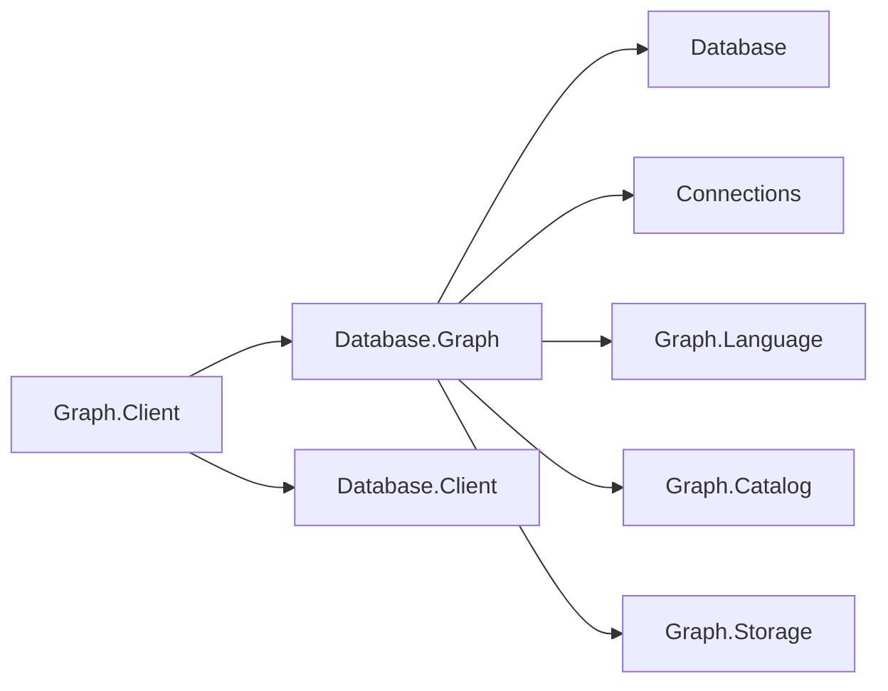
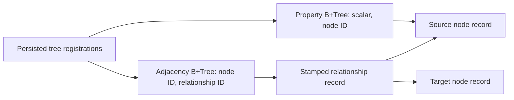
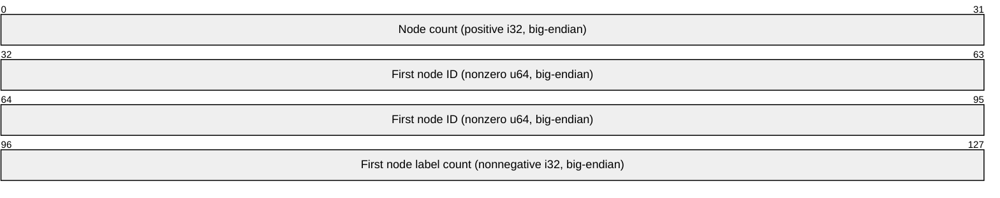
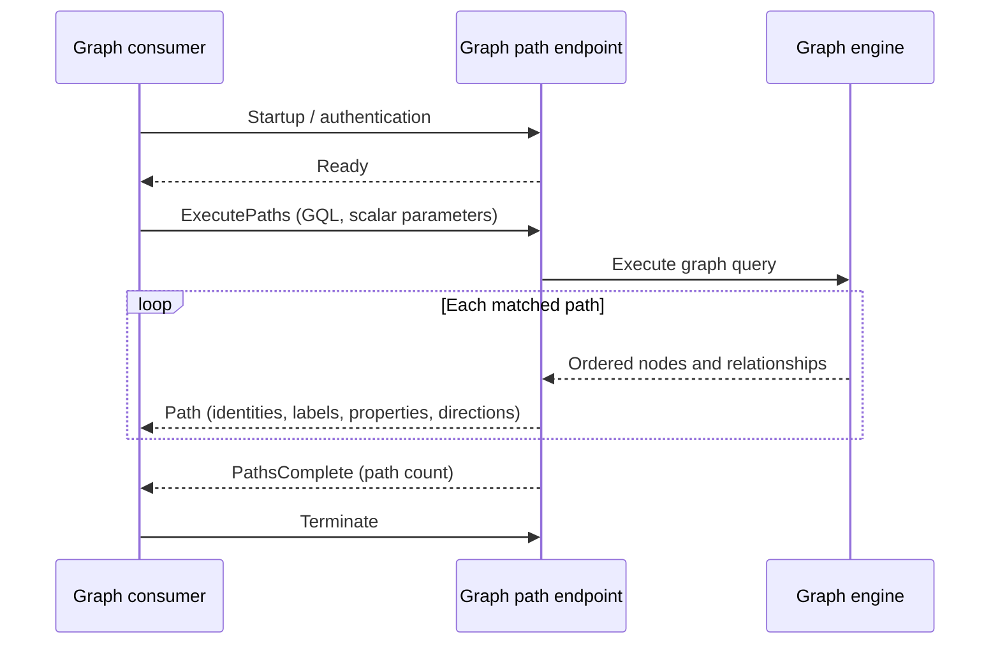

# Assimalign.Cohesion.Database.Graph design

This page describes the boundaries and implementation shape of `Assimalign.Cohesion.Database.Graph`.

> **Status:** Partial.

## Linear composition

The planner/executor consumes [GqlStage](../assimalign-cohesion-database-graph-language/gql-stage.md)
in source order. LET adds sequential bindings, FILTER retains TRUE and FOR/UNWIND expands lists
(NULL gives zero rows; non-list COHDBG013). WITH or RETURN … NEXT retains only referenceable
projected names, preserving entity kinds, optionality, possible composites and Int64 COUNT types.
WITH ORDER BY/WHERE can see incoming names only without DISTINCT/aggregation; WHERE executes
after sorting/paging. A write anywhere locks before the first stage. Every stage materializes
eagerly and sees earlier writes under Snapshot/ReadCommitted. NEXT after a write without RETURN
starts one empty row and no scope. FOR shares the 100,000-row bound with matching.

Proven node/relationship list elements survive UNWIND and can anchor MATCH/DELETE. Intermediate
collect/UNWIND is valid for read-only ExecutePaths with one mandatory final entity/path. Writes
exclude ExecutePaths; final entity lists remain outside wire Execute (COHDBG001; #1662). No catalog
format or wire frame changes. See [language rules](../../../../database/graph/language/clauses/next.md)
and [diagnostics](../../../../database/graph/language/diagnostics.md).

## String comparison and collation (#1025)

Graph remains ordinal-only. String property predicates use case-sensitive .NET ordinal (UTF-16
code-unit) comparison; property index keys encode the same order. Labels, edge types, property keys,
and query variable bindings retain ordinal, case-sensitive identity. Administrative database lookup
remains ordinal-ignore-case. SQL database defaults and `COLLATE` overrides do not apply to GQL or
graph storage. Configurable graph collation is deferred; no case or accent folding is applied to
stored labels or property values.

## Composition and frozen contracts

The fifth database engine follows Documents' parser/planner/executor composition and Blob's
engine-owned lifecycle. `GraphDatabaseEngine` is the public factory and engine implementation;
database, session, transaction, planner and executor implementations are internal. Its dependencies
are the area root, Connections and the Graph.Language, Graph.Catalog and `Graph.Storage` packages.
`Storage` uses shared `Storage`, Transactions and Indexing rather than another pager, journal or lock
manager.

| Package | Responsibility |
| --- | --- |
| `Database.Graph` | Engine, sessions, typed operations, planning, scalar/path execution, and graph protocol server |
| `Database.Graph.Client` | NuGet-only scalar and path client over the shared connection pool; references Graph and Database.Client |
| `Database.Graph.Language` | ISO GQL subset, AST and syntax/capability diagnostics |
| `Database.Graph.Catalog` | Snapshot-visible labels, types, property keys, index metadata and ownership |
| `Database.Graph.Storage` | Record encoding, kernel adapter, adjacency and property B+Trees |

The engine references the area root, transport abstraction and its model packages; the protocol and
security contracts arrive through the area's root composition. These are dependency edges:

No existing public interface changed. `IGraphDatabase` accepts an explicit `IDatabaseSession` for
each data operation. Every entry point checks the concrete session's database identity; sharing an
engine or database name is insufficient. `GraphSchema.Open(database, session)` returns the new
`IGraphSchema` interface, also bound to that exact database and session. Its operations join the
session transaction. Administrative database lifecycle remains on `IDatabaseEngine`; no GQL AST can
select a server, another database, or another graph.

## Physical records and adjacency

Each logical database owns `graph.dat`, `graph.log` and `graph.bak`. All records start with the
shared 16-byte little-endian writer/deleter transaction stamp. The graph payload's byte 16 is the
kind, byte 17 is format version 2, bytes 18–25 are a nonzero unsigned 64-bit identity and
bytes 26–33 hold the increasing revision. Format 1 is refused before recovery scrub without
an upgrade path. Graph
identities are reserved from the shared storage sequence allocator, so rollback does not recycle an
identity. `Database`-local IDs must always be paired with the correct session.

| Page owner / kind | Payload after the stamp |
| --- | --- |
| Owner 0, catalog | Catalog-specific version, discriminant and encoded definition; see Graph.Catalog's format |
| Owner 2, kind 1 | Common graph header, label count and strings, then scalar property map |
| Owner 2, kind 2 | Common graph header, source ID, target ID, type string, scalar property map |
| Owner 2, kind 3 | Common graph header, indexed label and property key |
| Owner 1, kind 4 | Zero stamps, kind/version, tree object ID, signed 64-bit root page; 34 bytes total |

Counts and fixed integers are little-endian. Strings use BinaryWriter's UTF-8 encoding with a 7-bit
encoded byte-length prefix. Property maps are ordered by ordinal key and preserve scalar type tags.
The exact tag table and index tuple encodings live in
[Graph.Storage DESIGN.md](../assimalign-cohesion-database-graph-storage/design.md) , which is the
format reference for another reader. Properties support null, Boolean, string, integral, decimal and
finite floating point values. Records fit one shared slotted page; oversized records are rejected
before publication. Large graph properties/chunking are deferred.

The adjacency B+Tree contains one entry per incident endpoint, keyed by `(node ID, relationship ID)`
and pointing to the relationship's packed physical record location `(page ID << 16) | slot`. A
self-loop has one entry. The relationship record carries both directed endpoints and its type;
direction/type filtering occurs after the node-prefix seek. Composite keys avoid duplicate-key
boundary ambiguity after B+Tree splits. A node identity map reconstructed from records at open
provides constant-time identity lookup followed by a stamped page read.

The diagram shows the references stored by the adjacency and property trees; relationship records
carry endpoint identities referring to node records.

An incident lookup costs `O(log E + degree)` index work plus one record read per incident edge;
deterministic result ordering adds `O(degree log degree)` CPU work. Direct traversal costs the sum
of these lookups for expanded nodes and uses `O(Vvisited)` visited state. A label scan examines node
records and sorts its matches. A property equality anchor instead seeks its shared B+Tree in
`O(log N + candidates)` after locating index metadata, then sorts its matches. `Index` numeric keys
normalize integral, decimal and finite floating point values through double conversion. Full scalar
comparisons filter index candidates using exact represented values across all numeric types despite
key collisions. Equality, inequality, ordering, property matching, IN and DISTINCT agree: Decimal
0.1m differs from Double 0.1d, while Int64 1 equals Double 1.0. Large integers retain every bit and
subnormals remain distinct from zero. Signed zeros compare equal; NULL comparisons are UNKNOWN
while DISTINCT groups NULLs. Arithmetic keeps its own promotion. All node create/update/delete paths
maintain property indexes. GQL SET/REMOVE uses storage replacement versions.

## Transactions, atomicity and recovery

One `TransactionCoordinator` per database owns MVCC, logical undo, journal durability, lock
management and physical statement brackets. A conservative database writer lock serializes writers
through their logical commit or rollback; readers use snapshots. Metadata and affected graph records
are checked against the latest committed view after lock acquisition, so a stale writer cannot
create an orphan endpoint or bypass a newer schema constraint. A queued writer sees the prior
writer's committed state after lock handoff, including before coordinator untracking. The latest
view includes its own writes and excludes other active transactions. Node/relationship metadata
conflicts, label/type in-use checks and property-metadata validation use this view.

Node creation and label/key metadata participate in the same logical transaction. Relationship
creation writes its record and both adjacency entries in one physical bracket. Deleting a node with
`DETACH DELETE` tombstones its incident relationships, adjacency and property entries with the node
atomically. Plain GQL `DELETE` refuses a still-connected node. `DELETE r,a` first deletes explicitly
selected relationships, then checks the nodes. The frozen typed `DeleteNodeAsync` contract
explicitly cascades and is implemented that way. Any mutation failure rolls back the owning logical
transaction, including an explicit session transaction, as in Documents.

Snapshot and ReadCommitted isolation are supported. ReadCommitted captures and pins a statement
snapshot, so metadata and each hop of a traversal share a visibility horizon. Serializable is
rejected rather than silently weakened. Explicit transactions use the existing session API; GQL
transaction-control syntax is outside the profile. Wire transactions are deliberately deferred:
`BEGIN`/ `COMMIT`/ `ROLLBACK` do not parse and reserved `Transaction` byte 9 is rejected with
`ProtocolViolation`. No connection-level transaction API is exposed. Results materialize before
the statement transaction is released, so result iteration cannot race record reclamation.

`Open` defers the storage checkpoint, performs physical WAL recovery, then invokes coordinator record
scrub, opens catalog/store indexes, purges unproven index writers using the same recovery plan, and
checkpoints last. The process fixture exits after committed graph/index creation and after
uncommitted detach/insertion page write-back, without disposal. Restart must recover the committed
path and index, remove partial nodes/types/edges, and undo partial tombstones; it then reopens a
second time to verify the recovery checkpoint.

## Planning, execution and bounds

`GqlQueryParser` builds `GqlQueryStatement`; `GraphPlanner` resolves labels, relationship types,
variable kinds and access paths; `GraphPlanExecutor` applies that plan. The planner considers
literal inline properties and equality predicates joined by `AND` for every node position in a
pattern. It can anchor at the middle or end, expanding right and then left with appropriately
reversed directions. Bound nodes from earlier paths or clauses take precedence over scans and
seeks at any position; otherwise a bound relationship supplies an adjacent endpoint. NULL bindings
refuse a later pattern before candidate reads. Each MATCH/OPTIONAL MATCH evaluates its own WHERE
after joining its paths. A failed mandatory clause drops the row; an optional clause preserves it
with NULL for new variables. The initial binding table has one empty row. Every selected candidate
still passes labels, property predicates and bindings.

GQL patterns have fixed/quantified edges and parenthesized segments with repetition-bound sums
of at most 64 relationships. Each matched path is a trail: an edge
identity is used at most once within that path; a node may recur. Separate comma-separated paths
have separate edge sets and share variable bindings. This makes a three-edge cycle a valid three-hop
result but forbids reusing its first edge on a fourth hop. At most 100,000 intermediate path matches
materialize across matching clauses, and a statement examines at most 1,000,000 node/edge candidates, including
dead ends; either overflow fails with `COHDBG004`, never silent truncation. Cancellation is
observed during expansion and materialization. Repeated node/relationship variables enforce identity
equality, and conflicting variable kinds fail before execution.

`TraverseAsync` implements the frozen `GraphTraversal` contract separately: breadth-first traversal,
an explicit nonnegative maximum depth, a visited-node set seeded with the start, and no repeated
nodes. It excludes the start even when a cycle or self-loop reaches it. Incident edges are ordered
by identity, making the breadth-first result deterministic. Its result contains visited nodes; GQL's
projected `a,r,b` values expose the actual frozen `GraphNode` /`GraphRelationship` objects through
`DatabaseRow.GetValue`. Property projections return scalars. This does not add a path member to the
frozen traversal contract.

`GraphPathsQueryRequest.FromGql` selects real path execution through the existing
`GraphDatabaseSession.ExecuteAsync(GraphRequest)` capability. Row and path requests
share the typed `GraphRequest` base. The returned `GraphPathsQueryResult.Paths` contains
materialized `GraphPath` objects from the matcher's bound entities and traversal sequence, under
the same pinned snapshot as scalar execution. Exactly one projection is required: a node variable
produces a singleton path, a relationship variable produces its stored source and target nodes,
and a named path (`MATCH p = (a)-[r:KNOWS]->(b) RETURN p`) preserves traversal order, including
reverse traversal and legal cycles. Properties, labels, types and database-local identities are
the actual engine values. Scalar projections, multiple projections, mutations and catalog queries
are rejected as path requests before execution. This new request/result pair adds no members to
existing public interfaces and does not infer paths from scalar rows.

The
[supported-clause matrix](../assimalign-cohesion-database-graph-language/design.md#supported-clause-matrix)
is the single executable-language inventory: MATCH, WHERE, LET, FILTER, FOR/UNWIND, WITH, NEXT, RETURN, INSERT, CREATE (compatibility
extension), DELETE, DETACH DELETE and SHOW (catalog extension). Parameters, six aggregates and
implicit/ISO GROUP BY execute. Core scalar functions and CAST execute; graph selection and
language DDL remain outside the profile.
Label/type/index management is the session-bound C# schema API. The ISO decision and conformance
corpus are documented alongside the parser; this is a bounded ISO subset, not a full conformance
claim.

## Catalog introspection (C2)

`GraphSchema.Open(database, session)` already supplies in-process discovery of labels, relationship
types, property keys and indexes. C2 preserves that interface and makes the same catalog reachable
through textual requests on `GraphDatabaseSession`, whose
`DatabaseLanguageSession<GraphRequest>` base provides typed and text execution. Dedicated
`SHOW` statements are Cohesion GQL extensions, not ISO conformance claims. A catalog definition is
not a graph node: exposing it through `MATCH` would invent graph identities and relationships and
would reserve labels in the user graph. `SHOW` instead returns a typed result set with no fabricated
graph elements or persisted system data.

`GraphDatabaseServer.Create(engine, options)` exposes these statements to the existing generic
model-owned catalog exchange over the shared `Database.Client` connection infrastructure. The
composition root supplies an `IDuplexConnectionListener` through
`GraphDatabaseServerOptions.Listener` and owns the engine lifecycle; the server owns the listener
and its accepted sessions. Startup authentication binds each connection to one database. Typed
scalar result columns and rows use the Graph-owned codecs, including GUID identities and nullable
ownership values. The same `Execute` exchange now serves scalar `MATCH`, `CREATE`, `DELETE` and
`DETACH DELETE` through the engine session; ownership, cycle and mutation validation remain engine
responsibilities. Entity and path projections use `ExecutePaths`, which dispatches a
`GraphPathsQueryRequest` and writes one `Path` frame for each real engine path, followed by
`PathsComplete`. Ordinary `Execute` rejects unsupported entity-shaped values instead of producing
scalar stand-ins. [Graph.Client](../assimalign-cohesion-database-graph-client/design.md) provides
typed access to both exchanges. The catalog contracts below remain unchanged. No existing
interface gained a transport member.

Each statement has a fixed ordered column contract. All name columns are strings, identity columns
are GUIDs, and `IS_REQUIRED` and `IS_UNIQUE` are Booleans.

| Statement | Columns in result order |
| --- | --- |
| `SHOW LABELS` | `DATABASE_NAME`, `LABEL_ID`, `LABEL_NAME` |
| `SHOW RELATIONSHIP TYPES` | `DATABASE_NAME`, `RELATIONSHIP_TYPE_ID`, `RELATIONSHIP_TYPE_NAME` |
| `SHOW PROPERTY KEYS` | `DATABASE_NAME`, `DEFINITION_TYPE`, `DEFINITION_ID`, `DEFINITION_NAME`, `PROPERTY_KEY`, `DATA_TYPE`, `IS_REQUIRED` |
| `SHOW INDEXES` | `DATABASE_NAME`, `LABEL_ID`, `LABEL_NAME`, `INDEX_NAME`, `PROPERTY_KEY`, `IS_UNIQUE` |
| `SHOW OBJECT OWNERSHIP` | `DATABASE_NAME`, `DEFINITION_TYPE`, `DEFINITION_ID`, `DEFINITION_NAME`, `OBJECT_TYPE`, `OBJECT_NAME`, `OWNER`, `OWNING_SCHEMA` |

`DEFINITION_TYPE` distinguishes `LABEL` from `RELATIONSHIP TYPE`, including when both have the same
name. `DATA_TYPE` is the declared shared `DatabaseType` name, or null for an unconstrained key;
observed property values do not invent a declared type. Current node-property indexes are nonunique,
so `IS_UNIQUE` is false. `Storage` pages and physical index registrations stay internal. Definition
names and their child names retain the catalog's ordinal ordering; label definitions precede
relationship-type definitions. Definitions remain discoverable when the last graph element is gone.

Ownership follows SQL's `COHESION_SCHEMA.OBJECT_OWNERSHIP` vocabulary: `OBJECT_TYPE`, `OBJECT_NAME`
, `OWNER` (`Adhoc` or `Schema`) and nullable `OWNING_SCHEMA`. The owning schema is the
compiled/schema authority, never a graph namespace. Label and relationship-type rows report their
persisted owner. Property and index metadata has no independent ownership field: its rows report the
parent definition's authority because catalog mutation enforcement checks that parent. `OBJECT_TYPE`
is `LABEL`, `RELATIONSHIP TYPE`, `PROPERTY KEY` or `INDEX`; the definition identity disambiguates
children.

The executor reads all definitions and children using the operation's existing pinned MVCC snapshot.
Snapshot transactions retain their original visibility; ReadCommitted and auto-commit statements
observe catalog changes at statement start. Own uncommitted definitions are visible in the same
transaction, other sessions cannot see them, and rollback leaves no virtual rows behind. Dropping a
definition removes its property/index/ownership rows from fresh snapshots. Results are computed at
execution time and never materialized into the graph's persistent record space.

`SHOW` always targets the session's logical database. There is no database qualifier, server
listing, graph selection, filtering, projection, or mutation composition in this bounded extension.
An attempt to append a mutation clause returns `GQL0007: Graph catalog introspection is read-only.`
before any writer lock or data mutation; hand-built ASTs have the same protection. Unsupported read
composition returns the ordinary syntax/binding diagnostic. Since no synthetic graph objects are
created, ordinary graph writes cannot address or change these result rows.

## Ordering and paging

The common row/path tail projects, removes DISTINCT duplicates, caches each sort key, sorts,
offsets and limits. Mutations run for every matched binding before this tail; paging does not reduce
the match or candidate caps. Default NULL placement is Cypher-style last ASC/first DESC. Numeric
comparison is exact, ties retain input order and nested map keys are canonicalized once for sorting.
Preparation and comparisons check cancellation; comparer cancellation reaches ordinary rollback
without a List.Sort wrapper. EXPLAIN maps SortPage and SortKey. Invalid dynamic counts use
COHDBG013 before reads/writer locks, unsupported/non-finite CLR inputs COHDBG003 and missing
parameters COHDBG001. No new code, SQLSTATE, catalog format or wire version is introduced.
See [ORDER BY](../../../../database/graph/language/clauses/order-by.md) and
[OFFSET/SKIP and LIMIT](../../../../database/graph/language/clauses/limit-offset.md).

## Metadata and diagnostics

Labels, relationship types and discovered property keys persist even when the last data object is
deleted. Discovery sees the session snapshot. `New` data introduces ad-hoc definitions. A supplied
property definition can require a value and its database scalar type; adding a constraint validates
existing objects first. Unsigned integer values map to the next wider signed database type (`byte`
to Int16, `ushort` to Int32, `uint` to Int64, `ulong` to `Decimal`); persisted CLR types remain
unchanged. Unsupported property types are refused. Dropping an in-use label/type is refused. Schema
ownership is enforced on drop and every alter/index/property-metadata path with
`DatabaseObjectLockedException`, naming the object, owning schema and operation. An initial
directly marked definition is supported to exercise that enforcement path; compiled provisioning is
not included.

| Code | Meaning |
| --- | --- |
| `COHDBL001` | Unsupported language capability, reported on the parsed statement |
| `GQL0001`–`GQL0006` | Parser syntax/literal/bound errors; see language design |
| `GQL0007` | Attempt to mutate catalog introspection results |
| `GQL0010` | Unknown function spelling; parsed arity uses GQL0002 |
| `COHDBG001` | Invalid hand-built function arity/unbound argument; invalid pattern, variable binding, traversal or grouping/aggregate placement |
| `COHDBG002` | Unknown label or relationship type |
| `COHDBG003` | Proven incompatible function/CAST kind; schema/data mismatch, restricted deletion, or invalid graph mutation |
| `COHDBG004` | Materialized path-match, candidate-expansion or runtime 64-hop trail limit exceeded |
| `COHDBG005` | Session/database binding mismatch |
| `COHDBG006` | Storage failure translated at the engine boundary |
| `COHDBG007` | Explicit transaction is aborted; later statements/commit refused until rollback |
| `COHDBG008` | Statement too complex for available stack (SQLSTATE 54001) |
| `COHDBG009` | Element or indexed property exceeds the stored-record/key bound |
| `COHDBG010` | Warning: read names an unknown label; GQLSTATUS 01N50 |
| `COHDBG011` | Warning: read names an unknown relationship type; GQLSTATUS 01N51 |
| `COHDBG012` | Database offline after durable storage failure |
| `COHDBG013` | Evaluated value error: non-Boolean condition, invalid arithmetic/concatenation/access, zero divisor, overflow, non-finite result, function/CAST kind, conversion or domain failure, computed temporal property, SUM/AVG nonnumeric operand or constructed/collected value/row limit |
| `COHDBG014` | Caller parameter keys collide after stripping one sigil |
| `COHDBG015` | Duplicate final RETURN column name, compared ordinally and case-sensitively; rejected before reads/mutations, including empty matches and EXPLAIN; no SQLSTATE assigned |
| `COHDBG016` | Possible composite wire projection without negotiated graph.composite-values; before reads, writer locks or writes, even for empty matches or skipped branches; no SQLSTATE assigned |

Planner/data errors carry stable codes in `DatabaseException.Diagnostics` with code-free messages.
Unknown labels/types in optional clauses warn with COHDBG010/011 while preserving NULL-extended
rows; a later unmatched mandatory clause can still empty the result. Kernel aborts cross the engine
boundary as `DatabaseTransactionAbortedException`; deadlocks retain their specialized subtype.
Ownership uses the shared dedicated exception rather than an invented graph ownership code.

## Lifecycle and delivery

Engine construction starts WAL-flush, page-writeback, checkpoint and version-purge workers, exposed
through `Workers`. State is Running until a worker fails (Faulted) or disposal begins (Disposed).
Disposal is idempotent: stop and join workers, abort outstanding transactions, durably flush and
close each database. Logical commits are synchronous through the coordinator even when physical
grouped durability is configured. The flush worker still services the storage group-commit seam.

Names are single path components, directory lookup is case insensitive, and enumeration includes
persisted databases not yet open in memory. Root-builder `AddGraph` captures a deferred engine
factory without Hosting dependencies. Engine packages ship in the App.Database framework;
Graph.Client ships separately as a NuGet-only package, with all solution, CI and release-inventory
entries. Model security policies, replication, Hosting/ApplicationModel changes and
compiled-schema provisioning remain out of scope. The graph server uses the shared authenticator
rather than adding graph-specific authentication contracts. No reflection or runtime code
generation is used.

## Composite values and wire framing

[GraphValueCodec](graph-value-codec.md) is public in Graph and shared with its client through the
existing reference. graph.composite-values adds no message type or protocol version. Negotiated
Execute/ExecutePaths parameters use its components, including scalar parameters. Result column
bit 7 marks possible composites. Marked cells use tag 0 plus a scalar component or tag 1 plus a
little-endian length and GraphValueCodec component; unsigned and Decimal scalars use the latter. Unmarked
scalar columns keep their baseline bytes and avoid a preflight pass. Direct COUNT projection metadata is Int64; other query metadata stays unknown.

Values allow depth 64 (root zero), 65,536 total values and 16 MiB encoded bytes, counting UTF-8,
escaping and framing. A row also fits 16 MiB. Invalid referenced trees fail planning with COHDBG003;
constructors enforce bounds during evaluation inside the transaction with COHDBG013. Header sizes
check before locks and row sizes before commit, so a refused result leaves no statement writes
committed. Possible composite results without negotiation fail COHDBG016 statically before data
access, including skipped branches and empty matches. Stored properties/index keys stay scalar;
there is no catalog/storage format change. Path frames and GraphPathResult are unchanged.

## Graph wire family

`GraphProtocol.Family` fixes the graph vocabulary for an accepted connection. Shared
`ProtocolChannel` handles framing and validates every type against the bound family; Graph owns all
request/result payloads. The endpoint selects Graph before startup. No model discriminator is added
to startup, and a connection or client pool cannot change families. Other endpoints may use the same
model-scoped bytes for other meanings; shared codes 1–4 and 10–13 retain their meanings.
Diagnostics uses shared byte 14; 15–63 remain reserved. Bytes 5–9 retain Graph's deployed catalog exchange. The path extension uses 64–66.
This follows the shared lexer/parser and per-model grammar precedent.

Current startup negotiates shared protocol **2.1**, optional structured diagnostics and
[graph.composite-values](graph-protocol.md). Without composite negotiation, result/parameter
payloads retain baseline encoding. Error payloads remain unchanged. Unknown major versions receive shared `UnsupportedVersion`. Compatible negotiation
chooses the smaller server/requested minor. The wire envelope is unsigned 32-bit big-endian payload
length, one type byte, then the payload. The length excludes the five-byte header and cannot exceed
16,777,216. Integers below are big-endian. A string is a nonnegative signed `int32` UTF-8 byte
length followed by those bytes. There is no padding.

| Byte | Direction | Payload |
| --- | --- | --- |
| 5 (`Execute`) | Client → server | GQL string; `int32` parameter count; repeated parameter-name string, `int32` encoded-value byte length, value bytes |
| 6 (`ResultHeader`) | Server → client | `int32` column count; repeated name string and type byte: DatabaseType in bits 0–6, negotiated composite-column flag in bit 7 |
| 7 (`ResultRow`) | Server → client | One value per column: unmarked scalar component; marked tag 0 plus scalar, or tag 1 plus little-endian Int32 length and GraphValueCodec component |
| 8 (`ResultComplete`) | Server → client | `int64` affected count; -1 for a result set |
| 9 (`Transaction`) | Client → server | Reserved legacy identifier; server rejects it with `ProtocolViolation` |
| 64 (`ExecutePaths`) | Client → server | The same GQL/parameter payload as byte 5, requesting path-shaped results |
| 65 (`Path`) | Server → client | Ordered node and relationship sequences in the format below |
| 66 (`PathsComplete`) | Server → client | Exactly eight bytes: nonnegative `int64` count of Path frames in this exchange |

Without graph.composite-values, parameters and tuples retain `DatabaseValueCodec` encoding; the precise scalar tags,
numeric transforms and variable-length escaping are specified in the unchanged SQL scalar wire
encoding (`cohesion/resources/Database/Assimalign.Cohesion.Database.Sql/docs/WIRE-PROTOCOL.md`).
The catalog response is Header, zero or more Row frames, Complete; command responses may have only
Complete. A shared Error ends the current exchange without Complete. Existing SHOW statements and
their ordered column contracts above remain supported by `GraphDatabaseServer`. Its channel is
bound to `GraphProtocol.Family` once, before the handshake. Path messages transport the engine's
real `GraphPathsQueryResult`, without changing the existing payload definitions. A path response
contains zero or more Path frames and one PathsComplete; a shared Error terminates either exchange
without a completion frame. Statement errors leave a completely consumed exchange reusable.
Malformed or out-of-order frames are protocol violations. Server/client acceptance tests use the
production `GraphDatabaseServer` and `Graph.Client` over `Connections.InMemory`.

### Path payload

A Path payload consists of the following fields, with no trailing bytes:

1. `int32 nodeCount`, followed by `nodeCount` node records in traversal order.
2. `int32 relationshipCount`, followed by `relationshipCount` relationship records in traversal order.

The other family layouts remain prose-only. `Execute` (5) and `ExecutePaths` (64) share one payload:
bytes 0–3 hold the signed 32-bit big-endian statement length `S`, the statement starts at byte 4,
and bytes `4 + S` –`7 + S` hold the signed 32-bit big-endian parameter count. Each parameter then
starts at some byte `Q` with a signed 32-bit big-endian name length `N` at `Q`, `N` name bytes at
`Q + 4`, a signed 32-bit big-endian encoded-value length `V` at `Q + 4 + N`, and `V` tuple-codec
bytes at `Q + 8 + N`. `ResultHeader` (6) starts with its signed 32-bit big-endian column count at
bytes 0–3; each repeated column has the same four-byte name length and name bytes followed by one
`DatabaseType` byte. `ResultRow` (7) is self-delimiting tuple components from byte 0 through the
payload end. The `ResultComplete` (8) encoder emits one signed 64-bit big-endian affected count at
bytes 0–7. `Transaction` (9) is reserved and has no accepted graph payload. `PathsComplete` (66) is
exactly a nonnegative signed 64-bit big-endian path count at bytes 0–7 with no trailing bytes.

A valid Path always contains a first node, so its payload has an exact 16-byte fixed prefix. At
payload-local bytes 0–3 (bits 0–31) is the positive signed 32-bit node count in big-endian order;
bytes 4–11 (bits 32–95) are the first node's nonzero unsigned 64-bit identity in big-endian order;
and bytes 12–15 (bits 96–127) are that node's nonnegative signed 32-bit label count in big-endian
order. Its length-prefixed labels and property map follow, then any remaining node records, the
relationship count, and the repeated relationship records described below. The packet view below
shows this exact fixed Path prefix; all variable and repeated tails remain in prose.

A node record contains `uint64 id`, `int32 labelCount`, that many label strings, then a property
map. A relationship record contains `uint64 id`, `uint64 fromNodeId`, `uint64 toNodeId`,
relationship-type string, then a property map. Identities are nonzero, database-local unsigned
integers; their entire 64-bit range is preserved. Counts are nonnegative and bounded by the
remaining payload before allocation. Each path contains at least one node and exactly one fewer
relationships than nodes. Relationship `i` connects node `i` and node `i+1`; either direction is
permitted. `From`/To always retain the graph's stored edge direction, including during reverse
traversal. A one-node path has zero relationships; repeated nodes, cycles and self-loops remain
representable.

A property map is `int32 propertyCount` followed by property-name string and tagged value for each
property. Names are ordinal and unique within the map; map entry order is not significant. Graph's
scalar tags preserve the existing engine's numeric runtime types, including unsigned types absent
from the shared catalog tuple codec. Their precise payloads are:

| `Tag` | Value | Bytes after tag |
| --- | --- | --- |
| 0 | null | None |
| 1 | false | None |
| 2 | true | None |
| 3 | string | Length-prefixed UTF-8 string |
| 4 | byte | One unsigned byte |
| 5 | sbyte | One two's-complement byte |
| 6 | Int16 | Two-byte two's-complement integer |
| 7 | UInt16 | Two-byte unsigned integer |
| 8 | Int32 | Four-byte two's-complement integer |
| 9 | UInt32 | Four-byte unsigned integer |
| 10 | Int64 | Eight-byte two's-complement integer |
| 11 | UInt64 | Eight-byte unsigned integer |
| 12 | Single | Four-byte IEEE-754 binary32 bit pattern |
| 13 | Double | Eight-byte IEEE-754 binary64 bit pattern |
| 14 | `Decimal` | Four 32-bit words: low, middle, high 96-bit unsigned coefficient limbs, then flags |

`For` `Decimal`, flags bit 31 is the sign, bits 16–23 hold the scale 0–28, and all other bits must be
zero. Its value is `(-1)^sign × coefficient / 10^scale`. Each word is big-endian; limb order is
low, middle, high. Single and Double must be finite. Unknown tags, duplicate property names,
malformed lengths/counts, zero IDs, disconnected relationships and extra path bytes are protocol
violations. Node labels and relationship types remain model strings; no fake table schema is
introduced.

After Ready, the path client sends ExecutePaths and consumes zero or more Path messages followed
by one PathsComplete, or a shared Error with no completion. Requests are serialized. The
completion count must match received paths; zero matches requires count zero. Each path fits one
frame. The client enumerates those frames through `IDatabaseStreamingExchange` and
`ExecuteStreamingAsync`, keeping the shared connection lease until enumeration completes or is
disposed. Consuming PathsComplete or a terminal statement Error permits reuse; cancellation or
early disposal before terminal consumption leaves the exchange incomplete and discards the
connection. Engine materialization is bounded by the existing traversal limits; the client does
not promise unbounded graph traversal. Codecs perform static, explicit encoding and decoding with
no reflection or runtime serializer metadata.

The sequence shows the graph-owned path exchange within the shared connection lifecycle:

## Phase 29: deferred hosting composition

The owner-approved `Database` hosting composition
(`cohesion/docs/programs/DATABASE_HOSTING_DESIGN.md`) is implemented as
`AddGraph((context, engine) => ...)` on `IDatabaseApplicationBuilder`. This replaces
`AddGraphDatabase`. The model callback runs during application `Build` and receives an
`IGraphDatabaseEngineBuilder`. It configures the complete option set, including
`FileSystemPath? RootPath`, durability, storage strategy, identity and worker intervals; it neither
binds configuration nor accesses a service container. Retained builder options and factories reject
mutation after the first engine `Build` attempt.

`AddWorker` and `AddServer` take factories whose engine argument exists before the factory runs. The
engine schedules custom workers through the common `IDatabaseEngineWorker.Run` contract; this is the
concrete generic consumer that earns `IDatabaseEngineBuilder`. There are no additional strongly
typed factory overloads: a model-specific factory can cast its argument, while ordinary workers
remain portable across models. The engine owns successful factory products and cleans them up on
subsequent construction failure. Nested servers must front that exact engine. The application
snapshots each engine's Servers for start/stop; disposing the engine disposes its servers and custom
workers.

`GraphDatabaseEngine.Create(options)` remains the standalone entry point. `Application` factory
registrations are application-owned; instance registrations remain caller-owned, including their
nested components. All four named database operations now take `DatabaseName`, with the existing
implicit string conversion preserving ordinary literal call sites. Empty/default names are rejected.

The explicit requirement for StorageStrategy supersedes the draft's statement that this model lacks
a storage injection parameter. `IGraphStorageStrategy` provides create/open/drop, existence and
discovery using the existing `GraphStorage` product. It overrides RootPath without allocating
default files; returned storage is engine-owned and the strategy itself is borrowed. Durability is
supplied explicitly, and opening must defer checkpointing until engine recovery. Default file/memory
selection remains unchanged.

`GraphDatabaseEngine.CreateBuilder()` exposes the model builder for the concrete hosting builder's
`AddEngine(name, build => ...)` overload. The consumer assigns resolved configuration/service
values, registers nested server/worker factories, and returns `Build()`; the model package still
never sees DI. There is no generic production orchestration over `IDatabaseEngineBuilder`; the base
contract supports model-agnostic worker composition, demonstrated by tests exercising the public
factory through that base interface.

## Connection contracts

The server accepts `IDuplexConnection` values through `IDuplexConnectionListener`:
framed database traffic requires the byte-pipe contract. The transport listener's live
`Connections` collection is observational; the server owns every connection it accepts,
performs its I/O, and drains, aborts or disposes it during shutdown. Disposing the listener
alone does not close accepted connections. `ConnectionClosed` signals local close, abort,
peer close and, at the latest, completion of connection disposal.

### Breaking changes from 10.0.0-preview.1 (#1459)

`GraphDatabaseServerOptions.Listener` changes from `IConnectionListener?` to
`IDuplexConnectionListener?`. Changing the property's getter and setter signatures breaks
preview.1 binaries and source that supplies a listener typed only as `IConnectionListener`.
This preview break is accepted under owner decisions 15 and 58. Rebuild consumers and use
`IDuplexConnectionListener` for listener variables and custom implementations. Custom listeners
can derive from `DuplexConnectionListener`, supply `Id`, and implement `AcceptCoreAsync`
returning `ValueTask<IDuplexConnection>`; the base handles shared accept dispatch and live
connection tracking. Custom byte-pipe connections derive from `DuplexConnection` or implement
`IDuplexConnection`. Built-in duplex listeners already satisfy the new contract. Database wire
framing, handshake and model messages are unchanged.

## Declared dependencies

| Reference | Kind |
|---|---|
| `Assimalign.Cohesion.Database` | `CohesionProjectReference` |
| `Assimalign.Cohesion.Connections` | `CohesionProjectReference` |
| `Assimalign.Cohesion.Database.Graph.Language` | `CohesionProjectReference` |
| `Assimalign.Cohesion.Database.Graph.Storage` | `CohesionProjectReference` |
| `Assimalign.Cohesion.Database.Graph.Catalog` | `CohesionProjectReference` |

[Assembly overview](index.md) · [Examples](examples/index.md)

## T1 scalar planning and EXPLAIN

WHERE and RETURN execute the [expanded scalar grammar](../../../../database/graph/language/expressions/operators.md)
with three-valued logic and COHDBG013 value errors. Parameters bind in WHERE, RETURN and property maps,
preserving runtime scalar/list/map values; normalized collisions use COHDBG014. EXPLAIN performs normal parameter,
binding and provisioning checks, then returns DatabasePlanDescription without executing writes.

RETURN accepts computed/aliased expressions, DISTINCT/ALL, named-binding star and standalone
evaluation. Columns follow source item order; star follows first declarations, with a named path
before its elements. Implicit names use normalized source text, or rendered syntax for source-free
ASTs. Final duplicate names fail COHDBG015 before execution. DISTINCT compares complete tuples and
retains the first representative's types; it does not reduce mutation counts. Entity/path equality
uses identities and ordered traversal, independently of materialization. Arithmetic uses Double
for floating operands, otherwise Decimal for decimal/ulong, otherwise checked Int64; comparison
and DISTINCT use exact values as described above.

Embedded rows can contain GraphNode, GraphRelationship and GraphPath. Wire Execute checks planned
result kinds before data reads, writer locks or mutation and rejects possible entity-valued columns with
COHDBG001 directing callers to ExecutePaths, including on empty inputs. EXPLAIN remains scalar.
Path requests require one bare bound entity/path from read-only composition, including DISTINCT or
star over one binding; invalid shapes use COHDBG001 before duplicate-name validation. A binding
supplied only by optional clauses is rejected with COHDBG001 during planning, even when all actual
rows would match. A mandatory clause may bind or subsequently constrain the returned entity/path.

Protocol 2.1 sends bounded Warning/Error diagnostics before scalar/path completion or Error.
[GraphPathResult](../assimalign-cohesion-database-graph-client/graph-path-result.md) exposes completion
warnings at EOF. A terminal pre-output path refusal leaves the session usable. See the complete
[GQL diagnostic table](../../../../database/graph/language/diagnostics.md).

## Aggregation and grouped results

The [aggregate pipeline](../../../../database/graph/language/functions/aggregate-functions.md)
uses exact numeric/structural grouping and DISTINCT keys. Every nonaggregate RETURN item becomes
an implicit key; ISO GROUP BY lists those keys or names, with () for no keys. A keyless empty
input produces the aggregate identities. GroupAggregate precedes projection, DISTINCT and sorting;
ORDER BY honors aliases that shadow input variables. Match bounds and mutation inputs are unchanged.

COUNT returns Int64, with Int64 wire metadata for a direct COUNT projection. SUM retains exact
integral and Decimal subtotals, promotes once to Double for floating inputs, and uses Decimal if
any retained input is Decimal/UInt64. Decimal SUM retains input scale; AVG returns Double unless
Decimal is present and rounds a Decimal average once. Invalid operands/overflow use COHDBG013.
COLLECT_LIST skips NULL, preserves order and observes composite limits during accumulation.
Malformed/nested/misplaced aggregates and group mismatches use COHDBG001; no SQLSTATE is assigned.

Negotiated GraphValueCodec tag 7 preserves Decimal's four 32-bit words, including scale. Lists
require graph.composite-values; COUNT does not. ExecutePaths keeps its projection-shape rejection.
EXPLAIN adds GroupAggregate without evaluating arguments, and aggregate value failures roll back
statement mutations. GraphAggregateTests and GraphAggregateWireTests cover local and both transports.

## Quantified expansion

[Quantified paths](../../../../database/graph/language/patterns.md#quantified-paths) enumerate trails,
with lists for variables inside repeated segments. Zero repetitions join both outer endpoint
constraints on one node and bind empty lists. Source order survives right/left index anchoring.
Only outer singleton entities can anchor. Repeated property maps apply at every occurrence.
The heap-based expansion frontier retains depth-proportional search state; materialized results
still have the existing budgets. Runtime unbounded paths fail COHDBG004 at a qualifying 65th
relationship before endpoint tests, regardless of LIMIT. EXPLAIN Expand detail reports
`quantifier={min,max}; body_hops=n; trail=True`; an empty max means unbounded.
Group/singleton conflicts and invalid group access use COHDBG003; invalid direct AST paths use
COHDBG001. Wire composite admission (COHDBG016) precedes the entity-list gate (COHDBG001).
No storage/catalog/wire format changes are needed.

## Scalar evaluation and transaction clock

[Scalar functions and CAST](../../../../database/graph/language/functions/scalar-functions.md)
validate signatures during planning/EXPLAIN, including empty matches. Strict NULL returns NULL;
dynamic kind/domain/conversion errors use COHDBG013. Proven incompatible kinds use COHDBG003,
invalid hand-built arity/unbound arguments COHDBG001, and unknown calls GQL0010 (no SQLSTATE).
Entity result shapes drive static wire admission before reads or writes; scalar properties of
computed entities remain legal. Composite outputs use the existing negotiation and bounds.

Graph captures one UTC instant before starting a transaction and passes it to every evaluator.
Explicit transactions reuse it across rows, stages and statements, including ReadCommitted;
autocommit captures once per statement. The clock seam remains internal and adds no public option.
CURRENT_DATE returns its UTC DateOnly; CURRENT_TIMESTAMP returns its UTC DateTimeOffset.
Temporal values compare/order but cannot be stored properties. The language reference documents
numeric type retention, half-away rounding, code-point substring and SQL CAST/Neo4j conversion
differences. No catalog/storage/wire format changes are required.

## Working copies and update isolation

GQL [SET/REMOVE](../../../../database/graph/language/clauses/set.md) keep statement-local entity
working copies. Rows observe earlier rows; items execute left to right. Carried lists/maps/paths
refresh after each stage; later scans, seeks and endpoint functions consult the working copy.
INSERT reserves stable IDs and publishes final nodes before final relationships. Each changed
entity publishes one format-2 replacement; type-exact no-ops publish nothing. Changed-then-restored
entities still count and publish, preserving Snapshot conflicts.

Snapshot writers use first-updater-wins and old snapshots retain records and index/adjacency
entries. ReadCommitted mutations retake the statement snapshot after the writer lock and replan
against captured parameters; queued increments serialize. GraphDatabase adds no public update
verb; the sealed [GraphStore](../assimalign-cohesion-database-graph-storage/graph-store.md) adds
UpdateNodeAsync/UpdateRelationshipAsync and accepts complete records for create.

Row-returning mutations carry direct affected counts through the existing ResultComplete frame.
EXPLAIN adds Set/Remove stages and UpdateEntity children. No wire-format change is required.

## Sources

- **Lock handoff regression** — `cohesion/resources/Database/Assimalign.Cohesion.Database.Graph/tests/GraphLockHandoffTests.cs`.

- **Primary source** — `cohesion/resources/Database/Assimalign.Cohesion.Database.Graph/docs/DESIGN.md`.
- **Source** — `cohesion/resources/Database/Assimalign.Cohesion.Database.Graph/src/Assimalign.Cohesion.Database.Graph.csproj`.

## Session execution (#1576, 2026-10-16)

`GraphDatabaseSession` derives from `DatabaseLanguageSession<GraphRequest>` for typed and text
execution. `GraphRequest` owns its typed `Statement` and optional `Parameters` over
the memberless `DatabaseRequest` root. Results use the `DatabaseResult` family.
