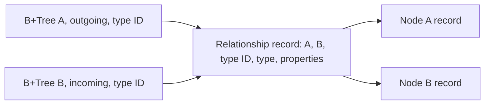

# Graph storage design

This page describes the storage component inside `Assimalign.Cohesion.Database.Graph`.

> **Status:** Partial.

Namespace: `Assimalign.Cohesion.Database.Graph.Storage`. Assembly: `Assimalign.Cohesion.Database.Graph.dll`. NuGet package: `Assimalign.Cohesion.Database.Graph`.

This storage component ships inside the model package. Keep its namespace
imports and replace the former satellite package reference with `Assimalign.Cohesion.Database.Graph`; recompile consumers.
The model enforces engine → Catalog → Storage → shared kernel through architecture tests.

## Ownership and composition

The sealed public GraphStore is created by GraphStore.Open. `GraphStorage` is the thin shared-kernel storage subclass. The engine owns its
storage streams and coordinator; the store owns neither and has no independent disposal or
background workers. All identities are reserved from the kernel's durable transaction-sequence
namespace, so rollback and restart do not reuse an identity.

The Graph root owns query planning, label/type validation and session scoping. Graph.Catalog owns
schema metadata. This component owns physical graph records and their indexes. The dependency arrows
point to the shared `Storage`, Transactions and Indexing packages; no model-specific paging, journal,
lock manager or B+Tree is implemented here.

## Physical layout and adjacency

The shared file header persists `StorageModel.Graph`. Slotted data pages carry an owner identifier:
owner 0 is Graph.Catalog metadata, owner 1 is physical B+Tree registrations, and owner 2 contains
nodes, relationships and logical property-index definitions. Shared B+Tree pages use the kernel's
`PageType.Index` format.

One relationship record contains both directed endpoints and a catalog type GUID supplied to
CreateRelationshipAsync. The store does not verify the GUID/name pairing; the engine resolves it
from Graph.Catalog. The shared adjacency B+Tree, registered under object ID UInt64.MaxValue and
name graph, maps (node, direction, type ID, relationship ID) to a packed physical location.
Each 33-byte key contains an unsigned big-endian UInt64 node, direction byte (1 outgoing, 2 incoming),
a 16-byte big-endian GUID and unsigned big-endian UInt64 relationship. Every relationship has two
entries, including a self-loop. Both-direction reads skip the incoming self-loop before decoding
it again, without retaining a set proportional to outgoing degree.

The diagram shows the same layout: each node's adjacency prefix selects references to relationship
records, and each relationship record contains both endpoints.

The filtered [GetIncidentAsync](graph-store.md#incident-reads) streams closed ranges from
(node, direction, type ID, 0) through (node, direction, type ID, UInt64.MaxValue).
Null types select all types in the requested directions; empty selects none; duplicate IDs add no
visits. For t selected type/direction ranges and r retained entries, work is O(t log E + r).
Only snapshot-visible references are decoded; unrelated directions/types add no relationship decodes.
The streaming API specifies no cross-range ordering. The unfiltered list overload and engine sort
visible relationships by identity.

The shared B+Tree currently collects an entire selected key/reference range under its read latch
when opening a cursor. Cancellation is checked before each range but cannot interrupt that
collection. The engine then collects and sorts decoded relationships before visiting them: its
candidate budget bounds visits, not range loading or decoding. Creating, replacing or deleting
relationships maintains both direction-specific entries in one physical statement bracket.

Compound keys make every current relationship entry distinct. This is also deliberate protection
against a duplicate-key lower-bound seek starting in a later leaf after a shared B+Tree split. A
regression creates 240 incident edges, forces splits, reopens the file set, and checks all edges.
There is no kernel change.

## Version 3 record format

All multibyte fixed-width values below are little-endian unless a key explicitly says otherwise.
Every slotted record starts with the shared 16-byte stamp prefix: writer sequence at offsets 0-7,
deleter sequence at offsets 8-15. Zero deleter means live. Graph records have kind at offset 16,
format version 3 at offset 17, a nonzero 64-bit logical identity at offsets 18-25, and an
UInt64 revision at offsets 26-33. Revision starts at zero and increases on replacement. The
remaining payload follows that header:

| Kind | Meaning | Payload after identity |
| --- | --- | --- |
| 1 | Node | Int32 label count, label strings, property map |
| 2 | Relationship | UInt64 source, UInt64 target, 16-byte catalog type GUID (Guid.ToByteArray order), type string, property map |
| 3 | Property index definition | Label string, property-key string |

A property map is an Int32 count followed by ordinally sorted `(key string, scalar)` pairs. Counts
must be nonnegative and bounded by the maximum record size. Strings use the .NET BinaryWriter length
format: a 7-bit encoded nonnegative UTF-8 byte length and those bytes, with strict UTF-8 validation.
Labels are ordinally deduplicated and sorted. The explicit scalar encoding is:

| `Tag` | Payload |
| --- | --- |
| 0 | Null, no payload |
| 1 | Boolean byte |
| 2 | String |
| 3, 4 | SByte, Byte |
| 5, 6 | Int16, UInt16 |
| 7, 8 | Int32, UInt32 |
| 9, 10 | Int64, UInt64 |
| 11 | `Decimal`, BinaryWriter's four Int32 words |
| 12, 13 | Finite IEEE-754 Float64, Float32 |

Record length is limited to the shared `SlottedPage.MaxRecordSize`. Unsupported CLR objects,
non-finite floating values and oversized records fail before insertion. This version does not define
arrays, nested objects or overflow chains. Nodes and relationships are immutable versions.
UpdateNodeAsync replaces labels/properties; UpdateRelationshipAsync preserves endpoints/type and
replaces properties. Both publish even equal values; GQL filters pure no-ops. Creation accepts
complete records with caller-reserved identities. Formats 1 and 2 are refused before logical
recovery scrub with COHDBG017 and the recreation remedy; there is no upgrade reader. Graph records
and tree registrations use version 3; catalog and B-tree page formats are unchanged. The low-level
StorageCorruptionException carries the code in its message; the engine preserves it in
DatabaseException.Diagnostics without assigning a SQLSTATE.

Owner-one physical registration records are exactly 34 bytes: a zero stamp prefix, kind `4`,
version `3`, UInt64 object ID, and Int64 root page ID. Every tree is named `graph`; its object ID
distinguishes it. `Root` registrations change in the same bracket as a split and are reloaded after
physical statement rollback. They are physical infrastructure, so logical rollback leaves an unused
tree available for recovery; logical property-index definitions remain stamped and determine
visibility.

Physical references use the high 48 bits for the page ID and low 16 bits for the slot. Readers check
page allocation, data-page owner, record identity and writer stamp before trusting cached
references. Checksum errors and real I/O failures propagate; reclaimed pages/slots and reused
locations are treated as stale directory entries.

## Secondary indexes

Each label/property definition owns a B+Tree whose object ID is its durable definition identity.
Keys consist of the shared `DatabaseKeyWriter` scalar encoding followed by the node identity as
eight unsigned big-endian bytes. The scalar encoding is null, Boolean, ordinal UTF-16 big-endian
string bytes, or Float64 for every numeric CLR type. The scalar prefix may occupy at most 1016
bytes, leaving eight bytes within the shared 1024-byte key limit. Missing properties have no entry;
a present null has a null key.

Numeric keys are a candidate projection. Nearby Int64 or `Decimal` values can map to the same Float64
value. Every result is compared to its original scalar: integral/`Decimal` pairs compare exactly as
`Decimal`, and a pair involving Float32 or Float64 compares as Double. This matches the root evaluator
and supports very large and very small finite floating values. Positive and negative zero share one
key. Prefix seeks bound the candidate range by node identities zero and `UInt64.MaxValue`; the
identity suffix also makes a heavily repeated property value safe across B+Tree leaf splits.

`Index` creation backfills visible nodes under the database writer lock and preserves source record
stamps. Every subsequent node create/update/delete maintains all current definitions in its transaction.
Dropping an index tombstones its logical definition; older snapshots retain the tree and their view.
This MVP retains dropped physical trees for later reclamation rather than recycling them while
snapshots may still reference them. An exact seek costs `O(log N + k)` index work for `k`
candidates, including numeric projection collisions and retained versions; ordering its `m` visible
matches adds `O(m log m)` CPU work.

## Atomicity, conflicts and recovery

All graph writers acquire the shared database-level exclusive lock and retain it until logical
commit/rollback; readers use MVCC snapshots. The lock is deliberately coarse for the MVP. After a
wait, the store checks cancellation and active transaction state and releases a grant received after
rollback. Update and deletion checks compare the caller's snapshot with the latest committed view
while holding the lock; a changed record produces `TransactionAbortedException`. A stale detach
cannot silently cascade a relationship that appeared after its snapshot.

Creating a relationship applies the record and endpoint indexes in one coordinator statement.
Deleting a connected node without detach is refused before mutation. Detach tombstones the node,
every incident relationship, both adjacency entries and all node-property entries in one physical
bracket. Version-ledger entries allow logical rollback to restore those records and index stamps
together. Committed tombstones remain available to older snapshots until the shared version-purge
worker's safe bound passes.

Opening follows this order:

1. `GraphStorage.Open(..., checkpointOnOpen: false)` runs shared physical recovery.
2. Run GraphStore.EnsureIndexFormat before scrub, refusing older graph records/registrations with COHDBG017 and incompatible B-trees.
3. With the coordinator constructed, call `AnalyzeAndScrub()` to undo unproven record writers.
4. `GraphStore.Open` loads owner-two record directories and owner-one registrations.
5. `RecoverIndexesAsync(plan.Aborted)` scrubs aborted index writers and deleters.
6. `CompleteRecovery()` checkpoints after lifecycle classification has been consumed.

Crash tests ordinarily flush the journal and clone data and journal memory streams without disposing
the live database. MemoryStream has no durable-flush contract; these serialized images test recovery
replay and scrub, not physical persistence. They prove committed nodes, relationships and property
indexes survive while a partially applied logical transaction disappears. The graph store keeps an
identity directory of every retained version rebuilt in O(R log R) for R retained records at open.
Persisted revisions order each chain newest first; reads select the first visible version. Label
scans examine node identities and retained versions and sort m visible matches in O(m log m). Traversal path enumeration and cycle limits are
owned and documented by the Graph root.

## Version publication and isolation

Each replacement encodes the record and new index keys before mutation, moves property-index
or adjacency entries, and tombstones the old version in one physical bracket. Rollback restores
stamps/removes new versions. Snapshot pins protect historical versions from purge; reclaimed/reused
references are removed from the directory. A per-transaction async gate serializes full store
mutations, including statement views, through directory publication.

Snapshot keeps its horizon and uses first-updater-wins. Original ReadCommitted contexts take a
fresh snapshot after the writer lock; caller-pinned statement views keep their horizon and may
conflict. Relationship insertion checks latest endpoint existence, so a concurrent endpoint
property update alone does not cause a conflict. See [GraphStore](graph-store.md).

## Sources

- **Primary source** — `cohesion/resources/Database/Assimalign.Cohesion.Database.Graph/docs/DESIGN.md`.
- **Source** — `cohesion/resources/Database/Assimalign.Cohesion.Database.Graph/src/Assimalign.Cohesion.Database.Graph.csproj`.
