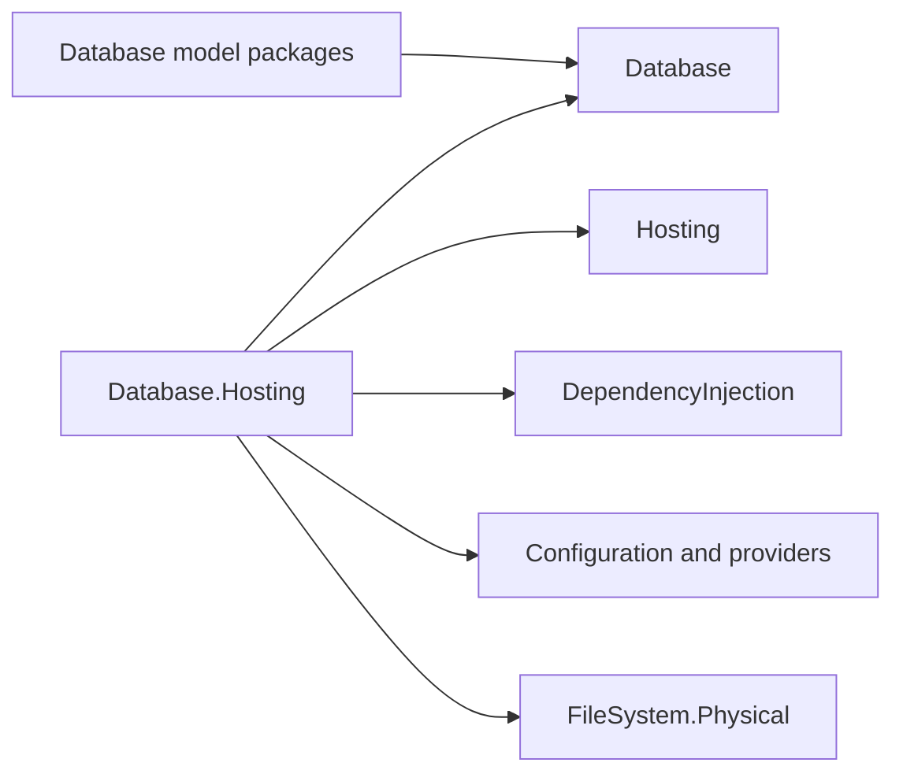

# Assimalign.Cohesion.Database.Hosting design

This page describes the boundaries and implementation shape of `Assimalign.Cohesion.Database.Hosting`.

> **Status:** Partial.

## Composition

Phase 29 implements the owner-approved `Database` hosting design
(`cohesion/docs/programs/DATABASE_HOSTING_DESIGN.md`), including its nested-engine corrections. The
public path is `DatabaseApplication.CreateBuilder(args)` → `Add` intent → one-shot `Build()` → engine
access / `RunAsync()`. There is no composition `Use` method or application-builder `AddServer`.

The root builder accepts borrowed engines and dependency-free engine factories receiving the
application context. Model packages supply `AddSql`, `AddDocuments`, `AddGraph`, `AddKeyValue`,
and `AddBlob` using `extension(IDatabaseApplicationBuilder)`. Their callbacks run at `Build` against
a model engine builder; worker and server factories run after that engine exists. Hosting never
references a model package, resolves model services, or binds model configuration. A concrete
hosting overload, `AddEngine(name, factory)`, receives built `Configuration` and `Services`
explicitly.

`COHRES001`–004 remain enforced. Private Web hosting/health references implement admin health.
[Database.Hosting.ApplicationModel](../assimalign-cohesion-database-hosting-applicationmodel/index.md)
supplies the managed-resource registration on `builder.Services`. Database.Hosting has no
ApplicationModel reference. Resource publication, restoration, and action dispatch are composed by
the integration package.

## `Build` and configuration

`Build` consumes the builder before user code runs, even if construction fails. Engine and service
registration closes, and host policy options are copied. Engines and services are registered through
`AddEngine` and `AddService`; servers belong to engines. There are no borrowed instance lists on
`Options` and no live `Engines` property on the root builder.

`CreateBuilder(args)` loads optional `appsettings.json`, optional
`appsettings.{Environment}.json`, `COHESION_CONFIG__` environment variables, then arguments when it
creates the builder. Later providers win. The files resolve under `AppContext.BaseDirectory`.
`CreateBuilder()` and `new DatabaseApplicationBuilder(options)` start with empty configuration.
Environment and content root are read when the builder is created; Build takes their values from
`Environment`. Configuration loads providers as they are added. Changes after Build load but do not
recompose engines. JSON reload is disabled. The application owns configuration and its default
physical file system from Build.

The concrete builder exposes `HostEnvironment Environment`, `ConfigurationManager Configuration`,
`LoggerFactoryBuilder Logging`, and `ServiceProviderBuilder Services`. Build creates one provider
and logger factory. Building `Services` directly creates a separate provider the caller owns;
building `Logging` directly consumes that builder and makes the application's Build fail.

One Cohesion service provider is built with `EnableDynamicCode = false`, `ValidateScopes = true`,
and `ValidateOnBuild = true`. This selects the interpreted resolver on JIT and NativeAOT. Hosting
permits closed factories and instances only, rejects implementation-type/open-generic activation,
and reserves `IHostEnvironment`, `IConfiguration`, and `ILoggerFactory` for its own borrowed pieces. Model
construction uses explicit assignments rather than reflection-based binding. Engine factories must
not return provider-owned services; lifecycle forwarding factories have the disposal caveat below.

Root engine factories observe preceding engine registrations, not later ones. Every factory is
named: names are reserved at Add and products must match them ordinally. Duplicate names fail before
factories can open data paths. Names are nonempty, case-sensitive, and unique across models.
`Context.GetEngine(name)` returns a borrowed reference. The concrete hosting factory receives the
built environment, configuration, provider, logger factory, and Build cancellation token.

## Nested servers and ownership

`Application` `Build` flattens each engine's `Servers` snapshot in engine/attachment order. Engines own
these servers and dispose them before workers and databases. The application drives their Start/Stop
through `DatabaseServerHostService` but never enrolls them for a second disposal. A server must
front its owning engine, which the engine base enforces. Duplicate lifecycle objects fail Build;
conflicting engine names fail registration.

| Input | Disposal owner |
| --- | --- |
| `AddEngine(instance)` | Caller |
| Root or hosting `AddEngine(name, factory)` / model Add verb | Application after Build; builder on failed Build |
| Model builder worker/server factory | Engine |
| `AddService(instance)` | Caller |
| `AddService(factory)` | `Application` if disposable |
| Container `IHostService` factory | Application if disposable, before engines |
| Other provider-created service | Provider |
| Provider instance registration | Caller |
| Configuration and default configuration file system | `Application` |
| Logger factory and service provider | Application |

A factory transfers a fresh product, and cleans up partial allocations if it throws before
returning. Detectable borrowed/owned aliases are rejected before re-enrollment. Fresh invalid
products are enrolled before validation so rollback disposes them. `Build` compensation attempts owned
services, engines (including their servers), provider, logger factory, configuration, and file system in reverse
dependency order. Synchronous `Build` bridges asynchronous cleanup on a worker without capturing the
caller's synchronization context. Original construction exceptions are preserved; cleanup failures
produce an aggregate with the original first. Files created by a factory are never silently deleted.

## Runtime lifetime

Lifecycle services come from `AddService` and from `IHostService` registrations on `builder.Services`.
After freezing the engine/server registry and creating every `AddService` product, Build reads the
unkeyed `IHostService` descriptors from `Services.Container` in registration order. It borrows
instance products and invokes each factory once, directly, with the built provider. It never
resolves `IEnumerable<IHostService>` from the provider. Keyed registrations are not lifecycle
services and are ignored. Start order is:

1. **AddService registrations**, in registration order.
2. **Container IHostService registrations**, in registration order.
3. **The optional reopen service**.
4. **Servers**, in engine/attachment order.

All lifecycle `StartingAsync` callbacks complete before any service starts. A managed instance
publishes and restores here, after Build has opened, recovered, and provisioned the engines.
Its platform client opens during service start, before servers listen. Shutdown reverses the
complete order: servers drain while the control plane stays open, then reopen/container services
stop before `AddService` services.

Container lifecycle registrations must be singletons. Scoped and transient registrations fail
Build with `Lifecycle service registration '{0}' must be a singleton.`, with `{0}` replaced by the
descriptor. Implementation-type registrations remain refused. A null lifecycle factory product
fails with `A service factory returned null.`

The application owns container lifecycle factory products alongside `AddService` factory products.
After stop, it disposes the reopen service, container services in reverse registration order,
`AddService` services in reverse order, engines, then infrastructure (provider, logger factory,
configuration, content root). Supplied instances remain borrowed and are never disposed by the
application. Registering one object through both `AddService` and the container, through multiple
container registrations, or as a server and a container service fails Build with
`A lifecycle service was registered more than once.` A throwing factory triggers Build
compensation; cleanup failures are aggregated with the construction failure first. Provider
disposal also continues past disposer failures in reverse creation order, propagating one failure
unchanged or aggregating several. Outer cleanup continues with the remaining infrastructure. See
[container service tests](examples/database-container-service-tests.md).

A forwarding lifecycle factory (`sp => sp.GetRequiredService<X>()`) hands the application an object
the provider also owns, so both dispose it. Its `Dispose` must be idempotent. Use
`AddService(instance)` or an instance registration when ownership must stay with the caller.

Provisioning belongs to each model's engine build. It opens or creates the databases declared on
its builder and completes inline schema migration before returning. Deferred migrations can
continue on engine workers with their admission gates. The concrete `Build(CancellationToken)`
passes cancellation to construction; `StartupTimeout` only bounds service start. A managed
program's gateway startup window must cover Build's recovery and inline migration.

`DatabaseApplication` remains `Host<DatabaseApplicationContext>` and its context remains
`HostContext` / `IHealthContributor`. `Run`, `RunAsync`, and `AsService` use the Hosting
extensions. Embedded applications can use engines immediately after `Build`, or `Run` to wait for host
shutdown without a listener.

The application permits one start lifecycle. Repeated Start while started is a host no-op; restart
after Stop or a failed start is rejected through the protected start hook, including interface/`Run`
paths. Stop before first Start does not consume the attempt. Concurrent Start/Stop/`Dispose` is
unsupported; concurrent `Dispose` calls alone share one cleanup task. `Dispose` is idempotent, stops if
needed, and attempts all application-owned roots after failures. Provider/configuration outlive
products that depend on them. Sessions remain caller-owned and must finish before application
disposal. Borrowed SQL/KeyValue servers may terminally close their listeners during Stop despite
remaining caller-owned for disposal.

Health observes distinct engines, states and workers from the frozen runtime registry.
For all five models, a maintenance lane delayed by capacity or stuck I/O can set engine Faulted
while HasFailingWorker(database) remains false and requests continue. Root events 35 and 36
identify delayed work and disposal waits. See [maintenance health and operations](../assimalign-cohesion-database/design.md#maintenance-lane-isolation).
Every deferred SQL migration, and every joint TYPE plan, reports through model-neutral Provisioning: queued/running work
is Degraded, and a failed preparation (`CS03402`) stays Degraded while the database serves its
old schema. A successful explicit apply or later Build, including an already-applied skip,
clears that failure. There is no automatic migration retry. An unconfirmed publication reports
`CS03403` and follows storage's offline/recovery policy. See
[typed migration health and recovery](../../../../database/sql/index.md#typed-migration-health-and-recovery).

The public static `CreateBuilder(name)` on each model engine returns its sealed model builder for
deferred standalone composition. Its `Options`, `AddDatabase`, `AddServer`, and `AddWorker` compose
the engine. Configuration and service reads remain in the hosting callback.

## Platform endpoints and HTTP health

When COHESION_GATEWAY is nonempty, a model server without a listener consumes its named endpoint:
sql, documents, graph, kv or blob. Explicit listeners win. The root resolves fallback on the options
snapshot inside model server validation, after timer and session-limit checks and before the
missing-listener refusal. Invalid snapshots therefore allocate no platform listener. The default is plain TCP;
schemes do not select TLS. Missing/malformed values retain CK08001; DNS bind hosts retain CK07101.
See [server options](../assimalign-cohesion-database/database-server-options.md). Two servers of one
model need distinct listeners; an address collision fails Start and rolls back prior listeners.

[AddHealthEndpoint(Uri)](database-application-builder.md#addhealthendpoint) configures one plain-HTTP
health listener; the last call wins. At Build, managed `http` assignments with plain HTTP and a
literal IP or localhost override an explicit health URI. Unsupported schemes or DNS hosts emit
event 18 and are skipped, keeping explicit health or composing no listener. Missing/malformed
assignments are unset. An unmanaged host creates no listener without AddHealthEndpoint.

The health singleton is last among container lifecycle services, before reopen and model servers.
Start awaits its bind; socket bind failure reports DatabaseException.Diagnostics code CK07102,
preserving the Web HostStartupException and SocketException cause. Startup rolls back prior
services. Event 15 reports the original failure once. Shutdown drains servers before health stops;
async disposal owns the private Web host. Readiness stays unavailable until the outer host reaches
Started after every model server accepts; liveness omits that readiness-only gate.

The internal source `Assimalign.Cohesion.Database.Hosting` adds:

| ID | Event | Level | Payload |
| --- | --- | --- | --- |
| 18 | HealthEndpointAssignmentSkipped | Informational | assignment (`http`), endpoint (scheme and authority), scheme |
| 19 | HealthEndpointOverridden | Informational | explicitEndpoint, platformEndpoint (scheme and authority) |

Event 19 occurs only when a usable platform assignment replaces a different explicit URI. Missing
or malformed assignments emit neither event. Existing event identities and health routes remain.

## Standalone admin control plane (#1431)

The internal `DatabaseAdminEndpointService` serves managed platform health or an explicitly
configured unmanaged endpoint through the builder composition above.

The listener restricts `/cohesion/v1` and every path below it to
transport peers at `127.0.0.1`, `::1`, or IPv4-mapped `127.0.0.1`. Other, absent, and non-IP
remote endpoints receive 403; the status makes the development-only restriction explicit. Forwarded
headers do not establish locality. The guard precedes Database's own namespaced health mappings,
which otherwise short-circuit the shared Web.Hosting control-plane middleware.

Bare `/healthz`, `/readyz`, and `/livez` remain open for orchestrators and load balancers. Loopback
probes keep the Database health report and its server-accepting readiness gate. Non-health routes
under `/cohesion/v1` return 403 even for loopback callers with bearer credentials. There is no
gateway-identity exception. The internal service accepts plain HTTP only; HTTPS has no certificate
source following retirement of the resource context and is refused.

This is a behavioral breaking change from 10.0.0-preview.1 (owner decision 46, accepted on
decision 15's preview terms): a reachable
standalone admin listener previously accepted remote control-plane requests without credentials.
The managed instance control plane is separate, reached through its selected platform client.

Model server factories supply `IDuplexConnectionListener` instances to their model options. Each server owns accepted `IDuplexConnection` sessions and closes them during its drain; listener disposal does not transfer connection ownership to the hosting module.

## File-set refusals

Declared Build uses the engines' open/create rules: SQL completes only a proven empty interrupted
create, while missing sidecars and ambiguous catalogs remain preserved refusals. Graph, Document and
Blob never recreate missing journals/backups during provisioning. A data-file-first drop prevents
reopening an interrupted deletion. See [model lifecycle codes](../../../../database/overview.md#database-file-sets-and-lifecycle).

## Declared dependencies

| Reference | Kind |
|---|---|
| `Assimalign.Cohesion.Database` | `CohesionProjectReference` |
| `Assimalign.Cohesion.DependencyInjection` | `CohesionProjectReference` |
| `Assimalign.Cohesion.Configuration` | `CohesionProjectReference` |
| `Assimalign.Cohesion.Configuration.Json` | `CohesionProjectReference` |
| `Assimalign.Cohesion.Configuration.EnvironmentVariables` | `CohesionProjectReference` |
| `Assimalign.Cohesion.Configuration.CommandLine` | `CohesionProjectReference` |
| `Assimalign.Cohesion.FileSystem.Physical` | `CohesionProjectReference` |
| `Assimalign.Cohesion.Hosting` | `CohesionProjectReference` |
| `Assimalign.Cohesion.Logging` | `CohesionProjectReference` |
| `Assimalign.Cohesion.Web.Hosting` | `CohesionPrivateProjectReference` |
| `Assimalign.Cohesion.Web.Health` | `CohesionPrivateProjectReference` |

[Assembly overview](index.md) · [Examples](examples/index.md)

## Shared TCP delivery

Database SDK hosts receive the public Database.Tcp package through App.Database; Connections.Tcp remains runtime-private. Import Assimalign.Cohesion.Database for Listen(Uri), usable with all five server-options leaves. See [TCP composition](../assimalign-cohesion-database-tcp/index.md).

## Health builder construction

The admin endpoint constructs the public sealed HealthChecksBuilder in Assimalign.Cohesion.Web.Health. The standalone HealthChecks.CreateBuilder factory is removed; IHealthChecksBuilder extensions and immutable service snapshots remain. See [builder API](health-checks-builder.md).

## Sources

- **Endpoint binding and health** — `cohesion/resources/Database/Assimalign.Cohesion.Database.Hosting/tests/DatabaseHealthEndpointTests.cs`, `DatabasePlatformCollisionTests.cs` and `DatabaseHostingEventSourceTests.PlatformEndpoints.cs` in the same test directory.

- **Primary source** — `cohesion/resources/Database/Assimalign.Cohesion.Database.Hosting/docs/DESIGN.md`.
- **Source** — `cohesion/resources/Database/Assimalign.Cohesion.Database.Hosting/src/Assimalign.Cohesion.Database.Hosting.csproj`.
- **Ordering and ownership** — `cohesion/resources/Database/Assimalign.Cohesion.Database.Hosting/src/DatabaseApplicationBuilder.cs` and `tests/DatabaseContainerServiceTests.cs`.
- **Admin behavior** — `cohesion/resources/Database/Assimalign.Cohesion.Database.Hosting/src/Internal/DatabaseAdminEndpointService.cs`.
