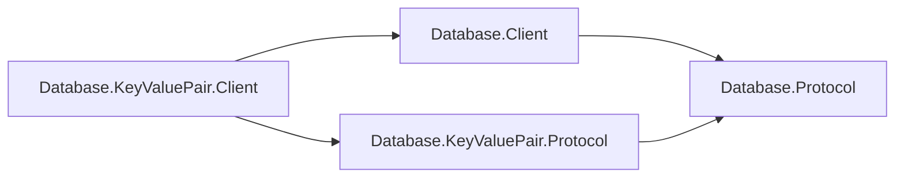

# Assimalign.Cohesion.Database.KeyValuePair.Client design

This page describes the boundaries and implementation shape of `Assimalign.Cohesion.Database.KeyValuePair.Client`.

> **Status:** Partial.

The key-value client owns command construction, parameter encoding, result materialization, typed
outcomes, error mapping, and telemetry. The shared client owns pooling, handshake, framing, and
exchange lifetime.

## Contract dependencies and client errors

This client references Database.Client, KeyValuePair.Protocol, shared Protocol and Types, and Connections. Wire contracts and transferred values use the
`Assimalign.Cohesion.Database.KeyValuePair.Protocol` namespace. The client references no engine.
COHDBCLIENT001 rejects engine project references, resolved engine assemblies and engine source imports.

`KeyValueClientException` derives directly from `System.Exception` and declares its own
non-null, read-only Diagnostics. Catch this client exception for remote failures; catching
`DatabaseException` no longer handles them. See the [migration guide](../../../../database/model-project-migration.md#remote-failures).

## Family position

The client references shared mechanism and the key-value wire family:

| Package | Role |
| --- | --- |
| `Database.KeyValuePair.Client` | Command/result policy and materialization |
| `Database.Client` | Pooling, handshake, framed exchange lifetime |
| `Database.KeyValuePair.Protocol` | Family identifiers and payload codecs |
| `Database.Protocol` | Shared framing and immutable family binding |

## Wire ownership

`KeyValueClient.Create` binds its pool to `KeyValueProtocol.Family`. `KeyValueExecuteExchange`
encodes parameters, writes the command, and materializes the complete response before returning its
private result to the typed connection. The model's command specification
(`cohesion/resources/Database/Assimalign.Cohesion.Database.KeyValuePair/docs/COMMANDS.md`) defines
command grammar and operation result shapes. Protocol 2.1 negotiates shared startup, with unchanged baseline model payloads. Key-Value
agrees no Diagnostics capability and retains Key-Value command and execution codes in Error text.

Detected storage damage carries CK06003 through the same ExecutionFailure Error text, with
database/page context rather than a successful missing-key result. No SQLSTATE is assigned.
See [command diagnostics](../../../../database/key-value-pair/diagnostics.md).

Database.KeyValuePair.Protocol supplies codecs independently of the engine. The client references
that contract assembly and shared client infrastructure; its dependency closure contains no
engine, catalog or storage implementation.

Keys and values remain byte-oriented and use `DatabaseValueCodec` binary components. Typed
serialization belongs to consumers; public client entry/range types remain independent from engine
request types.

## Conditional outcomes

An etag mismatch is a first-class outcome: conditional put returns `KeyValueWriteResult` with
`Applied` and the new-or-current etag; conditional delete returns a boolean. Staleness calls for
rereading, while a concurrently committed write conflict reports `ExecutionFailure` for contention
retry. Unconditional put returns its new etag directly.

## Errors, lifecycle, and telemetry

`KeyValueClientException : Exception` maps wire codes to model error kinds and preserves the
code. `MalformedResult` identifies a completed response that does not match the typed operation's
values; no unread frames remain. Framing/decoder failure or cancellation during an exchange
invalidates the shared connection. Disposing a healthy typed connection returns its session to the
pool; disposing the client disposes that pool.

Observers report grammar text, counts, and elapsed time. `Key`/value bytes are never included.
Observer exceptions cannot fault an operation or mask its exception.

## Materialized scans, AOT, and non-goals

Null or zero-length `KeyValueScanRange` bounds mean absent, including an implicitly converted
null `byte[]`. Only non-empty bounds participate in prefix/range conflict validation; empty
clauses and their parameters are omitted. See [ScanAsync](key-value-connection.md).

Materialized scans are this package's policy. `Use` a range limit to bound results; cursor composition
can resume after the last key. An incremental API can be added here without changing shared result
policy.

Encoding and materialization use no reflection or runtime code generation. Wire transactions, typed
serialization, caching, retry policy, and rent-time liveness pings remain outside this surface.

## Phase 29 composition migration

The TCP end-to-end fixture now registers `AddKeyValue` with a nested deferred `AddServer` factory.
`Build` constructs the engine and listener/server, then the fixture retrieves the engine from the
built context for provisioning. The application owns the engine and the engine owns its
server/listener; disposing the application closes this whole graph before the restart-recovery
composition. Wire/client behavior and protocol remain unchanged.

## Duplex transport composition

`ConnectionFactory` accepts `IDuplexConnectionFactory`. The shared client reads and writes
framed bytes through the returned `IDuplexConnection`; the common `IConnection` root carries
identity, features and lifecycle only. TCP, InMemory and TLS-layered duplex factories satisfy
this contract. The pool owns each established connection and disposes it when discarded or
when the pool closes; transport disposal has signaled `ConnectionClosed` before it completes.

### Breaking changes from 10.0.0-preview.1 (#1459)

`KeyValueClientOptions.ConnectionFactory` changes from `IConnectionFactory?` to
`IDuplexConnectionFactory?`. Changing the property's getter and setter signatures breaks
preview.1 binaries and source that supplies a factory typed only as `IConnectionFactory`.
This preview break is accepted under owner decisions 15 and 58. Rebuild consumers and use
`IDuplexConnectionFactory` for factory variables and custom implementations. Custom factories
can derive from `DuplexConnectionFactory`, implement `ConnectCoreAsync` returning
`ValueTask<IDuplexConnection>`, and produce a `DuplexConnection` implementation. Built-in TCP,
InMemory and TLS-layered duplex factories already satisfy the new contract. Database wire
framing, handshake and model messages are unchanged.

## Declared dependencies

| Reference | Kind |
|---|---|
| `Assimalign.Cohesion.Database.Protocol` | `CohesionProjectReference` |
| `Assimalign.Cohesion.Database.Client` | `CohesionProjectReference` |
| `Assimalign.Cohesion.Database.KeyValuePair.Protocol` | `CohesionProjectReference` |
| `Assimalign.Cohesion.Database.Types` | `CohesionProjectReference` |
| `Assimalign.Cohesion.Connections` | `CohesionProjectReference` |

[Assembly overview](index.md) · [Examples](examples/index.md)

## Rental isolation

KeyValueConnection wraps a new shared lease for each rental; the pool retains only its internal connector.
Database is captured before return, allowing operation diagnostics to finish after the core lease
is disposed. Ended leases permanently reject execution and report IsOpen false; cleanup cannot
reach another renter. See [DatabaseConnection](../assimalign-cohesion-database-client/database-connection.md)
for disposal, shutdown and SQL/Graph transaction-status reset.

## Queued terminal errors

Before the next admitted operation writes a request, the shared connector checks buffered input or
a closed transport and consumes a queued terminal Error once. Its original code reaches
KeyValueClientException and the connector is discarded. This also applies to streaming startup;
IsOpen continues to describe physical transport health. Unexpected/malformed terminal frames use
ProtocolViolation; clean EOF without an Error remains Internal. Rent-time pings are not implemented.
A clean handshake EOF has its own message naming the startup handshake. See
[shared admission](../assimalign-cohesion-database-client/database-connection.md#queued-terminal-errors)
and [terminal delivery/TLS limits](../assimalign-cohesion-database-protocol/design.md#terminal-delivery-and-frame-writes).

## Sources

- **Current project boundaries** — `cohesion/resources/Database/README.md`.
- **Build guard** — `cohesion/resources/Database/Directory.Build.targets`.

- **Primary source** — `cohesion/resources/Database/Assimalign.Cohesion.Database.KeyValuePair.Client/docs/DESIGN.md`.
- **Source** — `cohesion/resources/Database/Assimalign.Cohesion.Database.KeyValuePair.Client/src/Assimalign.Cohesion.Database.KeyValuePair.Client.csproj`.
