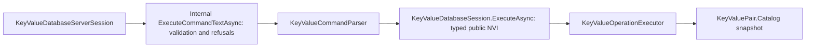
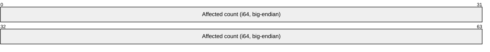

# Assimalign.Cohesion.Database.KeyValuePair design

This page describes the boundaries and implementation shape of `Assimalign.Cohesion.Database.KeyValuePair`.

> **Status:** Partial.

The key-value engine (area architecture: resources/`Database`/DESIGN.md
(`cohesion/docs/resources/Database/DESIGN.md`) `3.3, generality report `3.10): an ordered key space
over the shared kernel, and the **second model engine** — built deliberately as the proof that the
kernel is model-general, not SQL-shaped.

## Model component boundaries

Catalog, Storage and the empty Security satellite are now part of `Assimalign.Cohesion.Database.KeyValuePair`.
Public Catalog and Storage types retain their namespaces and members; they ship in the model
assembly and NuGet package. Replace satellite references with the model package and recompile.
Assembly-qualified type names change, with no compatibility assembly or type forwarders.

The direction is engine → Catalog → Storage → shared kernel. Public component types live in
`src/Catalog/` and `src/Storage/`; internal types live in `src/Internal/Catalog/`
and `src/Internal/Storage/`. Engine persistence strategies and catalog-aware codecs belong
in `src/Internal/Engine/Storage/`. Transaction record-space adapters belong to Storage.

Roslyn architecture tests check actual compiler inputs and resolved symbols: Storage cannot use
Catalog or engine types; Catalog cannot use engine types. Storage permits shared Storage,
Transactions and Indexing plus the BCL reference pack. Catalog additionally permits the
area root and Types. Protocol, Language, Schema and Connections are disallowed in both constrained
layers; engine code has no external assembly restriction.

Wire messages, codecs and transfer values now belong to [KeyValuePair.Protocol](../assimalign-cohesion-database-keyvaluepair-protocol/index.md).
Engine and client reference those same contracts. Moved wire types change namespace as well as
assembly identity; update their imports. Wire and disk formats are unchanged.

## String comparison and collation (#1025)

`Key`-Value remains binary-only for user data: keys and values are opaque bytes, and key equality,
ordering, uniqueness, and prefix ranges use unsigned lexicographic byte comparison. Text supplied as
a key is compared in its encoded form without case or accent folding. Command keywords and
administrative database lookup remain ordinal-ignore-case; those identifier rules do not transform
user keys. SQL database defaults and column/expression `COLLATE` have no effect on this model.
Configurable text collation is deferred.

## Design intent

Compose kernel pieces, never re-implement them — and compose them in a *different shape* than the
SQL engine, because the difference is the point:

| | SQL engine | `Key`-value engine |
|---|---|---|
| Primary structure | the record space (scan-primary; indexes are secondary accelerators) | **the B+Tree primary key index** (index-primary; every read is a seek) |
| Record payload | object-id-prefixed typed tuple, schema from the catalog | key + value as two binary tuple components, self-describing |
| Conflict grain | table intent locks + per-row location locks + unique-key locks | **key locks only** (one per command) |
| Statement surface | the SQL dialect | data commands plus `KEYSPACES` discovery (docs/COMMANDS.md) |
| Catalog | schemas/tables/columns/indexes | registrations + format marker only |

Both engines share, unchanged: the storage substrate (slotted pages, per-owner chains, WAL v2,
recovery), the MVCC discipline (16-byte writer/deleter stamp prefix, snapshot visibility,
first-updater-wins latest-state checks, logical rollback via the version-store ledger, open-time
recovery scrub), the B+Tree (MVCC-stamped entries, latest-state uniqueness under hashed-key locks),
the one-sequence-namespace pairing, and the per-statement bracket/apply-gate model.

## Execution model

Explicit commit and rollback observe cancellation only before their end starts. Cancellation
observed then leaves the transaction usable with nothing committed. A started commit ignores
caller cancellation and returns its real outcome. Automatic commit receives no command token
after execution completes, and `PutAsync` consumes its materialized outcome without that token.
Execution and lock waits remain cancellable; a dead wire connection can still lose the result.
See [the shared boundary](../assimalign-cohesion-database-transactions/transaction-coordinator.md#commit-and-rollback).

- **`Index`-primary reads.** `GET`/`EXISTS` seek the unique primary index
  (`key` → packed record location) through the command's snapshot; `SCAN` drives
  a snapshot cursor over an `IndexKeyRange`. Keys go into `IndexKey` **raw** —
  the key-value ordering contract (unsigned lexicographic byte comparison) *is*
  `IndexKey`'s comparison, so no codec transformation applies to keys. Every
  fetched record's stamps are re-checked against the same snapshot (the SQL seek
  executor's defense-in-depth discipline: entries mirror record stamps by
  construction, so a divergence is a bug this filter contains). Prefix scans map
  to `[prefix, successor(prefix))` by byte-successor arithmetic; an all-0xFF
  prefix is unbounded above.
- **`Entry` records.** `[writer u64][deleter u64]` — the fixed 16-byte stamp
  header, the same layout the SQL record space and the B+Tree leaves carry —
  followed by the shared tuple codec payload (`key` binary component, `value`
  binary component). Entries live in the key space's per-object page chain
  (owner id 1), so a full scan of the database touches only entry pages. The
  key is stored in the record (not only in the index) so recovery scrubs and
  integrity checks are self-describing; format version 1, catalog-persisted,
  rejected-if-newer at open (no upgrade machinery — the model was born stamped).
- **Writes are two-phase, key-grain.** Phase one: acquire the key's Exclusive
  lock (`LockResource.Entry(keySpace, IndexKey.Hash())` — the same identity the
  B+Tree's unique enforcement locks internally, so its in-gate re-acquisition is
  a same-owner re-grant), resolve the visible version by index seek, re-validate
  its **current** stamps under the lock (a foreign committed deleter =
  first-updater-wins conflict, retryable), and decide conditional writes. Phase
  two: the coordinator's gated apply bracket — tombstone the old version in
  place (same-length stamp write), insert the new version into the chain, mirror
  both in the primary index, ledger every effect. A unique violation on the
  insert is a concurrently committed invisible writer → translated to the same
  retryable conflict.
  - **Why no row/location locks (a deliberate divergence from SQL):** every
    key-value mutation is keyed by exactly one key, and every version of a key
    is only ever mutated by that key's writer — so the key lock subsumes
    per-location locks entirely. `Key`-grain locks are the model's whole
    user-visible conflict surface; deadlocks (multi-key transactions) surface
    through the shared lock manager's requester-closes-cycle detection.
- **Etags = writer sequences.** An entry's etag is the `TransactionSequence`
  that wrote its visible version — R1's "key/etag uniqueness" for free: the
  sequence namespace is unique per database, every applied write produces a new
  etag, and the stamp is already in the record. Surfaced as `long` (the wire's
  `Int64` component).
  - **`Compare`-and-swap is a conditional decision, not a conflict** (the
    recorded outcome-shape decision): `IF @etag` / `IF ABSENT` misses return
    first-class not-applied outcomes (`applied=false` + current etag, affected
    count 0) with **no mutation and no exception** — an etag mismatch means the
    caller's *own* view is stale, which is application flow, not contention.
    Contention (a concurrently *committed* change racing the command) instead
    aborts with the root's retryable `DatabaseTransactionAbortedException` —
    same taxonomy as SQL. Rejected alternative: throwing on CAS misses (an
    exception storm on a hot upsert path) or folding conflicts into
    `applied=false` (hides real contention and breaks retry semantics).
- **Transactions.** Identical binding to the SQL engine's (`3.8): per-database
  `Database.Transactions.TransactionCoordinator` (manager + lock manager + record-space
  version store + gated journal-bound log, one sequence namespace with storage),
  explicit transactions and auto-commit both ride manager contexts, `Snapshot`
  default / `ReadCommitted` per-command refresh / `Serializable` rejected,
  rollback is logical through the ledger, recovery classifies + scrubs record
  space and primary index at open. Kernel aborts are wrapped in the root's
  exceptions at the session boundary (the area error policy).
- **Result shapes.** `GET`/`SCAN` return result sets (`key`, `value`, `etag`);
  `PUT` a one-row outcome set (`applied`, `etag`); `EXISTS` a one-row boolean
  set; `DELETE` a plain result with its affected count. These shapes ride the
  wire's generic ResultHeader/Row/Complete framing untouched — a deliberate
  constraint so the model needs no protocol surface of its own.

## Typed execution and the wire command grammar

`KeyValueDatabaseSession` derives from `DatabaseExecutionSession<KeyValueRequest>`.
It accepts typed commands only; the request root has no statement or parameter map.
The server's internal `ExecuteCommandTextAsync` entry parses the grammar in
`COMMANDS.md` (`cohesion/resources/Database/Assimalign.Cohesion.Database.KeyValuePair/docs/COMMANDS.md`). It checks closed session, blank text, cancellation, offline
database and refusing transaction before parsing, then calls the public typed NVI.
The server decodes parameter values before entering it.

The owner decision of 2026-10-16 (#1576) removes the public text seam because the grammar
is deliberately not a language and per-model servers already own the wire path. Execute
frames, command grammar, result framing and error codes are unchanged. Root statement
events name the parsed verb request type; parse failures use this model's event 10, and
pre-parse refusals produce no root statement event.

The 2026-07-14 choice of a minimal grammar reused Execute frames without adding binary
command frames. That remains the wire contract: parser, COMMANDS.md and corpus tests change
together. Model-specific binary frames remain a measured-need optimization.

## `Key`-space catalog introspection (C2)

The survey found one implicit key space and no named key-space registry. The catalog holds its
primary index registration and entry-space format version; `GetAsync`, `ExistsAsync`, and
`ScanAsync` already expose entry access, but none describes that key space. `KEYSPACES` extends the
existing command vocabulary with discovery through the session and wire protocol. Its typed
counterpart is `KeyValueKeySpacesRequest`; no existing public interface changes.

The command returns one row describing the catalog-registered implicit space: database name,
key-space object id, entry format version, primary-index name, index kind, and uniqueness. The exact
column order and types are specified in COMMANDS.md
(`cohesion/resources/Database/Assimalign.Cohesion.Database.KeyValuePair/docs/COMMANDS.md`, section
`key-space-discovery-c2`). The key-space id is local to the database and does not imply named-space
support. Physical index pages remain internal. This model has no compiled-schema ownership or
ownership enforcement, so there is no `OWNER` or `OWNING_SCHEMA` field to report. A smaller surface
faithfully describes its catalog without inventing relational or schema concepts.

The executor captures format and index registrations together under the catalog's metadata lock when
each command runs. Rows are computed in memory from that capture and never persisted into entry
storage or a second metadata cache. The next command sees newly published catalog state, even inside
a snapshot transaction: catalog publications are self-committing, separate from entry MVCC. An
already returned result retains its capture. The executor receives only its session's database
catalog and name; no selector can address another database.

The catalog snapshot belongs to the catalog package. The executor obtains its public
`IKeyValueCatalogSnapshot` contract through the `public static`
`KeyValueCatalog.CaptureSnapshot(IKeyValueCatalog)` bridge - not through `IKeyValueCatalog`, which
the capture is deliberately not a member of - with the capture implementation kept internal. It owns
no storage handle and requires no disposal. The command executor returns the ordinary wire result
shape:



`KEYSPACES` is read-only. Both supported mutation verbs reject the reserved target
(`PUT KEYSPACES ...`, `DELETE KEYSPACES ...`) before execution with `DatabaseParseException`, mapped to
`ParseFailure` on the wire, and the stable diagnostic `The KEYSPACES catalog surface is read-only.`
Keys passed as byte parameters remain data, including the bytes `KEYSPACES`. Scope, fresh captures,
unchanged user storage, and client discovery/refusal are covered by `KeyValueIntrospectionTests`
without replacing existing entry-access tests.

## The key-value server runtime (`KeyValueDatabaseServer`)

The model ships its own wire-protocol server — the **second model server**, the one whose
construction fired the area's recorded server-core extraction trigger (2026-07-14) and thereby
produced the evidence behind the settled placement. `KeyValueDatabaseServer` is a sealed
implementation of the area root's `IDatabaseServer` contract fronting exactly one
`KeyValueDatabaseEngine` (`Create(engine, options)`, options in `KeyValueDatabaseServerOptions`),
and this package carries its **own full copy of the server machinery** — accept loop, session state
machine and frame pump (`Internal/`), auth/idle/session guardrails, two-phase drain. **Per-model
duplication is the owner's decision (2026-07-14), made with this model's extraction evidence in
hand:** the extraction into a shared `Database.Server` was executed and then reversed on review —
model independence outweighs the duplication/drift cost, and wire-behavior parity is held by the
protocol contract plus each model's E2E suite, not by shared code (the preserved
prediction-vs-evidence table and the full placement history live in the area `DESIGN.md` `3.10 and
decision log). The copy is textually near-identical to `Database.Sql` 's today; divergence over time
is sanctioned — that is the point. The pump passes the protocol's existing Execute message to the internal `ExecuteCommandTextAsync` entry, and the model's
result sets ride the generic result framing (`ResultComplete` carries the set's real `AffectedCount`
, so the model's one-row outcome sets report 1/0 on the wire). Model-specific wire surface (binary
command frames, if measurement ever demands them) grows here, in this copy, without touching any
other model. The machinery design record (composition seam, state machine, error taxonomy, two-phase
stop) is documented in `Database.Sql` 's DESIGN.md server section, whose decisions this copy
currently mirrors. In particular, `StartAsync` awaits the configured listener's `BindAsync` before
starting the accept loop or returning; bind failure terminally disposes the listener. `StopAsync`
cancels accept, drains sessions, then terminally disposes the listener. Stop is terminal, so restart
symmetry composes a fresh server and listener rather than reusing the disposed pair. When this copy
diverges, this section records the divergence.

## Engine-owned background workers

The same five-worker inventory as the SQL engine, spawned at creation on engine-owned threads,
quiesced on dispose (engines are data machines; R10): group-commit WAL flusher (signal-driven),
paced page write-back, checkpointer (both file sets; data set through the coordinator so truncating
checkpoint records carry in-flight sequences; re-exports index registrations when drifted),
**version purge — live** (the KV MVCC binding is real from the first cut, so the purge duty is real:
aborted-undo retries + reclamation below the minimum snapshot floor), and the index-maintenance
**stub** (the index layer has no compaction yet — the stub matters more here than in SQL, since
every delete accrues a tombstone in the primary structure; the seam is kept stable for the
compaction feature). Cadence knobs live on `KeyValueDatabaseEngineOptions`.

The group-commit flusher also serves provisional data/catalog storages during create/open.
It captures the storage snapshot before the published-instance snapshot, then flushes uncovered
storages without the engine lock so construction commits can finish. Published databases retain
their per-database failure/backoff handling. Offline provisional storages are skipped, disposed
storages tolerated, and other provisional flush errors reach the constructing commit without a
worker failure record. SQL uses the same pass; Documents, Blob and Graph retain self-help during open.

### Version purge refusals

A refusal against the same blocker is reported once after at least three actual attempts spanning
FailureBackoff (one second) on the engine clock. Not-due calls do not count; a changed blocker or
completed work resets the episode, while unrelated writes/WAL activity do not. Close, drop or
replacement ends it. A busy full pass retries after FailureBackoff. The report sets worker Fault
and engine Faulted but keeps clients served: HasFailingWorker remains false for the observation,
and it contributes neither offline time nor minimum-pass count. Completion clears the fault when
no other failure remains. ForeignStorage refusals report immediately as operational failures;
the checkpointer and statement-deferred checkpoint hand-off use the same distinction. See
[shared reporting](../assimalign-cohesion-database/design.md#worker-failure-reporting).
Evidence: `cohesion/resources/Database/Assimalign.Cohesion.Database.KeyValuePair/tests/VersionPurgeRefusalTests.cs`.

## Two file sets per database

`<name>` (entries + primary index pages — index pages ride the data storage's transactional page
surface, no separate index file) and `<name>.catalog` (registrations + format marker), both via
`IKeyValueStorageStrategy` — file-backed under `RootPath`, in-memory otherwise, the SQL strategy
pattern. The primary index bootstraps at database creation inside a durably-committed bracket (the
self-committing DDL posture), then persists its registration and the format marker as catalog
self-commits; a crash between tree build and registration leaves only an orphaned root page (safe
leak), repaired by re-bootstrapping on the next open.

## Error model

| Code | Meaning and trigger | SQLSTATE |
| --- | --- | --- |
| CV06105 | Storage/index operation failure at an engine boundary; original cause retained | 58030 for I/O |
| CK06003 | Storage or attached-index corruption | XX001 |
| CK06102 | Additional index-corruption diagnostic beside CK06003 and CV06105 | — |
| CV04101 | Aborted transaction refuses commands/commit; original cause retained | — |
| CV06106 | Incomplete file-backed creation or missing catalog, refused before storage opens | — |

StorageException subclasses, IndexException and IOException, including inner and aggregate
causes, cross begin, command, commit/rollback and create/open boundaries with CV06105 when
no more specific classification applies. I/O maps to SQLSTATE 58030. Corruption takes precedence:
CK06003 maps to XX001; attached-index damage also retains CK06102 and CV06105, keeping the
index cause and page. Format refusals retain CK06001/CK06101 and their authored messages,
diagnostics and inner causes. Existing offline/unconfirmed-commit outcomes remain in force.

A storage, I/O or index failure aborts an explicit transaction after command admission is released. Further
commands and COMMIT are refused with CV04101 in Diagnostics, retaining the original coded
cause; roll back before continuing. Ordinary command errors keep statement atomicity and the
transaction usable. In autocommit the next command can run immediately after a recoverable
failure. Wire ExecutionFailure preserves the session. I/O open failures release acquired file
sets and publish no database, permitting retry after the condition is resolved.

Storage-failure, corruption and aborted-transaction refusal messages are ordinary unprefixed
embedded text. The refusal carries CV04101 as an Error in Diagnostics and retains its original
InnerException cause. The wire still adds `CV04101: ` once; no SQLSTATE is assigned to that code.

If abort cleanup also fails, the exact coded command exception remains primary, including its
corruption type. EventSource Assimalign.Cohesion.Database.KeyValuePair emits Warning event 11,
TransactionCleanupFailed, with transactionId, exceptionType and exceptionMessage (bounded to
1,024 characters). The cleanup failure does not replace the read diagnosis.


Detected storage corruption uses
[DatabaseCorruptionException](../assimalign-cohesion-database/database-corruption-exception.md)
with CK06003 (SQLSTATE XX001), the database, optional page and original storage cause. Reads,
writes, transactions and create/open fail rather than treating damage as an absent key. Wrapped
and aggregate storage causes receive the same translation; legitimately reclaimed entries keep
absence semantics. Wire ExecutionFailure retains the common code. See
[diagnostics](../../../../database/key-value-pair/diagnostics.md).

`DatabaseException` (area root) for misuse and model errors; `DatabaseNotFoundException` for an open
request whose storage does not exist; `DatabaseParseException` for grammar violations (→
`ParseFailure` on the wire); `DatabaseTransactionAbortedException`
/`DatabaseTransactionDeadlockException` (retryable) for MVCC conflicts — kernel exceptions are
translated at the model boundary, never leaked raw.

## Shared MVCC composition (#918 — area DESIGN `3.10)

`TransactionCoordinator` and `RecordSpaceVersionStore` now live in the existing
`Database.Transactions` child root. `KeyValueTransactionRecordSpace` supplies entry reads,
transactional updates/deletes, and the existing packed location codec. `KeyValueRecordCodec` retains
key/value payload encoding and delegates stamp operations to `RecordVersionStamp`; the shared
[16-byte layout](../assimalign-cohesion-database-transactions/design.md#record-stamp-prefix-the-16-byte-contract)
is the contract for subsequent models. The instance's thin `IStorageTransactionSource` adapter
retains the engine's `DatabaseException` for a missing statement bracket; Indexing's
`RecordVersionIndex` binds the primary index to the shared undo ledger without a reverse dependency.

Recovery ordering is unchanged: re-attach the primary index, analyze and scrub records, scrub the
index with the same classification, then complete the deferred checkpoint before ensuring the
primary index exists. The coordinator retains the same journal append/checkpoint gate, statement
apply gate, and snapshot-based safe prune bound as the extracted copies.

## Non-goals (current cut)

- **TTL/expiration** — the area model table lists TTL for this model; it is
  deferred (#919), and the surface was deliberately shipped without
  `ExpiresAt` so etag semantics landed clean first.
- **Named key spaces (multiple ordered key spaces per database)** — the catalog
  reserves the concept; the engine currently owns one implicit key space.
- **Multi-key atomic batches, `Serializable`** — isolation, secondary value indexes,
  index compaction (the stub worker's future body).

## `Database` scope conformance (A5)

Each session captures one database instance and its operation executor. `IKeyValueDatabase`
validates that instance identity before all five typed operations, including deferred scan
enumeration. Typed requests carry no database selector; key bytes are data even when they resemble
qualified names. The text grammar has no database selector or server administration verb. `Database`
lifecycle operations belong to the host-owned engine.

`KeyValueDatabaseScopeTests` mirrors the SQL/Blob guard: two databases contain the same key with
different values, attempts to pass a foreign session fail, commands cannot select another database,
and attempted server/database commands leave the binding and engine inventory unchanged. The tests
use public execution behavior without reflection.

## AOT posture

No reflection, no runtime codegen: byte spans, the shared tuple codec, and boxed scalars only at the
result-row boundary (the Execution family's shape).

## Model-owned wire family (#1015)

KeyValuePair.Protocol owns the KeyValuePair request and tabular result codecs; the shared protocol contains
only mechanism. Wire format
(`cohesion/resources/Database/Assimalign.Cohesion.Database.KeyValuePair/docs/WIRE-PROTOCOL.md`)
specifies every message and scalar component for independent clients. The server binds
`KeyValueProtocol.Family` once on accept, negotiates shared protocol 2.1 while preserving baseline model bytes, and
negotiates incompatible majors before authentication. Result materialization belongs to
`Database.KeyValuePair.Client`. Transport listeners remain supplied through generic
IDuplexConnectionListener.

Payload offsets are zero-based and exclude the shared five-byte frame header. `Execute` (5) starts
with a signed 32-bit big-endian statement byte length `S` at bytes 0–3, followed by `S` UTF-8
statement bytes at byte 4 and a nonnegative signed 32-bit big-endian parameter count at bytes
`4 + S` –`7 + S`. Each parameter beginning at byte `Q` has a nonnegative signed 32-bit big-endian
name length `N` at bytes `Q` –`Q + 3`, `N` UTF-8 name bytes at byte `Q + 4`, a nonnegative signed
32-bit big-endian encoded-value length `V` at bytes `Q + 4 + N` –`Q + 7 + N`, and `V`
self-describing scalar-component bytes at byte `Q + 8 + N`. `ResultHeader` (6) starts with a
nonnegative signed 32-bit big-endian column count at bytes 0–3; each repeated column has the same
four-byte name length and UTF-8 name, followed immediately by one unsigned `DatabaseType` byte.
`ResultRow` (7) concatenates one self-describing scalar component per result field from byte 0
through the payload end, with no count prefix. `Transaction` (9) is reserved and has no implemented
payload. Neither the command grammar nor the typed client exposes explicit transaction control.

`ResultComplete` (8) is the implemented family's one fixed-width payload. Its encoder emits exactly
eight bytes: bytes 0–7 (bits 0–63) are the signed 64-bit affected count in big-endian order.
`Key`-value query sets use `-1`; outcome sets preserve their affected count of `1` or `0`. The
packet view below shows that complete fixed-width payload.



## Phase 29 hosting composition

`AddKeyValue(Action<IDatabaseApplicationContext, IKeyValueDatabaseEngineBuilder>)` replaces eager
`AddKeyValueDatabase` and the sibling application `AddKeyValueServer`. The verb registers a
dependency-free factory and returns the application builder. `Application` `Build` executes its
callback; the model builder exposes all existing options, including `FileSystemPath? RootPath` and
`IKeyValueStorageStrategy?`, and freezes them on its one `Build` attempt. It constructs the engine
before invoking nested `AddWorker` and `AddServer` factories. No DI or configuration enters this
model package. Direct `KeyValueDatabaseEngine.Create(options)` stays available.

The root builder interface earns its place through model-agnostic workers:
`IDatabaseEngineWorker.Run` lets each engine pump factory-supplied implementations and quiesce them
during disposal. No strongly typed factory overloads are added; server callbacks can cast to the
model engine once, avoiding ambiguous overloads. `IDatabaseEngine.Servers` is read-only observation;
application `Build` flattens it for lifecycle, while the engine owns server disposal, followed by
worker quiescence and database closure. Cleanup attempts independent children after a failure.
Factory engines are application-owned; instance registrations remain caller-owned. `Database`
create/open/drop/lookup now accept `DatabaseName`.

No production hosting code currently consumes `IDatabaseEngineBuilder` generically. Its shared
contract is retained for model-independent `AddWorker` composition; model-specific options stay on
each derived builder interface.

`KeyValueDatabaseEngine.CreateBuilder()` returns `IKeyValueDatabaseEngineBuilder`. This
interface-first entry enables standalone nested composition and lets the concrete hosting-aware
engine factory configure the same builder from its final configuration and services. The model still
sees no DI or configuration contract.

## Connection contracts

The server accepts `IDuplexConnection` values through `IDuplexConnectionListener`:
framed database traffic requires the byte-pipe contract. The transport listener's live
`Connections` collection is observational; the server owns every connection it accepts,
performs its I/O, and drains, aborts or disposes it during shutdown. Disposing the listener
alone does not close accepted connections. `ConnectionClosed` signals local close, abort,
peer close and, at the latest, completion of connection disposal.

### Breaking changes from 10.0.0-preview.1 (#1459)

`KeyValueDatabaseServerOptions.Listener` changes from `IConnectionListener?` to
`IDuplexConnectionListener?`. Changing the property's getter and setter signatures breaks
preview.1 binaries and source that supplies a listener typed only as `IConnectionListener`.
This preview break is accepted under owner decisions 15 and 58. Rebuild consumers and use
`IDuplexConnectionListener` for listener variables and custom implementations. Custom listeners
can derive from `DuplexConnectionListener`, supply `Id`, and implement `AcceptCoreAsync`
returning `ValueTask<IDuplexConnection>`; the base handles shared accept dispatch and live
connection tracking. Custom byte-pipe connections derive from `DuplexConnection` or implement
`IDuplexConnection`. Built-in duplex listeners already satisfy the new contract. Database wire
framing, handshake and model messages are unchanged.

## Declared dependencies

| Reference | Kind |
|---|---|
| `Assimalign.Cohesion.Database.KeyValuePair.Protocol` | `CohesionProjectReference` |
| `Assimalign.Cohesion.Database` | `CohesionProjectReference` |
| `Assimalign.Cohesion.Database` | `CohesionSharedSource` |
| `Assimalign.Cohesion.Connections` | `CohesionProjectReference` |
| `Assimalign.Cohesion.Database.Storage` | `CohesionProjectReference` |
| `Assimalign.Cohesion.Database.Types` | `CohesionProjectReference` |
| `Assimalign.Cohesion.Database.Indexing` | `CohesionProjectReference` |

[Assembly overview](index.md) · [Examples](examples/index.md)

## T1 transport contract

All parser refusals carry Key-Value command codes; uncoded execution failure uses CV04019. The existing Error
payload contains CODE: message. Parse/Execution failures preserve session readiness. Protocol 2.1
agrees an empty capability list; 2.0 retains empty Ready. Core Diagnostics is rejected in either
direction. The complete [Key-Value codes](../../../../database/key-value-pair/diagnostics.md) map
each refusal to its condition.

## Missing file sets and interrupted drop

File-backed open requires the original data and catalog file sets, including each journal and
backup. With the primary data file present, missing sidecars in an existing file set raise
DatabaseException with CV06104 in Diagnostics (Error, no
assigned SQLSTATE), before replacement files can be created. Preserve all files and restore the
complete backup, since the journal may contain acknowledged commits. Drop deletes keyvalue.dat
first, then other data files, then the remaining directory. It cannot resurrect a partially
dropped database by recreating a sidecar.

`OpenDatabaseAsync(DatabaseName name, CancellationToken cancellationToken = default)` throws
`DatabaseException` with Error diagnostic `CV06106` when file-backed data is at most one page
or its catalog is entirely missing. Neither storage opens at this gate. The short data-set
refusal directs `DropDatabaseAsync`, then `CreateDatabaseAsync`; a longer data set with no catalog
requires preserving storage and restoring the complete backup. The missing-catalog gate also
applies to in-memory storage. Surviving files remain byte-identical, no catalog is recreated,
and the engine publishes no database. Existing catalogs are decoded and format-validated before
data opens or recovers. No SQLSTATE is assigned to `CV06106`.

For an existing `kv` data set whose catalog is missing, the lifecycle tests observe this refusal:

```csharp
try { await engine.OpenDatabaseAsync("kv", CancellationToken.None); }
catch (DatabaseException failure)
{
    Console.WriteLine(failure.Diagnostics[0].Code); // CV06106
    Console.WriteLine(engine.TryGetDatabase("kv", out _)); // False
}
```

The open changes no files. Follow the specific drop/recreate or restore remedy in its message.

### Scan bounds

`KeyValueScanRequest(KeyValueScanOptions? options = null)` normalizes null or zero-length
`Prefix`, `Start` and `End` to null before checking conflicts. A non-empty prefix with a
non-empty explicit bound, or a negative limit, throws `ArgumentException`. `ScanAsync`
performs that validation on its first `MoveNextAsync`.

With the test keys `a`, `b`, `user:1`, `user:2`, `z`, this returns all five in order:

```csharp
await foreach (var entry in database.ScanAsync(session,
    new KeyValueScanOptions { End = Array.Empty<byte>() }))
{
    Console.WriteLine(System.Text.Encoding.UTF8.GetString(entry.Key.Span));
}
```

## Terminal errors and drain

Terminal shared Error delivery starts one ShutdownDrainTimeout deadline before the write. The
server writes and flushes the complete frame, completes connection Output, then consumes peer input
until peer close, TerminalDrainLinger or the outer deadline. The default drain budget is 30 seconds;
linger defaults to two seconds and starts after output completion. Capacity refusals use the same
sequence without creating a session, and are registered before I/O so Stop joins their cleanup.
Soft stop allows its terminal notice to drain, including a stop racing the final Ready flush.

Hard abort or outer expiry aborts blocked transport I/O. Teardown joins pending I/O and detaches
callbacks before disposing token sources, the transport and engine session. Every resource release
is attempted even when an earlier disposal fails. Final cleanup is joined without another timeout:
a transport/execution that ignores abort can delay Stop. ShutdownDrainTimeout bounds graceful work;
it does not abandon resources still owned by pending I/O. An unread idle pooled peer releases its
server slot after linger rather than occupying the whole outer budget.

Both ShutdownDrainTimeout and TerminalDrainLinger must be greater than zero and at most
4,294,967,294 milliseconds. Infinite values are refused with ArgumentOutOfRangeException at server
construction. Setters store values and creation snapshots them. A disposed input reader during
drain counts as transport closure. TLS terminal delivery remains a known gap (#1086): completing
the TLS output does not complete its inner TCP output, so a fatal frame can still be lost.

See [KeyValueDatabaseServerOptions](key-value-database-server-options.md) for signatures and configuration.

### Terminal drain diagnostics

Provider `Assimalign.Cohesion.Database.KeyValuePair` reports terminal-session deadline aborts:

| Id | Event | Level | Payload |
| --- | --- | --- | --- |
| 12 | TerminalDrainTimedOut | Warning | sessionId, drainTimeoutMilliseconds, suppressedCount |

Warnings are limited to one per second per provider; the next emitted warning carries the number
suppressed. The process-wide total-terminal-drain-timeouts polling counter counts every terminal
session deadline that wins the abort transition, even with events disabled or warnings suppressed.
Normal peer-close linger expiry and a server hard abort do not emit this event. Capacity refusals
have no session and do not increment this session counter. This warning adds no diagnostic code
or SQLSTATE.

## Maintenance lane isolation

Page write-back, WAL group flush, version purge and checkpoint use dedicated lanes for each
database. Each engine/worker kind admits 64 non-stuck operations under a hard ceiling of 128
lane threads, including parked and stuck runners. Due databases are admitted round-robin.
A stuck operation releases its admission slot after four intervals, clamped to 1–4 seconds,
but retains its I/O and storage ownership until completion. At the thread ceiling, further work
waits for a runner to return. After initialization, idle visits allocate nothing and dispatch no lane; parked runners
retire after 30 seconds. Completion wakes collect outcomes without accelerating healthy peers'
write-back interval. Full purge passes becoming due during running work remain owed.

The pump collects outcomes and maintains per-database backoff and failure state. Saturation and
stuck lanes are observational failures: worker Fault and engine Faulted expose the delay while
HasFailingWorker remains false for the observation alone. Operational faults retain precedence.
Disposal joins running lanes before closing storage, with periodic warnings and no I/O-abandonment
timeout. See [shared admission and operations](../assimalign-cohesion-database/design.md#maintenance-lane-isolation).
The index-maintenance dispatcher has the same isolation, but its production body remains empty.
Provisional SQL/Key-Value file sets also flush on lanes; publication preserves data-lane identity
and waits for an outstanding provisional catalog flush before flushing that catalog.

## Maintenance worker events

Provider `Assimalign.Cohesion.Database` reports maintenance lane delays for this model:

| Id | Event | Level | Payload |
| --- | --- | --- | --- |
| 35 | WorkerLaneDelayed | Warning | workerName, workerKind, database, reason, elapsedSeconds |
| 36 | WorkerLaneDisposalWaiting | Warning | workerName, workerKind, database, elapsedSeconds |

Event 35 names `capacity` deferral (zero elapsed time) or a `stuck` operation (its runtime),
limited to once per second per database/worker. The accompanying worker failure is observational:
engine Faulted can coexist with a serving database, and the report does not advance the offline
policy or replace an unresolved operational fault. Event 36 repeats once per second for each
running lane while disposal waits, measuring elapsed disposal time. Storage stays open until I/O
returns. These events add no diagnostic code or SQLSTATE. See [lane limits and worker health](../assimalign-cohesion-database/design.md#maintenance-lane-isolation).

## Application function API

KeyValueDatabaseEngine.CreateBuilder(name).Functions.Add(function) registers functions before
the builder's single Build/BuildAsync attempt. The builder owns
[KeyValueFunctionCollection](key-value-function-collection.md); the engine's public
KeyValueFunctionCatalog Functions property exposes the frozen engine-local catalog.
Registration freezes before storage/workers, even after a failed attempt. Names compare
ordinally ignoring case. Functions serve every database/session and are not persisted.

[KeyValueFunction](key-value-function.md) documents the callback contract: trusted, stateless
or thread-safe code, no engine reentry, no retained borrowed values/context, and cooperative
cancellation through derived cores. Same-session reentry uses CK07003 before nested execution.
There is no determinism/volatility metadata or purity guarantee.

CALL resolution uses CV01018 (unknown), CV01019 (arity), CV01020 (exact types) and CV01021 (NULL ambiguity). CV02016 means declared-result violation; CV05003 means external callback failure. Missing CALL name uses CV00019. There are no built-in functions or aggregates; a valid non-short-circuited CALL invokes its body once.

External I/O and timeout exceptions retain their cause under the callback code.
DatabaseException, out-of-memory, insufficient stack and actual statement cancellation keep
their identity. Completed wire failures leave the connection reusable.
Ordinary callback failures leave explicit transactions active.
No SQLSTATE is assigned to the function-specific codes. External callback effects cannot
be rolled back.

## Sources

- **Lane isolation evidence** — `cohesion/resources/Database/Assimalign.Cohesion.Database.KeyValuePair/tests/KeyValueWorkerResilienceTests.cs` and `cohesion/resources/Database/Assimalign.Cohesion.Database.Sql/tests/MaintenanceCapacityTests.cs`.
- **Terminal delivery** — `cohesion/resources/Database/Assimalign.Cohesion.Database.KeyValuePair/tests/KeyValueServerDrainTests.cs`, `KeyValueServerRejectionDrainTests.cs`, `KeyValueServerRejectionSetupTests.cs` and `KeyValueTerminalDrainEventTests.cs` in the same directory.

- **Conformance evidence** — `cohesion/resources/Database/Assimalign.Cohesion.Database.KeyValuePair/tests/KeyValueCommitCancellationTests.cs`.
- **Conformance evidence** — `cohesion/resources/Database/Assimalign.Cohesion.Database.KeyValuePair/tests/KeyValueInterruptedCreationTests.cs`.

- **Read failures and cleanup evidence** — `cohesion/resources/Database/Assimalign.Cohesion.Database.KeyValuePair/tests/KeyValueIndexReadIntegrityTests.cs`.

- **Construction durability and corruption** — `cohesion/resources/Database/Assimalign.Cohesion.Database.KeyValuePair/tests/KeyValueWorkerResilienceTests.cs` and `KeyValueIndexReadIntegrityTests.cs` in the same directory.

- **Current project boundaries** — `cohesion/resources/Database/README.md`.
- **Build guard** — `cohesion/resources/Database/Directory.Build.targets`.

- **Primary source** — `cohesion/resources/Database/Assimalign.Cohesion.Database.KeyValuePair/docs/DESIGN.md`.
- **Source** — `cohesion/resources/Database/Assimalign.Cohesion.Database.KeyValuePair/src/Assimalign.Cohesion.Database.KeyValuePair.csproj`.

## Wire parse-failure reporting (#1578, 2026-10-16)

`StatementParseFailed` (event 10, Error) reports `sessionId`, `database`, `code`,
`exceptionType` and `suppressedCount` (int). It reports at most once per second across
sessions; the suppression payload saturates at `int.MaxValue`. The exact
`total-statement-parse-failures` counter includes suppressed and disabled reports.
Parameter decoding precedes the internal entry's closed, blank, canceled, offline and
transaction checks, then parsing and the public typed NVI. Parse failures return
`ParseFailure` before any root statement event; the connection remains ready.
