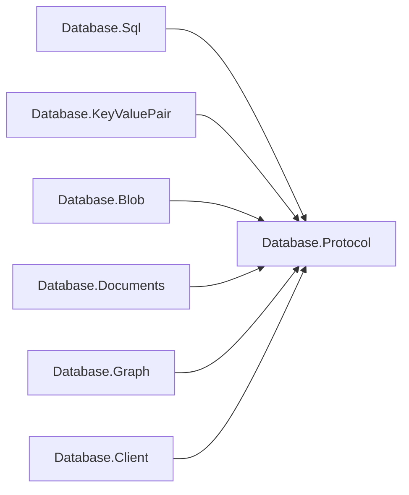
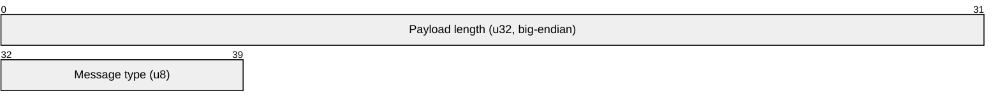
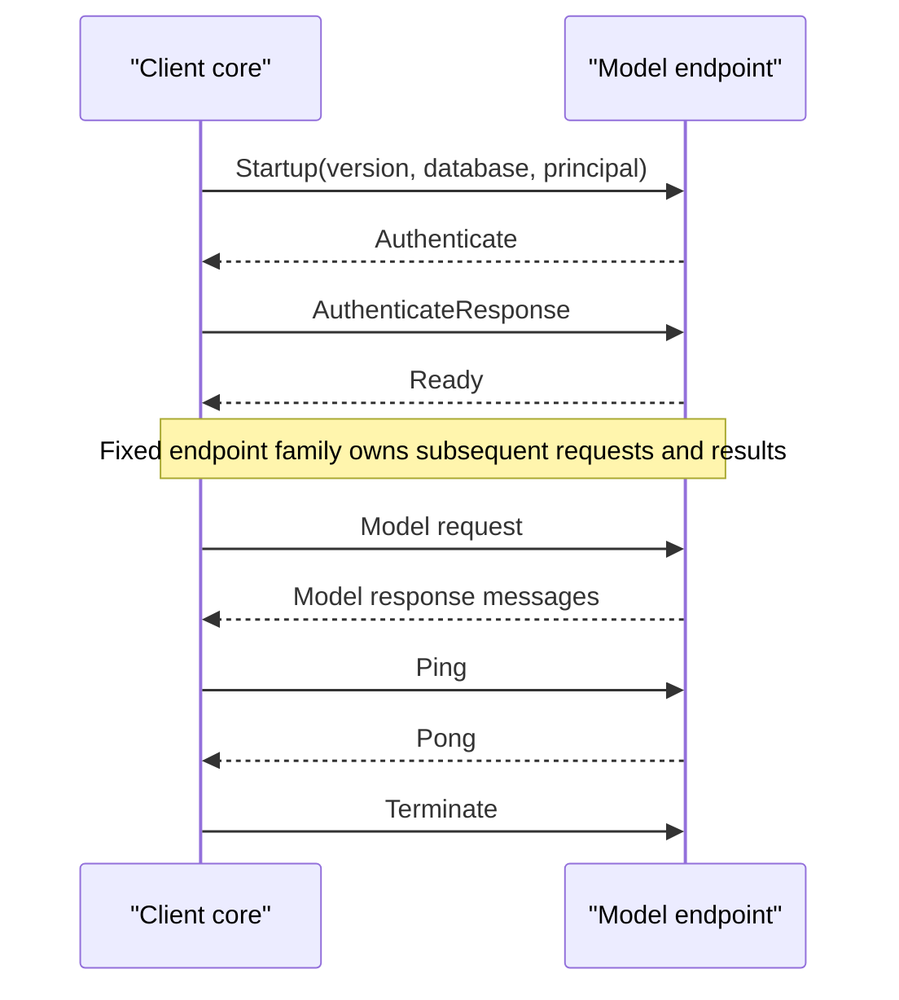
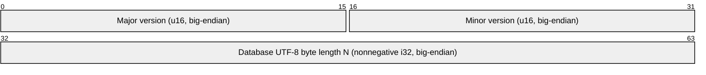

# Assimalign.Cohesion.Database.Protocol design

This page describes the boundaries and implementation shape of `Assimalign.Cohesion.Database.Protocol`.

> **Status:** Partial.

## Mechanism and model policy

This child root owns the frame envelope, shared payload primitives, startup and authentication
exchange, session lifecycle, error taxonomy, and version negotiation. It has no model dependencies.
As with `Database.Language`'s `TokenLexer`, `QueryLanguageProfile` and `QueryParser`, and `Database.Types`' `Diagnostic`, mechanism
is shared while each model supplies its own grammar: here that grammar is its message family and
payload codecs.

The dependencies point from model policy toward the shared mechanism.

Each model package owns its message identifiers, encode/decode routines, and exchange ordering. Each
model's Client package owns result materialization. `Database.Client` owns pooling, handshake, framed
exchanges, and connection health. Each model server continues to own its accept loop and session
state machine.

## Envelope and primitives

Every frame begins with a five-byte header. `Header` bytes 0–3 (bits 0–31) are the unsigned 32-bit
payload length in big-endian order, and byte 4 (bits 32–39) is the unsigned 8-bit message type. The
payload starts at byte 5, and the declared length counts only those payload bytes, not the header.
Payloads are limited to 16,777,216 bytes. Readers check the length before allocation, require the
entire declared payload, distinguish clean EOF between frames from truncation, and reject oversized
declarations. Writers apply the same bound. Framing imposes no logical-object buffering or transfer
policy. The packet view below shows the two fixed header fields.

`ProtocolPayload` provides signed i32/i64, unsigned u16, and strings encoded as
`i32 UTF8-byte-length + UTF8 bytes`. Negative lengths and out-of-bounds reads fail with
`ProtocolException`. Codecs are direct span operations, with no reflection, Microsoft.Extensions
dependencies, serialization discovery, or generated runtime code.

## Numbering and the family seam

The endpoint selects the model before accept. Startup has no model discriminator. A connection
serves one model and one database throughout its lifetime. A client must choose the endpoint for the
family it speaks; the protocol cannot discover a misconfigured endpoint without the deliberately
deferred handshake discriminator.

| Identifier | Owner / meaning |
| --- | --- |
| 0 | Reserved, invalid |
| 1 | Core: Startup |
| 2 | Core: Authenticate |
| 3 | Core: AuthenticateResponse |
| 4 | Core: Ready |
| 5–9 | Model family, preserving deployed identifiers |
| 10 | Core: Error |
| 11 | Core: Ping |
| 12 | Core: Pong |
| 13 | Core: Terminate |
| 14 | Core Diagnostics, gated by agreement |
| 15–63 | Reserved for future shared mechanism |
| 64–255 | Model family |

A single contiguous model range would have renumbered deployed messages unnecessarily. Instead, 5–9
remain endpoint-scoped legacy slots, and new families use 64–255. Different endpoints may assign the
same byte differently. There is never a union of families or a per-message registry lookup on one
session.

`ProtocolMessageFamily` copies its identifier set, rejects duplicate and reserved identifiers, and
has no mutators. `ProtocolChannel` permanently binds one family to one stream and validates incoming
and outgoing identifiers against that family and the core. Model server sessions create the channel
exactly once. Client pools select one family when composed and reject exchanges belonging to another
family. Payload interpretation belongs exclusively to that endpoint's model codec. Unknown
identifiers are protocol violations; session code reports Error(ProtocolViolation) and closes.

The low-level `ProtocolFraming` reader/writer remain available for diagnostics and framing tests. They
deliberately do not dispatch payloads or infer model semantics. Applications use `ProtocolChannel` for
their endpoint's validated exchange.

## Shared exchange and payloads

The shared handshake precedes every model-specific exchange, as shown here.

Startup is `u16 major + u16 minor + string database + string principal`. In its fixed prefix, bytes
0–1 (bits 0–15) are the big-endian unsigned 16-bit major version, bytes 2–3 (bits 16–31) are the
big-endian unsigned 16-bit minor version, and bytes 4–7 (bits 32–63) are the database string's
nonnegative big-endian signed 32-bit UTF-8 byte length `N`. The `N` database bytes start at byte 8;
the principal's nonnegative big-endian signed 32-bit UTF-8 byte length follows at byte `8 + N`,
followed by that many principal bytes. The packet view below shows the startup payload's fixed
eight-byte prefix.

The existing trust handshake sends an empty Authenticate and AuthenticateResponse; authenticators
receive response evidence as opaque bytes. Ready is empty on negotiated 2.0; 2.1 carries the agreement. Ping, Pong, and Terminate have
empty payloads. Error is `u16 code + string message`. Codes are append-only: Internal=0,
UnsupportedVersion=1, AuthenticationFailed=2, NotAuthorized=3, DatabaseNotFound=4, ParseFailure=5,
ExecutionFailure=6, TransactionAborted=7, ProtocolViolation=8, Unavailable=9. Statement failures can
leave a session ready; framing, handshake, or ordering violations terminate it.

## Version decision

Current is 2.1; different majors fail and the lower minor is selected. 2.0 retains empty Ready.

## Extending a model

Define a model-owned identifier enum, a single immutable family, codecs, and its ordering rules.
`Bind` that family at endpoint accept and client pool composition. `Use` shared `ProtocolPayload`
primitives where appropriate, and document the exact wire payload in the owning model package. `Add`
transport-independent conformance coverage through Connections.InMemory. Models do not add payload
policy to this core.

`ProtocolException` is this child root's independent exception type. Servers translate it to the
shared wire taxonomy; the client core translates it to `DatabaseClientException`. Transports remain
outside this package and outside engine packages.

[Assembly overview](index.md) · [Examples](examples/index.md)

## Protocol 2.1 negotiation

The shared protocol is 2.1. Startup optionally appends the client's capability names;
Ready returns the agreed version and the two-sided intersection. A negotiated 2.0
session retains empty Ready and the existing model and Error bytes. An empty Ready
from an older endpoint means 2.0 with no capabilities. Different majors are refused.
Capability names are ordinal and append-only; model names are scoped with the
lowercase endpoint family followed by a dot. The core owns `diagnostics` and frame 14.

SQL and Graph register `ProtocolCapability.Diagnostics`. When agreed, one Diagnostics
frame carries the bounded Warning/Error list immediately before Error on failure,
or immediately before ResultComplete (PathsComplete for graph paths) on success.
Information, including SQL0100, is never sent. Error and result payloads are unchanged.
Statement failures leave the server session ready. Model clients validate diagnostic
ordering and preserve every code, severity, message, nullable offset and source line.

### Startup extension and Ready

The unchanged Startup prefix is `u16 major + u16 minor + string database + string principal`.
For 2.1, append `u16 capabilityCount + capabilityCount * string name`. An absent
extension is an empty list. The 2.0 decoder stops after principal, accepting a 2.1
Startup; a 2.0 client sends the original four fields. Ready in 2.1 is
`u16 major + u16 minor + u16 capabilityCount + capabilityCount * string name`.
Both lists allow at most 64 unique names of 1..128 ASCII characters from
`a-z`, `0-9`, `.` and `-`; the extension/Ready bound is 16,384 bytes. Trailing
bytes, duplicates, malformed UTF-8, unsupported versions and unsolicited agreements
are ProtocolViolation; the client discards a failed handshake's transport.

`ProtocolMessageFamily` registers immutable capability descriptors alongside model
identifiers. A model capability begins with its lowercase family name and a dot;
it can gate only that family's identifiers. `ProtocolChannel.Negotiate` selects
the intersection, and `SetAgreement` applies it exactly once. Read and write gates
reject Diagnostics, and any model capability's added frames, until agreed. A
capability may describe a payload extension with no new frame. Existing frames
must keep their baseline encoding when the relevant capability was not agreed.

### Diagnostics payload

All numbers are big-endian. The payload is `i32 entryCount`, followed by entries:
`u8 severity + string code + string message + i32 start + i32 end + i32 line`.
Severity is Warning=1 or Error=2; other values are invalid. Both offsets are -1
for an unlocated diagnostic, otherwise 0 <= start <= end; end is exclusive and
line is one-based. Entry order is the producer's source order. The maximum is
4,096 entries and 1,048,576 encoded bytes. Counts, truncation, invalid strings,
invalid spans/lines, trailing bytes and size violations throw ProtocolException,
translated by the endpoint/client to ProtocolViolation. Outbound overflow follows the explicit prefix-and-notice policy below.

Outbound SQL and Graph diagnostics are preflighted before any result or Error output.
If the filtered Warning/Error list exceeds 4,096 entries or 1,048,576 encoded bytes,
the endpoint retains the longest leading prefix that fits both limits with a final
Warning notice, code COHDBP001. The notice counts toward both limits and states the
retained count, original filtered count and omitted count. Once an entry does not fit,
it and every following entry are omitted, even if a later entry would fit. Entries
are never shortened. A 4,097-entry list of small diagnostics therefore keeps the first
4,095 and the notice; a first entry larger than the byte limit leaves only the notice.
The original failure still sends exactly one Error with its original error category
and message. Success still sends its result and normal completion with the bounded
warning list. Overflow alone never terminates the session or changes transaction state.
Malformed incoming diagnostic frames remain fatal protocol violations.

Null diagnostic codes and messages encode as zero-length strings; zero-length strings
decode as null. An empty diagnostic code is never a valid code. Unlocated offsets
remain null. Ready.Capabilities and Diagnostics.Entries reject null at construction
and through init/with assignment. Capability-name byte lengths are checked against
the 128-character ASCII bound before decoding or allocating a name string.

Protocol owns ProtocolDiagnostic and ProtocolDiagnosticSeverity with no Language
or Types reference. Servers translate their carrier; the shared client maps the
wire values into the existing DatabaseException.Diagnostics collection. Success
result objects expose the ProtocolDiagnostic values directly. Codecs use checked
span reads and static encoding, with no reflection or runtime discovery.

## Sources

- **Primary source** — `cohesion/resources/Database/Assimalign.Cohesion.Database.Protocol/docs/DESIGN.md`.
- **Source** — `cohesion/resources/Database/Assimalign.Cohesion.Database.Protocol/src/Assimalign.Cohesion.Database.Protocol.csproj`.
