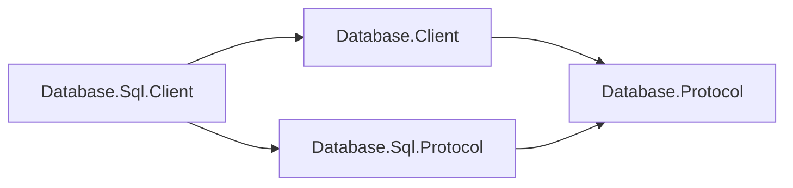

# Assimalign.Cohesion.Database.Sql.Client design

This page describes the boundaries and implementation shape of `Assimalign.Cohesion.Database.Sql.Client`.

> **Status:** Partial.

The SQL client owns parameter encoding, response decoding and materialization, typed
commands/results, and error/telemetry mapping. It delegates dialing, startup/authentication,
framing, and pooling to the shared client.

## Contract dependencies and client errors

This client references Database.Client, Sql.Protocol, shared Protocol and Types, and Connections. Wire contracts and transferred values use the
`Assimalign.Cohesion.Database.Sql.Protocol` namespace. The client references no engine.
COHDBCLIENT001 rejects engine project references, resolved engine assemblies and engine source imports.

`SqlClientException` derives directly from `System.Exception` and declares its own
non-null, read-only Diagnostics. Catch this client exception for remote failures; catching
`DatabaseException` no longer handles them. See the [migration guide](../../../../database/model-project-migration.md#remote-failures).

## Family position

The SQL client references shared mechanics and its model's codecs:

| Package | Role |
| --- | --- |
| `Database.Sql.Client` | SQL materialization and typed APIs |
| `Database.Client` | Pooling, handshake, framed exchange lifetime |
| `Database.Sql.Protocol` | SQL identifiers and payload codecs |
| `Database.Protocol` | Shared framing and immutable family binding |

Other model clients do not depend on this package.

## Join results

N-way INNER/LEFT/CROSS/comma joins and USING use the existing SQL result frames. USING wildcard
columns and later aliases/ordinals count visible output positions. Merged common types and cleared
character lengths reach client metadata; qualified columns retain their own type/length. LEFT can
return NULL values, but the wire header carries only name, type and length, without nullability.
SqlJoinWireTests checks values, multiplicity and metadata over InMemory and loopback TCP.

## SQL-owned exchange

`SqlClient.Create` binds the pool to `SqlProtocol.Family`. `SqlExecuteExchange` derives from
`DatabaseProtocolExchange<DatabaseClientResult>`: it encodes parameters with `DatabaseValueCodec`
, writes the execute request, consumes SQL's header/data/completion exchange, and materializes
values. `SqlConnection` projects this result into `SqlResultSet`.

`SqlProtocolConnectionExtensions.ExecuteAsync` provides the same operation on a rented
`DatabaseConnection` bound to SQL's exact family instance. `DatabaseClientResult` and
`DatabaseClientColumn` moved to this package's namespace. Typed SQL APIs and baseline model wire
behavior are unchanged.

Database.Sql.Protocol supplies codecs without parsing SQL or inspecting plans. Engine and client
consume that contract assembly independently; the client's dependency closure contains no SQL
engine, catalog or storage implementation. The model's
[design](../assimalign-cohesion-database-sql/design.md) defines wire ownership.

## Typed projection

`Column` names map to ordinals once, shared by every result record. First column wins duplicate names;
ordinal access reaches every value. Exact runtime types are returned directly; widening getters use
`Convert.ChangeType` and invariant culture, without reflection. Incompatible access produces
`InvalidCast`.

Parameter collection names strip a leading `@` or `$`; bare names travel on the wire. SQL parsing
remains the server's responsibility.

## Lifecycle, errors, and telemetry

Disposing a typed connection returns its shared authenticated session; disposing the client closes
its pool. Connections support one exchange at a time.

SQL, Graph and Documents negotiate server-reported transaction status. Pool return rolls back open or failed transactions before reuse; only an Idle session is pooled. Missing/invalid status, failed reset or a legacy transaction-capable peer causes connector discard.

`SqlConnection.AbortAsync` discards a rental and closes its session instead of returning it to the
pool. `Use` it when SQL session state cannot be reset, including a failed ROLLBACK or uncertain
COMMIT. It delegates to the shared client's discard operation and is not cancellable. Discarding
prevents session leakage; it cannot undo an already published transaction.

SQL transactions currently use ordinary `BEGIN`, `COMMIT` and `ROLLBACK` commands on one
connection. The wire protocol does not expose a durable transaction token, status lookup or replay
deduplication. A connection loss after the server publishes COMMIT but before the response reaches
the client has an unknown outcome. Client exceptions do not promise that a failed COMMIT left no
writes.

`SqlClientException : Exception` maps stable wire codes to SQL error kinds and retains the
original code. The shared pool invalidates incomplete exchanges, including cancellation and decoder
failure. Completed parse/execution failures keep the connection reusable.

ExecutionFailure also completes an exchange after ResultHeader or ResultRow. The SQL exchange
discards buffered columns/rows and retains the error and negotiated diagnostics. Writing statements
prepare all result payloads before commit, inside DML's undo bracket; preparation failure rolls
back only the statement. Read-only statements encode during delivery and may fail after partial
frames. Both paths preserve the explicit transaction and connection on result failures.
Uncoded failures and size refusals use CS05045 (54000 for size refusals). Each header/row fits
16 MiB, with no aggregate result cap. Writes retain prepared payloads until delivery; reads encode
one frame at a time alongside materialized values. Transport failure is terminal. ParseFailure
after result frames also invalidates the rental. See [statement results](../assimalign-cohesion-database-sql-protocol/design.md#statement-results).

Observers receive synchronous primitive callbacks before execution, on completion, and on failure.
Observer exceptions are swallowed so telemetry cannot change the command outcome.

## AOT and non-goals

Encoding and materialization are hand-written, with no reflection or code generation. Transports are
typed options, never string-named plugins. Full result materialization is SQL client policy; an
incremental API can be added here independently. Parsing, ORM behavior, retries, and explicit wire
transactions remain outside the current surface.

## Duplex transport composition

`ConnectionFactory` accepts `IDuplexConnectionFactory`. The shared client reads and writes
framed bytes through the returned `IDuplexConnection`; the common `IConnection` root carries
identity, features and lifecycle only. TCP, InMemory and TLS-layered duplex factories satisfy
this contract. The pool owns each established connection and disposes it when discarded or
when the pool closes; transport disposal has signaled `ConnectionClosed` before it completes.

### Breaking changes from 10.0.0-preview.1 (#1459)

`SqlClientOptions.ConnectionFactory` changes from `IConnectionFactory?` to
`IDuplexConnectionFactory?`. Changing the property's getter and setter signatures breaks
preview.1 binaries and source that supplies a factory typed only as `IConnectionFactory`.
This preview break is accepted under owner decisions 15 and 58. Rebuild consumers and use
`IDuplexConnectionFactory` for factory variables and custom implementations. Custom factories
can derive from `DuplexConnectionFactory`, implement `ConnectCoreAsync` returning
`ValueTask<IDuplexConnection>`, and produce a `DuplexConnection` implementation. Built-in TCP,
InMemory and TLS-layered duplex factories already satisfy the new contract. Database wire
framing, handshake and model messages are unchanged.

## Declared dependencies

| Reference | Kind |
|---|---|
| `Assimalign.Cohesion.Database.Protocol` | `CohesionProjectReference` |
| `Assimalign.Cohesion.Database.Client` | `CohesionSharedSource` |
| `Assimalign.Cohesion.Database.Client` | `CohesionProjectReference` |
| `Assimalign.Cohesion.Database.Sql.Protocol` | `CohesionProjectReference` |
| `Assimalign.Cohesion.Database.Types` | `CohesionProjectReference` |
| `Assimalign.Cohesion.Connections` | `CohesionProjectReference` |

[Assembly overview](index.md) · [Examples](examples/index.md)

## T1 transport contract

SqlResultSet exposes IReadOnlyList<ProtocolDiagnostic> Diagnostics on success. SqlClientException
preserves the shared failure carrier. Protocol 2.1 sends Warning/Error entries before completion
or Error; 2.0 retains baseline exchanges without the frame. Overflow preserves a leading prefix
plus CK07001 with exact omission counts, the original outcome and a usable session.
All SQL codes and SQLSTATE categories are in [SQL diagnostics](../../../../database/sql/language/diagnostics.md).

Constraint failures use ExecutionFailure with one negotiated Error diagnostic: CS03037 (23505)
for UNIQUE/PRIMARY KEY/unique indexes, CS03038 (23514) for CHECK/domain checks including CAST,
and CS03039 (23503) for foreign keys in either direction. NOT NULL retains CS03024 (23502).
Messages name the constraint and table without key values; domain CAST/function checks name the
domain without a table. Available statement spans survive both transports. The rejected statement
rolls back while the connection and explicit transaction remain usable. See
[SqlClientException](sql-client-exception.md) for handling and protocol 2.0 behavior.

## RETURNING results

QueryAsync returns [SqlResultSet.AffectedCount](sql-result-set.md) with buffered RETURNING rows.
ExecuteAsync receives and buffers those rows before discarding them; ExecuteScalarAsync returns
the first cell. ResultComplete already carries the count; framing and protocol version are unchanged.
Server projection errors occur before the result header and leave the connection usable.

## Predicate diagnostics

Detected storage corruption uses CK06003 (SQLSTATE XX001) through the existing ExecutionFailure
path, naming the database and optional page and leaving the connection usable. See
[SQL diagnostics](../../../../database/sql/language/diagnostics.md#database-creation-and-open).

Distinct/Boolean truth tables and bound LIKE ESCAPE parameters use existing SQL frames on
both transports. Invalid escapes (CS02034, 22025) and non-Boolean truth tests (CS02003,
42804) are ExecutionFailure responses; data and the connection remain usable. Invariant LIKE/NOT
LIKE work exhaustion is a located CS05040 ExecutionFailure (no SQLSTATE), also retaining a
usable connection. The server's session lifetime token reaches row-time matching; disconnect
cancels the matcher and closes the session on both InMemory and TCP. No client API or
protocol format changes are required. See [predicate examples](../../../../database/sql/language/expressions/operators.md).

## ON CONFLICT and final foreign-key checks

Existing requests carry VALUES/SELECT/DEFAULT VALUES ON CONFLICT and RETURNING. QueryAsync returns
inserted/post-update rows with their combined affected count; skips and false/UNKNOWN filters
contribute neither. CS03035 (42P10), CS05036 (21000) and ordinary constraint failures are
ExecutionFailure responses with usable connections; MySQL/SQLite alternatives and excluded
inference/action forms are CK00001 ParseFailure. No protocol or client API change is required.

Multi-row UPDATE final-state foreign-key behavior is the same on both transports. Tests select
Snapshot/ReadCommitted through the server-session API; SQL BEGIN adds no isolation syntax.
Snapshot newer-conflict aborts and detected deadlocks require callers to roll back and retry the
complete transaction. The client does not retry it automatically. See
[ON CONFLICT](../../../../database/sql/language/clauses/on-conflict.md#isolation-locking-and-retries).

## Boolean conditions, implicit rows and storage failures

Non-Boolean predicates arrive as ExecutionFailure with CS02003 (42804), available spans
and a reusable connection/explicit transaction. FROM-less SELECT, including scalar/IN/EXISTS
children and aggregates, uses the existing query exchange and returns the implicit row or its
filtered result on InMemory and TCP. No client API or wire payload changes.

Storage/index failures instead use CS06041 (58030 for I/O), or CK06003 (XX001) for
corruption. Attached-index damage retains CK06102 and CS06041. ExecutionFailure preserves
the connection but aborts an explicit transaction; roll back before continuing.

Encoded row/index-key size refusals use CS05042 / SQLSTATE 54000 as ExecutionFailure.
The connection and explicit transaction remain usable, with no statement rows changed and
earlier work intact. See [size limits](../../../../database/sql/language/diagnostics.md#row-and-index-key-limits).

Server-side statement and individual lock-wait deadlines use CS05043 / SQLSTATE 57014
and CS04044 / SQLSTATE 55P03. ExecutionFailure preserves the connection and explicit
transaction after statement rollback; earlier grants and upgrades remain, and new resources are
released after undo. CS04006 has no assigned SQLSTATE and means the bound target changed during
lock preparation: retry in a fresh transaction. SQLSTATE remains a reference mapping on the wire.
See [timeouts and diagnostics](../../../../database/sql/language/diagnostics.md#statement-and-lock-timeouts).

## Queued terminal errors

Before the next admitted operation writes a request, the shared connector checks buffered input or
a closed transport and consumes a queued terminal Error once. Its original code reaches
SqlClientException and the connector is discarded. This also applies to streaming startup;
IsOpen continues to describe physical transport health. Unexpected/malformed terminal frames use
ProtocolViolation; clean EOF without an Error remains Internal. Rent-time pings are not implemented.
A clean handshake EOF has its own message naming the startup handshake. See
[shared admission](../assimalign-cohesion-database-client/database-connection.md#queued-terminal-errors)
and [terminal delivery/TLS limits](../assimalign-cohesion-database-protocol/design.md#terminal-delivery-and-frame-writes).

## Structured execution failures

Execution, constraint, conversion, DEFAULT and DDL refusals retain the engine's stable codes and
statement spans through SqlClientException.Diagnostics on both in-memory and TCP transports.
The wire composes `CODE: message` exactly once; the diagnostic's Message has no embedded code
prefix. DEFAULT wrappers preserve the underlying diagnostic and cause, and stored-expression
offsets are replaced with current-statement locations. Previously uncoded failures now visibly
begin with a complete `CS` code followed by a colon. ExecutionFailure leaves the connection usable under the existing policy.
See [all execution codes and SQLSTATE mappings](../../../../database/sql/language/diagnostics.md#planning-and-execution-diagnostics).
This changes no public client member or wire format.

## Sources

- **Current project boundaries** — `cohesion/resources/Database/README.md`.
- **Build guard** — `cohesion/resources/Database/Directory.Build.targets`.

- **Primary source** — `cohesion/resources/Database/Assimalign.Cohesion.Database.Sql.Client/docs/DESIGN.md`.
- **Source** — `cohesion/resources/Database/Assimalign.Cohesion.Database.Sql.Client/src/Assimalign.Cohesion.Database.Sql.Client.csproj`.
