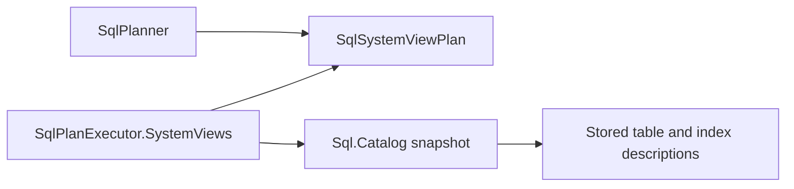
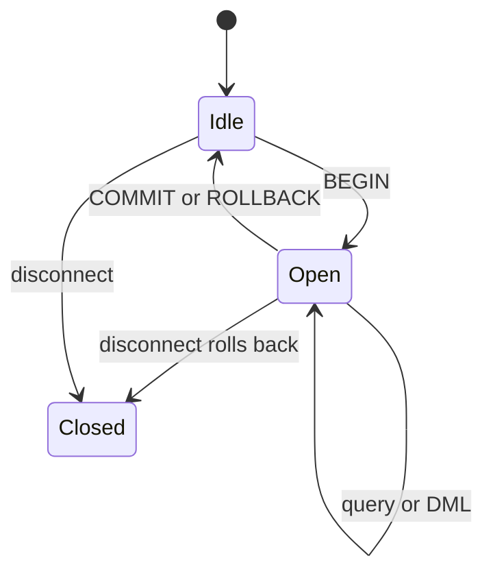
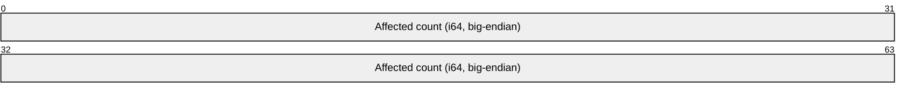

# Assimalign.Cohesion.Database.Sql design

This page describes the boundaries and implementation shape of `Assimalign.Cohesion.Database.Sql`.

> **Status:** Partial.

## ILIKE and postfix casts

ILIKE/NOT ILIKE share LIKE precedence, ESCAPE, NULL handling and its CS05040 work budget
(no SQLSTATE); invalid escapes retain CS02034 (22025). Binary lowercases both sides with SQL
LOWER's mapping. case_insensitive, case_accent_insensitive and invariant use their own
case-insensitive equality. Cohesion allows ILIKE under these nondeterministic collations,
where PostgreSQL refuses it. See [operator behavior and examples](../../../../database/sql/language/expressions/operators.md#ilike-and-not-ilike).

Postfix casts reuse CAST binding and targets and canonicalize as CAST. Their precedence is above
unary signs, so +1::TEXT and -1::TEXT fail with CS02003 (42804). Regex, SIMILAR TO and ^
retain CK00001. Integer bitwise execution uses the generic precedence level with concatenation;
CS02077 (42804) refuses noninteger operands and BIGINT shift counts. These expression
changes add no storage or compiled-schema format beyond the partial-index boundary.

## JSON expressions

[JSON access](../../../../database/sql/language/expressions/json-access.md) binds `->` and `->>`
to JSON/JSONB sources and text or SMALLINT/INTEGER selectors. Arrows associate left at the generic
operator level, below `::`. The bound selector type resolves CASE/COALESCE alternatives before
choosing a key/index overload. Identical bound JSON conjuncts can prove partial-index membership.

Extraction retains JSON identity for `->` and returns unquoted TEXT for `->>`. Missing members
and wrong container kinds return SQL NULL; a JSON `null` member stays JSON under `->` and becomes SQL NULL
under `->>`. IS JSON returns nullable BOOLEAN, with malformed text FALSE. Scalar casts require
JSON Booleans/numbers; JSON `null` becomes SQL NULL. JSONB retains its original UTF-8 text
without normalization. See the language page for depth, Unicode and deferred SQL/JSON limits.

| Code | Meaning and trigger | SQLSTATE |
| --- | --- | --- |
| CS01067 | Invalid JSON extraction or IS JSON signature | 42883 |
| CS02078 | Malformed access/assignment input, invalid Unicode/UTF-8 or depth over 128 | 22032 |
| CS02079 | Wrong JSON kind for a numeric or Boolean scalar cast | 22023 |
| CS02080 | Incompatible declared CASE/COALESCE alternatives in a JSON operand/selector | 42804 |

## Directed index keys

[CREATE INDEX](../../../../database/sql/language/statements/create-index.md#key-directions-and-null-placement)
accepts per-column ASC/DESC and independent NULL placement. Catalog KeyOrders snapshots the
effective order; compiled schema v11 carries the same vector. SQL format 32 uses mandatory
index extension 3. Runtime maintenance, builds, rewrites, conflict checks and undo share the
direction-aware transform; comparison ranges exclude the NULL block. Direction preserves
uniqueness. Matching single-table ORDER BY can use forward or backward index order without
sorting. Leading keys after equality prefixes (including IS NULL), resolved collations and
directions must agree; NULL placement must agree only where NULL can vary. Costing includes
residual selectivity and base-row fetches. See [ordered access](../../../../database/sql/language/clauses/order-by.md#index-order).
Invalid key-order width/value or directed primary-key metadata uses CS03085 (42P17).

## Partial indexes

[CREATE INDEX ... WHERE](../../../../database/sql/language/statements/create-index.md#partial-indexes)
stores canonical Predicate text, PredicateColumns and PredicateFunctionCalls in index extension 3.
Every write path maintains TRUE membership; FALSE/UNKNOWN has no entry. Partial uniqueness
keeps NULL-containing keys distinct. Untargeted DO NOTHING uses proposed-row membership;
targeted inference accepts a proving target WHERE. The bound strong-implication prover authorizes
partial seeks, ranges, correlated join probes and unbounded subset scans, with the complete
predicate retained as a residual. Proofs use only input-local WHERE and INNER JOIN ON conjuncts;
see the language page for exact rules and exclusions.

Catalog format 32 and compiled schema v11 refuse earlier files/artifacts. A changed required
registration can leave a predicate unresolved: open, reads and DROP INDEX work, while table
writes refuse CS01009 (42883). Predicate-column TYPE, including widening, requires dropping
and recreating the index; dropping a key/predicate column removes it, and renames rewrite text.

| Code | Condition | SQLSTATE |
| --- | --- | --- |
| CS03082 | Predicate on a primary key | 42P16 |
| CS03083 | Type change of a predicate column | 0A000 |
| CS03084 | Inconsistent predicate text/dependency metadata | 42P17 |
| CS05091 | Prohibited expression or call/conversion not proven immutable | 42P17 |
| CS05092 | Non-row-local ON CONFLICT inference predicate | — |

Evidence: SqlPartialIndexTests, SqlPartialIndexDurabilityTests and SqlPartialIndexThirdPassTests.

## Model component boundaries

Catalog, Storage and the empty Security satellite are now part of `Assimalign.Cohesion.Database.Sql`.
Public Catalog and Storage types retain their namespaces and members; they ship in the model
assembly and NuGet package. Replace satellite references with the model package and recompile.
Assembly-qualified type names change, with no compatibility assembly or type forwarders.

The direction is engine → Catalog → Storage → shared kernel. Public component types live in
`src/Catalog/` and `src/Storage/`; internal types live in `src/Internal/Catalog/`
and `src/Internal/Storage/`. Engine persistence strategies and catalog-aware codecs belong
in `src/Internal/Engine/Storage/`. Transaction record-space adapters belong to Storage.

Roslyn architecture tests check actual compiler inputs and resolved symbols: Storage cannot use
Catalog or engine types; Catalog cannot use engine types. Storage permits shared Storage,
Transactions and Indexing plus the BCL reference pack. Catalog additionally permits the
area root and Types. Protocol, Language, Schema and Connections are disallowed in both constrained
layers; engine code has no external assembly restriction.

Wire messages, codecs and transfer values now belong to [Sql.Protocol](../assimalign-cohesion-database-sql-protocol/index.md).
Engine and client reference those same contracts. Moved wire types change namespace as well as
assembly identity; update their imports. Wire and disk formats are unchanged.

## SQL namespaces and set operations

[CREATE SCHEMA](../../../../database/sql/language/statements/create-schema.md) persists namespaces;
[DROP SCHEMA](../../../../database/sql/language/statements/drop-schema.md) defaults to RESTRICT.
dbo is seeded at database creation and cannot be dropped (CS03031); code-first provisioning
stays pinned to dbo. AUTHORIZATION/nested elements use CK00001. Missing DDL namespaces use
CS01028 (3F000), duplicate CREATE CS03029 (42P06), and RESTRICT dependencies CS03030
(2BP01); reads/DML retain CS01014 (42P01). CASCADE publishes contained-table/index removal
and incoming-FK removal atomically, retaining outside tables. Ownership checks cover affected
objects. SCHEMATA reads the statement's captured namespaces, including empty ones.
Storage format 32 is current. Format 22 introduced STRING_AGG/LISTAGG identifier quoting;
format 23 introduced views and format 24 introduced explicit NULL placement.
Format 25 introduced distinct predicates, Boolean tests and LIKE ESCAPE in persisted definitions; format 26 introduced the temporal default-text fence.
Format 27 introduced the per-column TYPE default-assignment flag in table extension 7.
Format 28 introduced internal sequence definitions and reservations. Format 29 added owning
table/column metadata and identity ownership to kind 18; identity allocation uses kind 19 and
kind 16 is retired. Format 30 adds ON UPDATE metadata in table extension 8.
Format 30 and earlier databases are refused at open without an upgrade reader.
Format 21 introduced namespace records of kind 15; earlier formats have no upgrade path.

[Set operations](../../../../database/sql/language/clauses/set-operations.md) execute in every query
position through SqlQueryBodyExpression. Types/widths validate before reads, including unknown
literal coercion, unconstrained CHAR outputs and CS02003 mismatches (42804). Conversion precedes
tuple comparison; NULLs compare equal and one common collation governs the output. Combined
ORDER BY uses first-input output names or ordinals only. CORRESPONDING remains CK00001.
Compatible UNION chains flatten into one N-way materialization; INTERSECT/EXCEPT use hash counts.
All operands share a statement snapshot/catalog capture. ROUND at negative scales compares the
original exact remainder once, avoiding double rounding (#1661).

The SQL engine (area architecture: resources/`Database`/DESIGN.md
(`cohesion/docs/resources/Database/DESIGN.md`) `3.3): parse (`Sql.Language`) → plan (`SqlPlanner`) →
execute (`SqlPlanExecutor`) against shared storage, with the catalog (`Sql.Catalog`) as schema
authority.

## Ordering output values (#1024)

`SqlPlanner.Ordering.cs` binds aliases and standalone numeric ordinals to projection indexes for
stored tables, system relations, joins and groups. Unqualified aliases take precedence over source
columns, including inside scalar ordering expressions. Qualified references and aggregate operands
retain their source scope. Invalid numeric ordinals fail during binding, even for an empty input;
compound constants such as `1 + 1` remain scalar expressions.

The executor ordinarily evaluates each projection and its ordering keys in one pass, retaining completed
outputs and fixed keys rather than source rows. Independent volatile outputs without output-key
dependencies retain full sorting followed by projection. Grouped queries use the same binding against completed group
outputs. [Sequence outputs](../../../../database/sql/language/functions/sequences.md#evaluation-order)
needed as sort keys evaluate before sorting; independent sequence outputs evaluate afterward,
including OFFSET rows, and stop at LIMIT. `SqlExpressionEvaluator` resolves bound AST nodes by identity to these output slots and
follows each projection's source for collation. It does not reconstruct language AST nodes or
require cross-assembly internal access. Sorting is stable, with NULL first ascending and last
descending, followed by DISTINCT and LIMIT/OFFSET. Explicit NULL placement and derived-table
ordering execute. The exact syntax contract and execution evidence are in
DIALECT.md
(`cohesion/resources/Database/Assimalign.Cohesion.Database.Sql.Language/docs/DIALECT.md`).

## Subquery and insert-source operators (#1021)

The planner binds child SELECTs through a lexical scope chain and lowers their use sites to typed
slots. Independent children materialize once; correlated children execute for each reached outer
row under the same statement context. Frame-local slots keep nested results independent. CASE,
COALESCE and Boolean preparation preserve lazy evaluation. Projection and ordering retain each
row's child values before sorting. Retained BYTEA cells copy on delivery.

Local names and aliases shadow outer ones, including across multiple levels. Ambiguity and hidden
qualifiers use CS01015. Children over completed groups may read outer grouping-key columns only
(CS05017 otherwise); aggregate arguments read source rows. Aggregate levels follow the lowest
variable or aggregate dependency, including nested queries after adjusting levels. An outer-level
aggregate receives CK00001 before grouping checks; mixed local dependencies can keep it local.
See [Subqueries](../../../../database/sql/language/expressions/subqueries.md) for examples.

Scalar queries require one column and at most one row; zero rows produce typed NULL. IN preserves
three-valued membership, and EXISTS tests row existence. Types and collations cross materialization.
All children share the statement's MVCC and catalog snapshots. UPDATE/DELETE predicate children
finish for every candidate before writes; prior uncommitted session changes remain visible.
INSERT SELECT materializes the complete source before applying destination coercion, defaults and
constraints. Failure leaves no partial row changes.

### Quantified comparisons and repeated group keys

[ANY/SOME/ALL comparisons](../../../../database/sql/language/expressions/quantified-comparisons.md)
reuse typed subquery slots and the ordinary scalar comparer. ANY/SOME folds with OR and ALL
with AND, preserving UNKNOWN; empty results return FALSE/TRUE respectively and skip scalar
operand evaluation. Independent children materialize once, correlated children per reached
outer frame. Compared incompatible non-NULL values retain CS02055 (42804), and child width
retains CS05013. No disk or wire format changes.

Complete scalar-subquery, EXISTS, quantified-comparison and IN grouping keys compare query
bodies structurally, including identical correlations. Operators, quantifiers, negation and bound
operands remain significant. A repeated whole key reads its retained group value in SELECT,
HAVING and ORDER BY; unproven keys retain ordinary CS05017 grouping errors.

### WITH and derived relations

[WITH](../../../../database/sql/language/clauses/with.md) without RECURSIVE binds all definitions in declaration order,
including unused bodies. Read names prefer visible CTEs; qualified reads and DML targets use the
catalog. Self and later-sibling names fall back to stored tables; only missing future relations use
CS01026 (no assigned SQLSTATE). CTE names are schema-less and share ordinary alias-conflict
rules. Reachable definitions materialize once in declaration order before any DML write. Unused
bodies do not evaluate counts or seek bounds. Every FROM-less SELECT uses one implicit row,
including top-level queries, nested queries, views and set operands. Wildcards still need a relation. With, Materialize, CteScan and Constant describe these
plans without executing them.

Derived FROM/JOIN/comma relations reuse typed output metadata, including modifiers, domains,
nullability and collation provenance. Uncorrelated relations cache once per statement; correlated
derived bodies evaluate per enclosing frame. Only a reference that binds to a real sibling gets
the LATERAL refusal; typos retain CS01015. Outer ordering over derived outputs stays CK00001.
CorrelatedSubqueries retains complete child plans in EXPLAIN. Nesting remains limited to 32 query
levels. SET, VALUES, RETURNING, CHECK/DEFAULT and pagination-expression subqueries,
nested CTEs and explicit LATERAL remain excluded. Recursive fixpoints execute on demand.

Current SQL data-storage format is 32. Format 16 introduced SEARCH/MATERIALIZED identifier quoting;
format 17 added the insert-default/frozen-missing-value split in table extension 6; format 18 separately
quotes newly executable function names and BOTH/LEADING/TRAILING as identifiers in persisted SQL.
Ordinal CHECK-text comparison would otherwise report schema drift (`sign >= 0` becomes
`"sign" >= 0`). Defaults and function bodies share the renderer. Older formats are refused without
an upgrade reader; compiled schemas stay version 11. Evidence: SqlT1StorageFormatTests,
SqlAlterTableExecutionTests and SqlCteStorageFormatTests.

## Database creation, open and drop

SQL remains at data-storage format 32. Create commits the optional default collation, dbo and then
the format marker. An interrupted marker-free creation is completed only when its durable creation
claim and read-only probes prove initial empty data and creation-only catalog metadata. An empty
data scan alone cannot distinguish creation from a lost catalog after acknowledged empty-table DDL.

The transient sql.create claim is durably written before the first data header. Completion requires
the initial header state, no records or later page allocation, empty data journal/backup, and only
the catalog's initial object-id counter, optional collation and dbo. A data checkpoint fences a
stale claim before it is removed and the completed database is published.

| File state | Create/open behavior |
| --- | --- |
| Valid creation claim, initial empty data and absent or creation-only unmarked catalog | Create or open completes creation before publishing the database |
| Data or catalog shorter than a storage header, with no conflicting catalog/journal state | Open raises DatabaseNotFoundException carrying CS03401 and directs a CreateDatabaseAsync or declared Build retry |
| Missing journal/backup, ambiguous lost catalog, nonempty data beside creation-only metadata, or short files beside other persisted state | Refused with CS03401; originals are preserved and no replacement sidecars are created |
| Explicit old/new format marker or unmarked catalog containing user metadata | Existing format refusal; no upgrade or adoption |

A retried create uses its requested collation, including after dbo was committed. An undeclared
plain open retains a committed collation, otherwise uses Binary. Declared completion applies the
declaration's collation (or Binary when absent). A format refusal probes every catalog size through
read-only handles and private recovery overlays before either real
file set opens for writing. Refusals leave the original files byte-identical. Transient probe I/O
failures ask callers to retry OpenDatabaseAsync once resolved, without restore or drop advice.

Drop deletes sql.dat first, then other data files, then the remaining directory. A partial drop
cannot be reopened by recreating missing sidecars. Preserve ambiguous files and follow the refusal's
specific remedy; incomplete headers beside existing state cannot safely be restarted.

### Lifecycle API

```csharp
public new ValueTask<SqlDatabase> CreateDatabaseAsync(DatabaseName name, CancellationToken cancellationToken = default);
public ValueTask<SqlDatabase> CreateDatabaseAsync(DatabaseName name, Collation defaultCollation,
    CancellationToken cancellationToken = default);
public new ValueTask<SqlDatabase> OpenDatabaseAsync(DatabaseName name, CancellationToken cancellationToken = default);
public ValueTask DropDatabaseAsync(DatabaseName name, CancellationToken cancellationToken = default);
```

Names use DatabaseName validation. An existing completed database still rejects create. Lifecycle
refusals surface as DatabaseException; the SQL format-refusal subtype is internal. Disposed engines
throw ObjectDisposedException and cancellation throws OperationCanceledException. Declared databases
cannot be dropped. CS03401 is an Error diagnostic with no assigned SQLSTATE.

On a fresh in-memory engine, the ordinary lifecycle is:

```csharp
await using var engine = SqlDatabaseEngine.Create("sales-engine", new());
var database = await engine.CreateDatabaseAsync("sales", Collation.CaseInsensitive);
await database.DisposeAsync();
var reopened = await engine.OpenDatabaseAsync("SALES"); // same logical database and collation
await engine.DropDatabaseAsync("sales");
```

Creation recovery and collation retries are checked in SqlCreateRecoveryTests; file-set preservation
and partial drops are checked in SqlDatabaseNameTests. See [diagnostics](../../../../database/sql/language/diagnostics.md#database-creation-and-open).


## Compiled-schema provisioning

`ISqlDatabase` implements the root `IDatabaseSchemaProvisioner` seam. Before a schema is applied,
the provisioner requires `EngineModel.Sql`, the same logical database name, and a shape the shipped
SQL DDL surface can represent. It then reconstructs or reads the last canonical catalog state, uses
`SqlSchemaMigrationPlanner` from `Database.Sql.Schema` for deterministic ordering/destructive
gating, and `SqlMigrationScriptGenerator` for parser-validated engine requests. Supported steps are
table, column, and secondary-index add/drop; alter/rebuild operations and advanced objects (custom
types, functions, triggers, principals/grants, extensions) fail before execution rather than
recording a false applied hash. Foreign keys and checks now render into provisioning DDL and persist
in the table catalog; unique declarations use unique indexes.

Retained table, column, index and constraint names share the parser's delimited identifier contract.
The renderer preserves bare ordinary names and double-quotes reserved words or names containing
spaces and literal dots. Catalog names contain the identifier value without its delimiters. Embedded
double quotes and null characters fail before deployment because the current lexer does not support
those identifier forms. The mapper uses the same retained names, so its quoted DML binds the objects
deployed by this renderer without another naming convention.

Each DDL request remains self-committing under the catalog's established rule. On a later failure,
completed reversible steps run their compensating requests in reverse order and the applied-schema
marker remains unchanged. The marker is written only after all steps succeed, and a repeated apply
is a no-op only when the stored canonical document/hash and live catalog all agree. Full atomicity
for a destructive multi-statement migration is deliberately not claimed: the current catalog has no
transaction spanning DDL statements, and irreversible data loss cannot be compensated. That kernel
seam is recorded as the remaining gap rather than hidden behind the content hash.

### `Object` ownership and the schema package

The area root carries only `CompiledSchema` identity and canonical content, the
`IDatabaseSchemaProvisioner` seam, and model-independent ownership contracts. `Database.Sql.Schema`
owns SQL declarations, compiled tables/indexes/constraints, validation, serialization, and migration
plans. The engine references this thin package; the schema package never references the engine or
its storage/transport.

Live sessions create `Adhoc` tables and indexes. The provisioner's private session carries the
compiled schema name as `ProvisioningSchema` in an internal statement context, so catalog creation
persists `Schema` ownership and that name as `OwningSchema` in the object's first durable record.
`SqlCatalogTable.Schema` remains the separate SQL namespace (for example, `dbo`). Only that
internal session may execute `DROP TABLE`, `ALTER TABLE ADD COLUMN`, `ALTER TABLE DROP COLUMN`,
or `DROP INDEX` against its schema's objects. Normal sessions receive
`DatabaseObjectLockedException` with the object, compiled schema exposed as `OwningSchema`, and
refused operation; row DML remains available. Compensation uses the same private session and
preserves the existing reversible-step policy.

DDL re-reads catalog ownership after acquiring the exclusive object lock. If a table was dropped and
its name reused while the statement waited, the acquired lock covers the old object id: the
statement rejects a schema-owned replacement and requires a retry for any other replacement before
changing metadata or rows. `Index` drops likewise refresh their description after the wait.
Missing-table paths fail directly rather than issuing an unlocked catalog mutation by name.

Schema reconciliation compares only objects owned by the applying schema. Ad-hoc tables and ad-hoc
indexes coexist with it and do not create false drift or become implicit destructive migration
targets. A desired name that collides with an ad-hoc object is rejected before applying any steps;
adoption requires a future explicit policy. Table creation uses the catalog's reserve/build/publish
lifecycle, including its ownership metadata, through the `public static` `SqlCatalog` bridges rather
than any member of `ISqlCatalog`; ordinary `ISqlCatalog.CreateTableAsync` stays ad-hoc. The catalog
persists descriptions; the engine continues to authorize session operations against schema-owned
objects.

## Virtual system relations (C1)

The catalog is the sole data source for seven `INFORMATION_SCHEMA` relations and two Cohesion
extensions. Their complete MVP column matrix is in DIALECT.md
(`cohesion/resources/Database/Assimalign.Cohesion.Database.Sql.Language/docs/DIALECT.md`, section
`system-view-matrix-c1`). Every row describes an object in the session's current database. The
catalog name columns contain that database's name; schema qualification continues to select a SQL
namespace, never another database. `TABLES` lists stored tables as `BASE TABLE`; these virtual
relations have no catalog table records to list.

### The relation seam and statement snapshot

The binder resolves stored tables and registered system relations through one relation-source
path. Every system relation can participate in N-way INNER/LEFT/CROSS and comma joins,
with the same column, alias, USING, ambiguity and grouping checks. System sources take no object
locks and supply no indexes; an eligible stored input can still supply index probes. There are
no dummy stored objects or synthetic metadata rows.

The statement context captures one immutable catalog image on its first system binding. Child
queries and INSERT SELECT sources share it. Snapshot transactions provide their BEGIN-time image;
automatic and ReadCommitted statements capture on demand. A stored-only statement needs no
catalog capture. Table/index/constraint descriptions are captured together, so catalog publication
cannot split them during a metadata read. Fresh later captures reflect completed DDL according to
the session isolation level. Ordinary result/wire codecs return metadata and EXPLAIN plan rows.

The dependency split keeps virtual relation binding and execution in SQL while the catalog remains
the source of stored object descriptions:



### Deliberate extension: index metadata

ISO `INFORMATION_SCHEMA` has no general index relation. Cohesion exposes `COHESION_SCHEMA.INDEXES`,
with one row per ordered index key column. Repeating the table/index identity on each key row
supports ordinary column projection, filtering, and ordering without parsing a vendor-specific DDL
string or encoded column list. `IS_UNIQUE` and `IS_PRIMARY_KEY` are `YES` /`NO`; the latter
distinguishes the catalog's primary-key enforcement index from other unique indexes. Physical root
pages and index-manager registrations stay internal. This explicit extension namespace avoids
presenting a MySQL `STATISTICS` or PostgreSQL `pg_indexes` compatibility contract that Cohesion does
not implement.

### Deliberate extension: object ownership

`COHESION_SCHEMA.OBJECT_OWNERSHIP` has one row per table or index, identified by its table identity,
`OBJECT_TYPE` (`TABLE` or `INDEX`), and `OBJECT_NAME`. `OWNER` preserves the catalog values
`Adhoc` and `Schema`; `OWNING_SCHEMA` is the compiled schema's name for code-provisioned objects
and null for ad-hoc objects. It remains distinct from `TABLE_SCHEMA`, the SQL namespace. `Index`
ownership is reported from the index itself, so an ad-hoc index on a table does not accidentally
inherit that table's provisioning ownership.

These concepts have no ISO counterpart. A separate Cohesion relation keeps non-standard fields out
of `INFORMATION_SCHEMA.TABLES`, preserving the documented column ordering for tools that map
`SELECT *` positionally. The accepted cost is an additional metadata query when a client needs
provisioning ownership.

### Standard vocabulary and the MVP boundary

This is a documented subset of ISO 9075-11's information schema, not a claim to implement every
standard view, column, or SQL domain. Identifiers and descriptive text use the shared `String` type;
standard `yes_or_no` values are strings `YES` /`NO`, not Boolean values. Cardinal numbers use
nonnegative `Int64` values, with ordinal positions starting at one. These conventions follow the
[information-schema type definitions](https://www.postgresql.org/docs/17/infoschema-datatypes.html)
and [column metadata conventions](https://www.postgresql.org/docs/18/infoschema-columns.html)
documented by PostgreSQL's implementation of the standard.

`COLUMNS.DATA_TYPE` reports the canonical SQL name of the catalog's shared type identity. The
catalog does not preserve the original alias spelling (`INT` versus `INTEGER`, for example), so
this surface cannot reconstruct it. Declared length, precision, scale, nullability, and default text
come from catalog fields; unknown or inapplicable facts are null, including an unknown character
octet bound. Cohesion types without an ISO spelling, such as `JSONB`, retain their documented
dialect name.

Primary keys and unique constraints project the catalog's enforcing indexes; foreign keys and
explicit checks project persisted constraint descriptions. `For` older catalog records with
`PrimaryKeyColumns` but no index marked `IsPrimaryKey`, the constraint views infer the name
`PrimaryKey_<table>` from that existing primary-key declaration, appending `_1`, `_2`, and so on
until the name does not collide case-insensitively with a recorded index or constraint on that
table. This fallback does not invent an index row or index ownership; separately recorded unique
indexes remain `UNIQUE`. The catalog does not name `NOT NULL` declarations as separate check
objects: their nullability is exposed by `COLUMNS`, and no synthetic check names are invented. This
is a deliberate MVP limitation relative to the standard's
[check-constraint convention](https://www.postgresql.org/docs/18/infoschema-check-constraints.html)
. Foreign keys store referenced columns rather than an index identity. The views resolve those
columns to the primary key first (including the legacy fallback), then to a matching unique index
ordered deterministically by name. Foreign keys report `MATCH_OPTION = 'NONE'`,
UPDATE_RULE and DELETE_RULE each equal to `RESTRICT`, `CASCADE`, `NO ACTION`, `SET NULL` or `SET DEFAULT`. Constraints are
enforced immediately and are not deferrable.

`Constraint` names remain unique within a table, as the catalog already requires, rather than within
the entire SQL schema. Consequently `CHECK_CONSTRAINTS` and `REFERENTIAL_CONSTRAINTS` can contain
ambiguous repeated constraint identities if callers reuse names on different tables;
`TABLE_CONSTRAINTS` and `KEY_COLUMN_USAGE` carry table identities. This existing catalog limitation
is not changed by introspection; the same portability consequence is described in
[PostgreSQL's information-schema notes](https://www.postgresql.org/docs/18/information-schema.html)
. Metadata currently follows the engine's database visibility boundary; per-object privilege
filtering belongs to SQL security (D2).

### `Read`-only names

`INSERT`, `UPDATE`, `DELETE`, and all supported table/index DDL targeting a system relation fail
with `DatabaseException` and the stable message `System view '<SCHEMA>.<VIEW>' is read-only.` The
view name in the diagnostic is canonical uppercase, for example `INFORMATION_SCHEMA.TABLES`. The
wire server returns `ExecutionFailure` with that message and keeps the connection usable.
`CREATE TABLE` collisions are refused by the same rule, including `IF NOT EXISTS`;
`DROP TABLE IF EXISTS` and `DROP INDEX IF EXISTS` do not turn the refusal into a no-op.
`CREATE VIEW` and `DROP VIEW` remain outside the declared dialect and retain their existing
unsupported-clause diagnostics.

## Execution model

- **Binding, costing and the plan/execute split.** `SqlPlanner` binds the AST against
  the catalog into a small `SqlPlan` IR and rejects everything outside the
  executor's surface at plan time with precise messages. N-way joins, grouping, supported
  subqueries, aggregates and INSERT ... SELECT have executable plan nodes. The IR
  stays small while transient probe costing chooses among bound access candidates.
  Index adoption added one
  node family (`SqlAccessPath` on SELECT, UPDATE and DELETE plans — scan | index seek) and the
  executor seam did not move.
- **Access eligibility and probe costs.** The planner flattens the WHERE clause's top-level `AND`
  conjuncts into per-column sargable predicates — `column op comparand` where
  the comparand is plan-time evaluable (literal/parameter, no column
  references), non-null, and coercible to the column's storage type; `BETWEEN`
  contributes its two bounds. Bounded snapshot-visible probes rank eligible costs; ties retain
  the longest leading equality prefix, usable next-key range, uniqueness and ordinal name. **Range sargability is a type matrix**: only types
  whose evaluator comparison order provably equals the key codec's byte order
  (integers, decimal, boolean, temporal types and strings under matching
  byte-expressible collations) get range seeks; Guid/binary/json remain equality-only.
  String predicates with expression/index collation mismatch scan. Everything else — `OR` at the top level,
  computed columns, column-to-column comparisons, null comparands — falls
  back to the per-object scan. Scalar-subquery comparands also supply no bounds. Floating ranges
  scan, and signed-zero floating bounds are not sought. **The full WHERE always remains the residual
  predicate**, re-evaluated on every fetched row, so access-path selection
  can cost performance but never correctness. UPDATE/DELETE use the same selector with their
  target relation's scope, including aliases and qualified keys. See [index eligibility](../../../../database/sql/language/statements/select.md#index-access).
- **DML target materialization.** UPDATE/DELETE fully drain the seek or scan in one statement
  snapshot before sorted row locks, sorted unique-key locks and the apply gate. Residual/subquery
  evaluation holds no tree read latch, and cancellation/evaluation failure disposes the cursor.
  Updating the sought key cannot revisit replacement rows. Final-state constraint validation and
  first-updater-wins checks are unchanged. A dropped/detached bound index or changed catalog
  identity, including a reused name with different keys, falls back to a residual-filtered scan.
  A catalog-registered but missing maintenance tree still refuses writes.
- **`Seek` execution is snapshot-anchored.** The executor drives the B+Tree
  cursor in bounded cancellable batches through the **statement snapshot** (the `BTreeIndex.OpenCursor(snapshot, …)`
  overload — the same snapshot the equivalent scan filters through, which
  is the equivalence anchor under ReadCommitted's per-statement re-capture),
  unpacks each visible entry's packed row location, fetches the row, and
  re-checks the row's stamps against the same snapshot (defense in depth:
  entries mirror row stamps by the maintenance discipline, so a divergence is
  a bug this filter contains rather than surfaces; a dangling entry under an
  invisible stamp is skipped, never fetched wrongly). Prefix ranges ride the
  codec's order preservation: every composite key starting with prefix `P`
  sorts in `[P, successor(P))`; bound inclusivity maps to prefix-successor
  arithmetic on the encoded component. Per-statement observability
  (`SqlStatementMetrics`: access path + records examined) is the behavioral
  proof surface — the planner suite asserts an indexed equality seek examines
  O(matches) records while the equivalent scan examines O(table). AccessPath reports the last
  access executed, including nested work; cascading DELETE can therefore report
  `constraint-seek:<index>` rather than its original target path.
- **Row format: MVCC stamps + object-id-prefixed tuple, in per-object page
  chains (record-space format version 3).** Every data record is
  `[writer u64][deleter u64]` — a fixed 16-byte version-stamp header, the
  B+Tree leaf-entry design adopted for the record space — followed by the
  shared tuple codec payload (#854): the owning table's object id, then one
  self-describing component per column. Why a fixed binary prefix and not
  tuple components (the rejected alternative): (a) stamps in front never
  disturb ADD COLUMN's missing-tail decode, which depends on absent
  components being *trailing*; (b) fixed width makes tombstoning a same-length
  in-place write — a delete can never relocate a record; (c) stamp reads don't
  pay tuple-decode costs on the scan hot path. Since format version 3 the
  tables of a database still share one record *space* but not one page
  stream: rows land on pages tagged with their table's object id (the storage
  layer's per-owner chains), so **a table scan touches only its own table's
  pages** — O(table), not O(database) — and `DROP TABLE` releases the
  table's whole chain back to the allocator (transactionally, inside the
  statement bracket; the record-byte layout is unchanged from version 2, and
  the object-id prefix stays as defense in depth and upgrade detection).
- **Scans are snapshot-visible.** Every scan filters through the statement's
  snapshot: a version is visible when `IsVisible(writer)` and its deleter — when
  stamped — is *not* admitted (a visible tombstone reads as absence). Updates
  write version chains in the record space itself: tombstone the old version in
  place, insert the new one, both stamped with the writing transaction's
  sequence — so exactly one version of a logical row is visible per snapshot by
  construction, versions are WAL-covered like all record writes (restart keeps
  them correct for free), and aborted stamps revert physically with the page
  images. Deletes tombstone (older snapshots keep the row until the purge
  worker reclaims below every live horizon). DROP COLUMN preserves all stored versions and records dropped physical ordinals in metadata.
- **Format rule (record-space format version, catalog-persisted).** Only format 32 opens.
  Format 19 introduced canonical PERCENT/TIES identifier quoting; format 20 persists SET NULL,
  SET DEFAULT and NO ACTION actions. Format 21 adds namespace records of kind 15. Older and newer markers are refused before opening data files for write. An unmarked catalog
  containing only creation metadata can complete only under the creation-proof rules above.
  No upgrade reader exists; export with the writing engine, recreate and reload.

- **Schema evolution (#1023):** `ADD COLUMN` validates the default expression and
  current rows under the exclusive object lock before publishing the complete
  replacement definition in one catalog transaction. Backfill is resolved at
  read time from independent frozen missing-value metadata; no existing row bytes, locations or
  MVCC stamps are changed. `SqlRowCodec` reports how many fields were physically
  present, and the executor resolves only the missing tail, on both scans and
  index seeks. Explicit NULLs remain NULL. Default conversion is shared with
  omitted-column INSERT values and rejects overflow, nonfinite floats, string
  truncation, and decimal rounding or precision loss. Validation scans are
  O(table); there is no physical backfill or cross-storage row/catalog commit.
  A crash before catalog publication leaves the old definition; after publication
  the same frozen missing literal resolves old rows on reopen. Constrained additions
  still build enforcing indexes durably before publication; a crash can leave
  unpublished index pages, never a partly backfilled table.
  Bound plans retain their immutable definition; later statements bind the full
  new definition even with an older row snapshot. NOT NULL without a default
  fails if any current row exists; historical deleted versions can still read
  NULL under an older snapshot after an addition to a currently empty table.
  `DROP COLUMN` marks physical ordinals dropped in catalog metadata without rewriting versions. DDL is self-committing and refused in explicit
  transactions. Schema-owned tables retain their existing live-session DDL guard.
- **Expression evaluation** is interpretive with SQL null propagation (nulls
  reject predicates, comparisons with null are null, `AND`/`OR` are three-valued),
  numeric promotion to decimal, collation-aware comparisons, iterative cancellable `LIKE`
  (`%`/`_` with default or explicit ESCAPE), NULL-safe `IS [NOT] DISTINCT FROM`, Boolean
  truth tests, `CASE`, `BETWEEN`, `IN` (lists), `IS NULL`, parameters (`@name`
  bound by bare name), and a small builtin set (`COALESCE`, `UPPER`, `LOWER`,
  `LENGTH`, `ABS`). Compiled expression plans are a later optimization.
- **Bounded SELECT selection.** Unordered non-DISTINCT LIMIT stops after OFFSET + LIMIT
  qualifying outputs; table/system scans also stop reading. OFFSET rows evaluate projections;
  unvisited rows skip projection/HAVING errors and volatile calls. Grouped input still accumulates,
  while correlated outer rows and final join/set projection can stop. Fixed-collation ORDER BY
  with a non-DISTINCT positive limit examines all inputs but retains at most OFFSET + LIMIT outputs
  and key tuples in a max-heap, using input ordinals for stable ties. The bound saturates at
  Int64.MaxValue and storage grows from actual retained rows. Deferred collations use full sorting,
  retaining the last qualifying row's resolved collations. Independent volatile ordinary outputs
  keep full sorting then sorted-order projection before pagination; other projections evaluate
  before each input's keys. DISTINCT finishes before pagination. Aggregate state, join inputs/results
  and set operands still materialize. `SqlMaterializedResultSet` holds completed output before
  delivery; snapshot/lock/reader-epoch ownership remains statement-scoped. There is no public option
  or new wire frame. See [SELECT](../../../../database/sql/language/statements/select.md#bounded-result-selection).
- **Transactions (MVCC session binding, `3.8).** Every statement — explicit
  transaction or auto-commit — runs under an `ITransactionContext` from the
  database's transaction manager, whose sequences come from the storage's own
  counter (one namespace). The shared `Database.Transactions.TransactionCoordinator` owns
  the composition (manager + lock manager + record-space version store +
  journal-bound log). The instance's thin `IStorageTransactionSource` adapter
  resolves a context's *current statement bracket* and retains the engine's
  `DatabaseException` for a missing pairing. `Commit` flows
  through the manager: its journal-bound log appends the commit record and
  awaits durability (which, by journal ordering, also covers every statement
  bracket the transaction committed non-durably); rollback is **logical** —
  the version store's ledger physically undoes the writer's stamps before its
  locks release. Auto-commit statements ride a one-statement manager
  transaction, so visibility semantics never fork. Isolation: `Snapshot`
  (default) fixes the statement snapshot at begin, `ReadCommitted` re-captures
  per statement; `Serializable` is **rejected** until conflict detection
  exists (never run weaker than requested). Kernel aborts surface wrapped in
  the root's `DatabaseTransactionAbortedException` (deadlock victims:
  `DatabaseTransactionDeadlockException` — retryable by construction, an
  `ExecutionFailure` on the wire, session stays usable). On every database
  open the coordinator runs `TransactionRecovery.Analyze` over the recovered
  journal (the storage strategy defers the open-time checkpoint for exactly
  this) and scrubs every unproven writer's stamps out of the record space —
  the open-time bulk form of `IVersionStore.PurgeWriterAsync`, one pass
  instead of one scan per writer because the in-memory ledger died with the
  process; the checkpoint worker checkpoints data storages *through the
  coordinator*, so truncating checkpoint records carry in-flight logical
  sequences. DDL in auto-commit mode flows to the catalog, which self-commits on its own storage
  (see the catalog DESIGN.md for why DDL-in-DML is out of MVP scope), and
  interlocks with row writers through table-grain intent locks (below).
- **Shared record-space composition (#918).** `SqlTransactionRecordSpace`
  supplies row reads, transactional updates/deletes, and the existing packed
  location codec to `RecordSpaceVersionStore` in `Database.Transactions`.
  `SqlRowCodec` retains SQL tuple encoding, while
  its stamp operations delegate to the shared `RecordVersionStamp` contract
  ([layout](../assimalign-cohesion-database-transactions/design.md#record-stamp-prefix-the-16-byte-contract)).
  `RecordVersionIndex` in Indexing binds each live secondary index to the
  shared undo ledger. Recovery ordering is unchanged: re-attach indexes,
  analyze and scrub records, scrub indexes with the same classification, then
  complete the deferred checkpoint. The format gate refuses every noncurrent format before
  data files open; there are no format upgrades.
- **`Write` statements execute in two phases; the physical bracket is per
  statement (`3.8's migration path).** Phase one — no physical bracket: scan
  through the statement snapshot, collect targets, acquire an IntentExclusive
  table lock and an Exclusive lock per target row through the lock manager
  (asynchronous waits, cancellation-honoring; deadlocks detected here,
  requester-closes-cycle). **Lock-key scheme:** row locks key on
  `LockResource.Entry(objectId, packed page/slot location)` — the same packed
  identity the version-store ledger uses, and the same `LockResource` space
  the B+Tree's hashed key locks live in, so index and row locks cannot alias.
  Phase two — the coordinator's **apply gate** (one writer statement applies
  at a time per database): open the statement's storage bracket, **re-validate
  every target against its current stamps** (the latest-state check under the
  exclusive lock — the B+Tree uniqueness-discipline precedent; a snapshot-only
  check would admit write skew), apply, and commit the bracket *non-durably*
  (the transaction's commit record owns durability through journal ordering; a
  statement-level failure still rolls the bracket back physically). A target
  tombstoned by a concurrently *committed* transaction fails the statement
  with the retryable conflict — **first-updater-wins**; under `ReadCommitted`
  this is deliberately stricter than PostgreSQL's re-evaluation (the statement
  aborts rather than re-targeting the new version — retry is the policy).
  **Why the apply gate and not concurrent appliers with page-conflict retry
  (the recorded page-conflict fallback decision):** page locks release at
  statement end either way, so the gate costs only intra-database physical
  apply parallelism — which page-grain single-writer never had — while
  concurrent appliers reintroduce unbounded retry loops and page-vs-row wait
  cycles the lock manager cannot see. Revisited when per-object page chains
  landed (format version 3): chains remove data-page conflicts *between
  tables*, but writer statements still share the current write page within a
  table, the free-space map, and journal append ordering — the gate stays,
  and a per-object relaxation remains a measured-need follow-up, not a
  default. SELECT statements take no locks and no bracket: readers never block
  writers, and physical read/write interleaving is unchanged from the
  page-grain engine (a known storage-layer constraint, not widened by this
  design).
- **Two file sets per database:** `<name>` (data) and `<name>.catalog` — both via
  the engine's storage strategy, so file-backed and in-memory composition stays
  symmetric.

## Secondary indexes

`CREATE [UNIQUE] INDEX` / `DROP INDEX` are end-to-end: dialect (the DIALECT.md matrix), plan nodes,
catalog metadata, and B+Tree trees through `Database.Indexing` 's manager — **on the same database
file set** (index pages ride the data storage's transactional page surface; no new file assets). The
engine is the Indexing child root's first real consumer; the split of duties is unchanged: the tree
is physical, the catalog owns persistence (schema description + exported registrations), the engine
binds them.

- **DDL flow.** CREATE INDEX takes the table's Exclusive lock (DDL-blocking
  build — in-flight writers finish first, Indexing's documented no-online-rebuild
  posture), builds inside one gated **durably committed** bracket (the
  self-committing DDL posture: the catalog record commits independently and must
  never describe a tree a crash could revert), walks **every stored version** and
  inserts entries carrying the version's original writer/deleter stamps — so
  snapshots older than the index read exactly what the row scan shows them —
  then persists metadata + registrations in **one catalog self-commit** (the two
  must never tear: a registration without a description is an unused tree; a
  description without a registration would promise uniqueness no tree enforces).
  Crash windows leave only orphaned tree pages — safe leaks, never a
  half-attached index. DROP INDEX inverts the order (catalog first — the
  authoritative drop — then the in-memory directory) under the same lock; DROP
  TABLE drops its indexes' metadata/registrations atomically with the table
  record and DROP COLUMN on an indexed column is rejected (drop the index
  first — entries key on the column's values).
- **Bounded validation.** CREATE UNIQUE INDEX, deferred builds and PRIMARY KEY/UNIQUE backing
  indexes walk the completed tree in cursor batches of at most 64 keys, retaining one previous
  key instead of a table-sized set. The table's Exclusive lock stays held through validation and
  publication. Duplicate checks use latest live state; historical entries remain for snapshots.
  Build buffers retain their separate pool and spillable pre-image budgets. Construction can fail
  on an oversized key before checking duplicates; inline CREATE UNIQUE INDEX selects the smallest
  duplicated live key in encoded order. ADD CONSTRAINT and ADD COLUMN row validation retain only
  the current decoded row, with a preliminary count pass when provisioning needs progress totals.
  Pre-publication failures remove unpublished trees and preserve the old schema. See
  [DDL behavior and retry](../../../../database/sql/language/statements/alter-table.md#added-columns-and-publication).
- **`Write`-path maintenance mirrors the row-version discipline exactly.** INSERT
  adds entries stamped with the writer's sequence; DELETE stamps entry deleters
  (tombstones — old snapshots keep seeing them); UPDATE tombstones the
  old-location entries and inserts new-location entries, the index image of the
  in-space version chain. Every effect is recorded in the version-store ledger,
  so **logical rollback undoes index stamps through the ledger** (physical erase
  of aborted inserts, deleter-clear of aborted tombstones — the Indexing
  `EraseAsync`/`ClearDeleterAsync` undo surfaces), and the open-time recovery
  scrub purges unproven writers out of every tree in one walk
  (`IIndexManager.PurgeWritersAsync`, driven by the same
  `TransactionRecovery.Analyze` classification that scrubs the record space).
  The ledger route was chosen for live rollback (surgical, O(transaction
  effects)) and the tree walk for open-time scrub (the ledger dies with the
  process) — both end in the same physical operations.
- **The lock-ordering rule** (ordinary INSERT/UPDATE/DELETE, with exceptions below so cycles stay
  detectable and rare): phase one acquires the adjacent tables' IntentShared
  locks in object-id order, then the table's IntentExclusive lock, then row
  Exclusive locks sorted by packed location, then **parent-row Shared locks
  sorted by (object, entry)** for the outgoing foreign keys the statement takes
  on and for the ones it releases, then
  **unique-index key locks sorted by key hash** (`IndexKey.Hash`, the same FNV-1a
  identity the B+Tree locks internally). `Object`-grain locks are intent-only
  across classes one and two, and intent modes are mutually compatible, so only
  the entry-grain classes can conflict. Inside the apply gate the B+Tree
  re-acquires the key lock as a same-owner re-grant that completes synchronously
  — **no lock wait can ever occur while the gate is held** (a wait there would be
  invisible to deadlock detection). Non-unique indexes take no key locks. `Key`
  locks and row locks share the `LockResource.Entry` space; a hash/location
  collision only over-locks, and the class ordering keeps acquisition globally
  consistent. **The first deliberate exception is the cascade walk**, which locks
  rows in discovery order because the closure it is discovering is what
  determines the lock set; see "Referential enforcement locks parent rows" under
  constraints for why that trade was taken and what it costs. ON CONFLICT is the second:
  proposal keys precede nonblocking row arbitration; a contended row releases new grants before
  waiting and restarting with the wait's row grant retained. Replacement keys follow locked
  conflict rows. Opposite multi-row key/row orders can still deadlock; see the execution contract below.
- **Uniqueness = the B+Tree's latest-state check under the exclusive hashed-key
  lock** (never snapshot visibility — write skew; the recorded #851 lesson).
  Violations surface as the area root's `DatabaseException` at the model
  boundary (`IndexUniqueViolationException` translated — the child-root error
  policy); the statement's bracket has rolled back, the session stays usable.
  Unique keys treat nulls as values (stricter than ANSI; consistent with the
  codec's nulls-first ordering — documented dialect decision).
- **Registrations re-export at persistence points** (root page ids drift on
  splits): index DDL itself, each checkpoint pass, and instance disposal — each
  compares against the stored set first, so an idle checkpoint writes nothing.

## Engine-owned background workers

The engine is a **data machine**: `Create(options)` returns it operational, with the five-worker
inventory already pumping — one dedicated background thread per worker, spawned by the constructor
and joined on dispose. Nothing outside the engine schedules, claims, or configures these loops (the
2026-07-13 redesign deleted the #902 claim handshake — see the root DESIGN.md); the root contract's
`IDatabaseEngineWorker` view of them is observational (name, kind, cadence). Each worker iterates a
lock-free snapshot of every open storage file set (data + catalog per database, rebuilt when
databases open/close; passes tolerate racing a drop):

The group-commit flusher also serves provisional data/catalog storages during create/open.
It captures the storage snapshot before the instance snapshot and flushes storages not covered
by a published database without acquiring the engine lock, which construction holds while
waiting for durability. Published instances keep per-database failure/backoff handling.
Provisional offline storages are skipped and disposed storages tolerated; other provisional
flush errors reach the constructing commit without a worker failure record. This avoids relying
on a construction commit's self-help timeout. SQL and Key-Value Pair use this provisional pass;
Documents, Blob and Graph retain self-help during open.

- **`SqlWriteAheadFlushWorker`** — signal-driven group-commit flusher. Every open
  storage's `OnCommitPending` hook sets one engine-level event; a pass resets the
  event first (a mid-pass registration re-arms it) then calls
  `FlushPendingCommits()` per storage. Only does work under
  `SqlDatabaseEngineOptions.Durability = Grouped`; the default stays synchronous
  per-commit fsync.
- **`SqlPageWriteBackWorker`** — paced `WriteBackDirtyPages(batch)` per storage per
  pass (`PageWriteBackInterval`/`PageWriteBackBatchSize`).
- **`SqlCheckpointWorker`** — checkpoints **both** file sets of every open database
  per pass (`CheckpointInterval`); ordinary storage contention is
  skipped and retried next pass. The data file set checkpoints **through the
  database's transaction coordinator**, so the truncating checkpoint record
  carries every in-flight logical transaction's sequence (recovery
  classification survives truncation); the catalog file set has no logical
  transactions above it and checkpoints directly.
- **`SqlVersionPurgeWorker`** — **live** (#910): per pass, per open database, it
  retries the logical undo of any aborted writer whose rollback-time purge
  failed (`IVersionStore.PurgeWriterAsync`) and physically reclaims versions no
  snapshot can reach (`IVersionStore.PruneAsync` below the safe prune bound —
  the minimum snapshot floor of every open transaction, anchored above the
  recovered sequence namespace after a reopen, or the manager's oldest-active
  bound when idle; the manager's bound alone would let a live pinned snapshot
  lose a version it can still read). Full passes follow `MaintenanceInterval`;
  busy or failed work uses its retry backoff. Retained failures report Faulted;
  observational refusals and operational failures follow the policies below.
- **`SqlIndexMaintenanceWorker`** — the one remaining documented stub
  (sanctioned by #902): the index layer has no compaction to drive yet. It
  keeps the inventory — and any observer over it — stable; the throttled
  maintenance body fills in when index compaction lands, without touching the
  seam.

**Lifecycle (create → use → dispose):** the worker threads live exactly as long as the engine.
Disposal signals the pumps, joins the threads *before* closing storages (no worker pass may touch a
database being disposed), then durably flushes and closes every open database — an embedded consumer
gets identical durability with no host and no composition at all (R10). A retained worker fault
sets the engine's observational State to Faulted without ending the worker loop. Persistent purge
refusals keep the database in service; operational database failures follow the ordinary service
refusal and offline policy. State alone does not identify which policy applies.

Cadence knobs live here, on `SqlDatabaseEngineOptions` — the engine owns the loop, so cadence is
engine configuration; observers read it through `IDatabaseEngineWorker.Interval`.

### Version purge refusals

A refusal against the same blocker is reported once after at least three actual attempts spanning
FailureBackoff (one second) on the engine clock. Not-due calls do not count; a changed blocker or
completed work resets the episode, while unrelated writes/WAL activity do not. Close, drop or
replacement ends it. A busy full pass retries after FailureBackoff. The report sets worker Fault
and engine Faulted but keeps clients served: HasFailingWorker remains false for the observation,
and it contributes neither offline time nor minimum-pass count. Completion clears the fault when
no other failure remains. ForeignStorage refusals report immediately as operational failures;
the checkpointer and statement-deferred checkpoint hand-off use the same distinction.

SQL also runs bounded table reclamation between full purge passes. A successful reclamation batch
clears its own refusal report without waiting for the maintenance interval; a failed full purge
remains owed. See [table reclamation](storage-design.md#table-reclamation-and-page-reuse) and
[shared reporting](../assimalign-cohesion-database/design.md#worker-failure-reporting).
Evidence: `cohesion/resources/Database/Assimalign.Cohesion.Database.Sql/tests/VersionPurgeRefusalTests.cs`.

## The SQL server runtime (`SqlDatabaseServer`)

The SQL model ships its own wire-protocol server: `SqlDatabaseServer`, a sealed implementation of
the area root's `IDatabaseServer` contract fronting exactly one `SqlDatabaseEngine`
(`Create(engine, options)`, options in `SqlDatabaseServerOptions`). Servers are per-model by design: this type is
where SQL-specific wire behavior grows (typed relational payloads, SQL transaction frames) as the
protocol's model-specific surface lands; execution uses `SqlDatabaseSession` through its
`DatabaseLanguageSession<SqlQueryRequest>` capability. "Running" lives here — the engine underneath has no lifecycle;
the server starts and stops around it.

### Why the machinery is `Sql`-internal — per-model duplication (2026-07-14, owner decision; the settled placement)

The server machinery — accept loop, session state machine and frame pump, guardrails, two-phase
drain — lives **inside this package** (`Server/` for the public surface, `Internal/` for the pump
and context), not in a shared library. This is the fifth and final placement, and the history is
deliberate evidence discipline (each move recorded in the area DESIGN decision log): folded into
`Database.Hosting` (2026-07-12) → resurrected as a shared `Database.Server` base (2026-07-13) →
folded in here as premature abstraction from n=1 (2026-07-14), with an extraction trigger recorded
for the second model server → **the trigger fired the same day**: building `KeyValueDatabaseServer`
supplied the evidence, the evidence exceeded the prediction (even the execute pump proved common,
because model #2 rides the root's text-execute seam), and the proven core was extracted back into
`Database.Server` → **the owner reviewed the evidence and chose per-model duplication anyway**
(2026-07-14): the shared library was removed, and each model package carries its **own full copy**
of the machinery. The trade-off was stated and accepted — model independence (each model server free
to evolve its pump, framing, and guardrails without coordinating a shared base) outweighs the
duplication/drift cost; **wire-behavior parity is maintained by the protocol contract and per-model
E2E suites, not by shared code**. The copies are allowed to be textually near-identical today —
divergence over time is sanctioned, and no linked-source or shared-internals mechanism may be used
to fake the independence. The prediction-vs-evidence table from the extraction is preserved in the
area `DESIGN.md` `3.10. The root contracts
(`IDatabaseServer`/`IDatabaseServerContext`/`IDatabaseServerSession`) remain the **only area-wide
requirement** — every model implements them its own way against `Connections` and the
`Database.Protocol` child root (via the root's rollup).

### Composition seam

`SqlDatabaseServer.Create(engine, options)` — or the `AddSqlServer(engine, configure)` builder verb
— composes a server. The options carry one configured `IDuplexConnectionListener` instance, not a listener
factory. `StartAsync` explicitly awaits `BindAsync` before it starts the accept loop or returns; a
bind failure is propagated only after the listener is terminally disposed, so a partially acquired
endpoint cannot remain live. `StopAsync` cancels the pending accept, drains sessions within the
configured budget, then terminally disposes the listener. Listener ownership therefore transfers to
the server when start is attempted. Stop is terminal: restart symmetry is a fresh server with a
fresh listener, never reuse of the disposed pair. `options.Authenticator` defaults to
`DatabaseAuthenticator.AllowAll` (`Database.Security`) — the MVP development posture, deliberately
an explicit, discoverable object rather than hidden server behavior. The engine is likewise owned by
the composition root: engines are data machines (create → use → dispose), and the server never
disposes its engine.

### The text-execute path

The server receives statement *text* and tuple-codec parameter bytes off the wire; the bridge to the
engine is the **language capability** —
`DatabaseLanguageSession<SqlQueryRequest>.ExecuteAsync(string, IReadOnlyDictionary<string, object?>?, CancellationToken)` —
which `SqlDatabaseSession` implements with the model's own parser (`SqlQueryRequest.FromSql`).
Parameters decode with `DatabaseValueCodec` (`Database.Types`), one self-describing component per
parameter; result rows encode the same way, one component per column, so both directions ride the
one shared codec the client also speaks.

### Session state machine

`Connected → Startup received → Authenticating → Ready ⇄ Executing → Terminated`. Guardrails baked
into the options because they are DoS-critical (the HTTP/1.1 limits lesson, #791): unauthenticated
connections are dropped after `AuthenticationTimeout`; `MaxSessions` bounds concurrency (rejections
use the protocol `Unavailable` error); idle sessions are evicted; `StopAsync` drains within
`ShutdownDrainTimeout` then aborts.

Implementation decisions (carried over from the machinery's prior homes — this record moves with the
machinery):

- **Version negotiation:** an unknown *major* in `Startup` earns
  `UnsupportedVersion` and a close; the server then speaks
  the lower peer/server minor, with a validated capability intersection on 2.1.
- **`Database` binding** resolves on the server's one engine: already-open
  databases first (`TryGetDatabase`), then an open attempt; an exact
  `DatabaseNotFoundException` → wire `DatabaseNotFound` and close. Other open
  failures propagate to the handshake's internal-error path. (The pre-per-model
  server probed a *list* of engines in registration order; one engine per server
  removed that ambiguity.)
- **Authenticate exchange (MVP):** the challenge frame carries no payload (the
  trust method); the client's response bytes pass to `IDatabaseAuthenticator`
  as opaque evidence. Method-specific payload schemas arrive with real
  authenticators.
- **`MaxSessions` counts handshaking sessions too** — an unauthenticated
  connection holds a slot, otherwise the cap would not bound resource use at
  all. Over-limit connections get the `Unavailable` error frame immediately at
  accept and never become sessions.
- **Error taxonomy per exchange:** statement-level failures keep the session in
  Ready — `DatabaseParseException` → `ParseFailure`, any other
  `DatabaseException` → `ExecutionFailure` (an execution error is not a protocol
  violation). Framing/order violations (`ProtocolException`, malformed parameter
  components) → `ProtocolViolation` **and close**; anything unexpected →
  `Internal` and close. A child-root exception that escapes raw (for example a
  `StorageException` the engine failed to wrap) reaches the wire as `Internal`
  and closes the session — the engine's model boundary is where wrapping into
  `DatabaseException` belongs.
  Detected storage corruption is translated to DatabaseCorruptionException / CK06003,
  naming the database and optional page, and uses ExecutionFailure with a usable connection.
- **`ResultComplete` carries the result set's real `AffectedCount`** — the
  evidence-driven adjustment from the (since-reversed) shared-core extraction,
  kept in both models' copies: SQL's materialized query sets report `-1`, so
  SQL wire behavior is unchanged, while outcome-shaped sets elsewhere carry
  real counts.
- **Two-phase stop:** a *soft stop* token ends the accept loop and cancels reads
  at frame boundaries (idle sessions close immediately, telling the peer
  `Unavailable`); in-flight executions run on the session lifetime token and get
  the full drain budget. When the budget lapses, the *hard abort* token cancels
  executions and aborts connections. Session pumps own their errors — their
  completion tasks never fault, so drain is a plain `WhenAll`.

The server layer defines no exception root of its own: wire failures are the protocol's
(`ProtocolException`, mapped to wire error codes as above), and engine failures are the area root's
(`DatabaseException` family). Configuration misuse (no listener, non-positive session limit, null
engine) throws argument exceptions at creation.

Server non-goals: no host-service adapter (`Database.Hosting` wraps `IDatabaseServer` generically
through the root seam); no connection-level replication endpoints; no special transaction frames
(SQL transaction commands use the existing `Execute` payload); no TLS/transport policy — transport
configuration stays in `libraries/Connections` drivers, while the server owns bind-through-release
lifecycle.

## Statement and lock timeouts

[SqlDatabaseEngineOptions](sql-database-engine-options.md) supplies zero/off defaults.
[SqlDatabaseSession](sql-database-session.md) supplies nullable overrides: null inherits the engine
snapshot, zero disables, and a positive duration applies to subsequent statements. Engine creation
and override setters reject negative durations or values above int.MaxValue milliseconds.
Statement timers start after parsing and are cooperative; each contended lock wait has its own
budget, including nested unique-index requests through LockManager.EnterLockTimeout. The cause
that removes a queued wait fixes its diagnostic even if another deadline subsequently expires.

[SqlTimeoutException](sql-timeout-exception.md) reports CS05043 / 57014 or CS04044 / 55P03.
After physical statement rollback, explicit transactions release only new resources, keeping earlier
grants and upgrades. Offline/abandoned writers retain their locks for recovery. Caller cancellation
keeps OperationCanceledException and its existing lock retention. Transaction-control requests arm
neither timer. Auto-commit disarms its statement timer after execution; started commits and mandatory
post-self-commit binding, including CREATE/DROP FUNCTION and DOMAIN refreshes, complete without
cancellation and report the durable result. A disconnected peer can still lose its response.

Provisioning's private schema sessions explicitly disable both budgets, including deferred index
builds; caller/lifecycle cancellation remains effective. SQL SET timeout syntax is unavailable.
Other model engine/session timeout options are not provided by this change.


## SQL transaction control and the B7 seam

Explicit commit and rollback observe cancellation only before their end starts, leaving the
transaction usable if canceled then. Once claimed, commit ignores caller cancellation and returns
the real append/durability outcome. After execution completes, automatic commit receives no caller
token. Catalog DDL that self-committed finishes mandatory cleanup without caller cancellation and
delivers its committed result. A dead connection can still lose the result frame. See
[the shared boundary](../assimalign-cohesion-database-transactions/transaction-coordinator.md#commit-and-rollback).

`BEGIN [TRANSACTION]`, `COMMIT [TRANSACTION]`, and `ROLLBACK [TRANSACTION]` are ordinary SQL
requests over the existing wire `Execute` message. The session dispatches their parsed AST before
creating an auto-commit transaction. `BEGIN` opens a coordinator context; subsequent queries and DML
share that context and its visibility snapshot. `COMMIT` awaits the coordinator's durable commit;
`ROLLBACK` undoes row and index versions and releases locks. Closing the session, including EOF,
explicit wire termination, or server shutdown, rolls back an open transaction before releasing the
session. The C# transaction API and SQL control commands operate on the same scope.

The session exposes one root SqlDatabaseTransaction. Optionless BEGIN and automatic statements
default to Snapshot; SQL isolation modes can select ReadCommitted or Snapshot. Early SET replaces
the kernel context while preserving transaction identity, sequence, lifecycle and original BEGIN
snapshot. [Named savepoints](../../../../database/sql/language/statements/savepoint.md) use the
root's owned undo controls; SET while a savepoint is active refuses with CS04074 (25001).
`Serializable` remains rejected by the existing C# seam until the coordinator supports
serialization detection.

The session lifecycle below applies equally to SQL requests and C# transactions.



State misuse returns `DatabaseResultStatus.Error` with an error diagnostic, without throwing or
changing the active transaction. `CS04001` means nested `BEGIN`; `CS04002` means `COMMIT` or
`ROLLBACK` without an active scope. The wire maps these to `ExecutionFailure` and includes the
stable diagnostic code in its message. The connection remains usable.

DDL still commits on the catalog's separate storage and cannot enlist in a user transaction through
the frozen catalog contract. `CS04003` therefore refuses `CREATE`, `ALTER`, and `DROP` while a
session transaction is open, before catalog or data mutation. Auto-commit DDL retains its
established durability contract. This limitation and the unavailable interface seam are recorded in
`_out/phase4-b2-ESCALATIONS.md`.

## Integrity constraints

`UNIQUE` is a unique index, consistently across SQL syntax, catalog metadata and
`CompiledSchemaIndex(IsUnique: true)`. A separate compiled constraint kind would duplicate both
persistence and enforcement and permit the two paths to diverge. Named `UNIQUE` declarations keep
their name as the index name. Foreign keys and checks are table constraint records; their names,
ordered columns, reference target, delete action and check expression text are persisted in the
versioned table codec and recovered with the rest of the catalog.

Table creation reserves an unpublished object identity, durably builds its unique and primary-key
backing trees, then publishes the table, constraints, index metadata and registrations in one
catalog commit. A crash before publish can leave orphan tree pages, but cannot expose an unenforced
declaration. Adding column constraints or table constraints uses the same atomic publication path
after validating existing rows. Primary-key backing indexes carry an explicit catalog marker; schema
reconciliation keeps them separate from the schema's declared secondary indexes.

Primary keys use the same physical uniqueness enforcement, with a persisted `IsPrimaryKey` marker on
their backing indexes. Schema reconciliation excludes only those marked indexes from the declared
secondary-index list; an explicitly declared unique index over the same columns remains a separate
schema object. Compiled provisioning creates all tables and indexes before adding references, so
child-first names and cyclic reference graphs provision deterministically.

`SqlPlanExecutor` enforces checks and outgoing references on inserted or updated rows, and incoming
references on parent deletes or key changes. Checks reject a false result; SQL unknown/null passes.
Foreign keys with null components are not checked (MATCH SIMPLE). A non-null child key needs a
parent visible through the statement snapshot or its final pending replacements. ReadCommitted
ON CONFLICT refreshes committed visibility after arbitration. SQL `Delete` defaults to `NO ACTION`; `CASCADE` recursively
collects child deletions into the same statement apply bracket. ON UPDATE actions execute on parent key changes. Multi-row UPDATE excludes replaced old versions
and contributes every final replacement to outgoing/incoming NO ACTION checks; RESTRICT is immediate. Self-references
may move with their keys; mutually referenced keys may swap when final keys remain valid. UPDATE
tombstones all old row/index versions before inserting replacements in the same rollback bracket,
so uniqueness also validates the final swap. A removed key cannot authorize a dangling child. These
rules hold under Snapshot and ReadCommitted. ON CONFLICT shares the final-reference view.
All update paths execute CASCADE, SET NULL and SET DEFAULT by old-key match against final direct
assignments; stored key representations determine whether the key changed. RETURNING describes
direct writes before actions. Different action origins proposing conflicting values use CS05085
(27000). Every closure, including plain DELETE CASCADE, charges StatementMemoryBudget: about
840 bytes per two-column row, or about 79,900 rows at the default 64 MiB. CS05067 (53200) refuses
before writes; abandoned attempts release their reservations.
See [update actions](../../../../database/sql/language/constraints.md#on-update-declarations).

Checks require Boolean predicates made from supported deterministic row expressions. Parameters,
subqueries, aggregates, unsupported functions and casts are rejected during binding. Multiple
unnamed constraints receive distinct generated names. Cascades are collected before restriction
checks; a child already in the complete statement deletion set does not prevent that deletion, so
physical row order and declaration order do not change the result.

Enforcement uses the existing lock manager and coordinator. Unique keys acquire transaction-duration
key locks before entering the apply gate, then the B+Tree checks current entry stamps, including
winners committed after the caller's snapshot. Two transactions cannot both publish the same unique
key. `Constraint` failures roll back the physical statement bracket, preserving earlier successful
statements in an explicit transaction. The exception is `SqlConstraintViolationException`; callers
can inspect the constraint name, table name and safe offending value. Sensitive/raw binary values
are omitted where they cannot safely be exposed.

Uniqueness follows the existing index convention: null components participate in the key, including
its duplicate check. A single numeric or Boolean offending value is carried when available; strings,
binary values and composite keys are omitted, including the encoded index exception that could
disclose them.

**Referential enforcement locks parent rows, not reference graphs.** Every constraint check needs
one guarantee from the lock manager: *before a statement reads a table's latest state for some key,
every other writer of that key is already decided* — committed, or rolled back with its undo
complete. Two conflicting locks on the **parent row** deliver it:

- **A child writer (INSERT,** — or an UPDATE that sets a foreign key) takes `Shared`
  on the parent row version it matched, then re-checks that version's stamps
  under the lock. Holding it is what stops a concurrent parent delete from
  admitting an orphan; the stamp check is what rejects a parent the writer's own
  snapshot still sees but a committed transaction has already removed.
- **A child writer that **releases** a reference** — deleting the row (including as
  a cascade target), or changing its key away — takes the same `Shared` lock on
  the parent row it is giving up. This half is not symmetry for its own sake: a
  latest-state read treats an *undecided* tombstone as absence, so without it a
  parent delete concludes the row is unreferenced, commits, and is contradicted
  the moment the child's transaction rolls back and restores the reference.
  `ParentDelete_ConcurrentUncommittedChildDelete_ShouldNotStrandTheRestoredChild`
  is the regression guard. The cascade walk skips the edge it arrived by, whose
  parent row the statement already holds exclusively — that is also what keeps
  the constraint-lookup access-path metrics unchanged.
- **A parent writer takes** — `Exclusive` on every row it deletes or re-keys **before**
  reading child tables for incoming references. `Shared` and `Exclusive` are
  incompatible, so by the time that read happens every child writer that acquired
  *or released* a reference to the row has been decided.

Table-grain locks stay intent-only: `IntentShared` on the adjacent tables a statement reads for
constraint purposes, which is compatible with other writers' `IntentExclusive` and blocks only
table-grain DDL, keeping parent definitions stable for the life of the statement. A cascade walks
the closure locking as it descends — a row is exclusively locked before its children are read —
because a transitive closure cannot be pre-sorted.

**Why not component-wide exclusion (the rejected original).** The first cut took `Exclusive` on
every table in the transitive closure of the reference graph, in object-id order, before row/key
locks and the apply gate. It was correct and could not deadlock, but in a normalized schema that
closure is usually the whole database, so a single foreign key serialized nearly every writer — the
cost was the feature, not an edge case. Narrowing to parent-row granularity buys back that
concurrency (`ForeignKeyComponent_ConcurrentWritesToDifferentTables_ShouldNotSerialize` is the
proof: writers of different tables in one component now overlap, and two children may hold shared
locks on the same parent row at once) and pays for it in one place — **referential waits can now
form wait-for cycles**, where the closure's object-id ordering made them impossible. They surface as
the lock manager's requester-closes-cycle abort, the retryable
`DatabaseTransactionDeadlockException` the row-write path already produces, so the failure mode is
one callers must already handle. The MVCC alternative — validating references optimistically and
rechecking at commit — was not taken: the coordinator has no commit-time validation hook, adding one
would be a new concurrency mechanism in `Database.Transactions`, and lock-based enforcement reuses
the machinery that already arbitrates every other wait in the engine.

DDL constraint backfills are the exception that stays table-grain: `ADD CONSTRAINT` / `ADD COLUMN`
validate *every* existing row against latest state, so they hold the `Exclusive` table lock on their
own table plus the `Exclusive` locks on every referenced parent — the same guarantee at table grain,
and DDL is rare enough that its cost is not the engine's concurrency story.

Reference lookups select the longest usable leading-column index prefix and reorder equality values
to match its column order. Partial prefixes retain a residual comparison for remaining columns; they
scan the table only when no suitable index exists. A declared index whose physical tree is missing
fails closed.

### Foreign-key preparation

Incoming references, outgoing parent resolution, adjacent intent-lock batches and live-index
wrappers are shared per statement/table. Key projections bind to immutable endpoint versions;
parent projections use weak constraint-column-list keys so replaced child definitions can retire.
Each statement resolves its index choice and reordered equality-prefix mappings once per key.
Cascades, final-state UPDATE, SET actions and ON CONFLICT share these projections.

Preparation tries adjacent IS locks in ObjectId order before its own IX. Before waiting it releases
new preparation grants, then rebuilds the live graph and validates catalog generation under IX.
Adjacent definition changes refresh before row reads; a changed/dropped/replaced target returns
DatabaseTransactionAbortedException with CS04006 (no SQLSTATE), requiring a fresh-transaction
retry. Snapshot metadata reads still use their catalog image; integrity checks use live locked
versions. Statement reference state expires even inside an explicit transaction.

The local ARM64 NativeAOT 2,000-row chain proxy reduced allocation with 200 catalog tables from
158,395 to 7,724 bytes per deleted row (minimum of three warmed rounds). Discovery depends on
reached tables and catalog definitions rather than deleted row count. This is a local measurement,
not the deferred benchmark gate. The historical Q8 ILC allocation attribution remains unproven;
#1374 retired that superseded comparison rather than establishing an inlining cause.

## `Application` composition (Phase 29)

`AddSql(Action<IDatabaseApplicationContext, ISqlDatabaseEngineBuilder>)` is an
`extension(IDatabaseApplicationBuilder)` member in this model package. It captures one factory and
returns the application builder. `Application` `Build` invokes the callback with the build-time root
context and a model builder; no model registration uses DI, configuration binding, Hosting, or a
container. The model builder exposes all SQL options, including `FileSystemPath? RootPath`, and
permanently freezes them when its one `Build` attempt begins. Direct
`SqlDatabaseEngine.Create(options)` stays supported for standalone use.

Workers and servers are nested deferred factories on `IDatabaseEngineBuilder`. `Build` creates the
operational engine first, executes worker factories against it, then server factories. Workers are
pumped on engine-owned threads through `IDatabaseEngineWorker.Run`; this genuinely model-agnostic
registration/execution is why the base builder interface earns its place. No strongly typed factory
overloads are added: a model server factory can cast its supplied engine once; duplicate delegate
overloads would introduce lambda ambiguity without adding a construction capability. The former
`AddSqlDatabase` and sibling application `AddSqlServer` verbs are replaced by `AddSql` with nested
`AddServer`.

`IDatabaseEngine.Servers` exposes the resulting read-only server collection. `Application` `Build`
snapshots it for start/stop only. The engine owns these factory products and disposes servers in
reverse order before quiescing workers and closing databases. `Application`-owned factory engines
transfer ownership at successful `Build`; instance-registered engines remain caller-owned. Failed
factory construction cleans up accepted products, rejected products, and the engine; independent
cleanup failures are aggregated. Async cleanup reached through synchronous `Build`/`Dispose` runs
without the caller's synchronization context. `Database` name operations now accept `DatabaseName`,
including SQL's collation-specific creation overload. No production hosting code currently consumes
`IDatabaseEngineBuilder` generically. Its shared contract is retained for model-independent
`AddWorker` composition; model-specific options stay on each derived builder interface.

`SqlDatabaseEngine.CreateBuilder()` returns `ISqlDatabaseEngineBuilder`. This interface-first entry
enables standalone nested composition and lets the concrete hosting-aware engine factory configure
the same builder from its final configuration and services. The model still sees no DI or
configuration contract.

## T1 execution contract

FROM binds each comma item's join tree separately before data access. ON sees only that item's
inputs through the current step. Execution is left-deep; the first INNER pair can choose either
driver, preferring a full unique-key WHERE seek. Proven non-throwing single-input restrictions
filter both inputs early and select equality/range seeks; compatible mandatory equijoin keys
propagate exact constants. LEFT keeps nullable-side WHERE after NULL extension while safe right-only
ON terms may filter early. Complete ON/WHERE residuals preserve results and short-circuit errors.
See [predicate safety](../../../../database/sql/language/clauses/join.md#predicate-safety) for the exact
allowlist of types, casts, calls and collations. Both input and inner-probe seeks verify index identity
and scan if detached or replaced. EXPLAIN includes the driving IndexSeek and bounds plus each JoinStep.

USING maintains visible output separately from physical slots: merged names appear once, followed
by remaining left and right columns. Merged expressions use a common implicit type, retaining
identical domains and clearing modifiers when types/modifiers differ; qualified columns retain
their original types. Incompatible pairs fail CS01015 before reads. ORDER BY aliases after `*`
and ordinals count visible output columns. [JOIN](../../../../database/sql/language/clauses/join.md)
documents results and NULL behavior. The canonical FROM shape originated in format
14; the current SQL format is 32, including the extension-6 missing/default split and T1 identifier
quoting. Older files are refused without an upgrade reader. Compiled schema version is 11.

LIMIT/OFFSET retain nonnegative Int64 counts through every plan; excessive limits keep remaining
rows and excessive offsets produce none. System relations join stored/system sources through the
same N-way binder. The first system binding captures one catalog image shared by all child
queries and INSERT sources; snapshot transactions supply their BEGIN image. Aliases hide base names
in SELECT/UPDATE/DELETE and invalid qualifiers use located CS01015.

DEFAULT items, DEFAULT VALUES and SET c = DEFAULT use the omitted-column default path. NOT NULL
failures are CS03024 (23502). Typed temporal/day-time interval and X/N literals use SqlLiteralText;
shared binary values detach when supplied to rows. All defined 19-type CAST pairs execute, with
unsupported pairs rejected during planning as CS02011 (42846). Canonical CAST and concatenation
text follows [the conversion reference](../../../../database/sql/language/expressions/cast.md).

Plain EXPLAIN performs the wrapped statement's binding, parameter and provisioning admission and returns
[DatabasePlanDescription](../assimalign-cohesion-database-execution/database-plan-description.md)
without data execution. Every plan record has a guarded description mapping.
DatabaseException carries sorted, non-null diagnostics. SQL/GQL negotiate frame 14 under 2.1;
4,096-entry/1 MiB overflow retains a prefix plus CK07001 and preserves the original outcome.
All SQL parser codes, SQL execution codes and transaction meanings and SQLSTATE categories are in
[SQL diagnostics](../../../../database/sql/language/diagnostics.md).

## Identity columns and allocation

[IDENTITY](../../../../database/sql/language/clauses/identity.md) supports one built-in signed
integer column per table, backed by an owned sequence. SERIAL-family aliases mean BY DEFAULT
identity. ALWAYS permits DEFAULT in INSERT and UPDATE; OVERRIDING SYSTEM VALUE permits explicit
INSERT values and USER VALUE replaces supplied identity inputs after binding/assignment checks.
Typed numeric casts and volatile inputs discarded in VALUES/MERGE action lists stay unevaluated;
INSERT SELECT sources still materialize normally. Explicit values do not advance the allocator.

ADD GENERATED on an existing NOT NULL column retains its data. Adding a new identity column
backfills physical owner-page/slot order using recoverable prepared-owner storage before atomic
publication; chunk buffers charge the statement grant (CS05067, 53200). ALTER identity changes
mode/options/restart or removes the identity. TYPE preserves last value and called state.
Both identity inserts and backfill update the session's currval/lastval. Rollback and reopen can
leave gaps; CYCLE/restart can deliberately repeat values. Exhaustion retains CS02002 (22003).

The table extension 8 identity facet links through catalog ownership to a kind-18 sequence;
kind-19 reservations replace retired identity counter kind 16. Names use table_column_seq with
numeric collision suffixes and survive renames. Ownership/default dependencies validate at load
and publication. DROP identity/table/column removes owned sequences atomically; external defaults
must first be removed. TRUNCATE RESTART IDENTITY restarts all owned sequences in its closure.
Compiled typed schemas use v11 without identity metadata; SQL scripts retain their definitions.

## Standalone sequence catalog and shared allocation

Standalone sequences now expose [SQL DDL](../../../../database/sql/language/statements/create-sequence.md),
[session functions](../../../../database/sql/language/functions/sequences.md) and
[NEXT VALUE FOR](../../../../database/sql/language/expressions/next-value-for.md).
See [catalog records and namespace](catalog-design.md#standalone-sequences) and
[durable allocation](storage-design.md#identity-and-sequence-reservations).

Sequences, tables and views share a case-insensitive relation namespace, rechecked at publication,
including CTAS and table rename. Sequence creation against any occupied relation name, and a
table/view/rename colliding with an existing sequence, use CS03070 (42P07); the message names
the existing kind. Table-on-table collisions retain CS03049 (42P07).

Identity and standalone sequences use the same serialized cursor algorithm. Reservations commit
before values are returned, and recovery resumes beyond the durable endpoint. Rollback and unused
reservations leave gaps. CYCLE and explicit internal restart intentionally permit repeated numbers.
CACHE is metadata; durability reservations remain at most 32 values and there are no per-session
caches. Allocation does not change DdlGeneration and stays independent of data transactions.

| Code | Meaning and trigger | SQLSTATE |
| --- | --- | --- |
| CS02002 | Identity or noncycling sequence range exhausted | 22003 |
| CS03069 | Invalid resolved sequence options or restart/current value | 22023 |
| CS03070 | Occupied table/view/sequence relation name involving a sequence | 42P07 |
| CS03071 | Sequence namespace does not exist | 3F000 |
| CS03072 | Encoded sequence definition exceeds 8,092 bytes | 54000 |
| CS03073 | Named sequence or object identity is absent | 42P01 |
| CS03074 | Unsupported persisted sequence expression (constant column allocation defaults execute) or sequence DDL in provisioning scripts | 0A000 |
| CS03075 | setval value outside bounds | 22003 |
| CS03076 | Restricted sequence evaluation context, including NEXT VALUE FOR in RETURNING, or detached evaluation | 0A000 |
| CS03077 | Malformed reference or invalid runtime call argument | 22023 |
| CS04067 | Allocation/mutation uses a dropped or replaced sequence incarnation | 40001 |
| CS04068 | currval undefined for the sequence in this session | 55000 |
| CS04069 | lastval undefined or its selected sequence dropped | 55000 |
| CS04070 | DISCARD ALL inside an explicit transaction | 25001 |
| CS06061 | Malformed sequence definition, directory or reservation | XX001 |

CS02002 is the catalog allocator condition. SQL identity definition/assignment validation retains its existing
CS03025 wrapper. Sequence SQL DDL self-commits and uses CS04003 (25001) inside explicit transactions.
Shared object grants protect statement evaluation; ALTER/RESTART/DROP wait for transaction end.
Literal/parameter names lock their objects; row-varying names lock the captured sequence directory.
Ordered independent sequence outputs evaluate after sorting, including OFFSET rows, and stop at
LIMIT. Outputs needed as sort keys evaluate before sorting. Deferred sequence sorting follows the
ordinary sort's uncharged accounting; grouping-set states retain their existing CS05067 grant.
RETURNING lists containing calls evaluate before the global apply gate; durable sequence effects
survive write rollback. Identity, SERIAL and OWNED BY share the allocator; constant column sequence defaults track dependencies.

## Declaration validation

Repeated UPDATE SET targets, including DEFAULT and empty matches, fail planning with CS01019.
PRIMARY KEY, UNIQUE and FOREIGN KEY child/referenced lists reject case-insensitive repeated
columns before publication. A second PRIMARY KEY fails with the same code, including repeated
inline clauses, mixed inline/table declarations, ADD CONSTRAINT and ADD COLUMN. Messages name
the column/constraint or table. Composite keys remain supported; existing-table CREATE TABLE
IF NOT EXISTS skips key validation. Refusing repeated FOREIGN KEY child columns is stricter
than PostgreSQL. See [constraint rules and examples](../../../../database/sql/language/constraints.md).

New CHECK declarations validate table/schema qualifiers against the constrained table with
located CS01015 before publication. Stored CHECKs retain lenient qualifier binding on reopen.
Engine build validates other declaration rules before I/O, deferring qualifier identity until
provisioning reads the applied hash. Already-applied declared/imperative hashes retain their
earlier qualifier contract; new or changed hashes validate strictly before any migration step.
The validation cache keeps strict qualifier validation separate from prior lenient binding.

Self-reference validation builds candidate key sets once per constraint. Deterministic tests
bound candidate visits/probes at 10,000 and 50,000 rows for ADD CONSTRAINT, ADD COLUMN REFERENCES
and INSERT SELECT. DDL still seeks stored parents through the primary index; this does not
promise linear total index work or impose a 50,000-row limit.

## Boolean search conditions

WHERE, HAVING, JOIN ON, CHECK/domain CHECK, searched CASE WHEN, ON CONFLICT DO UPDATE WHERE
and logical/truth-test operands require BOOLEAN. Planning rejects known non-Boolean types
before reads with CS02003 (42804); runtime checks enforce values whose types were unknown.
Untyped NULL is UNKNOWN. Valid Boolean input string literals coerce in these positions, while
text columns and parameters retain their types. Every CASE result and COALESCE alternative in
a Boolean position is checked, including unreachable alternatives.

Stored SQL function bodies use load-only binding. Legacy invalid Boolean operands and changed
application return types fail with CS02003 on invocation and allow the database to open.
See [search conditions](../../../../database/sql/language/clauses/where.md#boolean-search-conditions).

Application scalars and aggregates receive the transaction start through
[SqlFunctionContext.TransactionTimestamp](sql-function-context.md), including aggregate creation,
row accumulation, DISTINCT/ordered input, SQL bodies and CHECK evaluation. Explicit transactions
share one instant across statements; autocommit statements each capture their own.

## Error model

### Wire result preparation

Writing statements prepare the result header and every row before commit or explicit EndStatement.
DML does this inside ApplyStatementAsync, including enumeration and disposal, so preparation
failure rolls back the statement and preserves earlier transaction work. DDL and transaction
control prepare their fixed zero-count completion before executing. Prepared payloads are retained
until delivery without re-encoding. Embedded execution uses no wire preparation buffers.

Read-only SELECT, EXPLAIN, system views and SHOW encode one frame at a time during delivery after
materialization and statement admission end. A late result failure sends ExecutionFailure even
after partial frames; the client discards them. Uncoded encoding/preparation failures use
CS05045; already-coded failures retain their diagnostics. Each header/row fits 16 MiB
(16,777,216 bytes), with no aggregate result cap. Size refusals map to 54000 and report encoded
size and limit. Both paths leave the connection and explicit transaction usable on result failures.
Transport failures remain terminal and cannot turn a committed write into an ordinary statement
failure. See [wire results](../assimalign-cohesion-database-sql-protocol/design.md#statement-results).

### Stored rows and execution failures

SQL validates final row and index-key sizes before DML apply. Rows include their MVCC header and
physical column layout and must fit 8,092 bytes. Every unique/nonunique write key, including
collation transforms and NULL markers, must fit `BTreeIndex.MaxKeyLength` (1,024 bytes).
Exactly-at-limit values are accepted. Refusals carry Error diagnostic `CS05042`, mapped to
SQLSTATE 54000, naming the table, encoded byte size and limit. A failure leaves the explicit
transaction active and earlier statements intact. See [limits and examples](../../../../database/sql/language/diagnostics.md#row-and-index-key-limits).

Upsert arbitration builds unchecked lookup/lock keys and encodes only writes; discarded oversized
proposals do not fail. Old-value locks and tombstones are unchecked, so existing rows remain
deletable or updatable to fitting replacements. Referential SET actions encode final rows after
collecting all assignments. Index builds, including schema-provisioned indexes, use the same
checked key builder and do not publish a failed tree. Deferred provisioning retains its pending
intent and CS03104 failure, with CS05042 in the underlying cause.

| Code | Meaning and trigger | SQLSTATE |
| --- | --- | --- |
| CS06041 | Storage/index operation failure at an engine boundary; original cause retained | 58030 for I/O |
| CS05043 | Cooperative statement execution deadline expired; statement rolled back | 57014 |
| CS04044 | Individual contended lock wait expired | 55P03 |
| CS05045 | Uncoded result encoding/preparation failure or encoded header/row above 16 MiB | 54000 for size refusals |
| CS04006 | Target definition changed during lock preparation; retry in a fresh transaction | — |
| CS05042 | Encoded row, index key or catalog definition exceeds its size limit, or DDL generation is exhausted | 54000 |
| CK06003 | Storage or attached-index corruption | XX001 |
| CK06102 | Additional index-corruption diagnostic beside CK06003 and CS06041 | — |
| CS04005 | Aborted transaction refuses statements/commit; original cause retained | — |
| `CS02046` | Scalar subquery returns more than one row | 21000 (`cardinality_violation`) |
| `CS02047` | Malformed temporal text in assignment, DEFAULT or CAST | 22007 (`invalid_datetime_format`) |
| `CS02048` | Calendar, clock or offset field out of range in assignment, DEFAULT or CAST | 22008 (`datetime_field_overflow`) |
| `CS03049` | Table or index name already exists, including provisioning collisions | 42P07 (`duplicate_table`) |
| `CS03050` | Constraint or catalog non-function SQL definition name already exists; SQL CREATE DOMAIN duplicates retain CS03301 | 42710 (`duplicate_object`) |
| `CS01051` | Missing table during execution/DDL | 42P01 (`undefined_table`) |
| `CS01052` | Missing constraint, index, collation or other catalog object; missing schemas retain CS01028 / 3F000 | 42704 (`undefined_object`) |
| `CS03053` | Invalid table definition, including nullable primary key or dropping the last column | 42P16 (`invalid_table_definition`) |
| `CS03054` | Invalid FOREIGN KEY column lists or referenced key is not unique | 42830 (`invalid_foreign_key`) |
| `CS02055` | Incompatible store value, DEFAULT, FOREIGN KEY column type, CHECK function result or compared values | 42804 (`datatype_mismatch`) |
| `CS02064` | ALTER COLUMN TYPE old value, USING result or dependent default lacks an assignment cast | 42804 (`datatype_mismatch`) |
| `CS03056` | DDL refused because constraints or indexes depend on the object; namespace RESTRICT retains CS03030 | 2BP01 (`dependent_objects_still_exist`) |
| `CS05057` | Unsupported execution/DDL operation, including a subquery encountered by CHECK admission | 0A000 (`feature_not_supported`) |
| `CS06058` | Damaged or incompatible loaded persisted expression or missing-value literal | XX001 (`data_corrupted`) |
| `CS03059` | Expression cannot be stored as a valid deterministic row definition | 42P17 (`invalid_object_definition`) |
| `CS05060` | Executor/catalog invariant failure, including unavailable constraint indexes or freshly rendered CREATE VIEW text that cannot reload | XX000 (`internal_error`) |
| `CS05068` | UPDATE target has multiple source associations; before SET evaluation or writes | 21000 (`cardinality_violation`) |
| `CS05069` | Direct RIGHT, FULL or unaliased parenthesized joined-DML source; refused before reads/writes | — |
| `CS05070` | FULL JOIN lacks a safe mandatory hash equality or proven non-throwing complete ON evaluation; before reads | — |
| `CS05072` | FILTER attached to a scalar/non-aggregate call | 42809 |
| `CS05073` | Same-scope aggregate inside a FILTER condition | 42803 |
| `CS00010` | GROUPING SETS inside ROLLUP/CUBE | 42601 |
| `CS01062` | GROUPING argument does not match its associated query level's grouping expressions | 42803 |
| `CS01063` | GROUPING requires 1–31 non-star arguments | 54023 |
| `CS05074` | GROUPING outside grouped output or in grouping/aggregate inputs | 42803 |
| `CS05075` | More than 4096 expanded sets before DISTINCT | 54001 |
| `CS05036` | Repeated ON CONFLICT/MERGE target modification, including MERGE rechecks | 21000 |
| `CS05067` | Statement memory grant exhausted by hash builds, retained joined-DML state, CTAS buffers or per-set grouping/mask state | 53200 |
| `CS01053` | merge_action() outside MERGE RETURNING | — |
| `CS05071` | MERGE WHEN follows an unconditional clause of the same match kind | — |
| `CS03068` | CTAS output names are missing, blank, duplicate or have the wrong width | 42601 (`syntax_error`) |
| `CS03061` | Column already exists | 42701 (`duplicate_column`) |
| `CS02062` | INTERVAL duration overflow in assignment, DEFAULT or CAST | 22015 (`interval_field_overflow`) |
| `CS02063` | FOREIGN KEY columns have incompatible collations | 42P21 (`collation_mismatch`) |
| `CS04064` | DDL target replacement, TRUNCATE closure change, or MERGE target recheck/apply-time modified-row version conflict; retry the statement or aborted transaction | 40001 (`serialization_failure`) |
| `CS03067` | TRUNCATE RESTRICT omits a required referencing table, even an empty one | 0A000 (`feature_not_supported`) |
| `CS04066` | TRUNCATE inside an explicit transaction; prior work and active state kept | 25001 (`active_sql_transaction`) |
| `CS03065` | Function signature already exists | 42723 (`duplicate_function`) |
| `CS03066` | Compiled-schema ownership refuses session DDL | 42501 (`insufficient_privilege`) |
| CS03302 | SQL definition dependency prevents DROP | 2BP01 |
| CS03303 | Engine-registered function/type cannot be dropped through SQL | 0A000 |

StorageException subclasses, IndexException and IOException, including inner and aggregate
causes, cross begin, statement, commit/rollback and create/open boundaries with CS06041
when no more specific classification applies. I/O maps to SQLSTATE 58030. Corruption takes
precedence: CK06003 maps to XX001; attached-index damage also retains CK06102 and CS06041
and keeps the IndexCorruptionException and page context. Storage-format CK06001 and index-format
CK06101 refusals retain their authored types/messages, diagnostics and inner causes. Existing
offline/unconfirmed-commit outcomes retain their precedence.

Storage, I/O and index failures abort an explicit transaction after statement admission/snapshot release.
Further statements and COMMIT are refused with structured CS04005 retaining the coded cause;
roll back before continuing. Ordinary constraint, evaluation and Boolean-condition failures
retain statement atomicity and leave the transaction usable. Autocommit can execute the next
statement after a recoverable storage failure. Wire ExecutionFailure preserves the session.
An I/O open failure releases acquired resources and publishes no database; resolve it and retry.

Storage-failure, corruption and aborted-transaction refusal messages are ordinary unprefixed
embedded text. The refusal carries CS04005 as an Error in Diagnostics and retains its original
InnerException cause. The wire still adds `CS04005: ` once; no SQLSTATE is assigned to that code.

If snapshot release or abort cleanup also fails, the exact coded statement exception remains
primary, including its corruption type. EventSource Assimalign.Cohesion.Database.Sql emits
Warning event 25, TransactionCleanupFailed, with transactionId, exceptionType and exceptionMessage
(bounded to 1,024 characters). No statement text or new counter is added.


Storage integrity failures use
[DatabaseCorruptionException](../assimalign-cohesion-database/database-corruption-exception.md)
with CK06003 (SQLSTATE XX001), the database, optional page and original storage cause. Reads,
statements, transactions and create/open receive the translation, including coded and aggregate
causes. Damaged reads fail rather than omitting rows; legitimate reclamation still reads as absence.
The existing wire ExecutionFailure path carries the code and leaves the connection usable.

`DatabaseException` (area root) for everything user-facing: plan-time validation and execution
errors. Named integrity violations use [SqlConstraintViolationException](sql-constraint-violation-exception.md),
a DatabaseException carrying the constraint, table and safe offending value. It supplies exactly
one Error diagnostic: CS03037 (23505) for UNIQUE/PRIMARY KEY/unique indexes, CS03038 (23514)
for CHECK/domain checks (including CAST and function domain arguments/results), CS03039 (23503)
for either direction of foreign-key enforcement, or CS03024 (23502) for NOT NULL. Messages omit
key values. Domain CAST/function checks name the domain without a table. The session attaches an
available statement span, preserving the original cause or thrown violation as the inner exception;
construction without source text remains unlocated. SQLSTATE is a documented category, with no
separate member on the exception or diagnostic. The existing server path sends ExecutionFailure,
the code-prefixed message and negotiated diagnostics, leaving the session and explicit transaction
usable. `Parse` failures (`SqlQueryRequest.FromSql`,
and therefore the session's text-execute seam) throw the root's `DatabaseParseException` so callers
— the wire-protocol server in particular — can distinguish fix-the-text errors (`ParseFailure` on
the wire) from execution errors without model knowledge. Opening a database absent from the storage
strategy throws the root's `DatabaseNotFoundException`; other open failures retain their own error
type. `SqlCatalogException` (a `DatabaseException`) surfaces catalog violations unchanged.

## The MVCC integration (scoped under #862)

The engine is the first adopter of the area's transaction-integration design
(`resources/Database/DESIGN.md` `3.8), which closes the isolation split-brain in four independently
shippable steps:

1. **Binding — delivered (#907):** `SqlDatabaseSession` begins an
   `ITransactionContext` on the database's transaction manager alongside the
   storage bracket (one shared sequence), paired through the coordinator's
   `IStorageTransactionSource`; commit/rollback flow through the manager
   (journal-bound log), the storage transaction stays the physical WAL bracket.
   The carried `IsolationLevel` is real per-level snapshot semantics — see
   "Transactions" under the execution model. **Scope decision:** the MVCC
   composition is per **database**, not per engine — the journal binding,
   recovery analysis, and the `OldestActive` prune bound are properties of one
   database's journal and record space; a per-engine manager would couple
   unrelated databases' snapshot horizons.
2. **Row versions + visibility — delivered (#908):** rows in the shared record
   space carry writer/deleter `TransactionSequence` stamps (the B+Tree
   leaf-entry design — tombstone deletes, aborted stamps reverting via page
   images); scans filter through `TransactionSnapshot.IsVisible`, closing the
   dirty-read window. **Version-layout decision:** chains live *in the record
   space itself* (update = tombstone old + insert new) rather than copying old
   versions out to a side store — in-space versions are WAL-covered, so restart
   visibility is correct by construction, no stable row identity is needed
   (the rejected copy-out design required one to key chains across record
   relocation), and the purge worker reclaims dead versions where they lie.
   See "Row format" and "Format rule" under the execution model.
3. **Row-grain write conflicts — delivered (#909):** exclusive row locks via
   `ILockManager` (the B+Tree uniqueness-lock precedent) replaced page
   conflicts as the user-visible surface — concurrent writers to disjoint rows
   of one table (and one page) both commit; same-row writers wait, then
   resolve first-updater-wins; deadlock victims surface as the root's
   retryable `DatabaseTransactionDeadlockException`; DDL interlocks with row
   writers via table-grain intent locks. See "`Write` statements execute in two
   phases" under the execution model for the bracket/gate mechanics and the
   recorded page-conflict fallback decision.
4. **Version purge — delivered (#910):** `SqlVersionPurgeWorker`'s body is
   real — aborted-writer undo retries plus physical reclamation below the safe
   prune bound; the worker slot was kept in the inventory precisely so this
   landed seam-stable (it did: the activation touched the body and nothing
   else). **Bound decision:** the prune bound is the minimum snapshot floor of
   every open transaction — never a statement-local view, and deliberately
   stricter than the issue's advisory `OldestActive` alone, which can reclaim
   a version a live snapshot with an older minimum still needs (the
   pinned-snapshot test is the proof).

## RIGHT normalization and groups

[RIGHT JOIN](../../../../database/sql/language/clauses/join.md) executes by physical LEFT
normalization while retaining written column slots and namespaces. Its entire left subtree becomes
nullable; USING reads the coerced right value and collation. Parenthesized groups, including
derived-first groups, retain their association and survive persisted views. EXPLAIN describes the
normalization and chosen access path. Direct RIGHT, FULL or unaliased grouped joined-DML sources fail
CS05069 before reads/writes; derived SELECT sources containing RIGHT or FULL execute with the target pinned.

FULL retains its written children and builds the right child with a bounded hash table. Duplicate
and NULL-key build rows remain independent; match flags are set only after the full ON condition
is TRUE. Unmatched rows from both sides are NULL-extended, with WHERE applied afterwards. USING
merges common-typed inputs with COALESCE; both qualified sides become nullable and a merged key
is nonnullable only when both original inputs were nonnullable. Nested/grouped joins retain these
computed keys. A safe mandatory hash equality and proven non-throwing ON are required (CS05070).
There is no FULL loop fallback or spill. Tracking flags, retained rows and overlapping array growth
share StatementMemoryBudget; every exit releases reservations. EXPLAIN describes FullHashJoin with
unmatched=both; ANALYZE counts candidate pairs, excluding unmatched-row emission. See
[FULL semantics and examples](../../../../database/sql/language/clauses/join.md#full-using-and-groups).

## Table rewrite

[SqlDatabase.RewriteTableAsync](sql-database.md) accepts decoded SqlObjectName components and
uses the provisioning worker, including for empty and schema-owned tables. Fail-fast schema/DDL
admission precedes source-table X, which is acquired before queueing; nonzero engine LockTimeout
bounds that wait (CS04044 / 55P03). Metadata admission on the worker also refuses rather than
waiting under source-table X. A blocked caller leaves the shared worker available to peer databases.

The copier decodes currently live rows through the old layout, including frozen missing values,
then writes dense ordinals into a fresh owner and rebuilds indexes. At most 64 decoded rows are
retained per durable copy batch. Unique indexes are validated before atomic catalog publication.
Identity allocation, constraints, defaults, collation, ownership, applied-schema hash and dependent
views survive. Historical versions remain in the retired owner for old snapshots. Writers needing
retired layouts abort with CS04006 and retry the whole transaction, including stale-snapshot
foreign-key probes rather than false FK violations. Empty/NULL-key cases needing no parent probe
keep their ordinary behavior.

Preparation, publication and cleanup use the existing storage-replacement transaction and durable
kind-14 reclamation intents. Interrupted preparation leaves the original current and is retried
explicitly. Publication is irrevocable; cleanup proceeds without caller cancellation. Recovery
exposes a complete old or compact layout/index set at every tested file boundary. Reclamation
waits for old snapshots. SQL format 32 and compiled schema v11 remain unchanged. See
[maintenance behavior and examples](sql-database.md).

## TRUNCATE

[TRUNCATE](../../../../database/sql/language/statements/truncate.md) atomically replaces storage
for its complete incoming foreign-key closure. RESTRICT requires every referencing table in the
written set; CASCADE recursively adds dependents independently of ON DELETE actions. Closure is
checked at reservation and publication, with retryable CS04064 for concurrent changes. Definitions,
ownership, indexes and defaults survive. CONTINUE IDENTITY is the default and preserves the exact
in-process next value/reservation block; RESTART resets START while retaining INCREMENT.

An explicit transaction is refused with CS04066 while retaining its active state and prior work.
Success reports affected count 0. Older snapshots retain retired table/index/view bindings, including
joins and joining views; old storage is reclaimed after all older transaction/statement pins end.
DML targeting retired tables or joining them as sources retains CS04006 before writes. See the
[session example](sql-database-session.md#truncate-and-old-snapshots).

[CTAS](../../../../database/sql/language/statements/create-table.md#create-table-as) reuses durable
prepared-owner reclamation to publish a complete inferred table, using one builder commit for row
visibility. It retains format 32 and uses CS04003 inside explicit transactions.

## Non-goals (current cut)

NATURAL joins, qualified wildcards, `Serializable` isolation (rejected at begin), persisted statistics and hash spill, and
index-only result production (a seek always fetches the row). (Row-level MVCC visibility and
secondary indexes — DDL, write-path maintenance, and planner seek adoption — were non-goals of
earlier cuts and are now delivered; see "The MVCC integration", "Secondary indexes", and the
access-path bullets above.)

## `Database` scope conformance (A5)

Each session captures one database instance and its catalog/executor. Table qualification selects a
schema inside that catalog; it cannot select another database or a server object. `Database` creation,
enumeration, and deletion belong to the host-owned `IDatabaseEngine`, not to SQL session execution.

`SqlDatabaseScopeTests` guards this boundary using two databases with the same table name and
different values. Text and typed requests cannot read or mutate the other database, and attempted
`USE`, database DDL, database enumeration, and server shutdown leave the binding and engine
inventory unchanged. These are behavioral tests; they do not use reflection or widen the session
contract.

## AOT posture

Interpretive evaluation over the AST — no expression compilation, no reflection. Values are boxed
scalars at this layer; span-based row codecs below.

## Model-owned wire family (#1015)

Sql.Protocol owns the SQL request and tabular result codecs; the shared protocol contains only
mechanism. Wire format
(`cohesion/resources/Database/Assimalign.Cohesion.Database.Sql/docs/WIRE-PROTOCOL.md`) specifies
every message and scalar component for independent clients. The server binds `SqlProtocol.Family` once
on accept, negotiates shared protocol 2.1 while preserving baseline model bytes, and negotiates incompatible majors
before authentication. Result materialization belongs to `Database.Sql.Client`. The TCP `Listen`(Uri)
extension lives in the optional `Database.Tcp` composition package; this engine references only
generic Connections.

Payload offsets are zero-based and exclude the shared five-byte frame header. `Execute` (5) starts
with a signed 32-bit big-endian statement byte length `S` at bytes 0–3, followed by `S` UTF-8
statement bytes at byte 4 and a nonnegative signed 32-bit big-endian parameter count at bytes
`4 + S` –`7 + S`. Each parameter beginning at byte `Q` has a nonnegative signed 32-bit big-endian
name length `N` at bytes `Q` –`Q + 3`, `N` UTF-8 name bytes at byte `Q + 4`, a nonnegative signed
32-bit big-endian encoded-value length `V` at bytes `Q + 4 + N` –`Q + 7 + N`, and `V`
self-describing scalar-component bytes at byte `Q + 8 + N`. `ResultHeader` (6) starts with a
nonnegative signed 32-bit big-endian column count at bytes 0–3; each repeated column has the same
four-byte name length and UTF-8 name, followed immediately by one unsigned `DatabaseType` byte.
`ResultRow` (7) concatenates one self-describing scalar component per result field from byte 0
through the payload end, with no count prefix. `Transaction` (9) is reserved and has no implemented
payload; SQL transaction commands travel as statement text in `Execute`.

`ResultComplete` (8) is the implemented family's one fixed-width payload. Its encoder emits exactly
eight bytes: bytes 0–7 (bits 0–63) are the signed 64-bit affected count in big-endian order. SQL
uses `-1` when the returned row stream is the count and otherwise reports the statement's affected
count. The packet view below shows that complete fixed-width payload.



## `Collation` (Phase 17, #1025)

The approved collation design (`cohesion/docs/programs/COLLATION_DESIGN.md`) now executes across
comparisons/LIKE, sorting, grouping and DISTINCT, and all unique index writes/locks/seeks. Binary is
the database default. The concrete engine creation overload accepts a different default, which is
persisted independently from nullable column overrides. `Column` and expression `COLLATE` use pinned
Unicode 17.0 byte transforms; original row spelling is preserved. Innermost explicit expression
overrides take precedence over column overrides and database defaults.

B+Tree keys, seek bounds, unique-key locks and backfill duplicate detection share the same encoding.
Expression overrides that differ from the indexed column scan. Legacy Invariant is scan-only; new
indexes and indexed constraints reject it clearly. Grouping and DISTINCT use the effective collation
for both equality and hashing. Foreign-key string columns require equal effective collations so
forward and reverse checks agree. Default changes after table creation reject until index rebuild
support exists. Other model defaults are unaffected. See the design for the legacy CompareInfo
compatibility escalation and #1026 linguistic-collation boundary.

## Connection contracts

The server accepts `IDuplexConnection` values through `IDuplexConnectionListener`:
framed database traffic requires the byte-pipe contract. The transport listener's live
`Connections` collection is observational; the server owns every connection it accepts,
performs its I/O, and drains, aborts or disposes it during shutdown. Disposing the listener
alone does not close accepted connections. `ConnectionClosed` signals local close, abort,
peer close and, at the latest, completion of connection disposal.

### Breaking changes from 10.0.0-preview.1 (#1459)

`SqlDatabaseServerOptions.Listener` changes from `IConnectionListener?` to
`IDuplexConnectionListener?`. Changing the property's getter and setter signatures breaks
preview.1 binaries and source that supplies a listener typed only as `IConnectionListener`.
This preview break is accepted under owner decisions 15 and 58. Rebuild consumers and use
`IDuplexConnectionListener` for listener variables and custom implementations. Custom listeners
can derive from `DuplexConnectionListener`, supply `Id`, and implement `AcceptCoreAsync`
returning `ValueTask<IDuplexConnection>`; the base handles shared accept dispatch and live
connection tracking. Custom byte-pipe connections derive from `DuplexConnection` or implement
`IDuplexConnection`. Built-in duplex listeners already satisfy the new contract. Database wire
framing, handshake and model messages are unchanged.

## T1 scalars and transaction clock

The [42 scalar names](../../../../database/sql/language/functions/builtin-functions.md) execute via
the existing reflection-free catalog. NULLIF and EXTRACT join COALESCE/CASE/CAST as evaluator forms.
TRIM/SUBSTRING/POSITION grammar normalizes onto calls. Signatures bind before reads, even on empty
input. UPPER/LOWER are text-only with TEXT results; LENGTH/CHAR_LENGTH count Unicode scalars.
String-producing builtins cap results/work buffers at 1,048,576 UTF-16 units and observe cancellation.
Numeric domain/range and allocation-bound failures retain CS02002; MOD by zero is CS02001.

A session captures one UTC instant at BEGIN/API transaction start or automatic statement start.
Bound calls, seek bounds, correlated children and SQL function bodies use that instant throughout
the transaction. SqlFunctionContext carries it internally; no public clock option/member is added.
[SqlFunctionCollection](sql-function-collection.md) reserves new T1 names at all arities, while
UPPER/LOWER/LENGTH/ABS retain nonoverlapping application arities. Temporal operators use the same
planning and evaluation rules; DATE participates in timestamp/instant midnight comparisons and
CASE/COALESCE calendar promotion. Stable/Volatile defaults execute per row on the transaction clock.

## Expression defaults and referential actions

[DEFAULT](../../../../database/sql/language/clauses/default.md) admits column-free scalar trees
with arithmetic, CAST and registered calls. Immutable defaults fold and coerce at declaration;
loaded trees bind without evaluation. Changed implementations can fail later default assignments
without blocking open, reads or explicit-value writes. Stable and Volatile calls run per assigned
row with the transaction-start clock, including INSERT SELECT and ON DELETE SET DEFAULT.

ADD COLUMN freezes one nonvolatile result into MissingValueLiteral. Volatile defaults require
no live rows (CS03027, no SQLSTATE). NULL-producing NOT NULL defaults may be declared, but
assignments and additions over live rows enforce nullability. SET/DROP DEFAULT never alters
frozen old-row values. Typed, domain and SDK default surfaces remain literal-only.

[Delete actions](../../../../database/sql/language/constraints.md) include NO ACTION, SET NULL
and SET DEFAULT through cascade chains. The deletion closure precedes SET updates; deleted
rows receive no SET assignment. Final child validation and row/index changes share the statement
rollback bracket. NO ACTION is the omitted SQL action; the catalog constructor's optional
argument still defaults to Restrict. Compiled schema v11 continues to model only Restrict
and Cascade for deletes; OnUpdate supports all five declarations.

## ALTER rename, defaults and nullability

[ALTER TABLE](../../../../database/sql/language/statements/alter-table.md) adds table/column rename
and column SET/DROP DEFAULT and SET/DROP NOT NULL. Renames publish CHECK, FK and index references
in one catalog transaction; physical identity, rows and trees stay intact. CHECK rewriting changes
bound identifiers at the persisted parser ceiling. Table renames retained by script target claims
are refused with CS03302 after ownership checks. Name collisions use CS05013.

Defaults are validated before publication, including function result assignment compatibility.
Stable/Volatile calls execute per assigned row; defaults never execute at table open. Domain DROP DEFAULT re-inherits its default and
SET DEFAULT NULL can preserve an explicit NULL override. Frozen ADD COLUMN missing literals are
independent and survive later default changes. Narrowing checks them even without live rows.
SET NOT NULL validates current live/synthesized values; DROP NOT NULL refuses primary keys.
Identity SET/DROP DEFAULT or DROP NOT NULL uses CS03025. DDL is self-committing and CS04003
inside explicit transactions, leaving them usable. Planning retries a catalog race before execution.
Format 17 introduced the default/missing split with table extension 6; current format is 32.

## ALTER COLUMN TYPE

[TYPE with USING](../../../../database/sql/language/statements/alter-table.md#alter-column-type)
binds against the old row; without USING it converts the old column. Both require assignment/
implicit registry casts, as does the independent default. CS02064 (42804) refuses a missing
assignment pathway. Immutable defaults freeze to canonical literals; Stable/Volatile defaults
retain per-insert assignment coercion. A default-free column inherits the target domain default.

Rewriting changes run inline under the source table's exclusive lock, plus affected FK neighbors.
They rebuild indexes, revalidate converted CHECK/domain/NOT NULL values and final FK keys, then
publish definition/indexes/generation atomically. FK storage identities must match; dependent
views refuse CS03302 (2BP01), even for same-type USING. Prepublication failure leaves the old
owner current; old read-only snapshots retain it and stale writers retry with CS04006.
Same-storage/scale/domain/collation widenings without USING retain heap/index trees, except CHAR
width changes. Integer identity conversion preserves cursor/start/increment and validates range
(CS03025). Full-definition changes retain CS05013 for changed defaults or implicit collation
changes and still refuse identity-type changes. Populated-table worker handoff arrives in batch 7.

## Declared dependencies

| Reference | Kind |
|---|---|
| `Assimalign.Cohesion.Database.Sql.Protocol` | `CohesionProjectReference` |
| `Assimalign.Cohesion.Database.Execution` | `CohesionSharedSource` |
| `Assimalign.Cohesion.Database.Sql.Language` | `CohesionSharedSource` |
| `Assimalign.Cohesion.Database` | `CohesionProjectReference` |
| `Assimalign.Cohesion.Database` | `CohesionSharedSource` |
| `Assimalign.Cohesion.Connections` | `CohesionProjectReference` |
| `Assimalign.Cohesion.Database.Sql.Language` | `CohesionProjectReference` |
| `Assimalign.Cohesion.Database.Sql.Schema` | `CohesionProjectReference` |
| `Assimalign.Cohesion.Database.Storage` | `CohesionProjectReference` |
| `Assimalign.Cohesion.Database.Types` | `CohesionProjectReference` |
| `Assimalign.Cohesion.Database.Indexing` | `CohesionProjectReference` |

[Assembly overview](index.md) · [Examples](examples/index.md)

Format 19 quotes PERCENT and TIES in persisted SQL. Format 20 adds persisted SET NULL,
SET DEFAULT and NO ACTION delete actions. Format 21 introduced namespace records of kind 15. Format 22 quotes STRING_AGG and LISTAGG
identifiers in persisted SQL. Format 23 introduced catalog views and format 24 explicit NULL
placement. Format 25 added distinct predicates, Boolean tests and LIKE ESCAPE.
Format 26 fenced temporal DEFAULT and frozen missing-value text.
Format 29 added owned-sequence metadata. Format 30 added ON UPDATE action metadata in table extension 8.
Format 31 added partial-index predicates in index extension 2. Current format 32 adds per-column
direction and NULL placement in mandatory index extension 3 and retains TYPE default assignment coercion.
Explicit earlier markers and unmarked user catalogs are refused at open; there is no
upgrade path. Proven interrupted creation may be completed as described above. Compiled schema format remains version 11.

## Aggregate modifiers and text results

[Aggregate calls](../../../../database/sql/language/functions/aggregate-functions.md) execute
DISTINCT/ALL and input ORDER BY on built-in or application aggregates. DISTINCT runs after
coercion under argument collations and exact numeric equality; ORDER BY integers are constants.
Scalar modifiers and invalid DISTINCT order keys use CS05032 (no SQLSTATE). STRING_AGG and
LISTAGG return nullable String, skip NULL values and accept only literal/parameter delimiters.
Their 1,048,576 UTF-16-unit output cap uses CS02002 (22003); incompatible signatures use
CS01006 (42883). ON OVERFLOW stays CK00001. Wire metadata/framing need no changes.

[FILTER](../../../../database/sql/language/clauses/filter.md) executes the source-bound condition
before arguments, argument/ordering subqueries, coercion, DISTINCT state or transitions. Only TRUE
admits a row; FALSE/NULL skips it. Independent subqueries inside filtered calls evaluate on first
demand and cache per statement. Different filters and volatile inputs retain independent states;
child queries conservatively prevent sharing. EXPLAIN adds filtered_aggregates only when nonzero.
Non-Boolean conditions reuse CS02003 (42804); placement uses CS05072/CS05073 above.

BOOL_AND/EVERY and BOOL_OR use strict Boolean transitions and nullable Boolean results. Empty
or all-NULL input yields NULL. Statistical signatures select Decimal for signed integers/Decimal
and Float64 for REAL/DOUBLE, with untyped NULL choosing Float64. Samples need two non-NULL
values; populations need one, returning zero for a singleton finite value.
Exact sums and squares retain scale-28 BigInteger state. Final division or the root of the exact
rational variance rounds once into the 96-bit Decimal domain, up to 28 fractional digits, with
midpoint ties away from zero. Final overflow uses CS02002 (22003). Floating transitions use
Youngs-Cramer accumulation. CASE/COALESCE within statistical arguments convert at each common
numeric type boundary before enclosing expressions, DISTINCT and accumulation, preserving REAL
rounding even through later widening, NULLIF, casts and arithmetic. Ordinary scalar typing is
unchanged. See [statistical semantics and examples](../../../../database/sql/language/functions/aggregate-functions.md#boolean-and-statistical-aggregates).

## Persisted views, ordering and RETURNING

[Read-only views](../../../../database/sql/language/statements/create-view.md) persist canonical bound
bodies, expanded stars, frozen columns and pinned function identities. Each reference materializes
once in the caller snapshot, without predicate pushdown. Recoverable bind failures are isolated to
reads; cancellation, stack exhaustion, memory, storage and I/O failures propagate.

Ordering accepts derived outputs and per-key NULLS FIRST/LAST everywhere, including aggregate
inputs and set results. EXPLAIN describes each effective placement. Format 24 introduced persisted
modifiers after format 23's catalog views. Format 25 introduced the predicate forms below. Current format 32
refuses explicit earlier markers and unmarked user catalogs; proven interrupted creation may complete.

[RETURNING](../../../../database/sql/language/clauses/returning.md) ordinarily evaluates per written row
inside apply after index checks, including immutable calls. Lists containing sequence calls evaluate
before the global apply gate; sequence effects survive a later write rollback. NEXT VALUE FOR in
RETURNING is refused with CS03076 (0A000). Rows buffer until apply/commit completes;
projection failure rolls back that whole statement. DatabaseResultSet.AffectedCount counts direct
writes and remains -1 for SELECT. EXPLAIN describes projection width/names without evaluation.

## Predicate binding and execution

[Distinct predicates, truth tests and LIKE ESCAPE](../../../../database/sql/language/expressions/operators.md)
participate in binding, grouping, collation, correlation, plans and stored definitions.
Distinct uses the ordinary comparer without NULL propagation or seek extraction. Boolean tests
validate known operand types before reads (CS02003, 42804).

LIKE tokenizes raw Unicode scalars before normalizing literal runs. Wildcards advance over original
input boundaries under every collation. Fixed and supplied-parameter patterns compile once during
binding; invalid escapes fail with CS02034 (22025) even with empty inputs or NULL matched values,
an intentional divergence from PostgreSQL's match-time validation. Dynamic patterns compile per
evaluation. The iterative matcher observes the current statement's cancellation without
data-dependent recursion, including in subqueries, cached views and stored CHECKs. Plans retain
the presence of LIKE, never a previous statement's token. Ordinary invariant prefix/suffix/contains
and exact matches use linear work in input length. Pathological invariant matching is bounded by
`64 × (input UTF-16 length + 1) × (raw pattern UTF-16 length + 1)` in checked 64-bit arithmetic.
The [LIKE reference](../../../../database/sql/language/expressions/operators.md#like-and-escape)
defines the charging rules. Exhaustion raises located CS05040 (no SQLSTATE), with cancellation
taking precedence. Binary, case-insensitive and independent invariant literals without ignorables
retain the last percent continuation; other paths retain visited boundaries, expanding from one
inline boundary per token to bits as more starts arrive. Other collations retain O(input × pattern)
search. Storage format 32 admits these persisted
forms and the corrected precedence; there is no upgrade reader.

## ON CONFLICT execution

[ON CONFLICT](../../../../database/sql/language/clauses/on-conflict.md) binds all exact column-set
unique indexes, one named unique index, or all unique indexes for untargeted DO NOTHING. The plan
retains the complete unique-index directory and revalidates metadata identities after obtaining IX.
Concurrent unique-index creation/drop/replacement during that wait aborts retryably before default
or identity evaluation. Missing arbiters use CS03035 (42P10); repeated row effects use CS05036
(21000). Duplicate whole-column SET targets fail binding with CS01019.

VALUES, DEFAULT VALUES and materialized SELECT sources share source-order proposal/default/conflict
projection evaluation. EXCLUDED supplies coerced/defaulted/generated proposed values beside the
original target. Proposed NOT NULL/domain/CHECK validation precedes arbitration; foreign keys
validate only writes. A pending per-index/key map records earlier proposals and source-order rekeys.
DO NOTHING and false/UNKNOWN filters produce no returned row or affected count. All row/index writes
and ordinary RETURNING evaluations share one ApplyStatementAsync bracket. Lists containing sequence
calls evaluate before the apply gate; their allocation/setval effects are nontransactional.

Without requested side-effecting defaults, every proposal's keys from every unique index acquire
one sorted batch. Requested identities or recursively non-immutable default calls, conservatively
including STABLE, use source-order per-proposal default evaluation and sorted key acquisition.
Constants and immutable defaults retain the complete batch, including reloaded definitions.
[BTreeIndex.FindLiveEntryAsync](../assimalign-cohesion-database-indexing/b-tree-index.md) re-grants
key locks outside the apply gate. DO UPDATE locks live conflicts with TryAcquire before reading
them or evaluating WHERE; FALSE/UNKNOWN keeps the row locked and unchanged. Old/new replacement
keys then acquire in a sorted batch, followed by reference locks. DO NOTHING takes no conflicting-row
lock and checks visibility under its arbiter key. An all-conflict DO NOTHING releases new arbitration
grants after visibility checks, leaving an open no-op transaction free of those grants. The table
remains IX; unrelated different-key inserts/upserts can progress.

Snapshot aborts retryably on a newer committed conflict, even for autocommit DO NOTHING or a false
filter. ReadCommitted skips or updates the newest committed row and refreshes FK committed
visibility. A rollback clears index entries before releasing locks. Live entries pointing at
missing/undecodable rows raise StorageCorruptionException, not a serialization retry.

Before preparing proposals, execution keeps an original [LockStatementMark](../assimalign-cohesion-database-transactions/lock-statement-mark.md)
and a retry mark. A contended conflict or FK parent row calls ReleaseSince on the retry mark,
waits through AcquireAsync, retains the granted row and takes a new retry mark before restarting
the whole arbitration. Later back-offs preserve earlier waited rows. This permits row-first
UPDATE/DELETE and referential SET actions to finish without the former key/row cycle. Retaining
the completed wait prevents contenders from repeatedly handing the same row back and forth.
Rows kept by successful waits remain locked until transaction end even after a committed rekey
or DELETE removes the original conflict. Snapshot still rejects a committed changed row;
ReadCommitted re-arbitrates against committed state. Earlier grants and upgrades remain held.

No heap/index change or ledger entry precedes final apply. Ordinary RETURNING projects there;
lists containing sequence calls evaluate before the apply gate. Restarting
re-enumerates proposals, so identities and non-immutable defaults run again; gaps and repeated
default side effects are possible. Final effects and RETURNING rows occur once. Every preparation
exception releases grants since the original statement mark, including retained waited rows,
while preserving earlier grants/upgrades. Once ApplyStatementAsync begins, this cleanup no longer
runs, including on apply failure. Written data keeps transaction-duration locks.

Opposite multi-row key orders (especially source-ordered defaults) and retained row orders can
still deadlock, as can locks from earlier transaction work. The lock manager chooses a retryable
victim; callers roll back/retry the complete transaction. Consistent input order reduces this
residual exposure, as in PostgreSQL. No lock wait runs inside the apply gate. SQL format 32, catalog
layout and wire framing remain unchanged. SqlUpsertArbitrationConformanceTests covers retained
grants, progress, preparation cleanup, replay, RETURNING and both isolation levels.

## Terminal errors and drain

Terminal shared Error delivery starts one ShutdownDrainTimeout deadline before the write. The
server writes and flushes the complete frame, completes connection Output, then consumes peer input
until peer close, TerminalDrainLinger or the outer deadline. The default drain budget is 30 seconds;
linger defaults to two seconds and starts after output completion. Capacity refusals use the same
sequence without creating a session, and are registered before I/O so Stop joins their cleanup.
Soft stop allows its terminal notice to drain, including a stop racing the final Ready flush.

Hard abort or outer expiry aborts blocked transport I/O. Teardown joins pending I/O and detaches
callbacks before disposing token sources, the transport and engine session. Every resource release
is attempted even when an earlier disposal fails. Final cleanup is joined without another timeout:
a transport/execution that ignores abort can delay Stop. ShutdownDrainTimeout bounds graceful work;
it does not abandon resources still owned by pending I/O. An unread idle pooled peer releases its
server slot after linger rather than occupying the whole outer budget.

Both ShutdownDrainTimeout and TerminalDrainLinger must be greater than zero and at most
4,294,967,294 milliseconds. Infinite values are refused with ArgumentOutOfRangeException at server
construction. Setters store values and creation snapshots them. A disposed input reader during
drain counts as transport closure. TLS terminal delivery remains a known gap (#1086): completing
the TLS output does not complete its inner TCP output, so a fatal frame can still be lost.

See [SqlDatabaseServerOptions](sql-database-server-options.md) for signatures and configuration.

### Terminal drain diagnostics

Provider `Assimalign.Cohesion.Database.Sql` reports terminal-session deadline aborts:

| Id | Event | Level | Payload |
| --- | --- | --- | --- |
| 26 | TerminalDrainTimedOut | Warning | sessionId, drainTimeoutMilliseconds, suppressedCount |

Warnings are limited to one per second per provider; the next emitted warning carries the number
suppressed. The process-wide total-terminal-drain-timeouts polling counter counts every terminal
session deadline that wins the abort transition, even with events disabled or warnings suppressed.
Normal peer-close linger expiry and a server hard abort do not emit this event. Capacity refusals
have no session and do not increment this session counter. This warning adds no diagnostic code
or SQLSTATE.

## Structured execution diagnostics

Execution diagnostics use the [complete code table](../../../../database/sql/language/diagnostics.md#planning-and-execution-diagnostics).
Execution/DDL failures retain their code separately from message text. The session preserves
current-statement expression locations or attaches the statement span; stored CHECK/DEFAULT/function
offsets are discarded first. Open-time failures have no statement. Storage/abort failures retain
their exact identity and existing policy. DEFAULT wrappers preserve the original carrier and cause;
the wire composes one code prefix. Unknown COLLATE names now fail binding with CS01052 (42704),
while missing loaded collations use CS06058 (XX001). SQL CREATE DOMAIN duplicate checks retain
CS03301; catalog non-function name collisions use CS03050 (42710).

## Maintenance lane isolation

Page write-back, WAL group flush, version purge and checkpoint use dedicated lanes for each
database. Each engine/worker kind admits 64 non-stuck operations under a hard ceiling of 128
lane threads, including parked and stuck runners. Due databases are admitted round-robin.
A stuck operation releases its admission slot after four intervals, clamped to 1–4 seconds,
but retains its I/O and storage ownership until completion. At the thread ceiling, further work
waits for a runner to return. After initialization, idle visits allocate nothing and dispatch no lane; parked runners
retire after 30 seconds. Completion wakes collect outcomes without accelerating healthy peers'
write-back interval. Full purge passes becoming due during running work remain owed.

The pump collects outcomes and maintains per-database backoff and failure state. Saturation and
stuck lanes are observational failures: worker Fault and engine Faulted expose the delay while
HasFailingWorker remains false for the observation alone. Operational faults retain precedence.
Disposal joins running lanes before closing storage, with periodic warnings and no I/O-abandonment
timeout. See [shared admission and operations](../assimalign-cohesion-database/design.md#maintenance-lane-isolation).
The index-maintenance dispatcher has the same isolation, but its production body remains empty.
Provisional SQL/Key-Value file sets also flush on lanes; publication preserves data-lane identity
and waits for an outstanding provisional catalog flush before flushing that catalog.

## Maintenance worker events

Provider `Assimalign.Cohesion.Database` reports maintenance lane delays for this model:

| Id | Event | Level | Payload |
| --- | --- | --- | --- |
| 35 | WorkerLaneDelayed | Warning | workerName, workerKind, database, reason, elapsedSeconds |
| 36 | WorkerLaneDisposalWaiting | Warning | workerName, workerKind, database, elapsedSeconds |

Event 35 names `capacity` deferral (zero elapsed time) or a `stuck` operation (its runtime),
limited to once per second per database/worker. The accompanying worker failure is observational:
engine Faulted can coexist with a serving database, and the report does not advance the offline
policy or replace an unresolved operational fault. Event 36 repeats once per second for each
running lane while disposal waits, measuring elapsed disposal time. Storage stays open until I/O
returns. These events add no diagnostic code or SQLSTATE. See [lane limits and worker health](../assimalign-cohesion-database/design.md#maintenance-lane-isolation).

## Probe costing and hash builds

Binding proves eligible paths and preserves complete residuals. Statement-local bounded B-tree probes rank access costs without persisted statistics or ANALYZE maintenance. Eligible equijoins compare hash-build/probe work with nested loops; safe smaller first INNER inputs can become the driver, while LEFT preserves its written outer side. Hash memory is reserved against StatementMemoryBudget before retained allocation and released on every exit. CS05067 / 53200 refuses exhausted builds; no spill exists.

Probes use tree read latches with table/index identity validation and no transaction object locks.
Costing is lazy: the primary-key/base-table total is probed only when the selected seek estimate
exceeds 16; join estimates reuse access counts, complete unique probes skip pair costing, and
later indexed steps need no pair estimates. When both inputs lack countable indexes, eligible
equijoins select hash joins regardless of actual size, even when empty or tiny, using 4,096-row
heuristic estimates. Any ON reference to a
derived String/Json/Character column prevents hash selection, including residual-only references,
to preserve deferred collation/Unicode errors.

Optional cost probes that observe a committed table-definition change discard their estimates
and retain the bound access path, for SELECT and plain EXPLAIN. This race does not report
CS04006. Mutation execution still checks its target definition and can report CS04006
(no SQLSTATE); roll back and retry that mutation in a fresh transaction. Plain EXPLAIN
never executes its wrapped data statement.

Plain EXPLAIN can perform index cost probes but never executes the wrapped data statement. SELECT-only EXPLAIN ANALYZE runs and drains the query, reporting candidate counts before residuals; nested invocation accounting avoids counting child work again on the parent. See [performance](../../../../database/sql/performance.md) and [EXPLAIN](../../../../database/sql/language/statements/explain.md). SqlCostAndHashJoinTests and SqlDmlSeekCostTests cover selection, semantics, refusal and analysis.

## MERGE execution

[MERGE](../../../../database/sql/language/statements/merge.md) drains associations before
selecting actions or writing. The first qualifying WHEN of each candidate's match kind wins;
DO NOTHING stops selection without a row effect. Action conditions, values and subqueries are
lazy. All writes, indexes, referential actions and RETURNING preparation share one rollback
bracket. Only direct actions count/return; new INSERT/UPDATE and old DELETE target values are
projected, with NULL sources for BY SOURCE. merge_action() yields INSERT/UPDATE/DELETE.

CS05036 (21000) refuses repeated physical target modifications, including after rechecks.
CS05067 (53200) refuses retained joined-DML state above the statement grant before any write.
ReadCommitted follows committed target replacements under row locks and reevaluates ON and
ordered WHEN clauses with the original source. A broken match produces both unmatched directions;
a deleted MATCHED target leaves BY TARGET only, and a deleted BY SOURCE target disappears.
Scalar assignments reevaluate; independent action subqueries keep their statement cache.
Snapshot refuses changed targets retryably with CS04064 (40001). In this path CS04064 covers
target recheck/apply-time modified-row version conflicts; cascade snapshot checks, referenced-parent
checks, host-ended transactions and abandoned owners retain ordinary uncoded aborts.

Foreign keys see composed final INSERT/UPDATE/DELETE and referential rows. Moved-away children
survive; overlapping CASCADE/SET NULL/SET DEFAULT effects compose without CS05036. Old parent-key
checks survive a cascade removing a directly updated row (CS03039, 23503 for surviving children).
NO ACTION accepts a replacement parent key; RESTRICT refuses substitution. A moved-then-cascaded
child retains locks on its old stored parent through transaction end.

Direct CHECK/domain/unique failures cannot be hidden by a cascade. Direct uniqueness (CS03037,
23505) precedes final FK and referential SET-action constraint failures. Retained constraint
failures skip further parent-row locking. Statement-level unique checks admit key swaps rejected
by PostgreSQL's immediate uniqueness and permit reuse of keys freed by MERGE deletes. RETURNING
describes direct values before referential effects, even for rows later cascaded away. The existing
statement memory budget includes composed constraint rows/projections; no disk or wire format changes.

## Joined source DML

UPDATE ... FROM and DELETE ... USING collect target/source associations through one statement
snapshot before SET or writes. Physical target location and writer stamp identify each target,
including equal unkeyed rows. UPDATE rejects a second association with CS05068 (21000) before
assignment evaluation. DELETE retains one association per target; the chosen source and result
order are unspecified. UPDATE RETURNING substitutes new target columns while keeping collected
source values; DELETE returns old target columns. Bare star expands visible target/source columns.

The target is pinned outer. Safe target-only predicates select target seeks; mandatory equalities
select source probes or budgeted hash builds. Equality-driven steps follow written source order;
list the source connected to the target first. General join-order search remains #1629. Costing
shares CTE identity, so volatile definitions materialize once. StatementMemoryBudget covers hash
builds and joined-DML retention: target identities, non-hash input buffers, derived copies,
intermediate frames, associations, selected values, encoded replacements and joined cascade state.
CS05067 (53200) refuses exhaustion before any write; reservations release on every exit.

Exclusive target locks precede constraint preparation; apply rechecks original locations and writer
stamps before writes. A concurrent committed target change raises the existing first-updater-wins
conflict. Existing final-row UPDATE checks and DELETE cascade helpers enforce constraints and
undo targets, indexes, child actions and RETURNING preparation together. The statement lock mark
precedes WITH/subqueries: failure releases new grants after undo, preserving earlier transaction
grants. Intent-shared locks include tables read only by CTEs/subqueries and remain until transaction
end after success. Cascade retries reuse associations and reacquire source intents. See
[UPDATE](../../../../database/sql/language/statements/update.md#from-sources) and
[DELETE](../../../../database/sql/language/statements/delete.md#using-sources).

## WITH RECURSIVE binding and execution

[WITH RECURSIVE](../../../../database/sql/language/clauses/with.md) binds all list names in dependency order. The non-recursive
term fixes output width, types, modifiers, domains and collations; use the cast or COLLATE hint
to preserve that contract. Recursive UNION ALL/DISTINCT fixpoints execute on demand through shared
readers. Single-pass scans reclaim consumed history; retained rows, DISTINCT state and consumer
scratch share StatementMemoryBudget. All definitions bind, but unused definitions do not execute.
Mutual recursion, recursive UNION ORDER BY/LIMIT/FETCH/OFFSET, SELECT locking tails and WITH
RECURSIVE ... MERGE remain CK00001. Plain WITH ... MERGE executes. No format changes apply.

| Code | Meaning and trigger | SQLSTATE |
| --- | --- | --- |
| CS01054 | Recursive definition lacks top-level anchor UNION [ALL] recursive term | 42P19 |
| CS01055 | Self-reference in the non-recursive term | 42P19 |
| CS01056 | Self-reference inside a scalar, IN, quantified or EXISTS subquery | 42P19 |
| CS01057 | Self-reference on the nullable side of an outer join | 42P19 |
| CS01058 | Self-reference under INTERSECT ALL | 42P19 |
| CS01059 | Self-reference on either side of EXCEPT ALL or the right of EXCEPT DISTINCT | 42P19 |
| CS01060 | Recursive term does not have exactly one self-reference | 42P19 |
| CS01061 | Aggregate at the query level containing the self-reference | 42P19 |
| CS02065 | Anchor, recursive output or declared column-list width mismatch | 42601 |
| CS02066 | UNION changes the anchor type, domain or modifiers; cast hint | 42804 |
| CS02067 | UNION changes or conflicts with anchor collation; COLLATE hint | 42P21 |
| CS05067 | Retained recursive tables, buffers, DISTINCT state or consumer scratch exceed statement memory | 53200 |
| CS05090 | Internal invariant: a CTE opens more readers than its plan counted | XX000 |

## Owned sequence diagnostics

| Code | Meaning and trigger | SQLSTATE |
| --- | --- | --- |
| CS03078 | ADD GENERATED requires NOT NULL | 55000 |
| CS03079 | Identity required by ALTER is absent | 55000 |
| CS03080 | Sequence required by identity or column default | 2BP01 |
| CS03081 | Invalid OWNED BY target or identity ownership change | 55000 |

Allocator exhaustion uses CS02002 (22003); disappearing identity or unplanned live referential
default sequence grants use CS04067 (40001). Retry replans before defaults or row mutation.

## SQL window functions

See [OVER and WINDOW](../../../../database/sql/language/clauses/window.md) for placement, inheritance and memory rules.

| Code | Meaning and trigger | SQLSTATE |
| --- | --- | --- |
| CS00011 | Window argument count or call modifier | 42601 |
| CS01064 | Duplicate WINDOW name | 42P20 |
| CS01065 | Unknown/self/forward window reference | 42704 |
| CS01066 | Copied PARTITION BY, overridden ORDER BY or copying an explicit frame | 42P20 |
| CS02068 | Non-integer offset or bucket count | 42804 |
| CS02069 | Incompatible navigation value/default types | 42804 |
| CS02070 | Noninteger ROWS frame offset | 42804 |
| CS02071 | NULL frame offset | 22004 |
| CS02072 | Negative frame offset | 22013 |
| CS02073 | Noninteger NTH_VALUE index | 42804 |
| CS02074 | Unsupported offset RANGE ordering-key domain | 0A000 |
| CS02075 | Incompatible RANGE offset domain | 0A000 |
| CS02076 | Negative or NaN RANGE offset | 22013 |
| CS05076 | Window placement or missing OVER | 42P20 |
| CS05077 | Nested window | 42P20 |
| CS05078 | Nonpositive NTILE count | 22014 |
| CS05079 | Window state exceeds statement memory grant | 54000 |
| CS05080 | Invalid frame boundary categories | 42P20 |
| CS05081 | Row variable, aggregate or window in frame offset | 42P20 |
| CS05082 | Nonpositive NTH_VALUE index | 22016 |
| CS05083 | OVER on a scalar function | 42809 |
| CS05084 | Application/order-sensitive or restart-path frame recomputation exceeds 1,000,000 candidate visits per statement | 54000 |
| CS05086 | Offset RANGE has other than one ORDER BY key | 42P20 |
| CS05087 | GROUPS without ORDER BY | 42P20 |
| CS05088 | NULL treatment on a function other than LAG/LEAD/FIRST_VALUE/LAST_VALUE/NTH_VALUE | 42601 |

## Window frames and aggregate execution

[ROWS, RANGE offsets, GROUPS and EXCLUDE](../../../../database/sql/language/clauses/window.md) execute, with NULL treatment for
navigation and frame value functions. Safe native moving aggregates run in O(n) work.
Application/order-sensitive aggregates retain CS05084; volatile or subquery arguments/FILTER
use restart semantics and that fallback can also reach CS05084 for native aggregates. Visits
count before FILTER/arguments across functions, partitions and stages, including under LIMIT.
Equal cached frames spend none. ANALYZE reports frame_visits, transitions, inverse_transitions
and boundary_visits. CS05079 covers retained window state; admitting earlier CTE/subquery caches
can use CS05067 (53200). See the linked memory section for default-grant fixture limits.

## SQL transaction isolation

[SET TRANSACTION](../../../../database/sql/language/statements/set-transaction.md) changes the current block before its first admitted data statement,
including plain EXPLAIN and failed data/DDL attempts. Parse/control failures leave configuration
open. READ UNCOMMITTED maps to ReadCommitted; REPEATABLE READ maps to Snapshot, fixed at the
original BEGIN even after early SET. This differs from PostgreSQL's first-query snapshot.
Outside-block SET changes no default, including for SERIALIZABLE. Refusals preserve the block.

| Code | Meaning and trigger | SQLSTATE |
| --- | --- | --- |
| CS00012 | Malformed or incomplete transaction isolation mode | 42601 |
| CS04071 | SET outside a block: warning and successful no-op | 25000 |
| CS04072 | SET after the first admitted data statement or during an operation | 25001 |
| CS04073 | SERIALIZABLE in a state-valid BEGIN or active usable block | 0A000 |
| CS04074 | SET TRANSACTION while a named savepoint is active | 25001 |

Named controls also use CK04012 for no explicit bound transaction and CK04013 for an absent
name (no SQLSTATE). CK04009 fences incomplete undo until rollback to the same or an outer
retained scope, or whole rollback. See [savepoint rules](../../../../database/sql/language/statements/savepoint.md).

Named-control parameter reads and result preparation follow the storage-failure abort policy
(#1364): I/O uses CS06041 and aborts the explicit transaction; recoverable partial undo retains
CK04009. Every named CK04009 retains its statement span and translated cause. A closed database
with a live fence returns CS04005 ahead of CK04009 and preserves the InMemory/TCP session with
Ready `E`. Direct transaction controls, refusals and commit throw ObjectDisposedException for
disposal; disposal/offline probes run outside the root monitor.

## Sources

- **Named-control failure and closure** — `cohesion/resources/Database/Assimalign.Cohesion.Database.Sql/tests/SavepointFixTests.cs`, `cohesion/resources/Database/Assimalign.Cohesion.Database.Sql.Client/tests/SavepointFailureWireTests.cs` and `cohesion/resources/Database/Assimalign.Cohesion.Database/tests/SavepointSeamTests.cs`.
- **JSON binding, extraction and casts** — `cohesion/resources/Database/Assimalign.Cohesion.Database.Sql/tests/SqlJsonAccessTests.cs` and `SqlJsonReviewFixTests.cs` in the same directory.
- **Recursive execution and isolation** — `cohesion/resources/Database/Assimalign.Cohesion.Database.Sql/tests/SqlRecursiveFixpointTests.cs`, `SqlRecursiveReclamationTests.cs`, `SqlRecursiveReaderTests.cs`, `SqlIsolationSyntaxTests.cs` and `SqlIsolationReviewTests.cs` in the same directory.

- **Lane isolation evidence** — `cohesion/resources/Database/Assimalign.Cohesion.Database.Sql/tests/SqlWorkerResilienceTests.cs` and `cohesion/resources/Database/Assimalign.Cohesion.Database.Sql/tests/MaintenanceCapacityTests.cs`.
- **Bounded DDL validation** — `cohesion/resources/Database/Assimalign.Cohesion.Database.Sql/tests/SqlDdlMemoryTests.cs` and `SqlUniqueIndexBuildTests.cs` in the same directory.
- **Terminal delivery** — `cohesion/resources/Database/Assimalign.Cohesion.Database.Sql/tests/SqlServerDrainTests.cs`, `SqlServerRejectionDrainTests.cs`, `SqlServerRejectionSetupTests.cs` and `SqlTerminalDrainEventTests.cs` in the same directory.

- **Timeout and FK conformance** — `cohesion/resources/Database/Assimalign.Cohesion.Database.Sql/tests/SqlTimeoutConformanceTests.cs`, `SqlTimeoutRegressionTests.cs`, `SqlCascadeCatalogTests.cs`, `SqlForeignKeyBindingTests.cs` and `SqlReferenceLockTests.cs` in the same directory.

- **Conformance evidence** — `cohesion/resources/Database/Assimalign.Cohesion.Database.Sql/tests/SqlProgramLimitConformanceTests.cs`.
- **Conformance evidence** — `cohesion/resources/Database/Assimalign.Cohesion.Database.Sql/tests/SqlDeferredProvisioningTests.ProgramLimits.cs`.
- **Conformance evidence** — `cohesion/resources/Database/Assimalign.Cohesion.Database.Sql/tests/SqlCommitCancellationConformanceTests.cs`.

- **Construction durability and corruption** — `cohesion/resources/Database/Assimalign.Cohesion.Database.Sql/tests/SqlWorkerResilienceTests.cs` and `SqlIndexReadIntegrityTests.cs` in the same directory.

- **Current project boundaries** — `cohesion/resources/Database/README.md`.
- **Build guard** — `cohesion/resources/Database/Directory.Build.targets`.

- **Creation recovery** — `cohesion/resources/Database/Assimalign.Cohesion.Database.Sql/tests/SqlCreateRecoveryTests.cs`.
- **Format refusal preservation** — `cohesion/resources/Database/Assimalign.Cohesion.Database.Sql/tests/SqlDataStorageFormatTests.cs`.
- **Primary source** — `cohesion/resources/Database/Assimalign.Cohesion.Database.Sql/docs/DESIGN.md`.
- **Source** — `cohesion/resources/Database/Assimalign.Cohesion.Database.Sql/src/Assimalign.Cohesion.Database.Sql.csproj`.

## Session execution (#1576, 2026-10-16)

`SqlDatabaseSession` derives from `DatabaseLanguageSession<SqlQueryRequest>` for typed and text
execution. `SqlQueryRequest` owns its typed `Statement` and optional `Parameters` over
the memberless `DatabaseRequest` root. Results use the `DatabaseResult` family.
