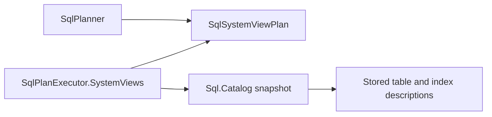
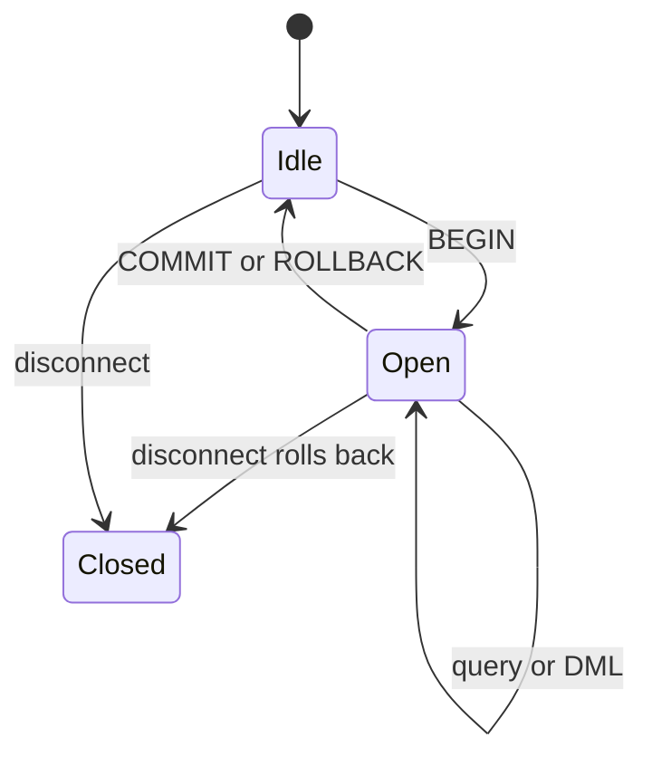
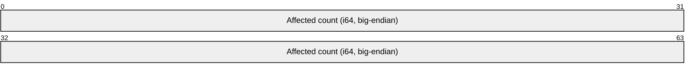

# Assimalign.Cohesion.Database.Sql design

This page describes the boundaries and implementation shape of `Assimalign.Cohesion.Database.Sql`.

> **Status:** Partial.

## SQL namespaces and set operations

[CREATE SCHEMA](../../../../database/sql/language/statements/create-schema.md) persists namespaces;
[DROP SCHEMA](../../../../database/sql/language/statements/drop-schema.md) defaults to RESTRICT.
dbo is seeded at database creation and cannot be dropped (COHSQLE031); code-first provisioning
stays pinned to dbo. AUTHORIZATION/nested elements use COHDBL001. Missing DDL namespaces use
COHSQLE028 (3F000), duplicate CREATE COHSQLE029 (42P06), and RESTRICT dependencies COHSQLE030
(2BP01); reads/DML retain COHSQLE014 (42P01). CASCADE publishes contained-table/index removal
and incoming-FK removal atomically, retaining outside tables. Ownership checks cover affected
objects. SCHEMATA reads the statement's captured namespaces, including empty ones.
Storage format 25 is current. Format 22 introduced STRING_AGG/LISTAGG identifier quoting;
format 23 introduced views and format 24 introduced explicit NULL placement.
Format 25 admits distinct predicates, Boolean tests and LIKE ESCAPE in persisted definitions.
Format 21 introduced namespace records of kind 15; earlier formats have no upgrade path.

[Set operations](../../../../database/sql/language/clauses/set-operations.md) execute in every query
position through SqlQueryBodyExpression. Types/widths validate before reads, including unknown
literal coercion, unconstrained CHAR outputs and COHSQLE003 mismatches (42804). Conversion precedes
tuple comparison; NULLs compare equal and one common collation governs the output. Combined
ORDER BY uses first-input output names or ordinals only. CORRESPONDING remains COHDBL001.
Compatible UNION chains flatten into one N-way materialization; INTERSECT/EXCEPT use hash counts.
All operands share a statement snapshot/catalog capture. ROUND at negative scales compares the
original exact remainder once, avoiding double rounding (#1661).

The SQL engine (area architecture: resources/`Database`/DESIGN.md
(`cohesion/docs/resources/Database/DESIGN.md`) `3.3): parse (`Sql.Language`) → plan (`SqlPlanner`) →
execute (`SqlPlanExecutor`) against shared storage, with the catalog (`Sql.Catalog`) as schema
authority.

## Ordering output values (#1024)

`SqlPlanner.Ordering.cs` binds aliases and standalone numeric ordinals to projection indexes for
stored tables, system relations, joins and groups. Unqualified aliases take precedence over source
columns, including inside scalar ordering expressions. Qualified references and aggregate operands
retain their source scope. Invalid numeric ordinals fail during binding, even for an empty input;
compound constants such as `1 + 1` remain scalar expressions.

The executor materializes each referenced projection before sorting and retains source values
alongside it for other ordering keys. Grouped queries use the same binding against completed group
outputs. `SqlExpressionEvaluator` resolves bound AST nodes by identity to these output slots and
follows each projection's source for collation. It does not reconstruct language AST nodes or
require cross-assembly internal access. Sorting is stable, with NULL first ascending and last
descending, followed by DISTINCT and LIMIT/OFFSET. Explicit NULL placement and derived-table
ordering remain capability errors. The exact syntax contract and execution evidence are in
DIALECT.md
(`cohesion/resources/Database/Assimalign.Cohesion.Database.Sql.Language/docs/DIALECT.md`).

## Subquery and insert-source operators (#1021)

The planner binds child SELECTs through a lexical scope chain and lowers their use sites to typed
slots. Independent children materialize once; correlated children execute for each reached outer
row under the same statement context. Frame-local slots keep nested results independent. CASE,
COALESCE and Boolean preparation preserve lazy evaluation. Projection and ordering retain each
row's child values before sorting. Retained BYTEA cells copy on delivery.

Local names and aliases shadow outer ones, including across multiple levels. Ambiguity and hidden
qualifiers use COHSQLE015. Children over completed groups may read outer grouping-key columns only
(COHSQLE017 otherwise); aggregate arguments read source rows. Aggregate levels follow the lowest
variable or aggregate dependency, including nested queries after adjusting levels. An outer-level
aggregate receives COHDBL001 before grouping checks; mixed local dependencies can keep it local.
See [Subqueries](../../../../database/sql/language/expressions/subqueries.md) for examples.

Scalar queries require one column and at most one row; zero rows produce typed NULL. IN preserves
three-valued membership, and EXISTS tests row existence. Types and collations cross materialization.
All children share the statement's MVCC and catalog snapshots. UPDATE/DELETE predicate children
finish for every candidate before writes; prior uncommitted session changes remain visible.
INSERT SELECT materializes the complete source before applying destination coercion, defaults and
constraints. Failure leaves no partial row changes.

### WITH and derived relations

[WITH](../../../../database/sql/language/clauses/with.md) binds all definitions in declaration order,
including unused bodies. Read names prefer visible CTEs; qualified reads and DML targets use the
catalog. Self and later-sibling names fall back to stored tables; only missing future relations use
COHSQLE026 (no assigned SQLSTATE). CTE names are schema-less and share ordinary alias-conflict
rules. Reachable definitions materialize once in declaration order before any DML write. Unused
bodies do not evaluate counts or seek bounds. A FROM-less definition root uses one implicit row;
ordinary nested queries still require FROM. With, Materialize, CteScan and Constant describe these
plans without executing them.

Derived FROM/JOIN/comma relations reuse typed output metadata, including modifiers, domains,
nullability and collation provenance. Uncorrelated relations cache once per statement; correlated
derived bodies evaluate per enclosing frame. Only a reference that binds to a real sibling gets
the LATERAL refusal; typos retain COHSQLE015. Outer ordering over derived outputs stays COHDBL001.
CorrelatedSubqueries retains complete child plans in EXPLAIN. Nesting remains limited to 32 query
levels. SET, VALUES, CHECK/DEFAULT and pagination-expression subqueries, quantified comparisons,
nested/recursive CTEs and explicit LATERAL remain excluded.

Current SQL data-storage format is 25. Format 16 introduced SEARCH/MATERIALIZED identifier quoting;
format 17 added the insert-default/frozen-missing-value split in table extension 6; format 18 separately
quotes newly executable function names and BOTH/LEADING/TRAILING as identifiers in persisted SQL.
Ordinal CHECK-text comparison would otherwise report schema drift (`sign >= 0` becomes
`"sign" >= 0`). Defaults and function bodies share the renderer. Older formats are refused without
an upgrade reader; compiled schemas stay version 7. Evidence: SqlT1StorageFormatTests,
SqlAlterTableExecutionTests and SqlCteStorageFormatTests.

## Compiled-schema provisioning

`ISqlDatabase` implements the root `IDatabaseSchemaProvisioner` seam. Before a schema is applied,
the provisioner requires `EngineModel.Sql`, the same logical database name, and a shape the shipped
SQL DDL surface can represent. It then reconstructs or reads the last canonical catalog state, uses
`SqlSchemaMigrationPlanner` from `Database.Sql.Schema` for deterministic ordering/destructive
gating, and `SqlMigrationScriptGenerator` for parser-validated engine requests. Supported steps are
table, column, and secondary-index add/drop; alter/rebuild operations and advanced objects (custom
types, functions, triggers, principals/grants, extensions) fail before execution rather than
recording a false applied hash. Foreign keys and checks now render into provisioning DDL and persist
in the table catalog; unique declarations use unique indexes.

Retained table, column, index and constraint names share the parser's delimited identifier contract.
The renderer preserves bare ordinary names and double-quotes reserved words or names containing
spaces and literal dots. Catalog names contain the identifier value without its delimiters. Embedded
double quotes and null characters fail before deployment because the current lexer does not support
those identifier forms. The mapper uses the same retained names, so its quoted DML binds the objects
deployed by this renderer without another naming convention.

Each DDL request remains self-committing under the catalog's established rule. On a later failure,
completed reversible steps run their compensating requests in reverse order and the applied-schema
marker remains unchanged. The marker is written only after all steps succeed, and a repeated apply
is a no-op only when the stored canonical document/hash and live catalog all agree. Full atomicity
for a destructive multi-statement migration is deliberately not claimed: the current catalog has no
transaction spanning DDL statements, and irreversible data loss cannot be compensated. That kernel
seam is recorded as the remaining gap rather than hidden behind the content hash.

### `Object` ownership and the schema package

The area root carries only `CompiledSchema` identity and canonical content, the
`IDatabaseSchemaProvisioner` seam, and model-independent ownership contracts. `Database.Sql.Schema`
owns SQL declarations, compiled tables/indexes/constraints, validation, serialization, and migration
plans. The engine references this thin package; the schema package never references the engine or
its storage/transport.

Live sessions create `Adhoc` tables and indexes. The provisioner's private session carries the
compiled schema name as `ProvisioningSchema` in an internal statement context, so catalog creation
persists `Schema` ownership and that name as `OwningSchema` in the object's first durable record.
`SqlCatalogTable.Schema` remains the separate SQL namespace (for example, `dbo`). Only that
internal session may execute `DROP TABLE`, `ALTER TABLE ADD COLUMN`, `ALTER TABLE DROP COLUMN`,
or `DROP INDEX` against its schema's objects. Normal sessions receive
`DatabaseObjectLockedException` with the object, compiled schema exposed as `OwningSchema`, and
refused operation; row DML remains available. Compensation uses the same private session and
preserves the existing reversible-step policy.

DDL re-reads catalog ownership after acquiring the exclusive object lock. If a table was dropped and
its name reused while the statement waited, the acquired lock covers the old object id: the
statement rejects a schema-owned replacement and requires a retry for any other replacement before
changing metadata or rows. `Index` drops likewise refresh their description after the wait.
Missing-table paths fail directly rather than issuing an unlocked catalog mutation by name.

Schema reconciliation compares only objects owned by the applying schema. Ad-hoc tables and ad-hoc
indexes coexist with it and do not create false drift or become implicit destructive migration
targets. A desired name that collides with an ad-hoc object is rejected before applying any steps;
adoption requires a future explicit policy. Table creation uses the catalog's reserve/build/publish
lifecycle, including its ownership metadata, through the `public static` `SqlCatalog` bridges rather
than any member of `ISqlCatalog`; ordinary `ISqlCatalog.CreateTableAsync` stays ad-hoc. The catalog
persists descriptions; the engine continues to authorize session operations against schema-owned
objects.

## Virtual system relations (C1)

The catalog is the sole data source for seven `INFORMATION_SCHEMA` relations and two Cohesion
extensions. Their complete MVP column matrix is in DIALECT.md
(`cohesion/resources/Database/Assimalign.Cohesion.Database.Sql.Language/docs/DIALECT.md`, section
`system-view-matrix-c1`). Every row describes an object in the session's current database. The
catalog name columns contain that database's name; schema qualification continues to select a SQL
namespace, never another database. `TABLES` lists stored tables as `BASE TABLE`; these virtual
relations have no catalog table records to list.

### The relation seam and statement snapshot

The binder resolves stored tables and registered system relations through one relation-source
path. Every system relation can participate in N-way INNER/LEFT/CROSS and comma joins,
with the same column, alias, USING, ambiguity and grouping checks. System sources take no object
locks and supply no indexes; an eligible stored input can still supply index probes. There are
no dummy stored objects or synthetic metadata rows.

The statement context captures one immutable catalog image on its first system binding. Child
queries and INSERT SELECT sources share it. Snapshot transactions provide their BEGIN-time image;
automatic and ReadCommitted statements capture on demand. A stored-only statement needs no
catalog capture. Table/index/constraint descriptions are captured together, so catalog publication
cannot split them during a metadata read. Fresh later captures reflect completed DDL according to
the session isolation level. Ordinary result/wire codecs return metadata and EXPLAIN plan rows.

The dependency split keeps virtual relation binding and execution in SQL while the catalog remains
the source of stored object descriptions:

### Deliberate extension: index metadata

ISO `INFORMATION_SCHEMA` has no general index relation. Cohesion exposes `COHESION_SCHEMA.INDEXES`,
with one row per ordered index key column. Repeating the table/index identity on each key row
supports ordinary column projection, filtering, and ordering without parsing a vendor-specific DDL
string or encoded column list. `IS_UNIQUE` and `IS_PRIMARY_KEY` are `YES` /`NO`; the latter
distinguishes the catalog's primary-key enforcement index from other unique indexes. Physical root
pages and index-manager registrations stay internal. This explicit extension namespace avoids
presenting a MySQL `STATISTICS` or PostgreSQL `pg_indexes` compatibility contract that Cohesion does
not implement.

### Deliberate extension: object ownership

`COHESION_SCHEMA.OBJECT_OWNERSHIP` has one row per table or index, identified by its table identity,
`OBJECT_TYPE` (`TABLE` or `INDEX`), and `OBJECT_NAME`. `OWNER` preserves the catalog values
`Adhoc` and `Schema`; `OWNING_SCHEMA` is the compiled schema's name for code-provisioned objects
and null for ad-hoc objects. It remains distinct from `TABLE_SCHEMA`, the SQL namespace. `Index`
ownership is reported from the index itself, so an ad-hoc index on a table does not accidentally
inherit that table's provisioning ownership.

These concepts have no ISO counterpart. A separate Cohesion relation keeps non-standard fields out
of `INFORMATION_SCHEMA.TABLES`, preserving the documented column ordering for tools that map
`SELECT *` positionally. The accepted cost is an additional metadata query when a client needs
provisioning ownership.

### Standard vocabulary and the MVP boundary

This is a documented subset of ISO 9075-11's information schema, not a claim to implement every
standard view, column, or SQL domain. Identifiers and descriptive text use the shared `String` type;
standard `yes_or_no` values are strings `YES` /`NO`, not Boolean values. Cardinal numbers use
nonnegative `Int64` values, with ordinal positions starting at one. These conventions follow the
[information-schema type definitions](https://www.postgresql.org/docs/17/infoschema-datatypes.html)
and [column metadata conventions](https://www.postgresql.org/docs/18/infoschema-columns.html)
documented by PostgreSQL's implementation of the standard.

`COLUMNS.DATA_TYPE` reports the canonical SQL name of the catalog's shared type identity. The
catalog does not preserve the original alias spelling (`INT` versus `INTEGER`, for example), so
this surface cannot reconstruct it. Declared length, precision, scale, nullability, and default text
come from catalog fields; unknown or inapplicable facts are null, including an unknown character
octet bound. Cohesion types without an ISO spelling, such as `JSONB`, retain their documented
dialect name.

Primary keys and unique constraints project the catalog's enforcing indexes; foreign keys and
explicit checks project persisted constraint descriptions. `For` older catalog records with
`PrimaryKeyColumns` but no index marked `IsPrimaryKey`, the constraint views infer the name
`PrimaryKey_<table>` from that existing primary-key declaration, appending `_1`, `_2`, and so on
until the name does not collide case-insensitively with a recorded index or constraint on that
table. This fallback does not invent an index row or index ownership; separately recorded unique
indexes remain `UNIQUE`. The catalog does not name `NOT NULL` declarations as separate check
objects: their nullability is exposed by `COLUMNS`, and no synthetic check names are invented. This
is a deliberate MVP limitation relative to the standard's
[check-constraint convention](https://www.postgresql.org/docs/18/infoschema-check-constraints.html)
. Foreign keys store referenced columns rather than an index identity. The views resolve those
columns to the primary key first (including the legacy fallback), then to a matching unique index
ordered deterministically by name. Foreign keys report `MATCH_OPTION = 'NONE'`,
`UPDATE_RULE = 'RESTRICT'`, and `DELETE_RULE` equal to `RESTRICT`, `CASCADE`, `NO ACTION`, `SET NULL` or `SET DEFAULT`. Constraints are
enforced immediately and are not deferrable.

`Constraint` names remain unique within a table, as the catalog already requires, rather than within
the entire SQL schema. Consequently `CHECK_CONSTRAINTS` and `REFERENTIAL_CONSTRAINTS` can contain
ambiguous repeated constraint identities if callers reuse names on different tables;
`TABLE_CONSTRAINTS` and `KEY_COLUMN_USAGE` carry table identities. This existing catalog limitation
is not changed by introspection; the same portability consequence is described in
[PostgreSQL's information-schema notes](https://www.postgresql.org/docs/18/information-schema.html)
. Metadata currently follows the engine's database visibility boundary; per-object privilege
filtering belongs to SQL security (D2).

### `Read`-only names

`INSERT`, `UPDATE`, `DELETE`, and all supported table/index DDL targeting a system relation fail
with `DatabaseException` and the stable message `System view '<SCHEMA>.<VIEW>' is read-only.` The
view name in the diagnostic is canonical uppercase, for example `INFORMATION_SCHEMA.TABLES`. The
wire server returns `ExecutionFailure` with that message and keeps the connection usable.
`CREATE TABLE` collisions are refused by the same rule, including `IF NOT EXISTS`;
`DROP TABLE IF EXISTS` and `DROP INDEX IF EXISTS` do not turn the refusal into a no-op.
`CREATE VIEW` and `DROP VIEW` remain outside the declared dialect and retain their existing
unsupported-clause diagnostics.

## Execution model

- **Rule-based planning, plan/execute split.** `SqlPlanner` binds the AST against
  the catalog into a small `SqlPlan` IR and rejects everything outside the
  executor's surface at plan time with precise messages. N-way joins, grouping, supported
  subqueries, aggregates and INSERT ... SELECT have executable plan nodes. The IR
  is deliberately thin — a cost-based planner replaces the binding internals
  later without changing the executor seam (#178's plan-stage requirement, MVP
  shape). That promise paid out with index adoption: the IR gained exactly one
  node family (`SqlAccessPath` on SELECT, UPDATE and DELETE plans — scan | index seek) and the
  executor seam did not move.
- **Access-path selection (rule-based; no cost model — the MVP planner
  contract).** The planner flattens the WHERE clause's top-level `AND`
  conjuncts into per-column sargable predicates — `column op comparand` where
  the comparand is plan-time evaluable (literal/parameter, no column
  references), non-null, and coercible to the column's storage type; `BETWEEN`
  contributes its two bounds — then picks the index with the **longest
  equality prefix** over its leading key columns (ties prefer a usable range
  bound, then uniqueness, then name — deterministic), extended by range bounds
  on the next key column. **Range sargability is a type matrix**: only types
  whose evaluator comparison order provably equals the key codec's byte order
  (integers, decimal, boolean, temporal types and strings under matching
  byte-expressible collations) get range seeks; Guid/binary/json remain equality-only.
  String predicates with expression/index collation mismatch scan. Everything else — `OR` at the top level,
  computed columns, column-to-column comparisons, null comparands — falls
  back to the per-object scan. Scalar-subquery comparands also supply no bounds. Floating ranges
  scan, and signed-zero floating bounds are not sought. **The full WHERE always remains the residual
  predicate**, re-evaluated on every fetched row, so access-path selection
  can cost performance but never correctness. UPDATE/DELETE use the same selector with their
  target relation's scope, including aliases and qualified keys. See [index eligibility](../../../../database/sql/language/statements/select.md#index-access).
- **DML target materialization.** UPDATE/DELETE fully drain the seek or scan in one statement
  snapshot before sorted row locks, sorted unique-key locks and the apply gate. Residual/subquery
  evaluation holds no tree read latch, and cancellation/evaluation failure disposes the cursor.
  Updating the sought key cannot revisit replacement rows. Final-state constraint validation and
  first-updater-wins checks are unchanged. A dropped/detached bound index or changed catalog
  identity, including a reused name with different keys, falls back to a residual-filtered scan.
  A catalog-registered but missing maintenance tree still refuses writes.
- **`Seek` execution is snapshot-anchored.** The executor drives the B+Tree
  cursor through the **statement snapshot** (the `IIndex.OpenCursor(snapshot, …)`
  overload — the same snapshot the equivalent scan filters through, which
  is the equivalence anchor under ReadCommitted's per-statement re-capture),
  unpacks each visible entry's packed row location, fetches the row, and
  re-checks the row's stamps against the same snapshot (defense in depth:
  entries mirror row stamps by the maintenance discipline, so a divergence is
  a bug this filter contains rather than surfaces; a dangling entry under an
  invisible stamp is skipped, never fetched wrongly). Prefix ranges ride the
  codec's order preservation: every composite key starting with prefix `P`
  sorts in `[P, successor(P))`; bound inclusivity maps to prefix-successor
  arithmetic on the encoded component. Per-statement observability
  (`SqlStatementMetrics`: access path + records examined) is the behavioral
  proof surface — the planner suite asserts an indexed equality seek examines
  O(matches) records while the equivalent scan examines O(table). AccessPath reports the last
  access executed, including nested work; cascading DELETE can therefore report
  `constraint-seek:<index>` rather than its original target path.
- **Row format: MVCC stamps + object-id-prefixed tuple, in per-object page
  chains (record-space format version 3).** Every data record is
  `[writer u64][deleter u64]` — a fixed 16-byte version-stamp header, the
  B+Tree leaf-entry design adopted for the record space — followed by the
  shared tuple codec payload (#854): the owning table's object id, then one
  self-describing component per column. Why a fixed binary prefix and not
  tuple components (the rejected alternative): (a) stamps in front never
  disturb ADD COLUMN's missing-tail decode, which depends on absent
  components being *trailing*; (b) fixed width makes tombstoning a same-length
  in-place write — a delete can never relocate a record; (c) stamp reads don't
  pay tuple-decode costs on the scan hot path. Since format version 3 the
  tables of a database still share one record *space* but not one page
  stream: rows land on pages tagged with their table's object id (the storage
  layer's per-owner chains), so **a table scan touches only its own table's
  pages** — O(table), not O(database) — and `DROP TABLE` releases the
  table's whole chain back to the allocator (transactionally, inside the
  statement bracket; the record-byte layout is unchanged from version 2, and
  the object-id prefix stays as defense in depth and upgrade detection).
- **Scans are snapshot-visible.** Every scan filters through the statement's
  snapshot: a version is visible when `IsVisible(writer)` and its deleter — when
  stamped — is *not* admitted (a visible tombstone reads as absence). Updates
  write version chains in the record space itself: tombstone the old version in
  place, insert the new one, both stamped with the writing transaction's
  sequence — so exactly one version of a logical row is visible per snapshot by
  construction, versions are WAL-covered like all record writes (restart keeps
  them correct for free), and aborted stamps revert physically with the page
  images. Deletes tombstone (older snapshots keep the row until the purge
  worker reclaims below every live horizon). DROP COLUMN preserves all stored versions and records dropped physical ordinals in metadata.
- **Format rule (record-space format version, catalog-persisted).** Only format 25 opens.
  Format 19 introduced canonical PERCENT/TIES identifier quoting; format 20 persists SET NULL,
  SET DEFAULT and NO ACTION actions. Format 21 adds namespace records of kind 15. Older and newer versions are refused before opening data
  files. No upgrade reader exists; export with the writing engine, recreate and reload.

- **Schema evolution (#1023):** `ADD COLUMN` validates the default expression and
  current rows under the exclusive object lock before publishing the complete
  replacement definition in one catalog transaction. Backfill is resolved at
  read time from independent frozen missing-value metadata; no existing row bytes, locations or
  MVCC stamps are changed. `SqlRowCodec` reports how many fields were physically
  present, and the executor resolves only the missing tail, on both scans and
  index seeks. Explicit NULLs remain NULL. Default conversion is shared with
  omitted-column INSERT values and rejects overflow, nonfinite floats, string
  truncation, and decimal rounding or precision loss. Validation scans are
  O(table); there is no physical backfill or cross-storage row/catalog commit.
  A crash before catalog publication leaves the old definition; after publication
  the same frozen missing literal resolves old rows on reopen. Constrained additions
  still build enforcing indexes durably before publication; a crash can leave
  unpublished index pages, never a partly backfilled table.
  Bound plans retain their immutable definition; later statements bind the full
  new definition even with an older row snapshot. NOT NULL without a default
  fails if any current row exists; historical deleted versions can still read
  NULL under an older snapshot after an addition to a currently empty table.
  `DROP COLUMN` marks physical ordinals dropped in catalog metadata without rewriting versions. DDL is self-committing and refused in explicit
  transactions. Schema-owned tables retain their existing live-session DDL guard.
- **Expression evaluation** is interpretive with SQL null propagation (nulls
  reject predicates, comparisons with null are null, `AND`/`OR` are three-valued),
  numeric promotion to decimal, collation-aware comparisons, iterative cancellable `LIKE`
  (`%`/`_` with default or explicit ESCAPE), NULL-safe `IS [NOT] DISTINCT FROM`, Boolean
  truth tests, `CASE`, `BETWEEN`, `IN` (lists), `IS NULL`, parameters (`@name`
  bound by bare name), and a small builtin set (`COALESCE`, `UPPER`, `LOWER`,
  `LENGTH`, `ABS`). Compiled expression plans are a later optimization.
- **SELECT materializes.** Sorting and `DISTINCT` need the full result anyway at
  this stage; `SqlMaterializedResultSet` carries typed columns and evaluated
  rows. Streaming operators arrive with the planner build-out.
- **Transactions (MVCC session binding, `3.8).** Every statement — explicit
  transaction or auto-commit — runs under an `ITransactionContext` from the
  database's transaction manager, whose sequences come from the storage's own
  counter (one namespace). The shared `Database.Transactions.TransactionCoordinator` owns
  the composition (manager + lock manager + record-space version store +
  journal-bound log). The instance's thin `IStorageTransactionSource` adapter
  resolves a context's *current statement bracket* and retains the engine's
  `DatabaseException` for a missing pairing. `Commit` flows
  through the manager: its journal-bound log appends the commit record and
  awaits durability (which, by journal ordering, also covers every statement
  bracket the transaction committed non-durably); rollback is **logical** —
  the version store's ledger physically undoes the writer's stamps before its
  locks release. Auto-commit statements ride a one-statement manager
  transaction, so visibility semantics never fork. Isolation: `Snapshot`
  (default) fixes the statement snapshot at begin, `ReadCommitted` re-captures
  per statement; `Serializable` is **rejected** until conflict detection
  exists (never run weaker than requested). Kernel aborts surface wrapped in
  the root's `DatabaseTransactionAbortedException` (deadlock victims:
  `DatabaseTransactionDeadlockException` — retryable by construction, an
  `ExecutionFailure` on the wire, session stays usable). On every database
  open the coordinator runs `TransactionRecovery.Analyze` over the recovered
  journal (the storage strategy defers the open-time checkpoint for exactly
  this) and scrubs every unproven writer's stamps out of the record space —
  the open-time bulk form of `IVersionStore.PurgeWriterAsync`, one pass
  instead of one scan per writer because the in-memory ledger died with the
  process; the checkpoint worker checkpoints data storages *through the
  coordinator*, so truncating checkpoint records carry in-flight logical
  sequences. DDL in auto-commit mode flows to the catalog, which self-commits on its own storage
  (see the catalog DESIGN.md for why DDL-in-DML is out of MVP scope), and
  interlocks with row writers through table-grain intent locks (below).
- **Shared record-space composition (#918).** `SqlTransactionRecordSpace`
  supplies row reads, transactional updates/deletes, and the existing packed
  location codec to `RecordSpaceVersionStore` in `Database.Transactions`.
  `SqlRowCodec` retains SQL tuple encoding, while
  its stamp operations delegate to the shared `RecordVersionStamp` contract
  ([layout](../assimalign-cohesion-database-transactions/design.md#record-stamp-prefix-the-16-byte-contract)).
  `RecordVersionIndex` in Indexing binds each live secondary index to the
  shared undo ledger. Recovery ordering is unchanged: re-attach indexes,
  analyze and scrub records, scrub indexes with the same classification, then
  complete the deferred checkpoint. The format gate refuses every noncurrent format before
  data files open; there are no format upgrades.
- **`Write` statements execute in two phases; the physical bracket is per
  statement (`3.8's migration path).** Phase one — no physical bracket: scan
  through the statement snapshot, collect targets, acquire an IntentExclusive
  table lock and an Exclusive lock per target row through the lock manager
  (asynchronous waits, cancellation-honoring; deadlocks detected here,
  requester-closes-cycle). **Lock-key scheme:** row locks key on
  `LockResource.Entry(objectId, packed page/slot location)` — the same packed
  identity the version-store ledger uses, and the same `LockResource` space
  the B+Tree's hashed key locks live in, so index and row locks cannot alias.
  Phase two — the coordinator's **apply gate** (one writer statement applies
  at a time per database): open the statement's storage bracket, **re-validate
  every target against its current stamps** (the latest-state check under the
  exclusive lock — the B+Tree uniqueness-discipline precedent; a snapshot-only
  check would admit write skew), apply, and commit the bracket *non-durably*
  (the transaction's commit record owns durability through journal ordering; a
  statement-level failure still rolls the bracket back physically). A target
  tombstoned by a concurrently *committed* transaction fails the statement
  with the retryable conflict — **first-updater-wins**; under `ReadCommitted`
  this is deliberately stricter than PostgreSQL's re-evaluation (the statement
  aborts rather than re-targeting the new version — retry is the policy).
  **Why the apply gate and not concurrent appliers with page-conflict retry
  (the recorded page-conflict fallback decision):** page locks release at
  statement end either way, so the gate costs only intra-database physical
  apply parallelism — which page-grain single-writer never had — while
  concurrent appliers reintroduce unbounded retry loops and page-vs-row wait
  cycles the lock manager cannot see. Revisited when per-object page chains
  landed (format version 3): chains remove data-page conflicts *between
  tables*, but writer statements still share the current write page within a
  table, the free-space map, and journal append ordering — the gate stays,
  and a per-object relaxation remains a measured-need follow-up, not a
  default. SELECT statements take no locks and no bracket: readers never block
  writers, and physical read/write interleaving is unchanged from the
  page-grain engine (a known storage-layer constraint, not widened by this
  design).
- **Two file sets per database:** `<name>` (data) and `<name>.catalog` — both via
  the engine's storage strategy, so file-backed and in-memory composition stays
  symmetric.

## Secondary indexes

`CREATE [UNIQUE] INDEX` / `DROP INDEX` are end-to-end: dialect (the DIALECT.md matrix), plan nodes,
catalog metadata, and B+Tree trees through `Database.Indexing` 's manager — **on the same database
file set** (index pages ride the data storage's transactional page surface; no new file assets). The
engine is the Indexing child root's first real consumer; the split of duties is unchanged: the tree
is physical, the catalog owns persistence (schema description + exported registrations), the engine
binds them.

- **DDL flow.** CREATE INDEX takes the table's Exclusive lock (DDL-blocking
  build — in-flight writers finish first, Indexing's documented no-online-rebuild
  posture), builds inside one gated **durably committed** bracket (the
  self-committing DDL posture: the catalog record commits independently and must
  never describe a tree a crash could revert), walks **every stored version** and
  inserts entries carrying the version's original writer/deleter stamps — so
  snapshots older than the index read exactly what the row scan shows them —
  then persists metadata + registrations in **one catalog self-commit** (the two
  must never tear: a registration without a description is an unused tree; a
  description without a registration would promise uniqueness no tree enforces).
  Crash windows leave only orphaned tree pages — safe leaks, never a
  half-attached index. DROP INDEX inverts the order (catalog first — the
  authoritative drop — then the in-memory directory) under the same lock; DROP
  TABLE drops its indexes' metadata/registrations atomically with the table
  record and DROP COLUMN on an indexed column is rejected (drop the index
  first — entries key on the column's values).
- **`Write`-path maintenance mirrors the row-version discipline exactly.** INSERT
  adds entries stamped with the writer's sequence; DELETE stamps entry deleters
  (tombstones — old snapshots keep seeing them); UPDATE tombstones the
  old-location entries and inserts new-location entries, the index image of the
  in-space version chain. Every effect is recorded in the version-store ledger,
  so **logical rollback undoes index stamps through the ledger** (physical erase
  of aborted inserts, deleter-clear of aborted tombstones — the Indexing
  `EraseAsync`/`ClearDeleterAsync` undo surfaces), and the open-time recovery
  scrub purges unproven writers out of every tree in one walk
  (`IIndexManager.PurgeWritersAsync`, driven by the same
  `TransactionRecovery.Analyze` classification that scrubs the record space).
  The ledger route was chosen for live rollback (surgical, O(transaction
  effects)) and the tree walk for open-time scrub (the ledger dies with the
  process) — both end in the same physical operations.
- **The lock-ordering rule** (ordinary INSERT/UPDATE/DELETE, with exceptions below so cycles stay
  detectable and rare): phase one acquires the adjacent tables' IntentShared
  locks in object-id order, then the table's IntentExclusive lock, then row
  Exclusive locks sorted by packed location, then **parent-row Shared locks
  sorted by (object, entry)** for the outgoing foreign keys the statement takes
  on and for the ones it releases, then
  **unique-index key locks sorted by key hash** (`IndexKey.Hash`, the same FNV-1a
  identity the B+Tree locks internally). `Object`-grain locks are intent-only
  across classes one and two, and intent modes are mutually compatible, so only
  the entry-grain classes can conflict. Inside the apply gate the B+Tree
  re-acquires the key lock as a same-owner re-grant that completes synchronously
  — **no lock wait can ever occur while the gate is held** (a wait there would be
  invisible to deadlock detection). Non-unique indexes take no key locks. `Key`
  locks and row locks share the `LockResource.Entry` space; a hash/location
  collision only over-locks, and the class ordering keeps acquisition globally
  consistent. **The first deliberate exception is the cascade walk**, which locks
  rows in discovery order because the closure it is discovering is what
  determines the lock set; see "Referential enforcement locks parent rows" under
  constraints for why that trade was taken and what it costs. ON CONFLICT is the second:
  proposal keys precede nonblocking row arbitration; a contended row releases new grants before
  waiting and restarting with the wait's row grant retained. Replacement keys follow locked
  conflict rows. Opposite multi-row key/row orders can still deadlock; see the execution contract below.
- **Uniqueness = the B+Tree's latest-state check under the exclusive hashed-key
  lock** (never snapshot visibility — write skew; the recorded #851 lesson).
  Violations surface as the area root's `DatabaseException` at the model
  boundary (`IndexUniqueViolationException` translated — the child-root error
  policy); the statement's bracket has rolled back, the session stays usable.
  Unique keys treat nulls as values (stricter than ANSI; consistent with the
  codec's nulls-first ordering — documented dialect decision).
- **Registrations re-export at persistence points** (root page ids drift on
  splits): index DDL itself, each checkpoint pass, and instance disposal — each
  compares against the stored set first, so an idle checkpoint writes nothing.

## Engine-owned background workers

The engine is a **data machine**: `Create(options)` returns it operational, with the five-worker
inventory already pumping — one dedicated background thread per worker, spawned by the constructor
and joined on dispose. Nothing outside the engine schedules, claims, or configures these loops (the
2026-07-13 redesign deleted the #902 claim handshake — see the root DESIGN.md); the root contract's
`IDatabaseEngineWorker` view of them is observational (name, kind, cadence). Each worker iterates a
lock-free snapshot of every open storage file set (data + catalog per database, rebuilt when
databases open/close; passes tolerate racing a drop):

- **`SqlWriteAheadFlushWorker`** — signal-driven group-commit flusher. Every open
  storage's `OnCommitPending` hook sets one engine-level event; a pass resets the
  event first (a mid-pass registration re-arms it) then calls
  `FlushPendingCommits()` per storage. Only does work under
  `SqlDatabaseEngineOptions.Durability = Grouped`; the default stays synchronous
  per-commit fsync.
- **`SqlPageWriteBackWorker`** — paced `WriteBackDirtyPages(batch)` per storage per
  pass (`PageWriteBackInterval`/`PageWriteBackBatchSize`).
- **`SqlCheckpointWorker`** — checkpoints **both** file sets of every open database
  per pass (`CheckpointInterval`); a busy storage (`StorageTransactionException`) is
  skipped and retried next pass. The data file set checkpoints **through the
  database's transaction coordinator**, so the truncating checkpoint record
  carries every in-flight logical transaction's sequence (recovery
  classification survives truncation); the catalog file set has no logical
  transactions above it and checkpoints directly.
- **`SqlVersionPurgeWorker`** — **live** (#910): per pass, per open database, it
  retries the logical undo of any aborted writer whose rollback-time purge
  failed (`IVersionStore.PurgeWriterAsync`) and physically reclaims versions no
  snapshot can reach (`IVersionStore.PruneAsync` below the safe prune bound —
  the minimum snapshot floor of every open transaction, anchored above the
  recovered sequence namespace after a reopen, or the manager's oldest-active
  bound when idle; the manager's bound alone would let a live pinned snapshot
  lose a version it can still read). Cadence: `MaintenanceInterval`. A pass
  failure flips the engine to `Faulted` without stopping service — unpurged
  versions cost space, never consistency. The stub-era seam was untouched, as
  designed: activation changed the worker body and nothing else.
- **`SqlIndexMaintenanceWorker`** — the one remaining documented stub
  (sanctioned by #902): the index layer has no compaction to drive yet. It
  keeps the inventory — and any observer over it — stable; the throttled
  maintenance body fills in when index compaction lands, without touching the
  seam.

**Lifecycle (create → use → dispose):** the worker threads live exactly as long as the engine.
Disposal signals the pumps, joins the threads *before* closing storages (no worker pass may touch a
database being disposed), then durably flushes and closes every open database — an embedded consumer
gets identical durability with no host and no composition at all (R10). A worker fault flips the
engine's observational `State` to `Faulted` without stopping service — a faulted worker never
compromises correctness (grouped commits self-help within the window; checkpoints simply stop
truncating), but the owner can observe the engine runs degraded. (Previously the fault was thrown
from `StopAsync`; with lifecycle members gone, `State` is the reporting surface — throwing from
`DisposeAsync` would be hostile to `await using`.)

Cadence knobs live here, on `SqlDatabaseEngineOptions` — the engine owns the loop, so cadence is
engine configuration; observers read it through `IDatabaseEngineWorker.Interval`.

## The SQL server runtime (`SqlDatabaseServer`)

The SQL model ships its own wire-protocol server: `SqlDatabaseServer`, a sealed implementation of
the area root's `IDatabaseServer` contract fronting exactly one `SqlDatabaseEngine`
(`Create(engine, options)`, options in `SqlDatabaseServerOptions`). Servers are per-model by design: this type is
where SQL-specific wire behavior grows (typed relational payloads, SQL transaction frames) as the
protocol's model-specific surface lands; execution uses `SqlDatabaseSession` through its
`DatabaseLanguageSession<SqlQueryRequest>` capability. "Running" lives here — the engine underneath has no lifecycle;
the server starts and stops around it.

### Why the machinery is `Sql`-internal — per-model duplication (2026-07-14, owner decision; the settled placement)

The server machinery — accept loop, session state machine and frame pump, guardrails, two-phase
drain — lives **inside this package** (`Server/` for the public surface, `Internal/` for the pump
and context), not in a shared library. This is the fifth and final placement, and the history is
deliberate evidence discipline (each move recorded in the area DESIGN decision log): folded into
`Database.Hosting` (2026-07-12) → resurrected as a shared `Database.Server` base (2026-07-13) →
folded in here as premature abstraction from n=1 (2026-07-14), with an extraction trigger recorded
for the second model server → **the trigger fired the same day**: building `KeyValueDatabaseServer`
supplied the evidence, the evidence exceeded the prediction (even the execute pump proved common,
because model #2 rides the root's text-execute seam), and the proven core was extracted back into
`Database.Server` → **the owner reviewed the evidence and chose per-model duplication anyway**
(2026-07-14): the shared library was removed, and each model package carries its **own full copy**
of the machinery. The trade-off was stated and accepted — model independence (each model server free
to evolve its pump, framing, and guardrails without coordinating a shared base) outweighs the
duplication/drift cost; **wire-behavior parity is maintained by the protocol contract and per-model
E2E suites, not by shared code**. The copies are allowed to be textually near-identical today —
divergence over time is sanctioned, and no linked-source or shared-internals mechanism may be used
to fake the independence. The prediction-vs-evidence table from the extraction is preserved in the
area `DESIGN.md` `3.10. The root contracts
(`IDatabaseServer`/`IDatabaseServerContext`/`IDatabaseServerSession`) remain the **only area-wide
requirement** — every model implements them its own way against `Connections` and the
`Database.Protocol` child root (via the root's rollup).

### Composition seam

`SqlDatabaseServer.Create(engine, options)` — or the `AddSqlServer(engine, configure)` builder verb
— composes a server. The options carry one configured `IDuplexConnectionListener` instance, not a listener
factory. `StartAsync` explicitly awaits `BindAsync` before it starts the accept loop or returns; a
bind failure is propagated only after the listener is terminally disposed, so a partially acquired
endpoint cannot remain live. `StopAsync` cancels the pending accept, drains sessions within the
configured budget, then terminally disposes the listener. Listener ownership therefore transfers to
the server when start is attempted. Stop is terminal: restart symmetry is a fresh server with a
fresh listener, never reuse of the disposed pair. `options.Authenticator` defaults to
`DatabaseAuthenticator.AllowAll` (`Database.Security`) — the MVP development posture, deliberately
an explicit, discoverable object rather than hidden server behavior. The engine is likewise owned by
the composition root: engines are data machines (create → use → dispose), and the server never
disposes its engine.

### The text-execute path

The server receives statement *text* and tuple-codec parameter bytes off the wire; the bridge to the
engine is the **language capability** —
`DatabaseLanguageSession<SqlQueryRequest>.ExecuteAsync(string, IReadOnlyDictionary<string, object?>?, CancellationToken)` —
which `SqlDatabaseSession` implements with the model's own parser (`SqlQueryRequest.FromSql`).
Parameters decode with `DatabaseValueCodec` (`Database.Types`), one self-describing component per
parameter; result rows encode the same way, one component per column, so both directions ride the
one shared codec the client also speaks.

### Session state machine

`Connected → Startup received → Authenticating → Ready ⇄ Executing → Terminated`. Guardrails baked
into the options because they are DoS-critical (the HTTP/1.1 limits lesson, #791): unauthenticated
connections are dropped after `AuthenticationTimeout`; `MaxSessions` bounds concurrency (rejections
use the protocol `Unavailable` error); idle sessions are evicted; `StopAsync` drains within
`ShutdownDrainTimeout` then aborts.

Implementation decisions (carried over from the machinery's prior homes — this record moves with the
machinery):

- **Version negotiation:** an unknown *major* in `Startup` earns
  `UnsupportedVersion` and a close; the server then speaks
  the lower peer/server minor, with a validated capability intersection on 2.1.
- **`Database` binding** resolves on the server's one engine: already-open
  databases first (`TryGetDatabase`), then an open attempt; an exact
  `DatabaseNotFoundException` → wire `DatabaseNotFound` and close. Other open
  failures propagate to the handshake's internal-error path. (The pre-per-model
  server probed a *list* of engines in registration order; one engine per server
  removed that ambiguity.)
- **Authenticate exchange (MVP):** the challenge frame carries no payload (the
  trust method); the client's response bytes pass to `IDatabaseAuthenticator`
  as opaque evidence. Method-specific payload schemas arrive with real
  authenticators.
- **`MaxSessions` counts handshaking sessions too** — an unauthenticated
  connection holds a slot, otherwise the cap would not bound resource use at
  all. Over-limit connections get the `Unavailable` error frame immediately at
  accept and never become sessions.
- **Error taxonomy per exchange:** statement-level failures keep the session in
  Ready — `DatabaseParseException` → `ParseFailure`, any other
  `DatabaseException` → `ExecutionFailure` (an execution error is not a protocol
  violation). Framing/order violations (`ProtocolException`, malformed parameter
  components) → `ProtocolViolation` **and close**; anything unexpected →
  `Internal` and close. A child-root exception that escapes raw (for example a
  `StorageException` the engine failed to wrap) reaches the wire as `Internal`
  and closes the session — the engine's model boundary is where wrapping into
  `DatabaseException` belongs.
- **`ResultComplete` carries the result set's real `AffectedCount`** — the
  evidence-driven adjustment from the (since-reversed) shared-core extraction,
  kept in both models' copies: SQL's materialized query sets report `-1`, so
  SQL wire behavior is unchanged, while outcome-shaped sets elsewhere carry
  real counts.
- **Two-phase stop:** a *soft stop* token ends the accept loop and cancels reads
  at frame boundaries (idle sessions close immediately, telling the peer
  `Unavailable`); in-flight executions run on the session lifetime token and get
  the full drain budget. When the budget lapses, the *hard abort* token cancels
  executions and aborts connections. Session pumps own their errors — their
  completion tasks never fault, so drain is a plain `WhenAll`.

The server layer defines no exception root of its own: wire failures are the protocol's
(`ProtocolException`, mapped to wire error codes as above), and engine failures are the area root's
(`DatabaseException` family). Configuration misuse (no listener, non-positive session limit, null
engine) throws argument exceptions at creation.

Server non-goals: no host-service adapter (`Database.Hosting` wraps `IDatabaseServer` generically
through the root seam); no connection-level replication endpoints; no special transaction frames
(SQL transaction commands use the existing `Execute` payload); no TLS/transport policy — transport
configuration stays in `libraries/Connections` drivers, while the server owns bind-through-release
lifecycle.

## SQL transaction control and the B7 seam

`BEGIN [TRANSACTION]`, `COMMIT [TRANSACTION]`, and `ROLLBACK [TRANSACTION]` are ordinary SQL
requests over the existing wire `Execute` message. The session dispatches their parsed AST before
creating an auto-commit transaction. `BEGIN` opens a coordinator context; subsequent queries and DML
share that context and its visibility snapshot. `COMMIT` awaits the coordinator's durable commit;
`ROLLBACK` undoes row and index versions and releases locks. Closing the session, including EOF,
explicit wire termination, or server shutdown, rolls back an open transaction before releasing the
session. The C# transaction API and SQL control commands operate on the same scope.

The session owns `Stack<SqlTransactionScope>`, with zero entries outside a transaction and exactly
one root entry in B2. Each scope carries its transaction and the existing
`Database.Transactions.IsolationLevel` value. The session's default isolation value is `Snapshot`;
begin and auto-commit pass that value to the coordinator instead of embedding a level at each call
site. B7 anticipates `SAVEPOINT name`, `ROLLBACK TO [SAVEPOINT] name`, `RELEASE [SAVEPOINT] name`
, and `SET TRANSACTION ISOLATION LEVEL ...`: named scopes and undo markers can extend the stack,
while isolation syntax sets the carried value. B2 implements none of that syntax or savepoint undo
machinery. `Serializable` remains rejected by the existing C# seam until the coordinator supports
serialization detection.

The session lifecycle below applies equally to SQL requests and C# transactions.

State misuse returns `DatabaseResultStatus.Error` with an error diagnostic, without throwing or
changing the active transaction. `COHSQLT001` means nested `BEGIN`; `COHSQLT002` means `COMMIT` or
`ROLLBACK` without an active scope. The wire maps these to `ExecutionFailure` and includes the
stable diagnostic code in its message. The connection remains usable.

DDL still commits on the catalog's separate storage and cannot enlist in a user transaction through
the frozen catalog contract. `COHSQLT003` therefore refuses `CREATE`, `ALTER`, and `DROP` while a
session transaction is open, before catalog or data mutation. Auto-commit DDL retains its
established durability contract. This limitation and the unavailable interface seam are recorded in
`_out/phase4-b2-ESCALATIONS.md`.

## Integrity constraints

`UNIQUE` is a unique index, consistently across SQL syntax, catalog metadata and
`CompiledSchemaIndex(IsUnique: true)`. A separate compiled constraint kind would duplicate both
persistence and enforcement and permit the two paths to diverge. Named `UNIQUE` declarations keep
their name as the index name. Foreign keys and checks are table constraint records; their names,
ordered columns, reference target, delete action and check expression text are persisted in the
versioned table codec and recovered with the rest of the catalog.

Table creation reserves an unpublished object identity, durably builds its unique and primary-key
backing trees, then publishes the table, constraints, index metadata and registrations in one
catalog commit. A crash before publish can leave orphan tree pages, but cannot expose an unenforced
declaration. Adding column constraints or table constraints uses the same atomic publication path
after validating existing rows. Primary-key backing indexes carry an explicit catalog marker; schema
reconciliation keeps them separate from the schema's declared secondary indexes.

Primary keys use the same physical uniqueness enforcement, with a persisted `IsPrimaryKey` marker on
their backing indexes. Schema reconciliation excludes only those marked indexes from the declared
secondary-index list; an explicitly declared unique index over the same columns remains a separate
schema object. Compiled provisioning creates all tables and indexes before adding references, so
child-first names and cyclic reference graphs provision deterministically.

`SqlPlanExecutor` enforces checks and outgoing references on inserted or updated rows, and incoming
references on parent deletes or key changes. Checks reject a false result; SQL unknown/null passes.
Foreign keys with null components are not checked (MATCH SIMPLE). A non-null child key needs a
parent visible through the statement snapshot or its final pending replacements. ReadCommitted
ON CONFLICT refreshes committed visibility after arbitration. SQL `Delete` defaults to `NO ACTION`; `CASCADE` recursively
collects child deletions into the same statement apply bracket. Parent key updates are restricted
while referenced in the final state. Multi-row UPDATE excludes all replaced old versions and
contributes every final replacement to outgoing/incoming NO ACTION/RESTRICT checks. Self-references
may move with their keys; mutually referenced keys may swap when final keys remain valid. UPDATE
tombstones all old row/index versions before inserting replacements in the same rollback bracket,
so uniqueness also validates the final swap. A removed key cannot authorize a dangling child. These
rules hold under Snapshot and ReadCommitted. ON CONFLICT shares the final-reference view.
`ON UPDATE` is unsupported and returns `COHDBL001`.

Checks require Boolean predicates made from supported deterministic row expressions. Parameters,
subqueries, aggregates, unsupported functions and casts are rejected during binding. Multiple
unnamed constraints receive distinct generated names. Cascades are collected before restriction
checks; a child already in the complete statement deletion set does not prevent that deletion, so
physical row order and declaration order do not change the result.

Enforcement uses the existing lock manager and coordinator. Unique keys acquire transaction-duration
key locks before entering the apply gate, then the B+Tree checks current entry stamps, including
winners committed after the caller's snapshot. Two transactions cannot both publish the same unique
key. `Constraint` failures roll back the physical statement bracket, preserving earlier successful
statements in an explicit transaction. The exception is `SqlConstraintViolationException`; callers
can inspect the constraint name, table name and safe offending value. Sensitive/raw binary values
are omitted where they cannot safely be exposed.

Uniqueness follows the existing index convention: null components participate in the key, including
its duplicate check. A single numeric or Boolean offending value is carried when available; strings,
binary values and composite keys are omitted, including the encoded index exception that could
disclose them.

**Referential enforcement locks parent rows, not reference graphs.** Every constraint check needs
one guarantee from the lock manager: *before a statement reads a table's latest state for some key,
every other writer of that key is already decided* — committed, or rolled back with its undo
complete. Two conflicting locks on the **parent row** deliver it:

- **A child writer (INSERT,** — or an UPDATE that sets a foreign key) takes `Shared`
  on the parent row version it matched, then re-checks that version's stamps
  under the lock. Holding it is what stops a concurrent parent delete from
  admitting an orphan; the stamp check is what rejects a parent the writer's own
  snapshot still sees but a committed transaction has already removed.
- **A child writer that **releases** a reference** — deleting the row (including as
  a cascade target), or changing its key away — takes the same `Shared` lock on
  the parent row it is giving up. This half is not symmetry for its own sake: a
  latest-state read treats an *undecided* tombstone as absence, so without it a
  parent delete concludes the row is unreferenced, commits, and is contradicted
  the moment the child's transaction rolls back and restores the reference.
  `ParentDelete_ConcurrentUncommittedChildDelete_ShouldNotStrandTheRestoredChild`
  is the regression guard. The cascade walk skips the edge it arrived by, whose
  parent row the statement already holds exclusively — that is also what keeps
  the constraint-lookup access-path metrics unchanged.
- **A parent writer takes** — `Exclusive` on every row it deletes or re-keys **before**
  reading child tables for incoming references. `Shared` and `Exclusive` are
  incompatible, so by the time that read happens every child writer that acquired
  *or released* a reference to the row has been decided.

Table-grain locks stay intent-only: `IntentShared` on the adjacent tables a statement reads for
constraint purposes, which is compatible with other writers' `IntentExclusive` and blocks only
table-grain DDL, keeping parent definitions stable for the life of the statement. A cascade walks
the closure locking as it descends — a row is exclusively locked before its children are read —
because a transitive closure cannot be pre-sorted.

**Why not component-wide exclusion (the rejected original).** The first cut took `Exclusive` on
every table in the transitive closure of the reference graph, in object-id order, before row/key
locks and the apply gate. It was correct and could not deadlock, but in a normalized schema that
closure is usually the whole database, so a single foreign key serialized nearly every writer — the
cost was the feature, not an edge case. Narrowing to parent-row granularity buys back that
concurrency (`ForeignKeyComponent_ConcurrentWritesToDifferentTables_ShouldNotSerialize` is the
proof: writers of different tables in one component now overlap, and two children may hold shared
locks on the same parent row at once) and pays for it in one place — **referential waits can now
form wait-for cycles**, where the closure's object-id ordering made them impossible. They surface as
the lock manager's requester-closes-cycle abort, the retryable
`DatabaseTransactionDeadlockException` the row-write path already produces, so the failure mode is
one callers must already handle. The MVCC alternative — validating references optimistically and
rechecking at commit — was not taken: the coordinator has no commit-time validation hook, adding one
would be a new concurrency mechanism in `Database.Transactions`, and lock-based enforcement reuses
the machinery that already arbitrates every other wait in the engine.

DDL constraint backfills are the exception that stays table-grain: `ADD CONSTRAINT` / `ADD COLUMN`
validate *every* existing row against latest state, so they hold the `Exclusive` table lock on their
own table plus the `Exclusive` locks on every referenced parent — the same guarantee at table grain,
and DDL is rare enough that its cost is not the engine's concurrency story.

Reference lookups select the longest usable leading-column index prefix and reorder equality values
to match its column order. Partial prefixes retain a residual comparison for remaining columns; they
scan the table only when no suitable index exists. A declared index whose physical tree is missing
fails closed.

## `Application` composition (Phase 29)

`AddSql(Action<IDatabaseApplicationContext, ISqlDatabaseEngineBuilder>)` is an
`extension(IDatabaseApplicationBuilder)` member in this model package. It captures one factory and
returns the application builder. `Application` `Build` invokes the callback with the build-time root
context and a model builder; no model registration uses DI, configuration binding, Hosting, or a
container. The model builder exposes all SQL options, including `FileSystemPath? RootPath`, and
permanently freezes them when its one `Build` attempt begins. Direct
`SqlDatabaseEngine.Create(options)` stays supported for standalone use.

Workers and servers are nested deferred factories on `IDatabaseEngineBuilder`. `Build` creates the
operational engine first, executes worker factories against it, then server factories. Workers are
pumped on engine-owned threads through `IDatabaseEngineWorker.Run`; this genuinely model-agnostic
registration/execution is why the base builder interface earns its place. No strongly typed factory
overloads are added: a model server factory can cast its supplied engine once; duplicate delegate
overloads would introduce lambda ambiguity without adding a construction capability. The former
`AddSqlDatabase` and sibling application `AddSqlServer` verbs are replaced by `AddSql` with nested
`AddServer`.

`IDatabaseEngine.Servers` exposes the resulting read-only server collection. `Application` `Build`
snapshots it for start/stop only. The engine owns these factory products and disposes servers in
reverse order before quiescing workers and closing databases. `Application`-owned factory engines
transfer ownership at successful `Build`; instance-registered engines remain caller-owned. Failed
factory construction cleans up accepted products, rejected products, and the engine; independent
cleanup failures are aggregated. Async cleanup reached through synchronous `Build`/`Dispose` runs
without the caller's synchronization context. `Database` name operations now accept `DatabaseName`,
including SQL's collation-specific creation overload. No production hosting code currently consumes
`IDatabaseEngineBuilder` generically. Its shared contract is retained for model-independent
`AddWorker` composition; model-specific options stay on each derived builder interface.

`SqlDatabaseEngine.CreateBuilder()` returns `ISqlDatabaseEngineBuilder`. This interface-first entry
enables standalone nested composition and lets the concrete hosting-aware engine factory configure
the same builder from its final configuration and services. The model still sees no DI or
configuration contract.

## T1 execution contract

FROM binds each comma item's join tree separately before data access. ON sees only that item's
inputs through the current step. Execution follows written order; only the first INNER pair may
swap for an index, later steps seek into the added input, and LEFT always preserves its left side.
Each LEFT step evaluates its residual before NULL extension; WHERE runs after the complete join.
EXPLAIN emits a JoinStep child and scan/seek access for each step.

USING maintains visible output separately from physical slots: merged names appear once, followed
by remaining left and right columns. Merged expressions use a common implicit type, retaining
identical domains and clearing modifiers when types/modifiers differ; qualified columns retain
their original types. Incompatible pairs fail COHSQLE015 before reads. ORDER BY aliases after `*`
and ordinals count visible output columns. [JOIN](../../../../database/sql/language/clauses/join.md)
documents results and NULL behavior. The canonical FROM shape originated in format
14; the current SQL format is 25, including the extension-6 missing/default split and T1 identifier
quoting. Older files are refused without an upgrade reader. Compiled schema version remains 7.

LIMIT/OFFSET retain nonnegative Int64 counts through every plan; excessive limits keep remaining
rows and excessive offsets produce none. System relations join stored/system sources through the
same N-way binder. The first system binding captures one catalog image shared by all child
queries and INSERT sources; snapshot transactions supply their BEGIN image. Aliases hide base names
in SELECT/UPDATE/DELETE and invalid qualifiers use located COHSQLE015.

DEFAULT items, DEFAULT VALUES and SET c = DEFAULT use the omitted-column default path. NOT NULL
failures are COHSQLE024 (23502). Typed temporal/day-time interval and X/N literals use SqlLiteralText;
shared binary values detach when supplied to rows. All defined 19-type CAST pairs execute, with
unsupported pairs rejected during planning as COHSQLE011 (42846). Canonical CAST and concatenation
text follows [the conversion reference](../../../../database/sql/language/expressions/cast.md).

EXPLAIN performs the wrapped statement's binding, parameter and provisioning admission and returns
[DatabasePlanDescription](../assimalign-cohesion-database-execution/database-plan-description.md)
without data execution. Every plan record has a guarded description mapping.
DatabaseException carries sorted, non-null diagnostics. SQL/GQL negotiate frame 14 under 2.1;
4,096-entry/1 MiB overflow retains a prefix plus COHDBP001 and preserves the original outcome.
All SQL000x, COHSQLE001–031 and transaction meanings and SQLSTATE categories are in
[SQL diagnostics](../../../../database/sql/language/diagnostics.md).

## Identity columns and allocation

[IDENTITY](../../../../database/sql/language/clauses/identity.md) supports one built-in signed
integer column per table. GENERATED ALWAYS and SQL Server IDENTITY refuse explicit INSERT values
and all UPDATE assignments to the identity column, including DEFAULT; BY DEFAULT accepts explicit
non-null values without advancing the counter and generates for SET id = DEFAULT. INSERT omission,
DEFAULT VALUES and whole-item DEFAULT generate per row. Explicit NULL is never generation.

The planner validates type, DEFAULT conflicts, start, increment and the single-identity rule before
catalog changes (`COHSQLE025`). ADD requires no live rows. ALTER retains the same type and NOT NULL
or fails the identity contract. Direction-dependent bounds are 1 through the type maximum ascending,
type minimum through -1 descending; default start follows direction. No cycle, restart, overriding
or generated key RETURNING is available. COHSQLE025 uses SQLSTATE reference 428C9 for explicit
ALWAYS assignments; definition/exhaustion failures share the local code. BY DEFAULT NULL uses
COHSQLE024 (23502). Conflicting explicit NULL/NOT NULL/PRIMARY KEY/IDENTITY declarations use SQL0003.

Catalog allocation self-commits up to 32 reserved values independently of row transactions, preserving
the table object and DDL generation. Rollback, failed writes and restarts leave gaps, without reusing
generated allocations for that identity. Exhaustion rolls back all row writes. Current SQL format 25 stores
immutable identity facets within table extension 6 (the identity facet originated in extension 5)
and last reserved values in catalog kind 16.
Typed schema reconciliation refuses identity metadata with SqlSchemaMigrationException / COHSQLP005;
compiled schemas have no identity representation. SQL script definitions retain it.

SQL CREATE DOMAIN and native SqlType.CreateDomain refuse serial/bigserial/smallserial names;
SQL reports COHDBL001, native construction throws ArgumentException with the IDENTITY suggestion.
For example, `SqlType.CreateDomain("serial", SqlType.Integer)` is refused before registration.

## Error model

`DatabaseException` (area root) for everything user-facing: plan-time validation and execution
errors. Named integrity violations use [SqlConstraintViolationException](sql-constraint-violation-exception.md),
a DatabaseException carrying the constraint, table and safe offending value. It supplies exactly
one Error diagnostic: COHSQLE037 (23505) for UNIQUE/PRIMARY KEY/unique indexes, COHSQLE038 (23514)
for CHECK/domain checks (including CAST and function domain arguments/results), COHSQLE039 (23503)
for either direction of foreign-key enforcement, or COHSQLE024 (23502) for NOT NULL. Messages omit
key values. Domain CAST/function checks name the domain without a table. The session attaches an
available statement span, preserving the original cause or thrown violation as the inner exception;
construction without source text remains unlocated. SQLSTATE is a documented category, with no
separate member on the exception or diagnostic. The existing server path sends ExecutionFailure,
the code-prefixed message and negotiated diagnostics, leaving the session and explicit transaction
usable. `Parse` failures (`SqlQueryRequest.FromSql`,
and therefore the session's text-execute seam) throw the root's `DatabaseParseException` so callers
— the wire-protocol server in particular — can distinguish fix-the-text errors (`ParseFailure` on
the wire) from execution errors without model knowledge. Opening a database absent from the storage
strategy throws the root's `DatabaseNotFoundException`; other open failures retain their own error
type. `SqlCatalogException` (a `DatabaseException`) surfaces catalog violations unchanged.

## The MVCC integration (scoped under #862)

The engine is the first adopter of the area's transaction-integration design
(`resources/Database/DESIGN.md` `3.8), which closes the isolation split-brain in four independently
shippable steps:

1. **Binding — delivered (#907):** `SqlDatabaseSession` begins an
   `ITransactionContext` on the database's transaction manager alongside the
   storage bracket (one shared sequence), paired through the coordinator's
   `IStorageTransactionSource`; commit/rollback flow through the manager
   (journal-bound log), the storage transaction stays the physical WAL bracket.
   The carried `IsolationLevel` is real per-level snapshot semantics — see
   "Transactions" under the execution model. **Scope decision:** the MVCC
   composition is per **database**, not per engine — the journal binding,
   recovery analysis, and the `OldestActive` prune bound are properties of one
   database's journal and record space; a per-engine manager would couple
   unrelated databases' snapshot horizons.
2. **Row versions + visibility — delivered (#908):** rows in the shared record
   space carry writer/deleter `TransactionSequence` stamps (the B+Tree
   leaf-entry design — tombstone deletes, aborted stamps reverting via page
   images); scans filter through `TransactionSnapshot.IsVisible`, closing the
   dirty-read window. **Version-layout decision:** chains live *in the record
   space itself* (update = tombstone old + insert new) rather than copying old
   versions out to a side store — in-space versions are WAL-covered, so restart
   visibility is correct by construction, no stable row identity is needed
   (the rejected copy-out design required one to key chains across record
   relocation), and the purge worker reclaims dead versions where they lie.
   See "Row format" and "Format rule" under the execution model.
3. **Row-grain write conflicts — delivered (#909):** exclusive row locks via
   `ILockManager` (the B+Tree uniqueness-lock precedent) replaced page
   conflicts as the user-visible surface — concurrent writers to disjoint rows
   of one table (and one page) both commit; same-row writers wait, then
   resolve first-updater-wins; deadlock victims surface as the root's
   retryable `DatabaseTransactionDeadlockException`; DDL interlocks with row
   writers via table-grain intent locks. See "`Write` statements execute in two
   phases" under the execution model for the bracket/gate mechanics and the
   recorded page-conflict fallback decision.
4. **Version purge — delivered (#910):** `SqlVersionPurgeWorker`'s body is
   real — aborted-writer undo retries plus physical reclamation below the safe
   prune bound; the worker slot was kept in the inventory precisely so this
   landed seam-stable (it did: the activation touched the body and nothing
   else). **Bound decision:** the prune bound is the minimum snapshot floor of
   every open transaction — never a statement-local view, and deliberately
   stricter than the issue's advisory `OldestActive` alone, which can reclaim
   a version a live snapshot with an older minimum still needs (the
   pinned-snapshot test is the proof).

## Non-goals (current cut)

RIGHT/FULL/NATURAL joins, qualified wildcards and outer ordering over derived outputs, explicit NULL placement, `Serializable` isolation (rejected at begin), cost-based
optimization (selection stays rule-based), index seeks for UPDATE/DELETE target collection, and
index-only result production (a seek always fetches the row). (Row-level MVCC visibility and
secondary indexes — DDL, write-path maintenance, and planner seek adoption — were non-goals of
earlier cuts and are now delivered; see "The MVCC integration", "Secondary indexes", and the
access-path bullets above.)

## `Database` scope conformance (A5)

Each session captures one database instance and its catalog/executor. Table qualification selects a
schema inside that catalog; it cannot select another database or a server object. `Database` creation,
enumeration, and deletion belong to the host-owned `IDatabaseEngine`, not to SQL session execution.

`SqlDatabaseScopeTests` guards this boundary using two databases with the same table name and
different values. Text and typed requests cannot read or mutate the other database, and attempted
`USE`, database DDL, database enumeration, and server shutdown leave the binding and engine
inventory unchanged. These are behavioral tests; they do not use reflection or widen the session
contract.

## AOT posture

Interpretive evaluation over the AST — no expression compilation, no reflection. Values are boxed
scalars at this layer; span-based row codecs below.

## Model-owned wire family (#1015)

This package owns the `Sql` request and tabular result codecs; the shared protocol contains only
mechanism. Wire format
(`cohesion/resources/Database/Assimalign.Cohesion.Database.Sql/docs/WIRE-PROTOCOL.md`) specifies
every message and scalar component for independent clients. The server binds `SqlProtocol.Family` once
on accept, negotiates shared protocol 2.1 while preserving baseline model bytes, and negotiates incompatible majors
before authentication. Result materialization belongs to `Database.Sql.Client`. The TCP `Listen`(Uri)
extension lives in the optional `Database.Sql.Tcp` composition package; this engine references only
generic Connections.

Payload offsets are zero-based and exclude the shared five-byte frame header. `Execute` (5) starts
with a signed 32-bit big-endian statement byte length `S` at bytes 0–3, followed by `S` UTF-8
statement bytes at byte 4 and a nonnegative signed 32-bit big-endian parameter count at bytes
`4 + S` –`7 + S`. Each parameter beginning at byte `Q` has a nonnegative signed 32-bit big-endian
name length `N` at bytes `Q` –`Q + 3`, `N` UTF-8 name bytes at byte `Q + 4`, a nonnegative signed
32-bit big-endian encoded-value length `V` at bytes `Q + 4 + N` –`Q + 7 + N`, and `V`
self-describing scalar-component bytes at byte `Q + 8 + N`. `ResultHeader` (6) starts with a
nonnegative signed 32-bit big-endian column count at bytes 0–3; each repeated column has the same
four-byte name length and UTF-8 name, followed immediately by one unsigned `DatabaseType` byte.
`ResultRow` (7) concatenates one self-describing scalar component per result field from byte 0
through the payload end, with no count prefix. `Transaction` (9) is reserved and has no implemented
payload; SQL transaction commands travel as statement text in `Execute`.

`ResultComplete` (8) is the implemented family's one fixed-width payload. Its encoder emits exactly
eight bytes: bytes 0–7 (bits 0–63) are the signed 64-bit affected count in big-endian order. SQL
uses `-1` when the returned row stream is the count and otherwise reports the statement's affected
count. The packet view below shows that complete fixed-width payload.

## `Collation` (Phase 17, #1025)

The approved collation design (`cohesion/docs/programs/COLLATION_DESIGN.md`) now executes across
comparisons/LIKE, sorting, grouping and DISTINCT, and all unique index writes/locks/seeks. Binary is
the database default. The concrete engine creation overload accepts a different default, which is
persisted independently from nullable column overrides. `Column` and expression `COLLATE` use pinned
Unicode 17.0 byte transforms; original row spelling is preserved. Innermost explicit expression
overrides take precedence over column overrides and database defaults.

B+Tree keys, seek bounds, unique-key locks and backfill duplicate detection share the same encoding.
Expression overrides that differ from the indexed column scan. Legacy Invariant is scan-only; new
indexes and indexed constraints reject it clearly. Grouping and DISTINCT use the effective collation
for both equality and hashing. Foreign-key string columns require equal effective collations so
forward and reverse checks agree. Default changes after table creation reject until index rebuild
support exists. Other model defaults are unaffected. See the design for the legacy CompareInfo
compatibility escalation and #1026 linguistic-collation boundary.

## Connection contracts

The server accepts `IDuplexConnection` values through `IDuplexConnectionListener`:
framed database traffic requires the byte-pipe contract. The transport listener's live
`Connections` collection is observational; the server owns every connection it accepts,
performs its I/O, and drains, aborts or disposes it during shutdown. Disposing the listener
alone does not close accepted connections. `ConnectionClosed` signals local close, abort,
peer close and, at the latest, completion of connection disposal.

### Breaking changes from 10.0.0-preview.1 (#1459)

`SqlDatabaseServerOptions.Listener` changes from `IConnectionListener?` to
`IDuplexConnectionListener?`. Changing the property's getter and setter signatures breaks
preview.1 binaries and source that supplies a listener typed only as `IConnectionListener`.
This preview break is accepted under owner decisions 15 and 58. Rebuild consumers and use
`IDuplexConnectionListener` for listener variables and custom implementations. Custom listeners
can derive from `DuplexConnectionListener`, supply `Id`, and implement `AcceptCoreAsync`
returning `ValueTask<IDuplexConnection>`; the base handles shared accept dispatch and live
connection tracking. Custom byte-pipe connections derive from `DuplexConnection` or implement
`IDuplexConnection`. Built-in duplex listeners already satisfy the new contract. Database wire
framing, handshake and model messages are unchanged.

## T1 scalars and transaction clock

The [42 scalar names](../../../../database/sql/language/functions/builtin-functions.md) execute via
the existing reflection-free catalog. NULLIF and EXTRACT join COALESCE/CASE/CAST as evaluator forms.
TRIM/SUBSTRING/POSITION grammar normalizes onto calls. Signatures bind before reads, even on empty
input. UPPER/LOWER are text-only with TEXT results; LENGTH/CHAR_LENGTH count Unicode scalars.
String-producing builtins cap results/work buffers at 1,048,576 UTF-16 units and observe cancellation.
Numeric domain/range and allocation-bound failures retain COHSQLE002; MOD by zero is COHSQLE001.

A session captures one UTC instant at BEGIN/API transaction start or automatic statement start.
Bound calls, seek bounds, correlated children and SQL function bodies use that instant throughout
the transaction. SqlFunctionContext carries it internally; no public clock option/member is added.
[SqlFunctionCollection](sql-function-collection.md) reserves new T1 names at all arities, while
UPPER/LOWER/LENGTH/ABS retain nonoverlapping application arities. Temporal operators use the same
planning and evaluation rules; DATE participates in timestamp/instant midnight comparisons and
CASE/COALESCE calendar promotion. Stable/Volatile defaults execute per row on the transaction clock.

## Expression defaults and referential actions

[DEFAULT](../../../../database/sql/language/clauses/default.md) admits column-free scalar trees
with arithmetic, CAST and registered calls. Immutable defaults fold and coerce at declaration;
loaded trees bind without evaluation. Changed implementations can fail later default assignments
without blocking open, reads or explicit-value writes. Stable and Volatile calls run per assigned
row with the transaction-start clock, including INSERT SELECT and ON DELETE SET DEFAULT.

ADD COLUMN freezes one nonvolatile result into MissingValueLiteral. Volatile defaults require
no live rows (COHSQLE027, no SQLSTATE). NULL-producing NOT NULL defaults may be declared, but
assignments and additions over live rows enforce nullability. SET/DROP DEFAULT never alters
frozen old-row values. Typed, domain and SDK default surfaces remain literal-only.

[Delete actions](../../../../database/sql/language/constraints.md) include NO ACTION, SET NULL
and SET DEFAULT through cascade chains. The deletion closure precedes SET updates; deleted
rows receive no SET assignment. Final child validation and row/index changes share the statement
rollback bracket. NO ACTION is the omitted SQL action; the catalog constructor's optional
argument still defaults to Restrict. Compiled schema version 7 continues to model only Restrict
and Cascade and refuses reconciliation with the newer catalog actions.

## ALTER rename, defaults and nullability

[ALTER TABLE](../../../../database/sql/language/statements/alter-table.md) adds table/column rename
and column SET/DROP DEFAULT and SET/DROP NOT NULL. Renames publish CHECK, FK and index references
in one catalog transaction; physical identity, rows and trees stay intact. CHECK rewriting changes
bound identifiers at the persisted parser ceiling. Table renames retained by script target claims
are refused with COHSQLD002 after ownership checks. Name collisions use COHSQLE013.

Defaults are validated before publication, including function result assignment compatibility.
Stable/Volatile calls execute per assigned row; defaults never execute at table open. Domain DROP DEFAULT re-inherits its default and
SET DEFAULT NULL can preserve an explicit NULL override. Frozen ADD COLUMN missing literals are
independent and survive later default changes. Narrowing checks them even without live rows.
SET NOT NULL validates current live/synthesized values; DROP NOT NULL refuses primary keys.
Identity SET/DROP DEFAULT or DROP NOT NULL uses COHSQLE025. DDL is self-committing and COHSQLT003
inside explicit transactions, leaving them usable. Planning retries a catalog race before execution.
Format 17 introduced the default/missing split with table extension 6; current format is 25.

## Declared dependencies

| Reference | Kind |
|---|---|
| `Assimalign.Cohesion.Database` | `CohesionProjectReference` |
| `Assimalign.Cohesion.Connections` | `CohesionProjectReference` |
| `Assimalign.Cohesion.Database.Sql.Storage` | `CohesionProjectReference` |
| `Assimalign.Cohesion.Database.Sql.Language` | `CohesionProjectReference` |
| `Assimalign.Cohesion.Database.Sql.Catalog` | `CohesionProjectReference` |
| `Assimalign.Cohesion.Database.Sql.Schema` | `CohesionProjectReference` |
| `Assimalign.Cohesion.Database.Storage` | `CohesionProjectReference` |
| `Assimalign.Cohesion.Database.Types` | `CohesionProjectReference` |

[Assembly overview](index.md) · [Examples](examples/index.md)

Format 19 quotes PERCENT and TIES in persisted SQL. Format 20 adds persisted SET NULL,
SET DEFAULT and NO ACTION delete actions. Format 21 introduced namespace records of kind 15. Format 22 quotes STRING_AGG and LISTAGG
identifiers in persisted SQL. Format 23 introduced catalog views and format 24 explicit NULL
placement. Current format 25 adds distinct predicates, Boolean tests and LIKE ESCAPE.
Every earlier format is refused at open; there is no
upgrade path. Compiled schema format remains version 7.

## Aggregate modifiers and text results

[Aggregate calls](../../../../database/sql/language/functions/aggregate-functions.md) execute
DISTINCT/ALL and input ORDER BY on built-in or application aggregates. DISTINCT runs after
coercion under argument collations and exact numeric equality; ORDER BY integers are constants.
Scalar modifiers and invalid DISTINCT order keys use COHSQLE032 (no SQLSTATE). STRING_AGG and
LISTAGG return nullable String, skip NULL values and accept only literal/parameter delimiters.
Their 1,048,576 UTF-16-unit output cap uses COHSQLE002 (22003); incompatible signatures use
COHSQLE006 (42883). ON OVERFLOW stays COHDBL001. Wire metadata/framing need no changes.

## Persisted views, ordering and RETURNING

[Read-only views](../../../../database/sql/language/statements/create-view.md) persist canonical bound
bodies, expanded stars, frozen columns and pinned function identities. Each reference materializes
once in the caller snapshot, without predicate pushdown. Recoverable bind failures are isolated to
reads; cancellation, stack exhaustion, memory, storage and I/O failures propagate.

Ordering accepts derived outputs and per-key NULLS FIRST/LAST everywhere, including aggregate
inputs and set results. EXPLAIN describes each effective placement. Format 24 introduced persisted
modifiers after format 23's catalog views. Current format 25 adds the predicate forms below and
refuses all earlier formats.

[RETURNING](../../../../database/sql/language/clauses/returning.md) evaluates per written row inside
apply after index checks, including immutable calls. Rows buffer until apply/commit completes;
projection failure rolls back that whole statement. DatabaseResultSet.AffectedCount counts direct
writes and remains -1 for SELECT. EXPLAIN describes projection width/names without evaluation.

## Predicate binding and execution

[Distinct predicates, truth tests and LIKE ESCAPE](../../../../database/sql/language/expressions/operators.md)
participate in binding, grouping, collation, correlation, plans and stored definitions.
Distinct uses the ordinary comparer without NULL propagation or seek extraction. Boolean tests
validate known operand types before reads (COHSQLE003, 42804).

LIKE tokenizes raw Unicode scalars before normalizing literal runs. Wildcards advance over original
input boundaries under every collation. Fixed and supplied-parameter patterns compile once during
binding; invalid escapes fail with COHSQLE034 (22025) even with empty inputs or NULL matched values,
an intentional divergence from PostgreSQL's match-time validation. Dynamic patterns compile per
evaluation. The iterative matcher observes cancellation without data-dependent recursion; binary
and case-insensitive matching retain the last percent continuation, while accent-insensitive and
linguistic matching retain visited token/input suffixes. Storage format 25 admits these persisted
forms and the corrected precedence; there is no upgrade reader.

## ON CONFLICT execution

[ON CONFLICT](../../../../database/sql/language/clauses/on-conflict.md) binds all exact column-set
unique indexes, one named unique index, or all unique indexes for untargeted DO NOTHING. The plan
retains the complete unique-index directory and revalidates metadata identities after obtaining IX.
Concurrent unique-index creation/drop/replacement during that wait aborts retryably before default
or identity evaluation. Missing arbiters use COHSQLE035 (42P10); repeated row effects use COHSQLE036
(21000). Duplicate whole-column SET targets fail binding with COHSQLE019.

VALUES, DEFAULT VALUES and materialized SELECT sources share source-order proposal/default/conflict
projection evaluation. EXCLUDED supplies coerced/defaulted/generated proposed values beside the
original target. Proposed NOT NULL/domain/CHECK validation precedes arbitration; foreign keys
validate only writes. A pending per-index/key map records earlier proposals and source-order rekeys.
DO NOTHING and false/UNKNOWN filters produce no returned row or affected count. All row/index writes
and RETURNING evaluations share one ApplyStatementAsync bracket.

Without requested side-effecting defaults, every proposal's keys from every unique index acquire
one sorted batch. Requested identities or recursively non-immutable default calls, conservatively
including STABLE, use source-order per-proposal default evaluation and sorted key acquisition.
Constants and immutable defaults retain the complete batch, including reloaded definitions.
[BTreeIndex.FindLiveEntryAsync](../assimalign-cohesion-database-indexing/b-tree-index.md) re-grants
key locks outside the apply gate. DO UPDATE locks live conflicts with TryAcquire before reading
them or evaluating WHERE; FALSE/UNKNOWN keeps the row locked and unchanged. Old/new replacement
keys then acquire in a sorted batch, followed by reference locks. DO NOTHING takes no conflicting-row
lock and checks visibility under its arbiter key. An all-conflict DO NOTHING releases new arbitration
grants after visibility checks, leaving an open no-op transaction free of those grants. The table
remains IX; unrelated different-key inserts/upserts can progress.

Snapshot aborts retryably on a newer committed conflict, even for autocommit DO NOTHING or a false
filter. ReadCommitted skips or updates the newest committed row and refreshes FK committed
visibility. A rollback clears index entries before releasing locks. Live entries pointing at
missing/undecodable rows raise StorageCorruptionException, not a serialization retry.

Before preparing proposals, execution keeps an original [LockStatementMark](../assimalign-cohesion-database-transactions/lock-statement-mark.md)
and a retry mark. A contended conflict or FK parent row calls ReleaseSince on the retry mark,
waits through AcquireAsync, retains the granted row and takes a new retry mark before restarting
the whole arbitration. Later back-offs preserve earlier waited rows. This permits row-first
UPDATE/DELETE and referential SET actions to finish without the former key/row cycle. Retaining
the completed wait prevents contenders from repeatedly handing the same row back and forth.
Rows kept by successful waits remain locked until transaction end even after a committed rekey
or DELETE removes the original conflict. Snapshot still rejects a committed changed row;
ReadCommitted re-arbitrates against committed state. Earlier grants and upgrades remain held.

No heap/index change, ledger entry or RETURNING projection precedes final apply. Restarting
re-enumerates proposals, so identities and non-immutable defaults run again; gaps and repeated
default side effects are possible. Final effects and RETURNING rows occur once. Every preparation
exception releases grants since the original statement mark, including retained waited rows,
while preserving earlier grants/upgrades. Once ApplyStatementAsync begins, this cleanup no longer
runs, including on apply failure. Written data keeps transaction-duration locks.

Opposite multi-row key orders (especially source-ordered defaults) and retained row orders can
still deadlock, as can locks from earlier transaction work. The lock manager chooses a retryable
victim; callers roll back/retry the complete transaction. Consistent input order reduces this
residual exposure, as in PostgreSQL. No lock wait runs inside the apply gate. Format 25, catalog
layout and wire framing remain unchanged. SqlUpsertArbitrationConformanceTests covers retained
grants, progress, preparation cleanup, replay, RETURNING and both isolation levels.

## Sources

- **Primary source** — `cohesion/resources/Database/Assimalign.Cohesion.Database.Sql/docs/DESIGN.md`.
- **Source** — `cohesion/resources/Database/Assimalign.Cohesion.Database.Sql/src/Assimalign.Cohesion.Database.Sql.csproj`.

## Session execution (#1576, 2026-10-16)

`SqlDatabaseSession` derives from `DatabaseLanguageSession<SqlQueryRequest>` for typed and text
execution. `SqlQueryRequest` owns its typed `Statement` and optional `Parameters` over
the memberless `DatabaseRequest` root. Results use the `DatabaseResult` family.
