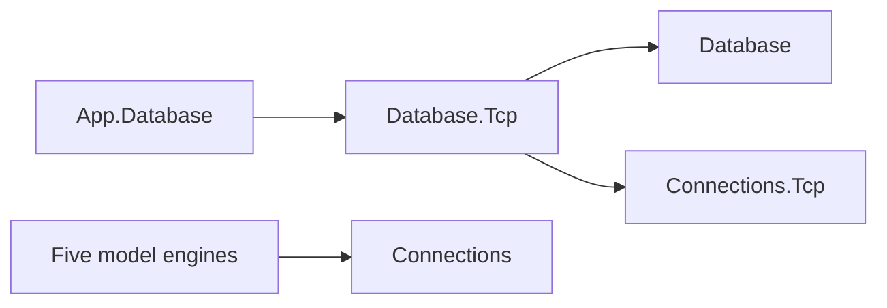

# Database TCP composition design

The five sealed model server-options types derive from DatabaseServerOptions. Its shared properties are Listener, Authenticator, MaxSessions, AuthenticationTimeout, IdleTimeout and ShutdownDrainTimeout. TerminalDrainLinger remains on each model leaf. Every model snapshots options before validation and owns the transferred listener.

The framework exposes Database.Tcp publicly and carries Connections.Tcp as runtime-private. Engines retain their generic transport dependency. Listen(Uri) returns its concrete options type; AddServer configure/factory ownership is unchanged. Consumers migrate the old package reference and import Assimalign.Cohesion.Database. See [binding rules](database-server-options-extensions.md).

The resolved endpoint helper requires a positive explicit port. DNS is refused; no hostname lookup is performed. Port-zero ephemeral transport binding remains available through a separately configured generic Listener. DatabaseTcpTests and the five-model NativeAOT sample verify the shared helper. Framework-installed SDK consumer checks verify Database.Tcp compiler visibility and Connections.Tcp runtime delivery.

[Assembly](index.md) · [Shared server options](../assimalign-cohesion-database/database-server-options.md)

## Sources

- `cohesion/resources/Database/Assimalign.Cohesion.Database.Tcp/docs/DESIGN.md`.
- `cohesion/resources/Database/Assimalign.Cohesion.Database.Tcp/samples/Assimalign.Cohesion.Database.Tcp.AotSample/TcpServerSmoke.cs`.
