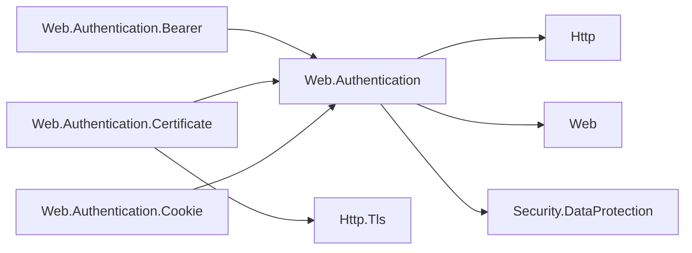

# Assimalign.Cohesion.Web.Authentication design

This page describes the boundaries and implementation shape of `Assimalign.Cohesion.Web.Authentication`.

> **Status:** Partial.

The package places authenticated `ClaimsPrincipal` state in an `IAuthenticationFeature` on
`IHttpContext.Features`. The `User` extension property returns an empty principal when the feature
is absent and reuses an existing feature when assigning a principal.

`AuthenticationBuilder`, `AuthenticationOptions`, and `AuthenticationScheme` compose handlers.
`IAuthenticationHandler` defines authentication, challenge, and forbidden handling;
`IAuthenticationSignInHandler` adds sign-in and sign-out.
`builder.Services.AddAuthentication(auth => ...)`, a component integration the application's
compilation receives, composes an `AuthenticationBuilder` and registers its service;
`UseAuthentication` composes the request pipeline.

Authorization is not part of this package. Policy evaluation, role and claim requirements, and
per-endpoint scheme selection live in
[`Assimalign.Cohesion.Web.Authorization`](../assimalign-cohesion-web-authorization/index.md), which
answers a failed policy through this package's `ChallengeAsync` and `ForbidAsync`.

The README and `docs/DESIGN.md` still use the older implementation name
`HttpAuthenticationFeature`. This reference uses the current source names `IAuthenticationFeature`
and the internal `AuthenticationFeature` implementation.

The concrete Cookie, Bearer and Certificate handlers live in their own packages. Each handler
package grafts its own scheme verb onto `AuthenticationBuilder`: `AddCookie`, `AddJwtBearer` and
`AddCertificate`. The service reads `AuthenticationOptions` live, so schemes registered by these
chained calls after the service is created are still resolved. The public handler factories
(`CookieAuthentication.CreateHandler`, `JwtBearerAuthentication.CreateHandler` and
`CertificateAuthentication.CreateHandler`) remain the seams the verbs use while the concrete
handlers stay internal.

## Family map

The scheme packages reference the shared authentication model; Certificate also reads the TLS
feature from `Http.Tls`. Arrows show dependencies.

| Package | Role | Dependencies |
|---------|------|---------------|
| `Assimalign.Cohesion.Web.Authentication` | Principal feature + scheme model (handler contract, scheme registry, dispatch service, result types) + builder-time registration (the `builder.Services.AddAuthentication` component integration over `AuthenticationBuilder`, and `UseAuthentication`) | `Assimalign.Cohesion.Http`, `Assimalign.Cohesion.Web`, `Security.DataProtection` |
| `…Web.Authentication.Bearer` | Bearer-token scheme handler (JWT validation + signature seam) + the grafted `AddJwtBearer` verb | This package, `IdentityModel.Token.JsonWebToken` |
| `…Web.Authentication.Certificate` | Validated TLS client-certificate principal, application mapping and validation + the grafted `AddCertificate` verb | This package, `Http.Tls` |
| `…Web.Authentication.Cookie` | Cookie-scheme handler (protected ticket, sliding expiration, login/logout) + the grafted `AddCookie` verb | This package, `Http.Cookies`, `Web.Routing`, `Security.DataProtection` |

Dependency direction is one-way: scheme handlers depend on this
package; this package depends on the protocol core and the root Web
composition abstractions. The protocol core never gains a
back-reference, and `Web.Hosting` references none of these packages —
the `App.Web` shared framework delivers the family to applications
(see the [Web area map](../index.md)).

## Declared dependencies

| Reference | Kind |
|---|---|
| `Assimalign.Cohesion.Http` | `CohesionProjectReference` |
| `Assimalign.Cohesion.Web` | `CohesionProjectReference` |
| `Assimalign.Cohesion.Security.DataProtection` | `CohesionProjectReference` |

[Assembly overview](index.md) · [Examples](examples/index.md)

## Sources

- **Primary source** — `cohesion/resources/Web/Assimalign.Cohesion.Web.Authentication/docs/DESIGN.md`.
- **Source** — `cohesion/resources/Web/Assimalign.Cohesion.Web.Authentication/src/Abstractions/IAuthenticationFeature.cs`.
- **Source** — `cohesion/resources/Web/Assimalign.Cohesion.Web.Authentication/src/Abstractions/IAuthenticationHandler.cs`.
- **Source** — `cohesion/resources/Web/Assimalign.Cohesion.Web.Authentication/src/Abstractions/IAuthenticationResultFeature.cs`.
- **Source** — `cohesion/resources/Web/Assimalign.Cohesion.Web.Authentication/src/Abstractions/IAuthenticationService.cs`.
- **Source** — `cohesion/resources/Web/Assimalign.Cohesion.Web.Authentication/src/Abstractions/IAuthenticationSignInHandler.cs`.
- **Source** — `cohesion/resources/Web/Assimalign.Cohesion.Web.Authentication/src/AuthenticateResult.cs`.
- **Source** — `cohesion/resources/Web/Assimalign.Cohesion.Web.Authentication/src/AuthenticationBuilder.cs`.
- **Source** — `cohesion/resources/Web/Assimalign.Cohesion.Web.Authentication/src/AuthenticationOptions.cs`.
- **Source** — `cohesion/resources/Web/Assimalign.Cohesion.Web.Authentication/src/AuthenticationProperties.cs`.
- **Source** — `cohesion/resources/Web/Assimalign.Cohesion.Web.Authentication/src/AuthenticationScheme.cs`.
- **Source** — `cohesion/resources/Web/Assimalign.Cohesion.Web.Authentication/src/AuthenticationService.cs`.
- **Source** — `cohesion/resources/Web/Assimalign.Cohesion.Web.Authentication/src/AuthenticationTicket.cs`.
- **Source** — `cohesion/resources/Web/Assimalign.Cohesion.Web.Authentication/src/Exceptions/AuthenticationFailureException.cs`.
- **Source** — `cohesion/resources/Web/Assimalign.Cohesion.Web.Authentication/src/Extensions/AuthenticationWebApplicationExtensions.cs`.
- **Source** — `cohesion/resources/Web/Assimalign.Cohesion.Web.Authentication/src/Extensions/HttpContextAuthenticationExtensions.cs`.
- **Source** — `cohesion/resources/Web/Assimalign.Cohesion.Web.Authentication/src/Extensions/HttpContextAuthenticationVerbExtensions.cs`.
- **Source** — `cohesion/resources/Web/Assimalign.Cohesion.Web.Authentication/src/Internal/AuthenticationFeature.cs`.
- **Source** — `cohesion/resources/Web/Assimalign.Cohesion.Web.Authentication/src/Internal/AuthenticationResultFeature.cs`.
- **Source** — `cohesion/resources/Web/Assimalign.Cohesion.Web.Authentication/src/Internal/DefaultAuthenticationService.cs`.
- **Source** — `cohesion/resources/Web/Assimalign.Cohesion.Web.Authentication/src/Metadata/ApiEndpointMetadata.cs`.
- **Source** — `cohesion/resources/Web/Assimalign.Cohesion.Web.Authentication/src/Abstractions/IApiEndpointMetadata.cs`.
- **Source** — `cohesion/resources/Web/Assimalign.Cohesion.Web.Authentication/src/Assimalign.Cohesion.Web.Authentication.csproj`.
